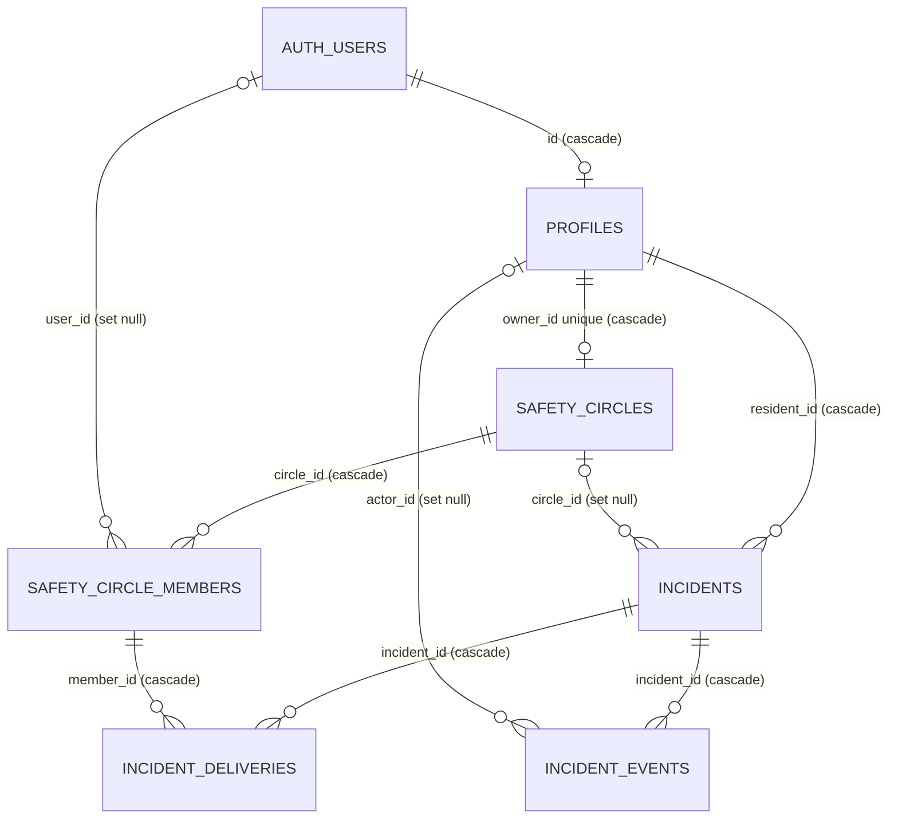
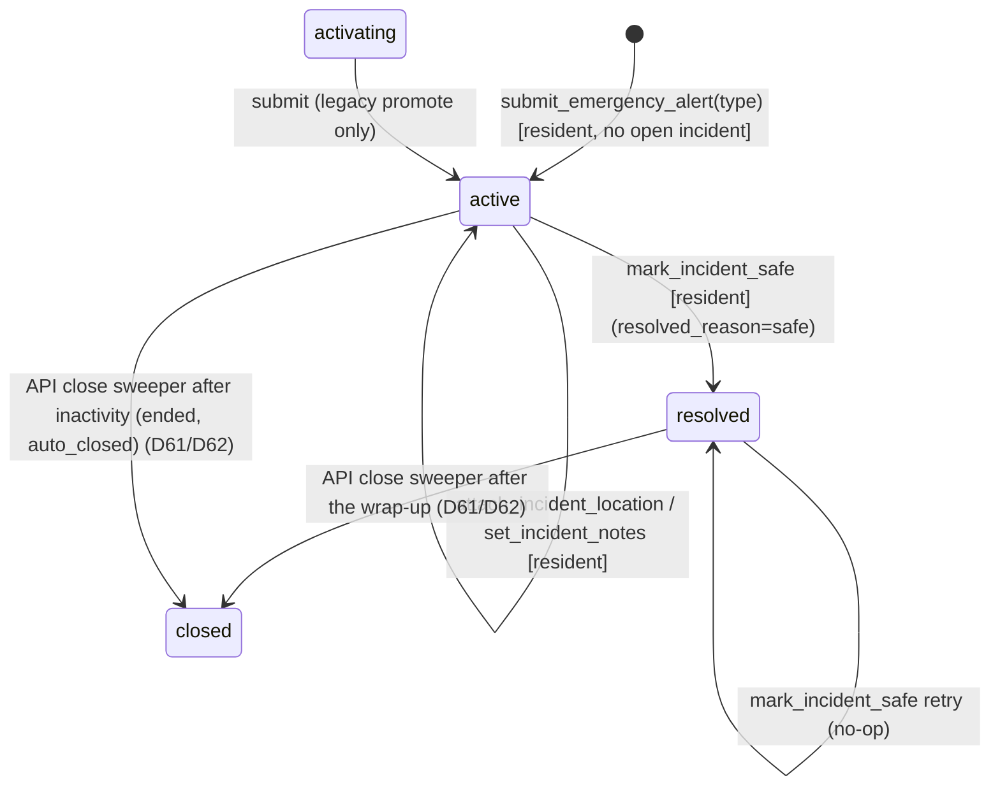

# Atlas Backend — Current State (Supabase) and Proposed API

> **How to use this document (for the implementing AI agent).**
> You do not have the Atlas repository. This file is your only source. It is split into two kinds of sections:
> - **CURRENT (Supabase, as built today)**: facts checked against the final state of the SQL migrations and the Flutter app code. Treat these as the behaviour to reproduce ("parity"). Where a contract document and the final migration disagree, the migration was used and the difference is listed in §13.4.
> - **PROPOSED (new API)**: decisions made by the product owner/developer (Dawit) on 2026-11-03 and 2026-11-17, plus a suggested endpoint map and tables. Where this doc fills in details that were not decided, it says "suggested".
> - **FUTURE**: §15 lists what each open (not yet built) Jira story will need from the API, so the foundations are designed for it. Do not build §15 features as part of parity work.
>
> Companion document: `epic_100_api.md` (Epic 100, the story-by-story build plan for the API). This file is the specification; Epic 100 is the order of work.
>
> Conventions: DB names are `snake_case`. Error codes keep today's `function_name:code` strings (example: `submit_emergency_alert:invalid_type`). "Owner" is the resident who owns a Safety Circle. "uid" is the authenticated user id. Times are `timestamptz` (UTC ISO-8601 in JSON).
> Anything marked **UNCLEAR** could not be confirmed from the code. Do not guess at it; ask.
>
> **Last verified against repo commit:** `2f4703d` (branch `main`) on **2026-11-17**. Includes the device test-run fixes of 2026-11-17 (rounds 1 and 2) and migrations up to `20261117120000_member_names_and_expired_invites.sql`.

---

## Table of contents

1. Overview
2. Current architecture (CURRENT)
3. Domain glossary
4. Data model (CURRENT)
5. Enumerations and state machines (CURRENT)
6. Business rules and invariants (CURRENT)
7. Server operations (CURRENT)
8. Authentication flows (CURRENT)
9. Realtime (CURRENT)
10. Mobile app expectations
11. Proposed API (PROPOSED)
12. Migration plan (PROPOSED)
13. Known gaps and constraints
14. Appendix
15. Future epics — API needs (FUTURE)

---

## 1. Overview

**What Atlas is.** A community emergency-response mobile app. A resident builds a **Safety Circle** of up to **5 trusted members** (the owner is not counted). With one tap (SOS, then pick an emergency type) the resident alerts every active member. Members see the emergency type, the resident's location (live while the incident is open), an optional live note, and only the emergency-profile fields the resident chose to share. The resident ends the incident by marking themselves **safe**. The same account can be a resident in one incident and a responder in another.

**V1 scope.** A closed prototype for simulated emergencies:
- Accounts (email + password, phone, Google; Apple button exists but provider not enabled), verification, login lockout.
- Onboarding profile: personal info, emergency info, per-field sharing flags, preferences, review/complete.
- Safety Circles: auto-create on setup completion, invite by phone or shareable link, accept/decline, list/remove/leave, cancel/resend invite (including expired invites).
- Incident loop: submit alert (type required) → in-app delivery to active members → live location → optional live note (backend only; no UI) → mark safe. A member sees only incidents that started after they joined the circle (membership access window, rule 54).
- Settings tab (low-end, approved 2026-11-17): Profile Information, Emergency Information, What responders see, Preferences, Location Access, Log Out. Edit screens reuse the same profile writes as onboarding.

**Explicit non-goals (V1).**
- No police / ambulance / fire dispatch. Atlas coordinates trusted people only.
- No public maps or public incident feeds.
- No member chat outside an active incident (and no chat is built at all yet).
- No continuous location outside an active incident (or an explicit test).
- Notifications are **in-app only** today: no push, no SMS, no email beyond Supabase Auth's own mails.

**Platforms.** Flutter app (package `atlas_mobile`) for **Android and iOS**. Flutter ≥ 3.44.

**How to read this doc.** §2–§10 describe the system today. §11–§12 describe the target API and the migration. §13 lists gaps and contract/migration differences. §14 maps Jira story keys to features. §15 describes what future stories need.

---

## 2. Current architecture (CURRENT)

There is **no custom server**. The Flutter app talks to a hosted Supabase project with the `supabase_flutter` SDK (anon key + user JWT).

| Component | Used for |
| --- | --- |
| **Supabase Auth (GoTrue)** | Email+password signup/sign-in, email confirmation link, phone OTP (test numbers only), phone+password sign-in, Google ID-token sign-in, Apple ID-token sign-in (code exists; provider disabled), password reset by email link, refresh-token rotation, global sign-out. A **custom access token hook** (Postgres function) blocks password sign-in for locked accounts. PKCE flow. |
| **Postgres + RLS** | All app data in schema `public`. Row-level security on every app table. |
| **SECURITY DEFINER RPCs** | Almost all business logic. Called with `supabase.rpc(name, params)` through PostgREST. Errors are raised as SQLSTATE `P0001` with message `fn_name:code`. |
| **Realtime** | `postgres_changes` on `public.incidents` (members watching an incident). `public.incident_events` is also in the publication but the app does not subscribe. Realtime follows RLS, so the membership access window (rule 54) also filters change events. |
| **Storage** | Public bucket `avatars` for profile photos. |

**What the app calls directly (PostgREST table access, not RPC)**
- `profiles`: SELECT own row; UPSERT personal info; UPDATE emergency info, preferences, share flags, `location_sharing_enabled` (onboarding and the Settings edit screens use the same calls).
- `safety_circles`: SELECT own circle (`owner_id = uid`).
- `safety_circle_members`: SELECT all rows of the caller's own circle — **fallback only** since 2026-11-17. The owner's member list now comes from `list_circle_members` (owner view, with profile names and `expired` status); the direct SELECT is used only when that RPC call fails.
- Storage `avatars`: upload (upsert) `{uid}/avatar.{jpg|png|webp}`; build public URL.

**Client-only features (no server involvement)**: place names for coordinates (the phone's built-in reverse geocoder, Android `Geocoder` / iOS `CLGeocoder`, no API key, coordinates shown as fallback), the "Updated … ago" label tick (15 s), the location-permission intro rule (device permission, not account), deep-link routing, network reachability check before SOS/mark safe.

**Everything else goes through RPCs** (§7). Incidents, deliveries and events are **not writable** by clients at all (SELECT-only grants).

**What does NOT exist yet**
- Push notifications (no FCM/APNs, no device-token table).
- SMS delivery (Twilio is configured off; "on hold"). Invite links are shared by the device's own SMS/share sheet; Atlas sends nothing.
- Email beyond Supabase Auth's confirmation / magic-link / recovery mails (default Supabase sender; no custom SMTP).
- Background jobs / schedulers (no pg_cron, no Edge Functions, no queues). The 24-hour auto-close was built and then removed.
- Server-side OTP attempt/resend limits (only enforced on the device).
- Server-enforced session lifetime cap on the hosted (Free) plan.

---

## 3. Domain glossary

| Term | Meaning |
| --- | --- |
| **Resident** | A signed-in user. As incident creator, the "resident" of that incident (`incidents.resident_id`). |
| **Profile** | `public.profiles` row (1:1 with the auth user). Created by the app at the Personal Info step. |
| **Profile setup complete** | `profiles.profile_setup_completed_at` is set by `complete_profile_setup()`. Required before submitting an alert. |
| **Safety Circle** | `public.safety_circles` row. At most one owned circle per user. Default name `My Safety Circle`. |
| **Owner** | The circle's creator (`safety_circles.owner_id`). Also has a `safety_circle_members` row with `role='owner'`, `status='active'`. **Never counted** in member counts or capacity. |
| **Member / trusted member** | A `safety_circle_members` row with `role='member'`. Only `status='active'` members receive incidents. |
| **Membership activation time** | `safety_circle_members.activated_at`: when the row last became `active` (accept, or owner row at circle creation). Null unless active. Set only by trigger. |
| **Membership access window** | Rule 54: a member may read an incident only if `incidents.activated_at >= safety_circle_members.activated_at` and the member row is still `active`. |
| **Invite** | A member row with `status='pending'` plus a 64-hex-char `invite_token`, 7-day expiry. Phone invites carry the invitee's E.164 phone; link invites have `phone = null`. |
| **Valid pending invite** | Stored `status='pending'`, `invite_canceled_at` null, `invite_consumed_at` null, and `coalesce(invite_expires_at, invited_at + 7 days) > now()`. |
| **Expired invite** | Stored `status='pending'` past `invite_expires_at`. Not stored as a status; returned as `expired` by lookups and by the owner's member list. Holds **no** slot (since 2026-11-17). |
| **Invitee / recipient** | The user who may accept a token: for phone invites the user whose normalized Auth phone equals the row phone; for link invites, whoever holds the token. |
| **Claim** | Setting `safety_circle_members.user_id` on a still-pending invite when the recipient previews or lists it. Status stays `pending`. |
| **Capacity / slot** | 5 trusted slots. `active` and **valid pending** member rows use a slot; declined, canceled and expired rows do not. |
| **Incident** | `public.incidents` row. Created `active` by `submit_emergency_alert`. Closed `resolved`/`safe` by `mark_incident_safe`. Never deleted. |
| **Open incident** | Status `active` (legacy `activating` also counts for the uniqueness index). At most one per resident. |
| **Delivery** | `public.incident_deliveries` row: the incident was made visible in-app to one active member at submit time. Not a push receipt. |
| **Acknowledgement** | `incident_deliveries.acknowledged_at` set by `acknowledge_incident` (RPC exists; no app UI yet). |
| **Re-notify** | A second submit (or `renotify_emergency_alert`) on an already active incident: bumps `renotified_at` and every existing delivery's `delivered_at`. Never a second incident. |
| **Share flags** | Nine booleans on `profiles` (eight `share_*` + `emergency_notes_shareable`), default `false`, deciding which emergency-profile fields members may see. |
| **Share payload** | `incidents.share_payload` JSON snapshot taken at submit of the flagged, non-empty emergency-profile fields. Not updated afterwards. |
| **Live location** | Repeated `attach_incident_location` calls (default every 12 s) overwriting the five location columns on the open incident. |
| **Location sharing (setting)** | `profiles.location_sharing_enabled`: Atlas app setting; required to own/manage a circle. Distinct from OS permission. |
| **Location sharing session** | From submit (`location_sharing_started` event) to mark safe (`location_sharing_ended_at` + `location_sharing_ended` event). |
| **Incident event** | Row in `public.incident_events`: append-only audit timeline. |
| **Lockout** | 5 failed password sign-ins in 15 minutes lock that account key for 15 minutes. |
| **Responder** | An active circle member, inside the membership access window, viewing someone else's incident. |

---

## 4. Data model (CURRENT)

Final state after all 37 migrations (last: `20261117120000_member_names_and_expired_invites.sql`). All tables are in schema `public` unless stated. API roles: `anon` (no JWT), `authenticated` (JWT), `service_role` (bypasses RLS), `supabase_auth_admin` (Auth server).

### 4.0 ER summary



Standalone tables: `app_config`, `login_lockouts`, `login_lockout_rpc_throttle`. Storage: bucket `avatars` (`storage.objects`).
`incident_deliveries.member_user_id` is **not** a foreign key (plain uuid).
No trigger on `auth.users`: a `profiles` row is **not** created on signup; the app upserts it at the Personal Info step.

### 4.1 `auth.users` (Supabase-managed) — fields the system relies on

| Field | Used by |
| --- | --- |
| `id` uuid | PK; equals `profiles.id`. |
| `email` | Login, lockout key (`lower(trim(email))`), `clear_login_failures` match. |
| `phone` | Stored by GoTrue **without** a leading `+` in some cases; server code always normalizes with `_normalize_e164`. Used for invite recipient matching and phone lockout keys. |
| `email_confirmed_at`, `phone_confirmed_at` | App treats a user as **verified** when either is non-null. |
| `created_at` | Tie-breaker when several users share a phone (lockout key resolution). |
| `raw_user_meta_data` | App writes `full_name`, `phone`, `signup_phone` at signup. Not read by SQL. |
| JWT claim `email` | Read by `clear_login_failures`. |
| Identities (Google / Apple) | Created by `signInWithIdToken`. |

### 4.2 `profiles`

| Column | Type | Null | Default | Notes / check |
| --- | --- | --- | --- | --- |
| `id` | uuid | no | — | PK, FK → `auth.users(id)` **on delete cascade** |
| `full_name` | text | no | — | check `char_length(trim(full_name)) > 0` |
| `date_of_birth` | date | no | — | client rejects future dates (no DB check) |
| `gender` | text | yes | null | `female` \| `male` \| `prefer_not_to_say` |
| `avatar_path` | text | yes | null | object path in `avatars`, e.g. `{uid}/avatar.jpg` |
| `personal_info_completed_at` | timestamptz | yes | null | set by the **client** on Personal Info continue |
| `created_at` | timestamptz | no | `now()` | |
| `updated_at` | timestamptz | no | `now()` | trigger `profiles_set_updated_at` (before update) |
| `alert_push_enabled` | boolean | no | `true` | stored only; no push exists |
| `alert_email_enabled` | boolean | no | `true` | stored only |
| `alert_sms_enabled` | boolean | no | `true` | stored only |
| `location_sharing_enabled` | boolean | no | `true` | gates circle ownership/invites (§6) |
| `hide_profile_from_non_members` | boolean | no | `false` | stored only; **not enforced anywhere** |
| `app_language` | text | no | `'en'` | check `app_language = 'en'` |
| `timezone` | text | no | `'Africa/Banjul'` | check `timezone = 'Africa/Banjul'` |
| `preferences_completed_at` | timestamptz | yes | null | set by client on Preferences continue |
| `preferred_language` | text | no | `'en'` | `en` \| `wo` \| `mnk` \| `ff` |
| `emergency_contact_full_name` | text | yes | null | required by `complete_profile_setup` |
| `emergency_contact_relationship` | text | yes | null | `spouse` \| `partner` \| `parent` \| `child` \| `sibling` \| `friend` \| `other` |
| `emergency_contact_phone` | text | yes | null | no DB check; `complete_profile_setup` requires `^\+[1-9][0-9]{7,14}$` |
| `emergency_contact_email` | text | yes | null | |
| `blood_type` | text | yes | null | `A+` `A-` `B+` `B-` `AB+` `AB-` `O+` `O-` `Unknown` |
| `allergies` | text | yes | null | free text; since SCRUM-21 (D51) kept equal to the `profile_allergies` items joined with ", " by the API |
| `medical_conditions` | text | yes | null | free text; since SCRUM-21 (D51) kept equal to the `profile_medical_conditions` items joined with ", " |
| `emergency_preferred_language` | text | yes | null | free text (not the enum) |
| `emergency_info_completed_at` | timestamptz | yes | null | set by client on Emergency Info continue |
| `emergency_notes` | text | yes | null | check `char_length <= 500` |
| `emergency_notes_shareable` | boolean | no | `false` | share flag for `emergency_notes` |
| `profile_setup_completed_at` | timestamptz | yes | null | set by `complete_profile_setup()` (first success wins) |
| `share_emergency_contact_full_name` | boolean | no | `false` | |
| `share_emergency_contact_relationship` | boolean | no | `false` | |
| `share_emergency_contact_phone` | boolean | no | `false` | |
| `share_emergency_contact_email` | boolean | no | `false` | |
| `share_blood_type` | boolean | no | `false` | |
| `share_allergies` | boolean | no | `false` | |
| `share_medical_conditions` | boolean | no | `false` | |
| `share_emergency_preferred_language` | boolean | no | `false` | |
| `medical_info_updated_at` | timestamptz | yes | null | API migration 0014 (SCRUM-21, D51): last item change or blood-type change |
| `share_phone` | boolean | no | `true` | API migration 0016 (SCRUM-52, D59): share the confirmed account phone as `resident_phone`; ON by default (also for existing rows) |

Constraints (names): `profiles_full_name_nonempty`, `profiles_gender_allowed`, `profiles_app_language_allowed`, `profiles_timezone_allowed`, `profiles_preferred_language_allowed`, `profiles_emergency_contact_relationship_allowed`, `profiles_blood_type_allowed`, `profiles_emergency_notes_length`.
Indexes: btree on `personal_info_completed_at`, `preferences_completed_at`, `emergency_info_completed_at`, `profile_setup_completed_at`.
RLS (enabled): `profiles_select_own`, `profiles_insert_own`, `profiles_update_own` — all `auth.uid() = id`. No delete policy.
Grants: `authenticated`: SELECT, INSERT, UPDATE. Nobody else.
Note: because UPDATE is column-unrestricted, a client could today write `profile_setup_completed_at` or any completion timestamp directly. The app does not. The new API should not allow it.
Members **cannot** read other users' profiles. Resident name reaches members only through DEFINER RPCs (`resident_name`, `owner_name`, `avatar_url`).
Not in the realtime publication.

### 4.3 `safety_circles`

| Column | Type | Null | Default | Notes |
| --- | --- | --- | --- | --- |
| `id` | uuid | no | `gen_random_uuid()` | PK |
| `owner_id` | uuid | no | — | **UNIQUE**; FK → `profiles(id)` on delete cascade |
| `name` | text | no | `'My Safety Circle'` | check `char_length(trim(name)) > 0` |
| `created_at` | timestamptz | no | `now()` | |
| `updated_at` | timestamptz | no | `now()` | trigger `safety_circles_set_updated_at` |

RLS: `safety_circles_select_own` (`auth.uid() = owner_id`); `safety_circles_select_active_member` (`_is_active_circle_member(id, auth.uid())`); `safety_circles_insert_own`; `safety_circles_update_own`. No delete.
Grants: `authenticated` SELECT, INSERT, UPDATE. The app only SELECTs; creation happens in `complete_profile_setup()`.

### 4.4 `safety_circle_members`

| Column | Type | Null | Default | Notes |
| --- | --- | --- | --- | --- |
| `id` | uuid | no | `gen_random_uuid()` | PK. Called `member_id` in all JSON |
| `circle_id` | uuid | no | — | FK → `safety_circles(id)` on delete cascade |
| `role` | text | no | — | `owner` \| `member` |
| `status` | text | no | — | `pending` \| `active` \| `declined` (since migration 0013, D44: also `removed` \| `left`, written by the API only; with the nullable `ended_at`) |
| `display_name` | text | no | — | check non-empty after trim. Owner row = owner `full_name`; invite = name typed by owner (`'Invited member'` for unnamed link invites). **On accept** it is overwritten with the accepter's trimmed `profiles.full_name` (kept if that is empty/missing) |
| `relationship` | text | yes | null | same 7 values as `emergency_contact_relationship` |
| `phone` | text | yes | null | check `phone ~ '^\+[1-9][0-9]{7,14}$'`. Null for link invites and the owner row |
| `email` | text | yes | null | only filled for the onboarding emergency-contact invite |
| `user_id` | uuid | yes | null | FK → `auth.users(id)` **on delete set null**. Set on claim/accept/decline; owner row = owner uid |
| `invited_at` | timestamptz | no | `now()` | refreshed on resend |
| `created_at` | timestamptz | no | `now()` | |
| `updated_at` | timestamptz | no | `now()` | trigger; also used as `joined_at` in `list_my_joined_circles` |
| `invite_token` | text | yes | null | 64 hex chars (two UUIDs without dashes). Rotated on resend. Not cleared on accept/decline |
| `invite_expires_at` | timestamptz | yes | null | `invited_at + 7 days` |
| `invite_consumed_at` | timestamptz | yes | null | set on accept |
| `invite_canceled_at` | timestamptz | yes | null | set on decline and owner cancel; cleared on resend and on a `complete_profile_setup` re-run for the emergency-contact row |
| `activated_at` | timestamptz | yes | null | **Added 2026-11-17** (rule 54). When the row last became `active`. Null unless `status='active'`. Maintained only by trigger `safety_circle_members_set_activated_at`. Backfill: owner rows = `safety_circles.created_at`; member rows = `coalesce(invite_consumed_at, updated_at, created_at)` |

Check constraints:
- `safety_circle_members_role_allowed`, `_status_allowed`, `_display_name_nonempty`, `_relationship_allowed`, `_phone_e164`.
- `safety_circle_members_activated_shape`: `(status='active' AND activated_at IS NOT NULL) OR (status<>'active' AND activated_at IS NULL)`.
- `safety_circle_members_owner_shape`: `(role='owner' AND status='active' AND user_id IS NOT NULL) OR role='member'`.
- `safety_circle_members_pending_invite_token`: `role<>'member' OR status<>'pending' OR (invite_token IS NOT NULL AND char_length(invite_token) >= 32 AND invite_expires_at IS NOT NULL)`.

Indexes:
| Name | Definition |
| --- | --- |
| `safety_circle_members_circle_phone_uidx` | UNIQUE `(circle_id, phone)` WHERE `phone IS NOT NULL` (declined rows still hold the phone, so re-inviting reuses the row) |
| `safety_circle_members_circle_user_uidx` | UNIQUE `(circle_id, user_id)` WHERE `user_id IS NOT NULL` |
| `safety_circle_members_one_owner_uidx` | UNIQUE `(circle_id)` WHERE `role = 'owner'` |
| `safety_circle_members_invite_token_uidx` | UNIQUE `(invite_token)` WHERE `invite_token IS NOT NULL` |
| `safety_circle_members_circle_id_idx` | `(circle_id)` |
| `safety_circle_members_user_id_idx` | `(user_id)` WHERE `user_id IS NOT NULL` |
| `safety_circle_members_phone_list_idx` | `(phone)` WHERE `phone IS NOT NULL AND role = 'member'` |

Triggers:
- `safety_circle_members_set_updated_at` (before update).
- `safety_circle_members_enforce_capacity` (before insert or update) → `enforce_safety_circle_member_capacity()`: if the NEW row **holds a slot** (`_circle_invite_holds_slot`: role `member` and either `active` or valid pending) and (INSERT, or UPDATE where OLD did **not** hold a slot — e.g. declined → pending, expired → refreshed pending), lock the circle row and raise `P0001` message **`circle_full`** (no prefix) when `available <= 0`. An expired pending row can be inserted/kept at 5/5 because it holds no slot.
- `safety_circle_members_set_activated_at` (before insert or update) → `set_safety_circle_members_activated_at()`: NEW status ≠ `active` → `activated_at = null`; INSERT as active or transition into active → `now()` (client roles `authenticated`/`anon` can never choose the value; service/maintenance roles may pass one); stays active → keeps OLD value (client writes ignored).

RLS: `safety_circle_members_select_owner` (caller owns the circle), `safety_circle_members_select_self` (`user_id = auth.uid()`), `safety_circle_members_insert_owner`, `safety_circle_members_update_owner`. **No DELETE grant or policy**; deletes happen only in DEFINER RPCs.
Grants: `authenticated` SELECT, INSERT, UPDATE. App only SELECTs (own circle, fallback path).
**Known bypass (do not reproduce in the API):** because of `insert_owner`/`update_owner` and the INSERT/UPDATE grants, an owner can insert or update a row to `status='active'` with any `user_id` directly, skipping invite consent. The activation trigger limits the damage (that person sees only incidents from that moment on). The API must only create active member rows through accept (and the owner row through setup).

### 4.5 `incidents`

| Column | Type | Null | Default | Notes |
| --- | --- | --- | --- | --- |
| `id` | uuid | no | `gen_random_uuid()` | PK |
| `resident_id` | uuid | no | — | FK → `profiles(id)` on delete cascade |
| `circle_id` | uuid | yes | null | FK → `safety_circles(id)` on delete set null. The resident's owned circle at submit, or null |
| `status` | text | no | — | `activating` \| `active` \| `cancelled` \| `resolved` (see §5.4) |
| `activated_at` | timestamptz | no | `now()` | |
| `created_at` | timestamptz | no | `now()` | |
| `updated_at` | timestamptz | no | `now()` | trigger `incidents_set_updated_at` |
| `emergency_type` | text | no | `'unspecified'` | `medical` \| `domestic_violence` \| `fire` \| `burglary` \| `other` \| `unspecified`(legacy) |
| `location_lat` | double precision | yes | null | |
| `location_lng` | double precision | yes | null | |
| `location_accuracy_m` | double precision | yes | null | metres |
| `location_captured_at` | timestamptz | yes | null | device fix time |
| `location_source` | text | yes | null | `current` \| `last_known` \| `unavailable` |
| `cancelled_at` | timestamptz | yes | null | legacy only |
| `sent_at` | timestamptz | yes | null | set at submit; unchanged by re-notify |
| `share_payload` | jsonb | yes | null | check: null or JSON object |
| `incident_notes` | text | yes | null | check `char_length <= 250` |
| `incident_notes_updated_at` | timestamptz | yes | null | stamped on every `set_incident_notes` |
| `renotified_at` | timestamptz | yes | null | last re-notify |
| `resolved_at` | timestamptz | yes | null | |
| `resolved_reason` | text | yes | null | `safe` \| `ended`(legacy) |
| `auto_closed` | boolean | no | `false` | true only on an incident closed automatically after inactivity (API close sweeper, SCRUM-63, D61/D62; legacy SCRUM-46 rows) |
| `activity_confirmed_at` | timestamptz | yes | null | legacy; no writer |
| `location_sharing_ended_at` | timestamptz | yes | null | set by mark safe, and by the automatic close (D62) |
| `live_share_payload` | jsonb | yes | null | API migration 0014 (SCRUM-21, D53): the live shared info of an active incident; `share_payload` stays the activation snapshot |
| `live_share_updated_at` | timestamptz | yes | null | API migration 0014 (D53): when `live_share_payload` was last rewritten |
| `closed_at` | timestamptz | yes | null | API migration 0017 (SCRUM-63, D61): when the incident became `closed`; set exactly for `closed` |

Check constraints:
- `incidents_status_allowed`, `incidents_emergency_type_allowed`, `incidents_location_source_allowed`, `incidents_share_payload_object`, `incidents_incident_notes_length`, `incidents_resolved_reason_check`.
- `incidents_location_shape`: (a) all five location columns null; or (b) `source='unavailable'` and the other four null; or (c) `source in ('current','last_known')`, lat/lng/captured_at not null, lat ∈ [-90,90], lng ∈ [-180,180], accuracy null or ≥ 0, and accuracy **required** when `source='current'`.
- `incidents_resolved_shape_check`: `(status='resolved' AND resolved_at NOT NULL AND resolved_reason NOT NULL) OR (status<>'resolved' AND resolved_at IS NULL AND resolved_reason IS NULL AND auto_closed = false)`. Since API migration 0017 (D61) `resolved` reads `resolved`/`closed` in both branches.
- `incidents_location_sharing_ended_shape`: `location_sharing_ended_at IS NULL OR status = 'resolved'` (0017: `status in ('resolved','closed')`).
- `incidents_closed_shape` (API migration 0017, D61): `(status = 'closed') = (closed_at IS NOT NULL)` and a closed row has `resolved_reason in ('safe','ended')`. `incidents_status_allowed` also allows `closed` since 0017.

Indexes: `incidents_one_open_per_resident_uidx` UNIQUE `(resident_id)` WHERE `status IN ('activating','active')`; `incidents_resident_id_idx (resident_id)`; `incidents_circle_id_idx (circle_id)` WHERE `circle_id IS NOT NULL`.
RLS: `incidents_select_own` (`auth.uid() = resident_id`); `incidents_select_active_member` (`circle_id IS NOT NULL AND status IN ('active','resolved') AND _is_active_circle_member_since(circle_id, auth.uid(), activated_at)` — rule 54 window). Insert/update policies were **dropped**.
Grants: `authenticated` **SELECT only**. All writes via DEFINER RPCs.
Realtime: **in** `supabase_realtime`.
Rows are never deleted by any code path.

### 4.6 `incident_deliveries`

| Column | Type | Null | Default | Notes |
| --- | --- | --- | --- | --- |
| `id` | uuid | no | `gen_random_uuid()` | PK |
| `incident_id` | uuid | no | — | FK → `incidents(id)` on delete cascade |
| `member_id` | uuid | no | — | FK → `safety_circle_members(id)` **on delete cascade** (removing/leaving deletes the member row and therefore its delivery history) |
| `member_user_id` | uuid | no | — | member's auth user id (no FK). Never the resident |
| `delivered_at` | timestamptz | no | `now()` | refreshed on re-notify |
| `acknowledged_at` | timestamptz | yes | null | set by `acknowledge_incident` |

Constraint: UNIQUE `(incident_id, member_user_id)` named `incident_deliveries_incident_member_user_uidx`. Indexes on `incident_id`, `member_user_id`.
RLS: `incident_deliveries_select_resident` (row's incident has `resident_id = auth.uid()`); `incident_deliveries_select_own` and `incident_deliveries_update_own` (`member_user_id = auth.uid() AND _can_view_incident_events(incident_id)` — i.e. only inside the membership window). No INSERT/DELETE policy.
Grants: `authenticated` SELECT, UPDATE. (Quirk: a member could UPDATE their own row's timestamps directly; the app does not.)
Not in realtime. The app never reads this table directly.

### 4.7 `incident_events`

| Column | Type | Null | Default | Notes |
| --- | --- | --- | --- | --- |
| `id` | uuid | no | `gen_random_uuid()` | PK |
| `incident_id` | uuid | no | — | FK → `incidents(id)` on delete cascade |
| `event_type` | text | no | — | see §5.6 |
| `occurred_at` | timestamptz | no | `now()` | server time |
| `actor_id` | uuid | yes | null | FK → `profiles(id)` on delete set null. The resident; the member for `responder_acknowledged` / `responder_status` (D71); null for the close sweeper |
| `detail` | jsonb | no | `'{}'` | check JSON object |

Indexes: `incident_events_incident_occurred_idx (incident_id, occurred_at)`; `incident_events_once_per_incident_uidx` UNIQUE `(incident_id, event_type)` WHERE `event_type IN ('alert_sent','location_sharing_started','location_sharing_ended','safe_recorded','incident_closed','closure_notified')` (`renotified` may repeat).
RLS: `incident_events_select_visible` → `_can_view_incident_events(incident_id)`: caller is the resident, **or** the incident status is `active`/`resolved` and `_is_active_circle_member_since(circle_id, caller, incident.activated_at)` (rule 54).
Grants: `authenticated` SELECT only. Written only by DEFINER functions.
Realtime: **in** `supabase_realtime` (app does not subscribe). App does not read this table today.

### 4.8 `app_config`

| Column | Type | Null | Default |
| --- | --- | --- | --- |
| `key` | text | no | — (PK) |
| `value` | jsonb | no | — |
| `updated_at` | timestamptz | no | `now()` (trigger `app_config_set_updated_at`) |

Seeds (insert … on conflict do nothing): `live_location_interval_seconds = 12`, `live_location_stale_threshold_seconds = 45` (JSON numbers). API migration 0016 (SCRUM-54, D60): `emergency_numbers` = `{"GM": [{"service": "ambulance", "label": "Ambulance", "number": "116"}, {"service": "police", "label": "Police", "number": "117"}, {"service": "fire_rescue", "label": "Fire and Rescue", "number": "119"}]}`. API migration 0017 (SCRUM-63, D62): `incident_close_after_minutes = 30`, `incident_auto_close_after_hours = 24` (JSON whole numbers; read by the close sweeper on every run).
RLS: `app_config_select_authenticated` (`using (true)`). Grants: `authenticated` SELECT only. Ops change values via SQL/service role.

### 4.9 `login_lockouts`

| Column | Type | Null | Default | Notes |
| --- | --- | --- | --- | --- |
| `email` | text | no | — | PK. **Lock key**: `lower(trim(email))`, or an E.164 phone when that phone has no usable Auth email (§6.8) |
| `failed_attempts` | integer | no | `0` | check `>= 0` |
| `locked_until` | timestamptz | yes | null | |
| `last_failed_at` | timestamptz | yes | null | |
| `updated_at` | timestamptz | no | `now()` | |

RLS enabled, no policies. Grants: none for `anon`/`authenticated`; `supabase_auth_admin` SELECT (used by the access-token hook).

### 4.10 `login_lockout_rpc_throttle`

| Column | Type | Null | Default |
| --- | --- | --- | --- |
| `bucket` | text | no | — (PK; `'{rpc_name}:{client_ip}'`) |
| `window_started_at` | timestamptz | no | — |
| `call_count` | integer | no | `0` (check ≥ 0) |

RLS enabled, no policies, no client grants. Rows are never cleaned up (UNCLEAR whether any ops job prunes it; none in repo).

### 4.11 Storage bucket `avatars`

| Setting | Value |
| --- | --- |
| Public | `true` (anyone can read with the public URL) |
| `file_size_limit` | 5,242,880 bytes (5 MiB) |
| `allowed_mime_types` | `image/jpeg`, `image/png`, `image/webp` |
| Path convention | `{auth.uid()}/avatar.{jpg\|png\|webp}`; app uploads with `upsert: true` |

Policies on `storage.objects`: `avatars_select_public` (to `public`, bucket = avatars); `avatars_insert_own`, `avatars_update_own`, `avatars_delete_own` (to `authenticated`, bucket = avatars AND first folder = `auth.uid()::text`).
Public URL form: `{SUPABASE_URL}/storage/v1/object/public/avatars/{avatar_path}`. DEFINER helper `_avatars_public_url` builds it from the request `Host` header (or returns a relative path if no header).
Note: changing extension (jpg → png) leaves the old object behind (UNCLEAR whether cleanup happens; no code does it).

### 4.12 Realtime publication `supabase_realtime`

Tables: `public.incidents`, `public.incident_events`. Nothing else (profiles are deliberately excluded).

---

## 5. Enumerations and state machines (CURRENT)

### 5.1 Simple enumerations

| Field | Values (stored) | Display labels (app) |
| --- | --- | --- |
| `profiles.gender` | `female`, `male`, `prefer_not_to_say`, null | — |
| relationship (profile + member) | `spouse`, `partner`, `parent`, `child`, `sibling`, `friend`, `other` | — |
| `profiles.blood_type` | `A+`, `A-`, `B+`, `B-`, `AB+`, `AB-`, `O+`, `O-`, `Unknown`, null | — |
| `profiles.preferred_language` | `en`, `wo`, `mnk`, `ff` | English, Wolof, Mandinka, Fula |
| `profiles.app_language` | `en` only | — |
| `profiles.timezone` | `Africa/Banjul` only | "GMT+00:00 Banjul" |
| `safety_circle_members.role` | `owner`, `member` | — |
| `incidents.location_source` | `current`, `last_known`, `unavailable` | — |
| `incidents.resolved_reason` | `safe` (only writer), `ended` (legacy) | — |
| `submit_outcome` (JSON only) | `created`, `promoted`, `renotified` | — |

### 5.2 Emergency type (`incidents.emergency_type`)

| Picker order | Stored | Label | Submittable |
| --- | --- | --- | --- |
| 1 | `medical` | Medical Emergency | yes |
| 2 | `domestic_violence` | Domestic Violence | yes |
| 3 | `fire` | Fire | yes |
| 4 | `burglary` | Burglary | yes |
| 5 | `other` | Other Emergency | yes |
| — | `unspecified` | Unspecified Emergency | **no** (legacy rows only; readers may return it) |

Removed values: `crime_safety` (renamed to `domestic_violence`), `accident` (renamed to `burglary`). Rejected with `invalid_type`.

### 5.3 Membership status (stored) and invite lookup status (derived)

Stored `status`: `pending`, `active`, `declined`. There is no stored "canceled", "expired", "removed" or "left" in the SQL functions. Since D44 (migration 0013) the API stores `removed` / `left` (with `ended_at`) when an active membership ends: history rows that every API reader ignores (§16 D44).

Derived lookup status (`_circle_invite_lookup_status`), first match wins:

| # | Condition | Lookup status |
| --- | --- | --- |
| 1 | `invite_canceled_at IS NOT NULL` OR `status = 'declined'` | `canceled` |
| 2 | `invite_consumed_at IS NOT NULL` OR `status = 'active'` | `consumed` |
| 3 | `invite_expires_at <= now()` (or expires null and `invited_at + 7 days <= now()`) | `expired` |
| 4 | `status = 'pending'` | `pending` |
| 5 | otherwise / token unknown | `not_found` |

Preview adds display statuses: `own_circle`, `already_member`, `circle_full` (§7.3).
The owner's member list (`list_circle_members`, owner view) returns a stored-`pending` row whose lookup status is `expired` as **`status: "expired"`** (JSON only). Possible owner-list statuses: `active`, `pending`, `expired`, `declined`.

Member row transitions (who triggers):

| From | To | Trigger | Writes |
| --- | --- | --- | --- |
| (none) | `pending` | owner: `invite_circle_member_by_phone`, `invite_circle_members_by_phone`, `create_circle_invite_link`; system: `complete_profile_setup` (emergency contact) | new token, `invited_at=now`, `invite_expires_at=now+7d`; needs a free slot |
| (none) | `active` owner row | `complete_profile_setup` | `role=owner`, `user_id=uid`, `activated_at=now` (trigger) |
| `pending` | `pending` (claimed) | invitee: `preview_circle_invite`, `list_my_circle_invites` | `user_id=uid` |
| valid `pending` | `pending` (refreshed) | owner: resend / re-invite same phone | new token, new expiry, `user_id=null`, clears consumed/canceled; **no new slot** |
| expired `pending` | `pending` (refreshed) | owner: resend / re-invite same phone (batch too) | same writes; **needs a free slot** (`circle_full` otherwise) |
| `pending` (lookup pending) | `active` | invitee: `accept_circle_invite` | `user_id=uid`, `display_name=` accepter's profile name (if any), `invite_consumed_at=now`, `invite_canceled_at=null`, `activated_at=now` (trigger) |
| `pending` | `declined` | invitee: `decline_circle_invite` | `user_id=uid` (if no unique clash), `invite_canceled_at=now`, `invite_consumed_at=null` |
| `pending` (lookup `pending` **or `expired`**) | `declined` | owner: `cancel_circle_invite` | `invite_canceled_at=now` (returned as `canceled`) |
| `declined` | `pending` | owner: resend / re-invite same phone | needs a free slot; new token; `user_id=null` |
| `declined` / `pending` (emergency-contact row) | `pending` | system: `complete_profile_setup` re-run | declined/canceled row: new token, `invite_canceled_at=null`, `invite_consumed_at=null`, `user_id=null`, `invite_expires_at=now+7d`; still-valid pending row: keeps token, new 7-day expiry. If the circle is full, the row is left unchanged and setup still succeeds |
| `pending`/`active`/`declined` (member) | **row deleted** | owner: `remove_circle_member` | hard DELETE (cascades its deliveries) |
| `active` (member) | **row deleted** | member: `leave_safety_circle` | hard DELETE |
| `active` | anything | — | resend/invite on an active or consumed row → `already_active` |

Expired is never written; a pending row past `invite_expires_at` stays `pending` in storage until resent, cancelled or removed, but since 2026-11-17 it **does not hold a slot**. Accepting an expired token still raises `accept_circle_invite:expired`. `cancel_circle_invite:expired` is no longer raised (cancel works on expired invites).
Not stored today and needed by Epic 3 (SCRUM-30/31/33): `removed`, `left`, `canceled`, `expired` (see §13.1 item 7 and §15.2).

### 5.4 Incident status

| Status | Written today? | By |
| --- | --- | --- |
| `active` | yes | `submit_emergency_alert` (insert, or promote a legacy `activating` row) |
| `resolved` | yes | `mark_incident_safe` (`resolved_reason='safe'`): Resolved (Safe) |
| `closed` | API only (migration 0017, SCRUM-63, D61/D62) | the API close sweeper: Resolved -> Closed after `incident_close_after_minutes` (reason kept), Active -> Closed after `incident_auto_close_after_hours` without activity (`resolved_reason='ended'`, `auto_closed=true`). Final, read-only |
| `activating` | no (legacy) | old `start_emergency_activation` (dropped). Migration converted all to `cancelled` |
| `cancelled` | no (legacy) | old grace cancel (dropped) + the cleanup migration |



No other transition exists (the API's state service refuses any other with `incidents:invalid_state_transition`, D61). A resolved or closed incident can never reopen; the next submit creates a new incident. The SQL functions know no `closed` (recorded divergence).

### 5.5 Location source shapes

| `location_source` | lat/lng/captured_at | accuracy |
| --- | --- | --- |
| null (never attached) | all null | null |
| `unavailable` | all null | null |
| `current` | required | **required**, ≥ 0 |
| `last_known` | required | optional, ≥ 0 |

### 5.6 `incident_events.event_type`

| Type | Written by | `detail` | Once per incident? |
| --- | --- | --- | --- |
| `alert_sent` | submit (created/promoted) | `{recipient_count:int, recipient_ids:uuid[], emergency_type:text}` | yes |
| `location_sharing_started` | submit (created/promoted) | `{}` | yes |
| `renotified` | submit on active / `renotify_emergency_alert` | `{recipient_count:int}` (= number of delivery rows refreshed) | no |
| `safe_recorded` | `mark_incident_safe` | `{}` | yes |
| `incident_closed` | `mark_incident_safe` (SQL); the API close sweeper at the real close since SCRUM-63 (D62; API mark safe no longer writes it) | SQL: `{resolved_reason:"safe"}`, actor the resident; API: `{reason:"safe"\|"ended", auto_closed}`, no actor | yes |
| `location_sharing_ended` | `mark_incident_safe`; the API automatic close (D62, no actor) | `{}` | yes |
| `closure_notified` | `mark_incident_safe` | `{recipient_count:int, recipient_ids:uuid[]}` = current active members (user_id not null) excluding the resident **whose `activated_at <= incident.activated_at`** (rule 54), ordered by user id | yes |
| `status_update` | the API, `POST /v1/incidents/{id}/updates` (SCRUM-44/59, D70; migration 0020 widened `incident_events_type_allowed`), actor the resident | `{preset:"situation_worsening"\|"help_is_here"}` or `{text}` (1-250 characters, trimmed) | no |
| `responder_acknowledged` | the API, `POST /v1/incidents/{id}/acknowledge` or the first `POST /v1/incidents/{id}/response` (SCRUM-60/61, D71; migration 0021), only when `acknowledged_at` is set for the first time; actor the member | `{}` | no (once per member) |
| `responder_status` | the API, `POST /v1/incidents/{id}/response` when the stored status changes (SCRUM-60/61, D71; migration 0021); actor the member | `{status:"responding"\|"unable"}` | no |

Incidents created before the events migration have no `alert_sent`/`location_sharing_started` rows (no backfill).

### 5.7 Login lockout state

`unlocked (failed_attempts 0..4)` → 5th failure within 15 min of `last_failed_at` → `locked (locked_until = now+15m)` → after `locked_until` passes, the next status/record call resets to `failed_attempts=0`. Successful sign-in → `clear_login_failures` deletes the row(s).

---

## 6. Business rules and invariants (CURRENT)

Each rule is testable. Numbers are exact.

### 6.1 Profile and onboarding
1. A profile row is created by the client (upsert on `id`) at Personal Info continue with `full_name` (non-empty after trim), `date_of_birth` (not in the future — client check only), optional `gender`, optional `avatar_path`, and `personal_info_completed_at` (client clock, UTC).
2. Onboarding order in the app: location permission step (client-only, stored on device) → Personal Info → Emergency Info (includes share flags and `location_sharing_enabled`) → optional "Incident sharing preview" → Preferences → Review → `complete_profile_setup()`.
3. Emergency Info requires contact full name, relationship, and phone. Phone without `+` gets `+220` (Gambia) prefixed by the client. Emergency notes ≤ 500 chars (client truncates; DB check enforces).
4. `complete_profile_setup()` requires: profile exists; `personal_info_completed_at` set, `full_name` non-blank, `date_of_birth` set; `emergency_info_completed_at` set with contact name, relationship and phone matching `^\+[1-9][0-9]{7,14}$`; `preferences_completed_at` set. It is idempotent: `profile_setup_completed_at` keeps its first value.
5. **Deferred circle creation:** if `location_sharing_enabled = false`, setup completes but no circle is created (`circle_id: null`). When the user later turns Location Sharing on (app updates `profiles.location_sharing_enabled = true` then calls `complete_profile_setup()` again), the circle, owner row and emergency-contact invite are created.
6. When `location_sharing_enabled = true`, `complete_profile_setup()` ensures: one circle (`name` default, never renamed on repeat), the owner member row (`role=owner, status=active, user_id=uid, display_name=trim(full_name)`), and a pending invite for the emergency contact (phone, relationship, email, name; 7-day token). Re-running: keeps an active row active (untouched token/timestamps); keeps a still-pending uncanceled row's token but sets a new 7-day `invite_expires_at` and `invited_at=now`; turns a declined/canceled row into a usable pending invite (new token, `invite_canceled_at`/`invite_consumed_at`/`user_id` cleared, 7-day expiry). If that refresh would need a slot and the circle is at 5 active + valid pending, the trigger's `circle_full` is swallowed: setup succeeds, the row is left as is, and `member_status` reports its stored status (e.g. `declined`).
6a. The Settings tab's Location Access / Preferences toggle from Off to On runs the same deferred-creation step as rule 5 (update `location_sharing_enabled = true`, then `complete_profile_setup()`).

### 6.2 Circle ownership and capacity
7. One owned circle per user (`safety_circles.owner_id` UNIQUE). One owner row per circle.
8. Capacity limit = **5** trusted members, **owner excluded**. `used = active_count + pending_count` over `role='member'` rows, where `pending_count` counts **valid pending only** (not canceled, not consumed, `coalesce(invite_expires_at, invited_at + 7 days) > now()`). Declined, canceled and **expired** rows do not count (changed 2026-11-17, fix #14). `available = max(0, 5 - used)`.
9. Any operation that makes a member row newly occupy a slot (insert as pending/active, declined → pending, **expired → refreshed pending**) fails with `circle_full` when `available = 0` (RPC message `{rpc}:circle_full`; raw trigger message `circle_full`). Refreshing a **valid** pending row, or accepting a valid pending row, does not need a new slot.
10. Accept at exactly 5 used succeeds when the accepted row is itself one of the 5 valid pending; accept fails `circle_full` only if `other_active + other_valid_pending + 1 > 5`. Preview reports `circle_full` with the same formula.
11. Owner-side invite RPCs (`invite_*`, `create_circle_invite_link`, `resend_circle_invite`) require `profiles.location_sharing_enabled = true` (`location_sharing_disabled`) and an owned circle (`circle_not_found`). `circle_invite_capacity`, `cancel_circle_invite`, `remove_circle_member`, `list_circle_members` do **not** check location sharing. Accept/decline/preview do **not** check location sharing or profiles at all.
12. Member counts shown anywhere exclude the owner. UI disables Add Member at 5/5 (from `circle_invite_capacity`). Pending invitees are not "members": the Home circle card says e.g. "1 member · 2 pending" or "No members yet · 2 pending" (fix #3). The member list shows the owner row first, then "Members (n)" (fix #2).

### 6.3 Invites
13. Token: 64 lowercase hex chars, unique across all rows; shared as `io.supabase.atlasmobile://invite/{token}`.
14. Expiry: `invite_expires_at = now() + 7 days` at create/resend.
15. Single use: accept sets `invite_consumed_at`; afterwards the token looks up as `consumed`. A repeat accept by the **same** user returns success with the same JSON (idempotent).
16. Phone invites: `invite_circle_member_by_phone` requires the phone already in strict E.164 `^\+[1-9][0-9]{7,14}$` (trimmed, no other normalization). The batch RPC normalizes each phone with `_normalize_e164` (trim; keep `+E.164`; prefix `+` on 8–15 digit strings starting 1–9).
17. Same phone in the same circle never creates a second row: existing valid pending → refreshed (new token, `resent: true`, no new slot); existing declined **or expired** → refreshed if a slot is free, else `circle_full`; existing active/consumed → `already_active`. Batch skips `already_pending` (valid pending only) / `already_active`; an expired pending phone in a batch is refreshed (`created` entry with `resent: true`) or reported in `not_created` with `circle_full`.
18. Recipient check: a claimed row (`user_id` set) is only for that user. A phone invite requires the caller's Auth phone, normalized, to equal the row phone normalized. A link invite (`phone` null) accepts any holder of the current token.
19. The owner cannot accept their own circle's invite (`own_circle`). A user already active in that circle gets `already_member`.
20. Decline sets `declined` + `invite_canceled_at`; the slot is released; lookup returns `canceled`. Decline is pending-only (a second decline → `canceled`).
21. Owner cancel: only when lookup status is `pending` **or `expired`** (anything else → `:not_pending`); writes `declined` + `invite_canceled_at`; returns `status: "canceled"`. Canceling an expired invite frees no slot (it held none).
21a. Owner resend (`resend_circle_invite`) works on valid pending, expired and declined rows (same `member_id`, new token, `invited_at=now`, 7-day expiry, `resent: true`). Expired/declined resend re-checks capacity → `resend_circle_invite:circle_full`, no write.
22. Preview and list-invites have a **write side effect**: they claim (`user_id = uid`) pending rows the caller is the recipient of. Unique `(circle_id, user_id)` clashes are swallowed (list) or raise `duplicate_membership` (preview, pending case).
23. Anonymous `lookup_circle_invite` returns only `status` and `invite_expires_at` — never names, phones or ids.
24. Remove (owner) and leave (active non-owner member) **hard-delete** the member row (and cascade its `incident_deliveries`). The owner cannot be removed and cannot leave. The circle itself is never deleted by any RPC.
24a. Member names (fix #18): wherever a member list is returned, an **active** row with a `user_id` is shown with that user's current trimmed `profiles.full_name` (live read; stored `display_name` if the profile name is empty or missing). Pending rows keep the stored invite name. `owner_name` (invite payloads, joined circles) is still the owner row's **stored** `display_name`.

### 6.4 Incident submit
25. Submit requires a JWT, an existing profile, and `profile_setup_completed_at` set. Type must be one of the five submittable values.
26. **One open incident per resident**: enforced by the `profiles` row lock (`SELECT … FOR UPDATE`) inside submit plus the unique partial index on `(resident_id) WHERE status IN ('activating','active')`.
27. Submit outcomes: caller already has `active` → **re-notify** that incident (type unchanged), `submit_outcome='renotified'`; legacy `activating` → promote, `'promoted'`; else insert new `active` row, `'created'`. Under a lost race the insert uses `ON CONFLICT DO NOTHING` and falls back to re-notify.
28. On created/promoted: `activated_at = sent_at = now()` (promote keeps `activated_at`), `circle_id` = caller's owned circle or null, `share_payload` = snapshot (rule 31), insert one `incident_deliveries` row per **active** member of that circle with `user_id` not null and ≠ resident (never pending/declined); log `alert_sent` and `location_sharing_started` once. **No circle or zero active members is still success** (`delivered_count = 0`).
29. Re-notify: `renotified_at = now()`, every existing delivery row's `delivered_at = now()` (no new rows even if new members joined; acks kept), log `renotified {recipient_count}`. Does **not** refresh `share_payload`, `circle_id` or type.
30. Submit is retry-safe: a retry after a lost response becomes a re-notify of the same incident, never a second incident. The app additionally re-reads `get_my_open_incident` after ambiguous failures instead of blindly retrying (§10.5).

### 6.5 Share payload
31. Snapshot built once at create/promote from the resident's profile. Includes a key only when its flag is true **and** the value is non-null and non-empty after `btrim`. Keys and flags:

| Payload key | Flag column |
| --- | --- |
| `emergency_contact_full_name` | `share_emergency_contact_full_name` |
| `emergency_contact_relationship` | `share_emergency_contact_relationship` |
| `emergency_contact_phone` | `share_emergency_contact_phone` |
| `emergency_contact_email` | `share_emergency_contact_email` |
| `blood_type` | `share_blood_type` |
| `allergies` | `share_allergies` |
| `medical_conditions` | `share_medical_conditions` |
| `emergency_preferred_language` | `share_emergency_preferred_language` |
| `emergency_notes` | `emergency_notes_shareable` |
| `resident_phone` (API only, SCRUM-52, D59: the CONFIRMED account phone `users.phone`, not a profile column) | `share_phone` (default **true**) |

32. All flags default `false` (no hidden opt-in), except `share_phone` (API migration 0016, D59: default true, approved by Dawit). Empty result is `{}` (not null) for new incidents. Never contains `full_name`, `date_of_birth`, `gender`, `preferred_language`, type, location or live notes. Later profile edits do not change an existing incident's payload. (Since SCRUM-21, D53: the API keeps this snapshot and adds a separate live view, `live_share_payload`, for the member incident view of an ACTIVE incident; D52: `allergies` / `medical_conditions` are arrays of strings in payloads the API writes.)

### 6.6 Live location and notes
33. `attach_incident_location` works only on the caller's own incident with `status='active'` AND `location_sharing_ended_at IS NULL`; otherwise `not_open`. Late pings after mark safe never write.
34. **Out-of-order guard:** if stored `location_captured_at` is not null and incoming `p_location_captured_at` is not null and incoming < stored, skip the update and return the current row (success, not an error). Equal or newer timestamps overwrite. An `unavailable` ping (null captured_at) always overwrites.
35. Live interval default **12 s**, stale threshold default **45 s**, read from `app_config` (`live_location_interval_seconds`, `live_location_stale_threshold_seconds`); non-number, missing, or ≤ 0 values fall back to 12/45. Stale is a **client** decision (`now - location_captured_at > stale_threshold`); the server stores no stale flag.
36. Attach never notifies, never creates deliveries, never changes status/type/notes.
37. Live note (`set_incident_notes`): own incident in `activating`/`active`; `btrim`; empty/whitespace → null; > 250 chars after trim → `too_long`; always stamps `incident_notes_updated_at` (also when clearing). Not copied to `share_payload`. Not the profile's `emergency_notes`.

### 6.7 Mark safe
38. Only the resident, only from `active`. One call sets `status='resolved'`, `resolved_at=now()`, `resolved_reason='safe'`, `auto_closed=false`, `location_sharing_ended_at=now()`, and logs `safe_recorded`, `incident_closed`, `location_sharing_ended`, `closure_notified` **exactly once**.
39. Idempotent: if already `resolved` with `safe`, return the row unchanged — no events, no timestamp change. Legacy `cancelled`/`activating`/`ended` → `not_open`.
40. Closure notification is in-app only: members see `status` flip to `resolved` via Realtime/list/details. No push/SMS.
41. Members can still read a resolved incident (including last location) while they remain active members and the incident is inside their membership window.

### 6.8 Login lockout
42. Lock: **5** failed password attempts within **15 minutes** (window measured from `last_failed_at`; a failure older than 15 min resets the count before incrementing) → `locked_until = now() + 15 minutes`. Further failures while locked do **not** extend the lock and raise `login_lockout:locked`.
43. Only Auth `invalid_credentials` counts. Unconfirmed email/phone, network errors, timeouts, 5xx do not (client responsibility today).
44. **Key:** email sign-in → `lower(trim(email))` (≤ 254 chars, must match `^[^@\s]+@[^@\s]+$`). Phone sign-in → normalized strict E.164; if an Auth user has that phone **and** a usable email, the key is that user's email (shared counter across email and phone sign-in); otherwise the E.164 itself. When several users share the phone: prefer one with a usable email, then oldest `created_at`.
45. Status responses always have the same shape for known and unknown identifiers (no account enumeration).
46. Server gate: the custom access token hook rejects any `password` grant (email or phone) whose user key is locked with HTTP 403 `login_lockout:locked`. OAuth, OTP, magic link, recovery and refresh are not blocked.
47. Successful password sign-in, Google sign-in, or password reset → `clear_login_failures` removes the caller's email row and E.164 row.
48. Per-IP throttle (5-minute fixed window, IP from `x-forwarded-for` first value, else `x-real-ip`, else `unknown`): `login_lockout_status` 60 calls, `record_login_failure` 15, `clear_login_failures` 30 → `login_lockout:rate_limited`.

### 6.9 Verification limits (client-only today)
49. Max **3** OTP/link resends per identifier per sliding **15 minutes**; **5** failed OTP attempts invalidate the current code until a resend; a resend resets the failure count. Stored in device SharedPreferences (survives restart; reinstall resets). Supabase cannot enforce these server-side.
50. Phone OTP countdown shown as 10 minutes; email link expiry 300 s (config). Hosted phone OTP expiry per README: 600 s, 6 digits.

### 6.10 Visibility (authorization summary)
51. Resident sees own incidents (all statuses) and all delivery rows of own incidents.
52. A user sees another user's incident only while they are an **active** member (current membership, not delivery rows) of the incident's `circle_id`, the status is `active`/`resolved`, **and the incident started at or after their membership `activated_at`** (rule 54). Pending/declined/removed/left users see nothing. The resident never gets their own incident through responder RPCs.
53. Non-owner active members of a circle see only active rows of that circle's member list, without phone/email/relationship/invite fields.

---


### 6.11 Rules added 2026-11-17 (device test-run decisions, rounds 1 and 2 — keep in the new API)

Source: decision record of the 2026-11-17 device test run (fix numbers below). Rules 54, 66 and 67 are **server rules, already implemented in SQL** (migrations `20261117100000`, `20261117120000`). The others are client behaviour the API must support (timing, shapes) but not implement.

54. **Membership access window (privacy, fix #9) — server.** A circle member may read an incident (list, details, location, shared fields, notes, events, delivery/ack data, realtime changes, closure recipients) **only if `incidents.activated_at >= safety_circle_members.activated_at`** for that member's row in the incident's circle, and only while that row is `active`. Alerts from before they joined are never visible; a member added while an incident is ongoing does not see that incident (and has no delivery row); after leave/remove nothing is visible; a person who rejoins gets a new `activated_at`. Pre-join incidents return the **same `not_found` code** as no access (existence not revealed). The resident's own reads are unchanged. Every new read path (sockets, activity log, history, push deep links) must apply the window.
55. **Fail fast on emergency writes (fix #6) — client, API must support.** No network at all → the app shows failure immediately. Otherwise the app caps `submit_emergency_alert` at **12 s**, then re-checks `get_my_open_incident` with a **3 s** cap before showing "We couldn't send your alert". Mark safe uses the same 12 s + 3 s pattern. The API must answer these within the caps under normal load and be idempotent (Idempotency-Key + domain idempotency), so a retry after a timeout never creates a second incident or a second closure.
56. **Location intro (fix #8) — client only.** The Enable Location screen is shown only if this device has not granted OS location permission (and not repeatedly after "Not Now" on this device). Permission is per device, not per account. No server state.
57. **Inline field errors (fix #1) — client.** Missing/invalid required fields show a red border and a message under the field; Continue stays tappable. API validation errors should name the field (`details.field`) so the app can map them (suggested).
58. **Invite deep links on top (fix #10) — client.** An invite link closes screens above and shows the invite, except during an active SOS (banner instead). No server change.
59. **Counts (fixes #2, #3) — client, from server data.** See rule 12.
60. **Live "Updated … ago" label (fix #5) — client.** Recomputed every 15 s from `location_captured_at`; Active ↔ Unavailable uses the stale threshold. Requires accurate server-stored `location_captured_at` (device fix time) and `get_live_location_config`.
61. **Place names (fix #4) — client only.** On-device reverse geocoding; the server stores and returns coordinates only. The API must not add a geocoding dependency for parity.
62. **Settings tab (fix #7).** Profile Information, Emergency Information, What responders see (sharing preview), Preferences, Location Access, Log Out. Uses the existing profile writes; turning Location Sharing on runs rule 6a.
63. **Live-location loop resilience (fix #15) — client.** Per-step caps: config read 5 s, GPS read 10 s, upload 15 s; uploads never overlap; a watchdog restarts the position stream when no upload succeeded for 2× the configured interval while the incident is active. The API must accept location pings that arrive late or out of order (rule 34) and answer `not_open` after close.
64. **Sign-in never hangs (fix #16) — client.** Social sign-in step capped at **30 s**; on timeout the app continues if a session exists, else returns to Sign In ("Sign-in didn't finish. Please try again."). The API's token endpoints must respond well inside 30 s.
65. **Sign-in loading order (fix #17) — client.** After sign-in: reset the previous user's state → load profile → load circle. Same data calls as today.
66. **Member names (fix #18) — server.** Rule 24a.
67. **Expired invites hold no slot and are manageable (fix #14) — server.** Rules 8, 9, 17, 21, 21a. The app lists `expired` rows under Pending Invitations with Resend and Cancel.
68. **Returning user lands on Home (fix #11) — client.** No server change.

## 7. Server operations (CURRENT)

All RPCs below are `SECURITY DEFINER`, `set search_path = public`, return `jsonb`, and raise `SQLSTATE P0001` with `message = '<prefix>:<code>'`. `not_authenticated` means no JWT. "Grants" lists roles with EXECUTE. Unless noted, grants are `authenticated` only (`PUBLIC` and `anon` revoked).

### 7.0 Shared JSON shapes

**MemberInvitePayload** (`_circle_invite_payload`):
`member_id` uuid, `circle_id` uuid, `status` text, `display_name` text, `relationship` text|null, `phone` text|null, `invite_token` text, `invite_url` text (`io.supabase.atlasmobile://invite/{token}`), `invited_at` timestamptz, `invite_expires_at` timestamptz, `resent` bool (true when an existing row was refreshed).

**Capacity**: `limit` int (5), `active_count` int (active members, owner excluded), `pending_count` int (**valid** pending only), `used` int (`active_count + pending_count`), `available` int (`max(0, 5 - used)`).

**IncidentShared** (`_incident_activation_json`), exactly 22 keys:
`id`, `resident_id`, `circle_id`, `status`, `activated_at`, `emergency_type`, `location_lat`, `location_lng`, `location_accuracy_m`, `location_captured_at`, `location_source`, `cancelled_at`, `sent_at`, `share_payload` (object or null — null only on legacy rows), `incident_notes`, `incident_notes_updated_at`, `renotified_at`, `resolved_at`, `resolved_reason`, `auto_closed` (bool), `activity_confirmed_at`, `location_sharing_ended_at`.

**IncidentSend** = IncidentShared + `delivered_count` int (rows in `incident_deliveries`) + `acknowledged_count` int (rows with `acknowledged_at` not null).

**DeliveryCounts**: `incident_id` uuid, `delivered_count` int, `acknowledged_count` int, `status` text.

**LockoutStatus**: `locked` bool, `locked_until` timestamptz|null (only when locked), `failed_attempts` int.

### 7.1 Profile

#### `complete_profile_setup()` — SCRUM-80 / 26 / 27
- Auth: JWT. Locks own profile row.
- Writes: `profiles.profile_setup_completed_at` (coalesce); if location sharing on: `safety_circles` (insert if missing), owner member row (upsert on `(circle_id, user_id)`; `activated_at` set by trigger on first insert), emergency-contact pending invite (upsert on `(circle_id, phone)`, rules in §6.1 rule 6).
- Returns: `{profile_setup_completed_at: timestamptz, location_sharing_enabled: bool, circle_id: uuid|null, member_id: uuid|null (the emergency-contact row), member_status: text|null (stored status: pending, active, or declined when left unchanged at 5/5)}`.
- Errors: `complete_profile_setup:not_authenticated`, `:profile_not_found`, `:personal_info_incomplete`, `:emergency_info_incomplete`, `:preferences_incomplete`. Since 2026-11-17 the trigger's raw `circle_full` on the contact row is caught: setup succeeds and the contact row is left unchanged.
- Idempotent: yes.

### 7.2 Circles and invites (owner side)

| RPC (args) | Returns | Errors (prefix = RPC name) | Notes |
| --- | --- | --- | --- |
| `circle_invite_capacity()` | Capacity | `not_authenticated`, `not_owner` | No location-sharing check. Active + valid pending only |
| `invite_circle_member_by_phone(display_name text, phone text, relationship text default null)` | MemberInvitePayload | `not_authenticated`, `profile_not_found`, `location_sharing_disabled`, `circle_not_found`, `invalid_display_name`, `invalid_phone`, `invalid_relationship`, `already_active`, `circle_full`, `duplicate_membership` | Strict E.164. Existing row for phone refreshed (`resent:true`): valid pending takes no slot; expired/declined needs a free slot. Relationship kept if arg null. App sends `relationship` only when non-empty |
| `invite_circle_members_by_phone(p_invites jsonb)` | `{created: MemberInvitePayload[], skipped: [{phone, display_name, reason, member_id}], not_created: [{phone, display_name, reason}], available_after: int}` | `not_authenticated`, `profile_not_found`, `location_sharing_disabled`, `circle_not_found`, `invalid_invites` (not an array) | `p_invites` = `[{phone, display_name}]` (no relationship). Skip reasons: `already_active`, `already_pending` (valid pending only). Not-created reasons: `invalid_invite`, `invalid_phone`, `invalid_display_name`, `circle_full`, `duplicate_membership`. Expired or declined phone → refreshed (`created`, `resent:true`) if a slot is free. One transaction; processes in array order; `available` decremented per created row |
| `create_circle_invite_link(display_name text default null)` | MemberInvitePayload (`phone: null`, `resent:false`) | `not_authenticated`, `profile_not_found`, `location_sharing_disabled`, `circle_not_found`, `circle_full` | Blank name → `'Invited member'`. Reserves a slot. Not idempotent (each call creates a row) |
| `resend_circle_invite(member_id uuid)` | MemberInvitePayload (`resent:true`) | `not_authenticated`, `profile_not_found`, `location_sharing_disabled`, `circle_not_found`, `member_not_found`, `not_invitable` (owner row), `already_active`, `circle_full` (expired or declined → pending when full; no write), `invalid_display_name` | Same row; rotates token (old link becomes `not_found`); `invited_at=now`, `invite_expires_at=now+7d`; clears `user_id`, consumed, canceled |
| `cancel_circle_invite(member_id uuid)` | `{member_id, circle_id, status: "canceled", owner_name}` | `not_authenticated`, `not_found`, `not_authorized`, `cannot_cancel_owner`, `not_pending` | Lookup status `pending` or `expired` only. Writes `declined` + `invite_canceled_at`. No location-sharing check. (`expired` error code retired 2026-11-17) |
| `remove_circle_member(member_id uuid)` | `{member_id, circle_id, removed: true}` | `not_authenticated`, `not_found`, `not_authorized`, `cannot_remove_owner` | Hard DELETE any non-owner row (pending/active/declined). App throws if `removed` is not true |
| `list_circle_members(circle_id uuid)` | array (see below) | `not_authenticated`, `not_found`, `not_authorized` | Owner or active member |

`list_circle_members` element keys:
- Always: `member_id`, `role`, `status`, `display_name`, `is_owner` (bool), `invited_at`, `user_id`, `avatar_url` (public URL from the member's `profiles.avatar_path` when `user_id` is set, or null).
- Owner caller only, plus: `phone`, `email`, `relationship`, `invite_expires_at`, `invite_consumed_at`, `invite_canceled_at`. (Never `invite_token`.)
- `status`: stored status, except a stored `pending` row whose lookup status is `expired` is returned as **`expired`** (owner view only; members never see non-active rows).
- `display_name`: active rows with a `user_id` (owner row included) → that user's current trimmed `profiles.full_name`, else the stored name. Other rows → stored name.
- Owner sees every row; a non-owner active member sees only `status='active'` rows (owner row + active members).
- Order: owner first, then status `active` < `pending` < `expired` < `declined`, then `lower(shown display_name)`, then `invited_at`.
- The app uses this (owner view) as the source of the owner's member list since 2026-11-17; direct table SELECT is the fallback.

### 7.3 Circles and invites (invitee / member side)

#### `lookup_circle_invite(token text)` — grants: **anon** and authenticated; not SECURITY-critical
- Returns `{status: pending|expired|consumed|canceled|not_found, invite_expires_at: timestamptz|null}`. No errors (blank/unknown → `not_found`). Read-only.

#### `preview_circle_invite(token text)`
- Returns `{status, invite_expires_at, member_id, circle_id, owner_name, invited_at, claimed: bool|null, recipient_ok: bool, owner_avatar_url}`. `claimed` is exactly what the SQL returns: `true`/`false` when the row is evaluated for a claim, **null** for an unclaimed row in the `own_circle`, `canceled` and `expired` branches (the API matches the SQL; decided 2026-11-20).
- Status logic (first match): unknown/blank → `not_found` (all other keys null/false); caller owns the circle → `own_circle` (shows owner, never claims); row active for caller → `already_member`; lookup `consumed` → `consumed` (hides row/owner); lookup `canceled` → `canceled` (row ids only if recipient_ok; no owner); lookup `expired` → `expired` (owner + row only if recipient_ok); caller already active in that circle via another row → `already_member`; pending + recipient_ok: if accepting would exceed 5 → `circle_full` (claims if the caller has no other row in the circle), else `pending` (claims; unique clash → error `duplicate_membership`); else the lookup status with nothing revealed.
- `member_id`, `circle_id`, `invited_at` only when the row is "included"; `owner_name`/`owner_avatar_url` only when owner is shown.
- Errors: `preview_circle_invite:not_authenticated`, `:duplicate_membership`.
- **Side effect:** claim (`user_id = uid`). Safe to repeat.

#### `accept_circle_invite(token text)`
- Locks the circle row, then the member row.
- Writes: `user_id=uid`, `status='active'`, `display_name = coalesce(accepter's trimmed non-empty profiles.full_name, stored display_name)`, `invite_consumed_at=now()`, `invite_canceled_at=null`; trigger sets `activated_at=now()`.
- Returns `{circle_id, member_id, status: "active", owner_name}`.
- Errors: `not_authenticated`, `not_found`, `expired`, `consumed`, `canceled`, `not_recipient`, `own_circle`, `already_member`, `circle_full` (other active + other valid pending + 1 > 5), `duplicate_membership`.
- Idempotent for the same user + same token (returns the same JSON, no second write). Reads the accepter's profile name only; does not write profiles, does not require location sharing, does not create a circle for the invitee.

#### `decline_circle_invite(token text)`
- Returns `{circle_id, member_id, status: "declined", owner_name}`.
- Errors: `not_authenticated`, `not_found`, `expired`, `consumed`, `canceled`, `not_recipient`. Not idempotent (repeat → `canceled`).

#### `list_my_circle_invites()`
- Returns array ordered by `invited_at` desc of `{member_id, circle_id, status (pending|expired|canceled), owner_name, invited_at, invite_expires_at, invite_token (only when pending, else null)}`.
- Includes member rows where `user_id = uid`, or unclaimed rows whose normalized phone equals the caller's normalized Auth phone; `consumed` rows excluded.
- Side effect: claims pending rows the caller may accept (skips if caller is already active in that circle).
- Errors: `list_my_circle_invites:not_authenticated`.

#### `list_my_joined_circles()`
- Returns array ordered by `joined_at` desc of `{circle_id, name, role (owner|member), member_id, status: "active", owner_name, joined_at (= member row updated_at), active_member_count (role member + active; owner excluded)}`.
- **Includes the caller's own circle** (role `owner`). Errors: `:not_authenticated`.

#### `leave_safety_circle(circle_id uuid)`
- Returns `{circle_id, member_id, left: true}`. Hard DELETE of the caller's active member row.
- Errors: `not_authenticated`, `not_found` (null/unknown circle), `is_owner`, `not_authorized` (caller not an active member).

`owner_name` everywhere = the circle's owner member row stored `display_name` (copied from `profiles.full_name` at circle creation and on each `complete_profile_setup` re-run; **not** updated by a plain profile rename). Only `list_circle_members` shows live profile names (rule 24a).

### 7.4 Incidents

| RPC (args) | Auth / who | Returns | Errors (prefix = RPC) | Idempotency / notes |
| --- | --- | --- | --- | --- |
| `submit_emergency_alert(p_emergency_type text)` | resident | IncidentSend + `submit_outcome` | `not_authenticated`, `invalid_type`, `profile_not_found`, `profile_setup_incomplete` | §6.4. Repeat = re-notify |
| `get_my_open_incident()` | resident | IncidentSend, or JSON `null` | `not_authenticated` | Read-only. Only `status='active'` |
| `list_my_recent_incidents(p_limit integer default 5)` | resident | array of `{id, emergency_type, status, activated_at, sent_at, resolved_at, resolved_reason}` | `not_authenticated` | Own `active`/`resolved` only; order `activated_at desc, id desc`; limit null→5, clamped 1–20 |
| `attach_incident_location(p_incident_id uuid, p_location_source text, p_location_lat float8 default null, p_location_lng float8 default null, p_location_accuracy_m float8 default null, p_location_captured_at timestamptz default null)` | resident | IncidentShared | `not_authenticated`, `invalid_source`, `invalid_location`, `not_found`, `not_open` | Validation before lookup. Out-of-order older ping returns current row (success). App omits lat/lng/captured_at for `unavailable` and omits accuracy when null |
| `get_live_location_config()` | any JWT | `{interval_seconds: int, stale_threshold_seconds: int}` | `not_authenticated` | Defaults 12 / 45 |
| `renotify_emergency_alert(p_incident_id uuid)` | resident | IncidentSend | `not_authenticated`, `not_found`, `not_open` | Not called by the app (submit covers it) |
| `set_incident_notes(p_incident_id uuid, p_incident_notes text default null)` | resident | IncidentShared | `not_authenticated`, `not_found`, `not_open`, `too_long` | Store method exists; **no UI** (SCRUM-39 not built) |
| `mark_incident_safe(p_incident_id uuid)` | resident | IncidentSend | `not_authenticated`, `not_found` (also for non-residents), `not_open` | Idempotent if already safe |
| `incident_delivery_counts(p_incident_id uuid)` | resident (any status) or active member inside the window (status `active` only) | DeliveryCounts | `not_authenticated`, `not_found` (also no access / outside window) | App polls every 2 s while open |
| `acknowledge_incident(p_incident_id uuid)` | member with a delivery row, still active, inside the window | DeliveryCounts | `not_authenticated`, `not_found` (no delivery row, or no longer active member, or outside window), `not_open` (status ≠ active) | Locks the delivery row. Sets `acknowledged_at=now()` only if `delivered_at` set and not yet acked. Idempotent. **Not called by the app** (Epic 5) |
| `list_responder_incidents()` | any JWT | array of `{id, resident_name, emergency_type, activated_at, status, sent_at, renotified_at, resolved_at, resolved_reason, auto_closed}` | `not_authenticated` | Incidents with status active/resolved, resident ≠ caller, caller currently active member of `circle_id` **with `activated_at <= incident.activated_at`**. `resident_name` = `coalesce(profiles.full_name, '')`. Order `coalesce(resolved_at, sent_at, activated_at) desc, id`. No pagination |
| `get_incident_details(p_incident_id uuid)` | active member inside the window (not the resident) | `{id, resident_name, emergency_type, activated_at, status, sent_at, renotified_at, resolved_at, resolved_reason, auto_closed, location_lat, location_lng, location_accuracy_m, location_captured_at, location_source, location_sharing_ended_at, incident_notes, incident_notes_updated_at, share_payload (object, {} if null)}` | `not_authenticated`, `not_found` (unknown, no access, resident, `circle_id` null, status not active/resolved, or pre-join) | `resident_name` = `profiles.full_name` (empty string if missing) |

### 7.5 Login lockout (SCRUM-16)

All three use error prefix **`login_lockout:`** (not the function name).

| RPC (args) | Grants | Returns | Errors |
| --- | --- | --- | --- |
| `login_lockout_status(p_email text default null, p_phone text default null)` | anon, authenticated | LockoutStatus | `rate_limited`, `identifier_exclusive` (both given), `identifier_required` (none), `email_required`, `invalid_email`, `phone_required`, `invalid_phone` |
| `record_login_failure(p_email text default null, p_phone text default null)` | anon, authenticated | LockoutStatus (5th failure returns `locked: true` — it does **not** raise, so the write commits) | same as above + `locked` when already locked (DETAIL = LockoutStatus JSON text) |
| `clear_login_failures(email text default null)` | authenticated | `{locked:false, locked_until:null, failed_attempts:0}` | `rate_limited`, `not_authenticated`, `email_required`/`invalid_email` (caller has an email but arg blank/invalid), `email_mismatch` (arg ≠ JWT email and ≠ Auth email) |

Exactly one of `p_email` / `p_phone` must be non-null. Clear deletes the email-key row (only if caller has an email and arg matches) and the caller's E.164 row.

### 7.6 Auth hook (not callable by clients)

`hook_reject_locked_password_session(event jsonb)` — EXECUTE granted only to `supabase_auth_admin`; configured as Supabase "custom access token" hook. For `authentication_method = 'password'`, if the user's lock key is locked → returns `{error: {http_code: 403, message: "login_lockout:locked"}}`; otherwise returns `{claims}` unchanged.

### 7.7 Internal helpers still present (not for clients)

Granted to `authenticated` only because RLS policies call them: `_is_active_circle_member(circle_id uuid, uid uuid) → bool` (still gates `safety_circles` reads; a new member sees the circle and member list), `_is_active_circle_member_since(circle_id uuid, uid uuid, incident_activated_at timestamptz) → bool` (rule 54; true when an active row exists with `activated_at <= incident_activated_at`; false if any argument is null), `_can_view_incident_events(p_incident_id uuid) → bool`. (`enforce_safety_circle_member_capacity()` trigger function also has EXECUTE granted to `authenticated` — harmless quirk.)

Not granted to API roles: `_circle_invite_holds_slot(member_row) → bool` (role member and active, or valid pending), `_member_profile_name(uid) → text` (trimmed non-empty `full_name` or null), `new_circle_invite_token`, `_owner_circle_for_invite`, `_circle_invite_payload`, `_refresh_circle_invite`, `_require_auth_uid`, `_auth_user_phone`, `_normalize_e164`, `_circle_owner_display_name`, `_circle_invite_lookup_status`, `_circle_invite_recipient_ok`, `_reject_unless_pending`, `_circle_has_active_membership`, `_circle_invite_preview_payload` (unused leftover), `_avatars_public_url`, `_member_avatar_url`, `_circle_member_limit`, `_circle_invite_capacity_json`, `_require_circle_invite_slot`, `_circle_accept_used_after`, `_incident_activation_json`, `_incident_share_payload`, `_incident_delivery_counts_json`, `_incident_send_json`, `_incident_record_event`, `_incident_active_recipient_ids`, `_incident_apply_renotify`, `_normalize_login_email`, `_login_lockout_status_json`, `_login_lockout_client_ip`, `_login_lockout_rate_limit`, `_login_lockout_load`, `_login_lockout_payload`, `_login_lockout_phone_key`, `_login_lockout_key_for_user`, `_login_lockout_resolve_key`.
Trigger functions: `set_profiles_updated_at`, `set_safety_circles_updated_at`, `set_safety_circle_members_updated_at`, `set_safety_circle_members_activated_at`, `set_incidents_updated_at`, `_app_config_set_updated_at`, `enforce_safety_circle_member_capacity`.

### 7.8 Direct table, storage and auth use by the app

| Operation (app method) | Call | Columns / payload |
| --- | --- | --- |
| `fetchOwn` | `profiles` SELECT * WHERE id = uid (maybeSingle) | all columns |
| `isPersonalInfoComplete` / `isPreferencesComplete` / `isEmergencyInfoComplete` / `isProfileSetupComplete` | `profiles` SELECT one timestamp column | `*_completed_at` |
| `upsertPersonalInfo` | `profiles` UPSERT on `id` | `id, full_name (trimmed), date_of_birth (YYYY-MM-DD), gender, avatar_path, personal_info_completed_at` |
| `updateEmergencyInfo` | `profiles` UPDATE WHERE id = uid | `emergency_contact_full_name, emergency_contact_relationship, emergency_contact_phone (E.164, +220 default), emergency_contact_email, blood_type, allergies, medical_conditions, emergency_preferred_language, location_sharing_enabled, emergency_notes (≤500), emergency_notes_shareable, 8 share_* flags, emergency_info_completed_at` (blank strings sent as null) |
| `updatePreferences` | `profiles` UPDATE | `alert_push_enabled, alert_email_enabled, alert_sms_enabled, location_sharing_enabled, hide_profile_from_non_members, app_language ('en'), timezone ('Africa/Banjul'), preferred_language, preferences_completed_at` |
| `updateIncidentSharingFlags` | `profiles` UPDATE | 8 `share_*` flags + `emergency_notes_shareable` only |
| `updateLocationSharingEnabled` | `profiles` UPDATE | `location_sharing_enabled` |
| `fetchOwnCircle` | `safety_circles` SELECT * WHERE owner_id = uid | `id, owner_id, name, created_at, updated_at` |
| `listCircleMembers` (owner view, primary) | RPC `list_circle_members(own circle id)` | §7.2 keys; `expired` status; profile names |
| `fetchCircleMembers` (fallback only) | `safety_circle_members` SELECT * WHERE circle_id = own circle | all columns (incl. `invite_token`, `activated_at`); used only when `list_circle_members` fails. The app never uses `invite_token` from this read |
| `uploadAvatar` | Storage `avatars.uploadBinary('{uid}/avatar.{ext}', upsert:true, contentType)` | ext from content type: png, webp, else jpg |
| `publicAvatarUrl` | `storage.from('avatars').getPublicUrl(path)` | |
| `watchIncidentRow` | Realtime channel (§9) | |
| Auth calls | see §8 | |

**Client timeouts (the API must answer well inside these)**

| Call(s) | Client cap | Behaviour on timeout |
| --- | --- | --- |
| `submit_emergency_alert` | 12 s (0 s when no network interface) | recheck `get_my_open_incident` (3 s cap); still unknown → failure screen with Try Again (retry-safe) |
| `mark_incident_safe` | 12 s (0 s when offline) | recheck `get_my_open_incident` (3 s cap); null/other id → treat as closed; else keep Alert Sent with Try Again |
| `get_my_open_incident` (recheck) | 3 s | as above |
| `get_live_location_config` | 5 s | defaults 12 / 45 |
| GPS read per live tick (device) | 10 s | tick skipped |
| `attach_incident_location` | 15 s | next tick retries; watchdog restarts the stream after 2× interval without a successful upload |
| Profile fetch (`fetchOwn`) | 15 s | error state with retry |
| Own circle, members, capacity | 15 s each | "Try again" state |
| Social sign-in step (Google/Apple + session) | 30 s | continue if a session exists, else back to Sign In |
| Refresh user / attach signup phone / clear lockout after sign-in | 10 s | continue without blocking |
| `incident_delivery_counts` poll | every 2 s while open | — |

### 7.9 Functions that were REMOVED (do not reintroduce)

| Removed | Replacement |
| --- | --- |
| `start_emergency_activation()` | `submit_emergency_alert(type)` |
| `set_emergency_type(uuid, text)` | type is the submit argument |
| `send_emergency_alert(uuid)` | `submit_emergency_alert(type)` |
| `cancel_emergency_activation(uuid)` | none (grace period cancelled, SCRUM-42) |
| `end_incident(uuid)` | `mark_incident_safe` (SCRUM-46 merged into 45) |
| `incident_inactivity_due()` | none (no 24 h auto-close) |
| `confirm_incident_still_active(uuid)` | none |
| `auto_close_inactive_incident(uuid)` | none |
| `_incident_inactivity_is_due(incidents)`, `_incident_activity_at(incidents)` | none |
| `login_lockout_status(email text)` (1-arg) | `login_lockout_status(p_email, p_phone)` |
| `record_login_failure(email text)` (1-arg) | `record_login_failure(p_email, p_phone)` |
| Policies `incidents_insert_own`, `incidents_update_own`; client INSERT/UPDATE grants on `incidents` | none (RPC-only writes) |

There is no grace period, countdown, "end incident", or inactivity prompt anywhere.

---

## 8. Authentication flows (CURRENT)

Supabase Auth with PKCE. Redirect URL for all auth mails: `io.supabase.atlasmobile://login-callback/`. Settings below come from the local `config.toml` and contracts; hosted values are set in the dashboard and may differ where noted.

| Setting | Value |
| --- | --- |
| Access JWT lifetime | 3600 s |
| Refresh token rotation | on; reuse interval 10 s |
| Signup | enabled; anonymous sign-in disabled; manual identity linking disabled |
| Password policy (server) | min length 8; `lower_upper_letters_digits` (needs lowercase, uppercase, digit) |
| Password policy (client UI) | ≥ 8 chars, ≥ 1 digit, ≥ 1 uppercase (lowercase not checked client-side) |
| Email confirmations | on; email OTP/link expiry 300 s |
| Phone (SMS) | signup on, confirmations on; Twilio **off**; only configured **test numbers** receive a fixed code (no SMS sent). Real numbers fail (`sms_send_failed` / provider errors) |
| Session timebox / inactivity | local 168 h / 168 h; **hosted disabled (Free plan)** |
| Google | enabled (ID-token flow with Web/Android/iOS client IDs) |
| Apple | **disabled** in config; app shows the button and maps the failure to "Apple Sign In is not available yet" |
| Custom access token hook | `public.hook_reject_locked_password_session` |
| Auth rate limits (local config) | email sent 2 per hour, SMS sent 30 per hour; sign-in/sign-up 30, token verifications 30, token refresh 150 (these three per 5 minutes per IP, Supabase semantics). Hosted values UNCLEAR (dashboard) |

### 8.1 Sign up (SCRUM-14)
1. Client validates name, phone (E.164 after normalization), email, password.
2. `auth.signUp(email, password, data: {full_name, phone, signup_phone}, emailRedirectTo: callback)`. Phone cannot be sent together with email in GoTrue signup, so it is kept in metadata and on the device (`atlas.pending_signup_phone`).
3. Duplicate detection: Supabase returns a fake user for existing emails; app maps that to `user_already_exists`.
4. If a session exists right away, the app calls `auth.updateUser(phone: E.164)` ("attach phone"). Otherwise it attaches the phone after the user verifies email and gets a session.
5. Verification channel: phone OTP only when the phone is attached **and** is a configured test number; else email link.

### 8.2 Email confirmation (SCRUM-15)
- Mail contains a link to `io.supabase.atlasmobile://login-callback/...`. App receives it (app_links), calls `auth.getSessionFromUrl(uri)`, then refreshes the user. Verified = `email_confirmed_at` or `phone_confirmed_at` non-null.
- Resend: `auth.resend(type: signup, email)`; on non-rate-limit failure, falls back to `signInWithOtp(email)` (magic link).

### 8.3 Phone OTP (test numbers only)
- Send: `auth.signInWithOtp(phone, channel: sms)`; resend: `auth.resend(type: sms, phone)`; verify: `auth.verifyOTP(type: sms, phone, token)` (6 digits).
- Test-number mechanism: Supabase "test OTP" map (phone → fixed code) configured in the dashboard/config; the app also has a hard-coded list of the same test numbers to decide when to offer phone verification. (Numbers/codes intentionally not listed here.)
- Limits 3 resends / 15 min and 5 failed attempts: **client-only** (§6.9).

### 8.4 Sign in with email or phone + password (SCRUM-16)
1. Exactly one identifier (email trimmed, or phone normalized to E.164).
2. `rpc('login_lockout_status', {p_email} or {p_phone})`. If `locked` → show remaining time (copy: "This account is locked for 15 minutes. Try again in N minutes."). If the RPC is missing from the schema cache (PGRST202), fail open.
3. `auth.signInWithPassword(email|phone, password)`.
4. On `invalid_credentials` → `rpc('record_login_failure', same identifier)`; if response `locked` → locked screen.
5. On Auth error containing `login_lockout:locked` (hook) → re-read status for remaining time.
6. On success → refresh user → `rpc('clear_login_failures', {email: user's email or null})`; if the user is unverified, route to verification.

### 8.5 Google and Apple (ID token)
- Google: native Google Sign-In → `auth.signInWithIdToken(provider: google, idToken, accessToken)`.
- Apple: native Sign in with Apple (scopes email, fullName) → `auth.signInWithIdToken(provider: apple, idToken)`. Provider disabled on the server today.
- The whole social step (native chooser + `signInWithIdToken`) is capped at **30 s** (fix #16). On timeout: if a session exists, continue into the app; otherwise show "Sign-in didn't finish. Please try again." A cancelled chooser returns to Sign In quietly.
- After success: refresh user (10 s cap); for **Google only**, `clear_login_failures` with the user email (Apple does not call it today).
- Then, for every sign-in: reset any previous user's state → load profile (15 s) → load circle (fix #17). A returning user with a saved session lands on Home (fix #11).

### 8.6 Password reset
1. `auth.resetPasswordForEmail(email, redirectTo: callback)`.
2. User opens the link; URI has `type=recovery` (query or fragment) → app recovers the session and sets a persisted "recovery pending" flag.
3. New password screen → `auth.updateUser(password)` (same policy) → `clear_login_failures(email)`.

### 8.7 Sign out
- `auth.signOut(scope: global)` (revokes all refresh tokens of the user). Before that, the app stops live location and polling. Log Out lives in the Settings tab (with a confirm and an open-alert warning); the Home ☰ menu keeps a shortcut.
- If the server call fails: `signOut(scope: local)` and show "server could not confirm sign-out" (`signOutServerUnconfirmed`).
- No push token deregistration (no push exists).

### 8.8 Session expiry
- Triggers: Auth `signedOut` event not started by the user, `session_expired` / `refresh_token_not_found`, any RPC error `*:not_authenticated`, or `42501` permission errors on lockout RPCs.
- Behaviour: if the user has a finished profile on Home, show a session-expired modal over Home; otherwise go to Sign In. The on-device profile cache is kept.

### 8.9 Deep links
| Link | Purpose |
| --- | --- |
| `io.supabase.atlasmobile://login-callback/` (+ query/fragment) | Auth callback (confirmation, magic link, recovery when `type=recovery`) |
| `io.supabase.atlasmobile://invite/{token}` | Safety Circle invite; first path segment is the token. Not an auth callback |

Custom scheme only; no HTTPS universal/app links (no domain yet), so links opened on a phone without the app do nothing (no deferred deep linking).

### 8.10 Gaps
- Server cannot enforce OTP attempt/resend limits (Supabase Auth limitation for this setup).
- No 7-day session timebox on hosted Free plan (JWT 1 h + refresh rotation only; sessions live until refresh failure or global sign-out).
- Lockout before-check is a client courtesy; the hook is the real gate for password grants.

---

## 9. Realtime (CURRENT)

| Item | Value |
| --- | --- |
| Publication | `supabase_realtime`: `public.incidents`, `public.incident_events` |
| App subscriptions | One: the **member** Incident Details screen while the incident is live (`status = active`) |
| Channel name | `incident:{incidentId}` |
| Subscription | `postgres_changes`, event `*` (all), schema `public`, table `incidents`, filter `id=eq.{incidentId}` |
| Payload used | `payload.newRecord` (full incident row as the member can SELECT it). App merges keys: `emergency_type, status, sent_at, renotified_at, resolved_at, resolved_reason, auto_closed, location_lat, location_lng, location_accuracy_m, location_captured_at, location_source, incident_notes, incident_notes_updated_at, share_payload` |
| Unsubscribe | when the row stops being live (status not active) or the screen closes |
| RLS effect | Realtime delivers only rows the subscriber can SELECT: active members **inside the membership window** (rule 54) get updates while status is `active`/`resolved` (so they see the flip to resolved); pending/declined/removed users, members who joined after the incident started, and outsiders receive nothing |
| Not subscribed | `incident_events`; responder list (re-fetched by RPC on screen open / pull); resident's own incident (resident polls `incident_delivery_counts` every 2 s and re-reads `get_my_open_incident` on resume) |

What a member receives per change today = the whole incidents row including `resident_id`, `circle_id`, `share_payload`, legacy columns. It does not include `resident_name`.

---

## 10. Mobile app expectations

### 10.1 Structure
- `AtlasAppController` owns five `ChangeNotifier` stores: **SessionStore** (auth, verification, lockout, sign-out, session expiry, deep-link auth), **ProfileStore** (onboarding, profile read/writes, avatar, location-sharing toggle, `complete_profile_setup`), **CirclesStore** (own circle, members, capacity, invites, joined circles, pending invites, invite token from deep link), **IncidentStore** (submit, restore open incident, counts polling, live location, mark safe, recent activity, responder list/details), plus a shared base `AtlasStore`.
- All server access goes through one `ProfileRepository` interface (Supabase implementation + in-memory fake for tests). Replacing Supabase means implementing this interface against the new API (and replacing `AtlasAuth`). Cutover is **per store/area** (§12): each store's repository methods switch to the API when that area reaches parity, while the others keep calling Supabase.
- Bottom navigation: **Home | Activity | Safety Circle | Settings**. Activity shows pending incoming invitations and incoming responder alerts (SCRUM-82 activity log not built). All settings only via the Settings tab.
- Other client modules relevant to the API: `net/network_reachability.dart` (any interface up = online; plugin failure counts as online), `location/place_names.dart` (on-device reverse geocoding), `location/last_known_location_store.dart` (device-side last fix, used as `last_known` source), `screens/settings_routes.dart` (Settings edit screens without the onboarding wizard).

### 10.2 Screens → operations
| Screen | Operations |
| --- | --- |
| Welcome / Create account / Sign in / Verification / Reset password / Locked | §8 auth calls, lockout RPCs |
| Location onboarding | OS permission only (stored on device, not server) |
| Personal Info | `profiles` upsert, avatar upload |
| Emergency Info / Incident sharing preview | `profiles` update (emergency fields + flags) |
| Preferences | `profiles` update |
| Review | `complete_profile_setup` |
| Home (SOS, What's happening?, Alert Sent, I'm safe, Recent Activity) | `submit_emergency_alert`, `get_my_open_incident`, `attach_incident_location`, `get_live_location_config`, `incident_delivery_counts` (2 s poll), `mark_incident_safe`, `list_my_recent_incidents` |
| Activity tab / Incident details (member) | `list_responder_incidents`, `get_incident_details`, Realtime `incident:{id}`; `list_my_circle_invites` |
| Safety Circles landing / My Safety Circle | `safety_circles` direct SELECT, `list_circle_members` (owner view; direct `safety_circle_members` SELECT as fallback), `circle_invite_capacity` ("n of 5" bar, spots available), `remove_circle_member`, `resend_circle_invite`, `cancel_circle_invite` (pending and expired rows) |
| Settings tab (Profile Information, Emergency Information, What responders see, Preferences, Location Access, Log Out) | same `profiles` writes as onboarding (`upsertPersonalInfo`, `updateEmergencyInfo`, `updateIncidentSharingFlags`, `updatePreferences`, `updateLocationSharingEnabled`), avatar upload, `complete_profile_setup` when Location Sharing goes Off → On; Location Access shows OS permission status only; Log Out = §8.7 |
| Add Member (contacts / share link) | `invite_circle_members_by_phone`, `invite_circle_member_by_phone`, `create_circle_invite_link`; opens native SMS/share sheet itself |
| Safety Circle Unavailable (location sharing off) | `profiles.location_sharing_enabled = true` + `complete_profile_setup` (deferred creation) |
| Circles I've Joined / joined circle members | `list_my_joined_circles`, `list_circle_members`, `leave_safety_circle` |
| Pending Invitations / invite decision / invite link | `lookup_circle_invite` (signed out), `preview_circle_invite`, `accept_circle_invite`, `decline_circle_invite`, `list_my_circle_invites`; owner's outgoing pending + **expired** rows (from `list_circle_members`) with Resend / Cancel |

### 10.3 Client rules the server must stay consistent with
- **Emergency types**: the five submittable values and order in §5.2; `unspecified` read-only.
- **Password**: server must accept what the client allows only if it also contains a lowercase letter (current server rule). Keep: ≥ 8, upper, lower, digit — or relax server to match client (decide; do not silently differ).
- **Phone**: client normalizes (strip spaces/dashes/parentheses; `00` → `+`; digits-only → `+digits`; emergency contact without `+` → `+220…`). Client accepts `^\+[1-9]\d{6,14}$` (7–15 digits); server requires 8–15 digits. Return clear `invalid_phone` errors.
- **Live location**: client calls config once per incident start/resume (5 s cap), attaches every `interval_seconds` (position stream throttled to the interval + fallback timer; uploads never overlap; GPS 10 s and upload 15 s caps; watchdog restarts the stream after 2× interval without a successful upload), background updates enabled during an active incident (iOS blue indicator), stops on mark-safe success or `attach_incident_location:not_open`. Stale label when `now - location_captured_at > stale_threshold_seconds`; "Updated … ago" recomputed every 15 s; place name from the phone's geocoder.
- **Counts**: polled every 2 s while the resident's incident is open. Member counts shown exclude the owner and pending invitees ("1 member · 2 pending").
- **Membership window**: a pre-join incident id (deep link, cached row, future push) returns `not_found`; the app treats it as unavailable and drops cached details.
- **Errors**: the app string-matches `fn:code` messages (for example `submit_emergency_alert:not_authenticated` → session expired). Keep the exact codes.
- **Invite token**: from a deep link while signed out, stored on device until verified, then `lookup` → `preview` → accept/decline.

### 10.4 JSON parsing
The app parses snake_case keys exactly as listed in §7. Timestamps as ISO-8601 strings. `get_my_open_incident` may return JSON `null`. `share_payload` may be `{}`.

### 10.5 Idempotent retries / rechecks
- Submit: no network interface → failure screen at once (no request). Otherwise 12 s cap; on any non-mapped failure (network/timeout/unknown error), the app calls `get_my_open_incident` (3 s cap); if it returns an active incident, it shows Alert Sent for it (no second submit). "Try Again" re-submits the same type (safe: becomes a re-notify).
- Mark safe: offline → Try Again at once. Otherwise 12 s cap; on unknown failure, or `not_found`/`not_open`, the app calls `get_my_open_incident` (3 s cap); null or a different id → treat as closed.
- Restore: on launch/sign-in/resume, `get_my_open_incident` → if active, resume Alert Sent, counts polling and live location; if null while showing an alert, drop it (closed elsewhere).

---

## 11. Proposed API (PROPOSED)

### 11.1 Decisions (2026-11-03 and 2026-11-17, Dawit)

| Area | Decision |
| --- | --- |
| Language / framework | TypeScript, **NestJS on the Fastify adapter** |
| Shape | One service, **modular monolith** (no microservices). Code in its **own git repository** (workspace folder `api/`, separate from the Atlas app repo; decided 2026-11-17) |
| Role of Supabase (2026-11-17) | Supabase stays **only** as (a) the PostgreSQL host and (b) Storage for avatars (for now). Supabase Auth, RLS-as-the-API, SQL RPCs and Supabase Realtime are **replaced** by the API. The Supabase free plan pauses a project after ~7 idle days, so production needs Supabase Pro or another Postgres host (undecided). Keep the API host-agnostic: Docker image, all endpoints/keys from environment config |
| Cutover (2026-11-17, **changed 2026-11-19 by D13**) | ~~Area by area (strangler)~~ → **one switch at the end** (§16 D13). The API is built in this order: (1) incidents & live location, (2) circles & invites, (3) profile & settings, (4) realtime, (5) notifications, (6) auth last, (7) cutover. Each phase gate proves parity and Dawit approves the phase; the app does not switch per phase. When the whole API is built, the entire app moves to it in one mobile epic; the app keeps working on Supabase until then |
| Transition auth (2026-11-17) | Until own auth ships, the API **accepts Supabase-issued access JWTs** (verified with the project's JWKS or JWT secret from config; `sub` = user id). After own auth ships, it accepts both during a dual-token window, then only its own |
| Behaviour spec | The SQL tests in `backend/supabase/tests/*.sql` (listed in §14.3) are the behavioural specification the API's integration tests must reproduce |
| Modules | `auth`, `users`, `profiles`, `circles`, `invites`, `incidents`, `locations`, `notifications`, `activity`, `config`, `audit`; plus `realtime/` (Socket.IO gateway), `jobs/` (BullMQ workers), `common/` (guards, policies, idempotency, errors) |
| Database | **Keep PostgreSQL** and the existing schema and data. **Drizzle ORM** (typed queries, SQL-first migrations) |
| Authorization | Moves from RLS to per-module policy checks with tests. RLS may stay as defense in depth (**optional**) |
| Realtime | **Socket.IO** + `@socket.io/redis-adapter`; one room per incident `incident:{id}`; JWT checked on handshake; client re-fetches state after reconnect |
| Redis | socket fan-out, rate limits, login lockouts, OTP attempt/resend counters (server-enforced: 5 failed attempts invalidate a code; 3 resends per 15 min), latest location cache, BullMQ queues |
| Jobs | BullMQ workers: push (FCM Android, APNs iOS), SMS (Twilio), email; retries; per-recipient delivery records; **the DB write happens before any notification is queued** |
| Auth (own) | Access JWT **15 min**, asymmetric signing, key rotation via `kid`; refresh token **30 days**, rotating with reuse detection, stored **hashed** per device session; device sessions table holds the push token; **argon2id** passwords; phone OTP via **Twilio Verify**; Google/Apple ID-token verification server-side; lockout **5 / 15 min** kept; logout revokes the session; multi-device |
| Contract | REST under `/v1`; OpenAPI generated from code; Dart client generated from the spec; **`Idempotency-Key` header required** on SOS submit and mark-safe (recommended on invite creation) |
| Files | **Supabase Storage** bucket `avatars` stays for now (2026-11-17; replaces the earlier S3/R2 idea). The API issues **signed upload URLs** and returns download URLs (public URL today; signed GET optional later). The API uses a server-side Storage key from config; the app never needs Storage credentials after cutover |
| Ops | pino structured logs, OpenTelemetry tracing, Sentry, health/readiness endpoints, audit table, Docker, GitHub Actions, staging + production |
| Not decided | **Hosting provider, budget, Postgres plan (Supabase Pro vs other host), start date** (team discussion). Dawit is pausing feature work until the team approves the API |

### 11.2 API conventions (suggested)
- **JSON naming: snake_case** for all request/response bodies (matches today's payloads and the Dart models). Query params snake_case. Paths kebab-case.
- Timestamps ISO-8601 UTC. IDs uuid.
- Auth: `Authorization: Bearer <access_jwt>`. JWT claims: `sub` (user id), `sid` (device session id), `iat`, `exp`, `kid` header.
- **Error envelope** (all non-2xx):
  ```json
  { "error": { "code": "submit_emergency_alert:invalid_type", "message": "Human-readable text", "details": {} } }
  ```
  `code` keeps the existing `fn:code` string so the app's matching logic keeps working.
- **HTTP status mapping for existing codes:**

| Code suffix | HTTP |
| --- | --- |
| `not_authenticated` | 401 |
| `not_authorized`, `not_owner`, `not_recipient`, `email_mismatch` | 403 |
| `not_found`, `member_not_found`, `profile_not_found`, `circle_not_found` | 404 |
| `invalid_*`, `too_long`, `identifier_*`, `email_required`, `phone_required` | 422 |
| `already_active`, `already_member`, `already_pending`, `duplicate_membership`, `circle_full`, `consumed`, `canceled`, `not_pending`, `not_open`, `own_circle`, `is_owner`, `cannot_remove_owner`, `cannot_cancel_owner`, `not_invitable`, `location_sharing_disabled`, `profile_setup_incomplete`, `*_incomplete` | 409 |
| `expired` (accept/decline only since 2026-11-17) | 410 |
| `login_lockout:locked` | 423 (body `details` = LockoutStatus) |
| `rate_limited` | 429 (+ `Retry-After`) |
| Idempotency key reused with a different body | 422 `idempotency:key_mismatch` |
| Same key still in flight | 409 `idempotency:in_progress` |

- **Idempotency**: `Idempotency-Key` (UUID v4 from client) **required** on `POST /v1/incidents` and `POST /v1/incidents/{id}/mark-safe`; recommended on invite creation. Store `(user_id, key, method, path, request_hash, response_status, response_body, created_at)` for 24 h (suggested); replay returns the stored response. Domain idempotency (one open incident; mark-safe no-op) stays in place underneath.
- **Pagination** (new lists): `?limit=&cursor=`; existing lists keep their current limits for parity.
- **Hidden existence**: any incident read outside the caller's access (including the membership window) returns 404 with the parity `fn:not_found` code, never 403.
- **Validation details** (suggested): 422 errors carry `details.field` naming the request field, so the app can show inline field errors (rule 57).
- **Latency budget**: `POST /v1/incidents` and `POST /v1/incidents/{id}/mark-safe` must complete well under the client's 12 s cap (target p99 < 2 s); notification fan-out is always asynchronous (after commit).

### 11.3 Complete endpoint map

Legend — **P** = required for parity with today's app; **N** = new and required by the decided architecture (own auth, push, files); **F** = future/Epic 5 or later. "Owner" = caller owns the circle; "Resident" = caller is `incidents.resident_id`; "Active member" = caller has an active member row in the circle.

#### auth module

| # | Method + path | Replaces | Request | Response | Errors | Rule / idempotency | Tag |
| --- | --- | --- | --- | --- | --- | --- | --- |
| A1 | `POST /v1/auth/signup` | `auth.signUp` (+ phone metadata) | `{email, password, phone, full_name, device: {platform, app_version, device_name?}}` | `201 {user: User, verification: {channel: "email"\|"phone"}}` (no tokens until verified — suggested; today Supabase returns no session when confirmations are on) | 409 `auth:email_exists` / `auth:phone_exists`, 422 `auth:weak_password`, `auth:invalid_email`, `auth:invalid_phone` | Public. Stores phone unverified on the user (no metadata trick needed). Sends email verification job | P |
| A2 | `POST /v1/auth/email/verify` | `getSessionFromUrl` | `{token, device}` | `200 Session` | 400 `auth:link_invalid`, 410 `auth:link_expired` | Public. Link: `io.supabase.atlasmobile://login-callback/?type=signup&token=…` (scheme kept for app compatibility) | P |
| A3 | `POST /v1/auth/email/resend` | `auth.resend(signup)` / magic link | `{email, purpose: "signup"\|"magic_link"}` | `202` | 429 `auth:over_email_send_rate_limit` | Public; always 202 (no enumeration) | P |
| A4 | `POST /v1/auth/otp/send` | `signInWithOtp(phone)` | `{phone, purpose: "verify_phone"\|"sign_in"}` | `202 {expires_in_seconds, resends_remaining}` | 429 `auth:otp_resend_limit` (3 / 15 min, Redis), 422 `auth:invalid_phone`, 503 `auth:sms_unavailable` | Twilio Verify. Server-enforced resend limit | P |
| A5 | `POST /v1/auth/otp/resend` | `auth.resend(sms)` | `{phone, purpose}` | same as A4 | same | resets failed-attempt counter | P |
| A6 | `POST /v1/auth/otp/verify` | `verifyOTP(sms)` | `{phone, code, purpose, device}` | `200 Session` (sign_in) or `200 {user}` (verify_phone) | 400 `auth:otp_invalid` (+`attempts_remaining`), 410 `auth:otp_expired`, 423 `auth:otp_invalidated` (5 failures) | Server-enforced 5 attempts per code | P |
| A7 | `POST /v1/auth/login` | `login_lockout_status` + `signInWithPassword` + `record_login_failure` + `clear_login_failures` | `{email?, phone?, password, device}` exactly one identifier | `200 Session` | 401 `auth:invalid_credentials`, 423 `login_lockout:locked` (+LockoutStatus), 403 `auth:email_not_confirmed` / `auth:phone_not_confirmed`, 422 `login_lockout:identifier_exclusive`/`identifier_required`/`invalid_email`/`invalid_phone`, 429 `login_lockout:rate_limited` | Lockout check → verify argon2id → on wrong password increment (same key rules §6.8) → on success clear. Lockout counters in Redis (or keep `login_lockouts` table) | P |
| A8 | `GET /v1/auth/lockout-status?email=\|phone=` | `login_lockout_status` | — | `200 LockoutStatus` | 422, 429 | Public; optional (A7 enforces). Keep for UI copy parity | P |
| A9 | `POST /v1/auth/oauth/google` | `signInWithIdToken(google)` | `{id_token, access_token?, device}` | `200 Session` (+`is_new_user`) | 401 `auth:oauth_invalid_token`, 409 `auth:identity_conflict` | Verify Google JWKS, `aud` ∈ configured client IDs; link by provider subject; clears lockout | P |
| A10 | `POST /v1/auth/oauth/apple` | `signInWithIdToken(apple)` | `{id_token, nonce?, full_name?, device}` | `200 Session` | same | Verify Apple JWKS; link by `sub` | P (provider currently disabled) |
| A11 | `POST /v1/auth/refresh` | SDK auto refresh | `{refresh_token}` | `200 Session` | 401 `auth:session_expired`, 401 `auth:refresh_token_reused` (revokes the whole session family) | Rotating; reuse detection | N |
| A12 | `POST /v1/auth/logout` | `signOut(local)` | — | `204` | 401 | Revokes current device session; clears its push token | P |
| A13 | `POST /v1/auth/logout-all` | `signOut(global)` | — | `204` | 401 | Revokes all sessions of the user (today's app default) | P |
| A14 | `POST /v1/auth/password/forgot` | `resetPasswordForEmail` | `{email}` | `202` | 429 | Sends link `io.supabase.atlasmobile://login-callback/?type=recovery&token=…` | P |
| A15 | `POST /v1/auth/password/reset` | recovery session + `updateUser(password)` + clear lockout | `{token, new_password, device}` | `200 Session` | 410 `auth:link_expired`, 422 `auth:weak_password`, `auth:same_password` | Clears lockout; revokes other sessions (suggested) | P |
| A16 | `PUT /v1/auth/password` | `updateUser(password)` (signed in) | `{current_password, new_password}` | `204` | 401 `auth:invalid_credentials` (field `current_password`), 422 `auth:weak_password` / `auth:same_password`, 429 `rate_limit:exceeded` | Built in stage 7.1 (D38): the other sessions are revoked | F |
| A17 | `GET /v1/me` | `auth.getUser()` | — | `200 User` | 401 | `User = {id, email, phone, email_confirmed_at, phone_confirmed_at, created_at, identities: [{provider, created_at}]}` | P |
| A18 | `PUT /v1/me/phone` + `POST /v1/me/phone/verify` | `updateUser(phone)` (attach signup phone) + `verifyOTP(phone_change)` | `{phone}` / `{phone, code}` | `202 {verification: {channel:"phone", expires_in_seconds, resends_remaining}}` / `200 {user}` | 422 `auth:invalid_phone`, 429 `auth:otp_resend_limit`, 400 / 410 / 423 `auth:otp_*`, 503 `auth:sms_unavailable` (no `auth:phone_exists`: D39) | Built in stage 7.1 (D39): a code to the new number (A4's limits); the phone changes, confirmed, only after the code | P |
| A19 | `GET /v1/me/sessions` | — | — | `200 [{id, platform, device_name, created_at, last_seen_at, current: bool}]` | 401 | | N |
| A20 | `DELETE /v1/me/sessions/{session_id}` | — | — | `204` | 404 | Own sessions only | N |

`Session = {access_token, access_token_expires_at, refresh_token, refresh_token_expires_at, session_id, user: User}`.
Password policy (server): ≥ 8 chars with lowercase, uppercase and digit (today's Auth preset) — align the client or the server (§10.3).
**Built in Phase 6 (API-100-50 to 59).** Tokens and the dual-token guard: D27; sign-up and links: D28; OTP: D29; sign-in and lockout: D30; Google/Apple: D31; sessions: D32; reset: D33; user migration: D34; exchange: D35; accounts created before Phase 7: D36 (§16). **Stage 7.1 (2026-11-21):** the foreign keys repointed at `users` (D37), A16 `PUT /v1/auth/password` (D38), A18 `PUT /v1/me/phone` + `POST /v1/me/phone/verify` (D39), Supabase access tokens off by default (D40). **Gap 7 (2026-11-21):** re-invite after a decline or cancel works (D41). **Stage 7.6 (2026-11-22):** the Supabase app paths retired: `anon` / `authenticated` table and function grants revoked, `incidents` / `incident_events` out of `supabase_realtime`, the `avatars` direct-write policies dropped, with an exact rollback script (D42). App-side guide: `docs/phase6_handoff.md` (section 0 lists the stage 7.1 changes).

#### users / devices (notifications module)

| # | Method + path | Request | Response | Rule | Tag |
| --- | --- | --- | --- | --- | --- |
| U1 | `PUT /v1/me/devices/current` | header `X-Atlas-Installation-Id` (UUID the app generates once per install) + `{platform: "android"\|"ios", app_version, push_provider?: "fcm"\|"apns", push_token?}` | `200 {device_id, push_token_status}` | Upserts `user_devices (user_id, installation_id)`; works with Supabase JWTs (no own sessions needed). A push token is unique across devices (re-register moves it to this device). Called after sign-in and on token refresh. Errors: 401 `user_devices:not_authenticated`, 422 `user_devices:invalid_installation_id` / `invalid_platform` / `invalid_app_version` / `invalid_push_provider` / `invalid_push_token`, `validation:invalid_request`; token and provider left out = keep, `null` = clear (§16 D22). `push_token_status` `ok` (a token is stored) / `none` (none stored) / `invalid` (the token sent is the one the provider last answered `unregistered` for on this installation: not stored, the app gets a new token and calls U1 again) (§16 D69). Called after sign-in, at launch, on resume and on token refresh | N |
| U2 | `DELETE /v1/me/devices/current/push-token` | header `X-Atlas-Installation-Id` | `204` | Clears the token (sign-out); 204 also when there is none. 422 `user_devices:invalid_installation_id` (§16 D22). Own-auth logout (A12) also clears it | N |

#### profiles module

| # | Method + path | Replaces | Request | Response | Errors | Rule | Tag |
| --- | --- | --- | --- | --- | --- | --- | --- |
| P1 | `GET /v1/me/profile` | `profiles` SELECT (`fetchOwn`, `is*Complete`) | — | `200 Profile` (all §4.2 columns in table column order, plus `avatar_url`; since SCRUM-21 also `medical_info_updated_at` (a column, last) and, after `avatar_url`, `allergy_items` / `medical_condition_items` `[{id, text, updated_at}]` oldest first, D51) | 401 `profiles:not_authenticated`, 404 `profiles:profile_not_found` | Own only (`profile.self`; no route takes a profile id). Completion checks derive from timestamps | P |
| P2 | `PUT /v1/me/profile/personal-info` | `profiles` upsert | `{full_name, date_of_birth (YYYY-MM-DD), gender?, avatar_path?}` | `200 Profile` | 401 `profiles:not_authenticated` (also a token whose user no longer exists), 422 `profiles:invalid_full_name`, `profiles:invalid_date_of_birth` (not a real date, or after today in UTC = Africa/Banjul), `profiles:invalid_gender`, `profiles:invalid_avatar_path` (not a path in the caller's own folder) | Creates row if missing; **server** sets `personal_info_completed_at` (first time only). `gender` / `avatar_path` left out = keep the stored value, null = clear (§16 D16) | P |
| P3 | `PUT /v1/me/profile/emergency-info` | `profiles` update | `{emergency_contact_full_name, emergency_contact_relationship, emergency_contact_phone, emergency_contact_email?, blood_type?, allergies? (ignored since SCRUM-21, D51), medical_conditions? (ignored, D51), emergency_preferred_language?, location_sharing_enabled, emergency_notes?, emergency_notes_shareable, share_emergency_contact_full_name, share_emergency_contact_relationship, share_emergency_contact_phone, share_emergency_contact_email, share_blood_type, share_allergies, share_medical_conditions, share_emergency_preferred_language, share_phone? (D59: optional, left out keeps the stored value)}` | `200 Profile` | 404 `profiles:profile_not_found`, 422 `profiles:invalid_emergency_contact_full_name`, `profiles:invalid_relationship`, `profiles:invalid_phone`, `profiles:invalid_email`, `profiles:invalid_blood_type`, `profiles:emergency_notes_too_long` (field order) | Server sets `emergency_info_completed_at` (first time only); blank → null; strict E.164 `^\+[1-9][0-9]{7,14}$` (the rule of `complete_profile_setup`). Since SCRUM-21 (D51) a blood-type change sets `medical_info_updated_at` and the old `allergies` / `medical_conditions` text is no longer written (the item lists P10-P15 own it); during an active incident the live view is updated (D53, also P5) | P |
| P4 | `PUT /v1/me/profile/preferences` | `profiles` update | `{alert_push_enabled, alert_email_enabled, alert_sms_enabled, location_sharing_enabled, hide_profile_from_non_members, app_language: "en", timezone: "Africa/Banjul", preferred_language}` | `200 Profile` | 404 `profiles:profile_not_found`, 422 `profiles:invalid_app_language`, `profiles:invalid_timezone`, `profiles:invalid_preferred_language` | Server sets `preferences_completed_at` (first time only) | P |
| P5 | `PATCH /v1/me/profile/sharing-flags` | `profiles` update (SCRUM-25) | any subset of the 9 flags, plus `share_phone` (SCRUM-52, D59) | `200 Profile` | 404 `profiles:profile_not_found`, 422 `validation:invalid_request` (a flag that is not a JSON boolean) | Does not touch values or completion timestamps | P |
| P6 | `PATCH /v1/me/profile/location-sharing` | `profiles.location_sharing_enabled` update | `{enabled: bool}` | `200 Profile` | 404 `profiles:profile_not_found`, 422 `validation:invalid_request` | Creates no circle (that is P7, rule 6a) | P |
| P7 | `POST /v1/me/profile/complete` | `complete_profile_setup()` | — | `200 {circle_id, member_id, member_status, location_sharing_enabled, profile_setup_completed_at}` (the function's jsonb key order) | 401 `complete_profile_setup:not_authenticated`, 404 `complete_profile_setup:profile_not_found`, 409 `complete_profile_setup:personal_info_incomplete` / `:emergency_info_incomplete` / `:preferences_incomplete`, 409 `complete_profile_setup:circle_full` (listed for completeness; caught by the function since 2026-11-17 and never returned) | Same semantics §6.1; idempotent; one transaction; locks profile, then circle, then member rows (§16 D18) | P |
| P8 | `POST /v1/me/avatar/upload-url` | Storage upload | `{content_type: "image/jpeg"\|"image/png"\|"image/webp", content_length}` | `200 {upload_url, method: "PUT", headers, object_path: "{uid}/avatar-{uuid}.{ext}", expires_at}` | 422 `profiles:invalid_content_type`, `profiles:file_too_large` (more than 5,242,880 bytes), 503 `profiles:avatar_storage_unavailable` | **Supabase Storage signed upload URL** for bucket `avatars` (server-side key; first folder is the caller's uid; valid 2 h; single use). Own per-user rate limit `avatar_upload` (20 / h). `cache-control: no-store`. Then the client sends `object_path` in P9 (§16 D17) | N |
| P9 | `PUT /v1/me/profile/avatar` | — | `{object_path}` or `{object_path: null}` to remove | `200 Profile` | 404 `profiles:profile_not_found`, `profiles:avatar_not_found` (nothing uploaded at that path), 422 `profiles:invalid_avatar_path`, 503 `profiles:avatar_storage_unavailable` | Verifies the object exists and is in the caller's folder; after the commit deletes the previous object of the caller's folder (best effort, logged without the path) | N |
| P10 | `POST /v1/me/profile/allergies` | — (SCRUM-21, D51) | `{text}` (trimmed, 1-100 characters) | `200 Profile` (with the new item last in `allergy_items`) | 401 `profiles:not_authenticated`, 404 `profiles:profile_not_found`, 409 `profiles:medical_item_limit_reached` (20 items), `profiles:duplicate_medical_item` (same text in this list, ignoring case), 422 `profiles:invalid_medical_item` (blank or more than 100 characters), `validation:invalid_request` (`text` not a JSON string) | Own only. Sets `medical_info_updated_at`; the old text column = items joined with ", "; audit `profile.medical_item.added` (list and id only). During an active incident: live view + `incident.shared_info_updated` (D53) | F |
| P11 | `PATCH /v1/me/profile/allergies/{item_id}` | — (SCRUM-21, D51) | `{text}` | `200 Profile` | 404 `profiles:profile_not_found`, `profiles:medical_item_not_found` (unknown, another user's, or the other list's id), 409 `profiles:duplicate_medical_item`, 422 `profiles:invalid_medical_item`, `validation:invalid_request` (`item_id` not a uuid, `text` not a string) | Own only. The item's `updated_at` and `medical_info_updated_at` set; an item may change its own case | F |
| P12 | `DELETE /v1/me/profile/allergies/{item_id}` | — (SCRUM-21, D51) | — | `200 Profile` | 404 `profiles:profile_not_found`, `profiles:medical_item_not_found`, 422 `validation:invalid_request` (`item_id` not a uuid) | Own only. Sets `medical_info_updated_at` | F |
| P13 | `POST /v1/me/profile/medical-conditions` | — (SCRUM-21, D51) | `{text}` (trimmed, 1-100 characters) | `200 Profile` (with the new item last in `medical_condition_items`) | 401 `profiles:not_authenticated`, 404 `profiles:profile_not_found`, 409 `profiles:medical_item_limit_reached` (20 items), `profiles:duplicate_medical_item` (same text in this list, ignoring case), 422 `profiles:invalid_medical_item` (blank or more than 100 characters), `validation:invalid_request` (`text` not a JSON string) | Own only. Sets `medical_info_updated_at`; the old text column = items joined with ", "; audit `profile.medical_item.added` (list and id only). During an active incident: live view + `incident.shared_info_updated` (D53) | F |
| P14 | `PATCH /v1/me/profile/medical-conditions/{item_id}` | — (SCRUM-21, D51) | `{text}` | `200 Profile` | 404 `profiles:profile_not_found`, `profiles:medical_item_not_found` (unknown, another user's, or the other list's id), 409 `profiles:duplicate_medical_item`, 422 `profiles:invalid_medical_item`, `validation:invalid_request` (`item_id` not a uuid, `text` not a string) | Own only. The item's `updated_at` and `medical_info_updated_at` set; an item may change its own case | F |
| P15 | `DELETE /v1/me/profile/medical-conditions/{item_id}` | — (SCRUM-21, D51) | — | `200 Profile` | 404 `profiles:profile_not_found`, `profiles:medical_item_not_found`, 422 `validation:invalid_request` (`item_id` not a uuid) | Own only. Sets `medical_info_updated_at` | F |

`avatar_url` in responses = Supabase Storage public URL for `avatar_path` today (replaces `_avatars_public_url` and `getPublicUrl`). The URL base comes from config, not from the request `Host` header. Switching to signed GET URLs (private bucket) is a later privacy improvement (F).
Settings tab edits (rule 62) use P2–P6 unchanged; they must not reset completion timestamps that are already set (suggested: server keeps the first value of each `*_completed_at`).

#### circles module

| # | Method + path | Replaces | Request | Response | Errors | Authorization | Tag |
| --- | --- | --- | --- | --- | --- | --- | --- |
| C1 | `GET /v1/me/circle` | `safety_circles` SELECT + `list_circle_members` (owner view) + `circle_invite_capacity` | — | `200 {circle: {id, owner_id, name, created_at, updated_at}\|null, members: Member[] (owner view of C3), capacity: Capacity\|null}` | 401 `safety_circles:not_authenticated` (new code, prefix = the table it replaces, as `profiles:*` and `incident_events:*`; API-100-24) | Own circle. Members use the C3 owner projection (profile names, `expired` status). **No `invite_token`** (verified 2026-11-17: the app never reads it from the member list; tokens come only from invite payloads) | P |
| C2 | `GET /v1/me/circle/capacity` | `circle_invite_capacity()` | — | `200 Capacity` | 401, 403 `circle_invite_capacity:not_owner` | Owner | P |
| C3 | `GET /v1/circles/{circle_id}/members` | `list_circle_members(circle_id)` | — | `200 Member[]` (keys §7.2; owner vs member projection) | 401, 404 `list_circle_members:not_found`, 403 `list_circle_members:not_authorized` | Owner or active member | P |
| C4 | `DELETE /v1/circles/{circle_id}/members/{member_id}` | `remove_circle_member(member_id)` | — | `200 {member_id, circle_id, removed: true}` | 404 `remove_circle_member:not_found` (also a member row of another circle, §16 D15), 403 `:not_authorized`, 409 `:cannot_remove_owner` | Owner. Parity was the hard delete; since D44 (SCRUM-30) an active row is kept as status `removed` (`ended_at`, token cleared), a pending/declined row is still deleted; same body and codes. After success: force-leave the member's sockets from that circle's incident rooms | P |
| C5 | `POST /v1/circles/{circle_id}/leave` | `leave_safety_circle(circle_id)` | — | `200 {circle_id, member_id, left: true}` | 404 `leave_safety_circle:not_found`, 409 `:is_owner`, 403 `:not_authorized` | Active non-owner member. Parity was the hard delete; since D44 (SCRUM-31) the row is kept as status `left` (`ended_at`, token cleared); same body and codes. Same socket revocation as C4 | P |
| C6 | `GET /v1/me/joined-circles` | `list_my_joined_circles()` | — | `200 JoinedCircle[]` (keys §7.3, includes own circle; since D45 also `active_incident_id`, uuid or null; since D50 also `capacity_used`, integer) | 401 | Self. SCRUM-81 wants own circle excluded — keep parity, add `?exclude_own=true` later (F). SCRUM-81 active-incident label: `active_incident_id` (§16 D45) | P |
| C7 | `POST /v1/me/circle/test-alerts` | — (SCRUM-35) | no body; **Idempotency-Key required** | `201 TestAlertSent {id, created_at, recipient_count}` | 401 `test_alerts:not_authenticated`, 409 `test_alerts:no_eligible_recipients`, 429 `test_alerts:rate_limited` (`Retry-After`, `details {retry_after_seconds, next_allowed_at, reason}`) | Owner of the caller's own circle; active members only (D66) | N |
| C8 | `GET /v1/me/circle/test-alerts/latest` | — (SCRUM-35) | — | `200 {test_alert: TestAlertStatus\|null}` | 401 `test_alerts:not_authenticated` | Owner (D68) | N |
| C9 | `GET /v1/me/circle/test-alerts/{id}` | — (SCRUM-35) | — | `200 TestAlertStatus` | 404 `test_alerts:not_found`, 422 `validation:invalid_request` | Owner of that test (D68) | N |
| C10 | `GET /v1/test-alerts/{id}` | — (SCRUM-35) | — | `200 MemberTestAlert {id, owner_name, created_at, is_test, seen_at}` | 404 `test_alerts:not_found`, 422 | A recipient who is still an active member (D68) | N |
| C11 | `POST /v1/test-alerts/{id}/seen` | — (SCRUM-35) | — | `200 MemberTestAlert` (idempotent) | 404 `test_alerts:not_found`, 422 | As C10 | N |

There is **no** endpoint that inserts or activates a member row directly (closes the RLS bypass in §4.4). Active member rows are created only by I8 (accept) and the owner row only by P7.

#### invites module

| # | Method + path | Replaces | Request | Response | Errors (HTTP per §11.2) | Authorization / idempotency | Tag |
| --- | --- | --- | --- | --- | --- | --- | --- |
| I1 | `POST /v1/me/circle/invites/phone` | `invite_circle_member_by_phone` | `{display_name, phone, relationship?}` | `201 MemberInvitePayload` (`200` with `resent:true` when an existing row was refreshed) | `invite_circle_member_by_phone:*` codes §7.2 | Owner with location sharing on. `Idempotency-Key` recommended | P |
| I2 | `POST /v1/me/circle/invites/phone/batch` | `invite_circle_members_by_phone` | `{invites: [{phone, display_name}]}` | `200 {created, skipped, not_created, available_after}` | `invite_circle_members_by_phone:*` | Owner; one transaction; `Idempotency-Key` recommended | P |
| I3 | `POST /v1/me/circle/invites/link` | `create_circle_invite_link` | `{display_name?}` | `201 MemberInvitePayload` | `create_circle_invite_link:*` | Owner; **`Idempotency-Key` strongly recommended** (each call reserves a slot) | P |
| I4 | `POST /v1/me/circle/invites/{member_id}/resend` | `resend_circle_invite` | — | `200 MemberInvitePayload` | `resend_circle_invite:*` (incl. `circle_full` for expired/declined at 5/5) | Owner. Works on valid pending, expired, declined. Queues SMS when Twilio is enabled (F) | P |
| I5 | `POST /v1/me/circle/invites/{member_id}/cancel` | `cancel_circle_invite` | — | `200 {member_id, circle_id, status:"canceled", owner_name}` | `cancel_circle_invite:*` (no `expired` code) | Owner. Works on pending and expired | P |
| I6 | `GET /v1/invites/{token}/status` | `lookup_circle_invite` | — | `200 {status, invite_expires_at}` | none | **Public** (no auth). Rate-limit per IP | P |
| I7 | `POST /v1/invites/{token}/preview` | `preview_circle_invite` | — | `200 {status, invite_expires_at, member_id, circle_id, owner_name, invited_at, claimed (bool or null, as the SQL), recipient_ok, owner_avatar_url}` | `preview_circle_invite:duplicate_membership` | Auth. POST because it claims. A finished row of the caller in that circle is released first (D41) | P |
| I8 | `POST /v1/invites/{token}/accept` | `accept_circle_invite` | — | `200 {circle_id, member_id, status:"active", owner_name}` | `accept_circle_invite:*` | Auth + recipient. Idempotent same user. A finished row of the caller in that circle is released first (D41) | P |
| I9 | `POST /v1/invites/{token}/decline` | `decline_circle_invite` | — | `200 {circle_id, member_id, status:"declined", owner_name}` | `decline_circle_invite:*` | Auth + recipient | P |
| I10 | `GET /v1/me/invites` | `list_my_circle_invites` | — | `200 IncomingInvite[]` (keys §7.3; since D46 also `owner_avatar_url`, string or null) | 401 | Auth. Side effect: idempotent claim. SCRUM-33 Incoming tab: inviter photo `owner_avatar_url` (§16 D46; F: circle name) | P |
| I11 | `GET /v1/me/circle/invites` | — (today: pending + expired rows of C1/C3) | — | `200 OutgoingInvite[]` (`member_id, display_name, phone, relationship, status: pending\|expired, invited_at, invite_expires_at`) | 401 | Owner; for SCRUM-33 Outgoing tab | F |

Invite tokens must stay opaque, 64 hex chars (or longer), unique; invite URL format `io.supabase.atlasmobile://invite/{token}` for parity; an HTTPS link (`https://<domain>/invite/{token}`) once a domain exists (F, enables deferred deep linking).

#### incidents module

| # | Method + path | Replaces | Request | Response | Errors | Authorization / idempotency | Tag |
| --- | --- | --- | --- | --- | --- | --- | --- |
| E1 | `POST /v1/incidents` | `submit_emergency_alert` | `{emergency_type}` + header **`Idempotency-Key` (required)** | `201` (created/promoted) or `200` (renotified) `IncidentSend + {submit_outcome}` (since SCRUM-54, D60: `+ emergency_services`) | 401, 422 `submit_emergency_alert:invalid_type`, 404 `:profile_not_found`, 409 `:profile_setup_incomplete`, 400 `idempotency:key_required` | Self. Transaction: lock profile → create/renotify → deliveries → events → commit → **then** enqueue push/SMS per recipient | P |
| E2 | `GET /v1/me/incidents/open` | `get_my_open_incident` | — | `200 {open_incident: IncidentSend\|null}` (suggested wrapper; or `200` body `null`); since SCRUM-54 (D60) the open incident is IncidentLive (`+ emergency_services`) | 401 | Self | P |
| E3 | `GET /v1/me/incidents?limit=5` | `list_my_recent_incidents` | — | `200 RecentIncident[]` | 401 | Self; limit clamp 1–20 | P |
| E4 | `POST /v1/incidents/{id}/renotify` | `renotify_emergency_alert` | — | `200 IncidentSend` (since SCRUM-54, D60: IncidentLive, `+ emergency_services`) | 404, 409 `renotify_emergency_alert:not_open` | Resident | P (unused by app) |
| E5 | `PUT /v1/incidents/{id}/notes` | `set_incident_notes` | `{incident_notes: string\|null}` | `200 IncidentShared` | 404, 409 `set_incident_notes:not_open`, 422 `:too_long` | Resident; emits realtime `incident.notes` | P (no UI yet) |
| E6 | `POST /v1/incidents/{id}/mark-safe` | `mark_incident_safe` | header **`Idempotency-Key` (required)** | `200 IncidentSend` | 404 `mark_incident_safe:not_found`, 409 `:not_open` | Resident. Commit → realtime `incident.resolved` → enqueue closure push per recipient | P |
| E7 | `GET /v1/incidents/{id}/delivery-counts` | `incident_delivery_counts` | — | `200 DeliveryCounts` | 404 `incident_delivery_counts:not_found` | Resident (any status) or active member inside the window (active only). Prefer realtime `incident.delivery_counts` over 2 s polling once realtime ships | P |
| E8 | `POST /v1/incidents/{id}/acknowledge` | `acknowledge_incident` | — | `200 DeliveryCounts` | 404 `acknowledge_incident:not_found` (no delivery row, not active member, outside window), 409 `:not_open` | Member with delivery row inside the window. Built for parity (server exists today); app UI is Epic 5 (SCRUM-49) | P (no UI) |
| E9 | `GET /v1/responder/incidents` | `list_responder_incidents` | — | `200 ResponderIncident[]` | 401 | Current active membership **and** window (rule 54) | P |
| E10 | `GET /v1/incidents/{id}` | `get_incident_details` | — | `200 IncidentDetails` (keys §7.4; since SCRUM-54 also `emergency_services`, D60; `share_payload` may carry `resident_phone`, D59) | 404 `get_incident_details:not_found` (incl. pre-join) | Active member inside the window, not resident (parity). Suggested: resident gets `IncidentSend` from the same path (F) | P |
| E11 | `GET /v1/incidents/{id}/events` | `incident_events` SELECT (RLS) | — | `200 [{id, event_type, occurred_at, actor_id, actor_name, detail}]` ordered `occurred_at, id` (`actor_name`, D71: the actor's display name, null without an actor) | 404 `incident_events:not_found` (new code) | Resident, or active member inside the window while active/resolved. Not used by app today; foundation for SCRUM-60/61/64/82. Member view must not expose `recipient_ids` of other members (suggested: strip `detail.recipient_ids` for non-residents; decided §16 D3). For non-residents `actor_id` is shown obscured, except an actor who is the caller (§16 D11) | N |
| E12 | `POST /v1/incidents/{id}/response` | — (SCRUM-50/51, D56) | `{status: "responding"\|"unable"}` | `200 Responder` (the caller's own row) | 401, 422 `incident_response:invalid_status` (field `status`), 404 `incident_response:not_found` (no delivery row, not an active member inside the window, unknown), 409 `:not_open` (not active) | Notified member passing `incident.memberView`; switching allowed; same status again = no-op; also sets `acknowledged_at` when empty. Built 2026-11-23 (D56-D58) | N |
| E13 | `GET /v1/incidents/{id}/responders` | — (SCRUM-49/55, D56) | — | `200 Responder[]` `{user_id, display_name, avatar_url, status, acknowledged_at, status_at, is_me}`, responding → acknowledged → unable → no_response, each oldest first | 401, 404 `incident_responders:not_found` | Resident (any status) or active member inside the window while active/resolved (`incident.eventsView`). One row per notified member still inside the window (ended memberships left out). Members get other members' `user_id` masked as D11, their own in full; the resident full ids. No phone/email. Built 2026-11-23 (D56-D58) | N |
| E14 | `POST /v1/incidents/{id}/updates` | — (SCRUM-44/59, D70) | `{preset: "situation_worsening"\|"help_is_here"}` or `{text}` (exactly one; trimmed, 1-250 characters; `null` = not given) + header **`Idempotency-Key` (required)** | `201 IncidentUpdate` `{id, preset, text, created_at}` | 401 `incident_updates:not_authenticated`, 422 `incident_updates:invalid_update` (field `body`/`preset`/`text`), 404 `incident_updates:not_found` (not the resident, unknown), 409 `incident_updates:not_open` (not active), 429 `incident_updates:rate_limited` (10 per minute per alert, `Retry-After`) | Resident of an active alert. Writes the `status_update` event, the `incident.status_update` outbox row (push to the alert's recipients, emergency channel) and audit `incident.update_sent` (never the text); after the commit realtime `incident.event` + `incident.update`. Built 2026-11-24 (D70) | N |
| E15 | `GET /v1/incidents/{id}/updates` | — (SCRUM-44/59, D70) | — | `200 IncidentUpdate[]` `{id, preset, text, created_at}`, newest first (`created_at`, then `id`, descending) | 401 `incident_updates:not_authenticated`, 404 `incident_updates:not_found` | Resident (any status) or a member passing `incident.memberView` (inside the window while active/resolved/closed). Read-only once resolved or closed. No id of a person. Built 2026-11-24 (D70) | N |

#### locations module

| # | Method + path | Replaces | Request | Response | Errors | Rule | Tag |
| --- | --- | --- | --- | --- | --- | --- | --- |
| L1 | `POST /v1/incidents/{id}/locations` | `attach_incident_location` | `{location_source, location_lat?, location_lng?, location_accuracy_m?, location_captured_at?}` | `200 IncidentShared` | 422 `attach_incident_location:invalid_source` / `:invalid_location`, 404 `:not_found`, 409 `:not_open` | Resident; active and sharing not ended; out-of-order guard (§6.6). Write DB (or Redis latest + periodic DB flush — must keep the guard and `not_open` semantics), then emit `incident.location`. No idempotency key needed (guard makes it safe). Rate-limit ≈ 1 per (interval/2) | P |

#### config module

| # | Method + path | Replaces | Response | Tag |
| --- | --- | --- | --- | --- |
| G1 | `GET /v1/config/live-location` | `get_live_location_config` | `200 {interval_seconds, stale_threshold_seconds}` (defaults 12 / 45) | P |
| G3 | `GET /v1/config/emergency-numbers` | — (SCRUM-54, D60) | `200 {country: "GM", emergency_services: [{service, label, number}]}` (fixed order ambulance, police, fire_rescue); 401 `get_emergency_numbers:not_authenticated` | Built |
| G2 | `GET /v1/config` | `app_config` SELECT | `200 {key: value, …}` (authenticated) | F |

#### activity module (future)

| # | Method + path | Purpose | Tag |
| --- | --- | --- | --- |
| V1 | `GET /v1/me/activity?category=all\|mine\|circle&cursor=&limit=` | SCRUM-82 activity log built from `incident_events` (own incidents + incidents inside the caller's membership windows). See §15.5 | F |

#### audit / health

| # | Method + path | Purpose | Tag |
| --- | --- | --- | --- |
| H1 | `GET /healthz` | liveness (no dependencies) | N |
| H2 | `GET /readyz` | DB + Redis reachable, migrations applied, realtime adapter Redis connected (D19), job queues' Redis connected (`jobs`, D23) | N |
| H3 | (internal) audit writer | every auth event, membership change, incident write → `audit_log` | N |

### 11.4 Authorization policies (replacing RLS) — must be unit-tested

| Policy | Rule |
| --- | --- |
| `profile.self` | caller id = profile id |
| `circle.owner` | `safety_circles.owner_id = caller` |
| `circle.activeMember(circle_id)` | exists member row (circle_id, user_id = caller, status active) — includes the owner row. Gates circle and member-list reads |
| `circle.activeMemberSince(circle_id, t)` | exists member row (circle_id, user_id = caller, status active, `activated_at <= t`) — rule 54 |
| `incident.resident` | `incidents.resident_id = caller` |
| `incident.memberView` | `circle_id not null` AND status ∈ {active, resolved} AND `circle.activeMemberSince(circle_id, incident.activated_at)` AND caller ≠ resident (for details/list) |
| `incident.eventsView` | resident OR (status ∈ {active, resolved} AND `circle.activeMemberSince(circle_id, incident.activated_at)`) |
| `incident.countsView` | resident (any status) OR (status = active AND `circle.activeMemberSince`) |
| `delivery.own` | `member_user_id = caller` AND `incident.eventsView` |
| `membership.activate` | only accept (invitee consent) and setup (owner row) may set `status='active'`; `activated_at` is always server time |
| `invite.recipient(row)` | §6.3 rule 18 |
| Hidden existence | Unauthorized incident reads return **404 `not_found`**, not 403 (parity) |

### 11.5 Realtime (Socket.IO) — PROPOSED

- Namespace `/v1/realtime`. Handshake `auth: {token: <access_jwt>}` (Supabase JWT accepted during transition); reject on invalid/expired (`connect_error` `auth:session_expired`). Re-validate `incident.memberView` (including the membership window) or `incident.resident` on every `join`. On membership end (remove/leave), the server removes that user's sockets from the circle's incident rooms immediately.
- Redis adapter for multi-instance fan-out.
- Rooms: `incident:{id}` (resident + authorized members), `user:{id}` (each socket auto-joins its own user room).
- After reconnect the client **must re-fetch** state over REST (E2/E7/E10) — events are not replayed.
- Payload keys snake_case. Every event carries `incident_id` and `occurred_at` (server time); clients ignore events older than their last applied `updated_at`.
- **Built in Phase 4 (API-100-39 to 43).** Transport, session and `/readyz`: D19; join acks, rooms and revocation: D20; payload times, recipients and per-receiver privacy: D21 (§16). The contract is published as data under `x-realtime` in `openapi.json`; the app-side guide is `docs/phase4_handoff.md`.

| Direction | Event | Payload | Notes |
| --- | --- | --- | --- |
| C→S | `incident.join` | `{incident_id}` | ack `{ok: true}` or `{ok:false, error:{code:"get_incident_details:not_found"}}` |
| C→S | `incident.leave` | `{incident_id}` | |
| S→C | `incident.updated` | `{incident_id, incident: {emergency_type, status, sent_at, renotified_at, resolved_at, resolved_reason, auto_closed, location_lat, location_lng, location_accuracy_m, location_captured_at, location_source, location_sharing_ended_at, incident_notes, incident_notes_updated_at, share_payload}, updated_at}` | Generic replacement for today's postgres_changes row (same keys the app merges). Do **not** send `resident_id`/`circle_id` to members unless needed |
| S→C | `incident.location` | `{incident_id, location_source, location_lat, location_lng, location_accuracy_m, location_captured_at}` | after each accepted L1 |
| S→C | `incident.notes` | `{incident_id, incident_notes, incident_notes_updated_at}` | after E5 |
| S→C | `incident.renotified` | `{incident_id, renotified_at}` | after E1 (renotified) / E4 |
| S→C | `incident.resolved` | `{incident_id, status:"resolved", resolved_at, resolved_reason, location_sharing_ended_at}` | after E6; clients stop live views. Since D48 also to `user:{id}` of every recipient still inside the window and to `user:{resident_id}` (one broadcast, once per socket), so "Active incident" clears live |
| S→C | `incident.shared_info_updated` | `{incident_id, share_payload, updated_at, occurred_at}` | Built (D53, SCRUM-21): to `incident:{id}` after the resident changed their shared info during the active incident; `share_payload` = the live view (allergies / conditions arrays), `updated_at` = `live_share_updated_at`. The activation snapshot never changes. SCRUM-52 (D59): turning `share_phone` on or off adds or removes `resident_phone` |
| S→C | `incident.responders` | `{incident_id, responder: {user_id, display_name, avatar_url, status, acknowledged_at, status_at, is_me}, occurred_at}` | Built (D56, SCRUM-49/50/51/55): to `incident:{id}` after a member's first acknowledge or a response change; per receiver as E13 (resident full ids; the member's own row in full; other members masked, D11). Not sent for a repeat. Re-fetch E13 after a reconnect |
| S→C | `incident.closed` | `{incident_id, status:"closed", closed_at, resolved_reason, auto_closed, occurred_at}` | Built (D61/D62, SCRUM-63): from the worker's close sweeper after the commit, to `incident:{id}`, `user:{id}` of every recipient still inside the window and `user:{resident_id}` (as `incident.resolved`, D48; once per socket); then `incident.updated` and `incident.event` in the room. No push, SMS or email at the close |
| S→C | `incident.update` | `{incident_id, update: {id, preset, text, created_at}, occurred_at}` | Built (D70, SCRUM-44/59): to `incident:{id}` after E14 committed, right after its `incident.event`; `update` = the E15 entry; no id of a person. Members also get a push (`incident.status_update`) |
| S→C | `incident.delivery_counts` | `{incident_id, delivered_count, acknowledged_count, status}` | to resident room on submit/ack/renotify; replaces 2 s polling |
| S→C (user room) | `incident.incoming` | `{incident_id, resident_name, emergency_type, activated_at, sent_at}` | to each recipient user room on create (recipients = delivery rows, which are inside the window by construction) (N; push covers background) |
| S→C | `incident.event` | `{incident_id, event: {id, event_type, occurred_at, actor_id, actor_name, detail}, occurred_at}` (`actor_name`, D71) | after each `incident_events` insert; foundation for timeline/activity (F consumers) |
| S→C (user room) | `invite.received` / `invite.updated` | `{member_id, circle_id, status, owner_name}` | F (SCRUM-33) |
| S→C (user room) | `circle.membership_ended` | `{circle_id, occurred_at}` | Built (D49, replaces the planned `membership.changed`): to `user:{id}` of the member whose ACTIVE membership was removed or who left, after the commit and right after the D20 eviction from that circle's incident rooms; no reason, no names; open screens of that circle show "no longer available" |
| S→C (user room) | `circle.test_alert` | `{test_alert_id, owner_name, created_at, occurred_at}` | Built (D67, SCRUM-35): from the API after a test alert is sent, to `user:{id}` of each recipient (active members at send time only). A test, never an incident: show the TEST ALERT banner and open C10 |

### 11.6 Notifications (jobs) — PROPOSED
- Order: DB transaction commits (incident, deliveries, events) → insert `notification_outbox` rows (same transaction) → worker publishes to BullMQ → per-recipient sender (FCM/APNs/Twilio/email) → update `notification_deliveries`.
- Retries with exponential backoff: **up to 3 retries within 60 s** before a delivery is marked `failed` (SCRUM-66 text; configurable). SMS fallback when push fails and SMS is enabled (SCRUM-75, future; Twilio hold). Respect `alert_push_enabled`/`alert_email_enabled`/`alert_sms_enabled` — UNCLEAR whether a member may opt out of SOS push entirely (ask before enforcing for SOS).
- Channels are disabled by config by default (no real push/SMS/email until each provider is set up and Dawit lifts the hold); disabled channels record `skipped` deliveries.
- Push payloads must not contain medical/share data (only incident id, type, resident display name) — suggested.
- `incident_deliveries` (in-app visibility) stays as is; channel receipts go in `notification_deliveries`.
- **Built in Phase 5 (API-100-44 to 49).** Devices: D22; outbox, relay and `WORKER=1`: D23; channel adapters and the Twilio hold: D24; delivery rows and retries: D25; incident notices (push only, recipients, D4 recorded not enforced): D26 (§16). App-side guide: `docs/phase5_handoff.md`.
- **Status updates (D70, SCRUM-44/59):** topic `incident.status_update`, written with the `status_update` event of E14; recipients = the alert's delivery rows re-checked with `incident.memberView`; push only on the emergency channel (D55 alert options); title = resident name, body = `Situation worsening · HH:mm` / `Help is here · HH:mm` / the text shortened to 100 characters + ` · HH:mm` (D54); data keys `topic`, `incident_id` only. No push at Closed (D62).

### 11.7 Proposed new tables (PROPOSED)

Suggested columns; types Postgres. Keep existing tables untouched for parity.

**`users`** (if auth leaves `auth.users`; keep the **same ids**)
| Column | Type | Notes |
| --- | --- | --- |
| `id` | uuid PK | same as old `auth.users.id` = `profiles.id` |
| `email` | citext null unique | |
| `email_confirmed_at` | timestamptz null | |
| `phone` | text null unique (E.164 with `+`) | normalized |
| `phone_confirmed_at` | timestamptz null | |
| `created_at`, `updated_at` | timestamptz | |
| `disabled_at` | timestamptz null | |
| `metadata` | jsonb default `{}` | e.g. migrated `full_name`, `signup_phone` |

Repoint FKs `profiles.id` and `safety_circle_members.user_id` from `auth.users` to `users` during cutover. **Done in stage 7.1a by migration 0010 (D37)**, together with `user_devices.user_id`.

**`user_credentials`**: `user_id` uuid PK FK users, `password_hash` text, `hash_algo` text (`bcrypt`\|`argon2id`), `password_updated_at` timestamptz.

**`user_identities`**: `id` uuid PK, `user_id` FK users, `provider` text (`google`\|`apple`\|`email`\|`phone`), `provider_subject` text, `email` text null, `created_at`, `last_sign_in_at`; UNIQUE `(provider, provider_subject)`.

**`user_devices`** (Phase 5, before own auth): `id` uuid PK, `user_id` uuid (FK `users` since migration 0010, D37; `auth.users` before), `installation_id` text, `platform` text (`android`\|`ios`), `device_name` text null, `app_version` text null, `push_provider` text null (`fcm`\|`apns`), `push_token` text null (UNIQUE where not null), `push_token_updated_at` timestamptz null, `push_token_invalid_hash` text null (SHA-256 of the last token the provider answered `unregistered` for; migration 0019, D69), `created_at`, `last_seen_at`, `revoked_at` timestamptz null; UNIQUE `(user_id, installation_id)`.

**`device_sessions`** (own auth): `id` uuid PK, `user_id` FK, `device_id` FK `user_devices` null, `created_at`, `last_seen_at`, `ip_last` inet null, `user_agent` text null, `revoked_at` timestamptz null, `revoke_reason` text null. Push tokens live on `user_devices`, not here.

**`refresh_tokens`**: `id` uuid PK, `session_id` FK device_sessions, `token_hash` bytea UNIQUE (SHA-256), `family_id` uuid, `parent_id` uuid null, `issued_at`, `expires_at` (30 days), `used_at` null, `revoked_at` null. Reuse of a used token → revoke the session family.

**`auth_tokens`** (email verify / password reset / magic link): `id`, `user_id`, `purpose`, `token_hash`, `expires_at`, `used_at`, `created_at`.

**`notification_outbox`**: `id` uuid PK, `topic` text (`incident.created`, `incident.renotified`, `incident.resolved`, `incident.status_update` (D70), `invite.created`…), `aggregate_id` uuid, `payload` jsonb, `created_at`, `published_at` null, `attempts` int. Built (API migration 0006) with `deliver_at` timestamptz null in addition (delayed jobs, §16 D23).

**`notification_deliveries`**: `id` uuid PK, `outbox_id` FK, `incident_id` uuid null, `recipient_user_id` uuid, `channel` text (`push`\|`sms`\|`email`), `device_id` uuid null (FK `user_devices`), `provider_message_id` text null, `status` text (`queued`\|`sent`\|`delivered`\|`failed`\|`skipped`), `error_code` text null, `attempts` int, `queued_at`, `sent_at`, `updated_at`; index `(recipient_user_id, queued_at)`. Built (API migration 0007) with `preferences` jsonb in addition (§16 D25).

**`circle_test_alerts`** / **`circle_test_alert_receipts`** (built, migration 0018, SCRUM-35, D66-D68): one row per test alert (`id, circle_id, owner_id, created_at, recipient_count > 0`) and one per recipient (`test_alert_id, member_user_id, seen_at`); `notification_deliveries.test_alert_id` (nullable FK, never set together with `incident_id`). Kept apart from every incident table.

**`idempotency_keys`**: `user_id` uuid, `key` text, `method` text, `path` text, `request_hash` text, `status` text (`in_progress`\|`completed`), `response_status` int null, `response_body` jsonb null, `created_at`, `expires_at`; PK `(user_id, key)`.

**`audit_log`**: `id` bigserial PK, `occurred_at`, `actor_user_id` uuid null, `actor_session_id` uuid null, `action` text (e.g. `auth.login.success`, `auth.login.failure`, `circle.member.removed`, `incident.created`), `target_type` text, `target_id` uuid null, `ip` inet null, `request_id` text, `detail` jsonb. Append-only.

Optional: keep `login_lockouts` as a durable mirror of Redis counters (or drop after cutover); `otp_challenges` is not needed if Twilio Verify holds codes (counters in Redis).

**Schema-change rules for the API project:** only backward-compatible (additive) migrations while the Supabase app paths still run: add tables/columns with defaults, never rename or drop a column the app or a SQL function still reads, never change a stored enum value. Columns such as `safety_circle_members.activated_at` stay trigger-maintained until the SQL write paths are retired, so both the SQL functions and the API produce identical rows.

---

## 12. Migration plan (PROPOSED)

Build order (decided 2026-11-17; **switch changed 2026-11-19 by §16 D13**): the Supabase app keeps working while the API is built phase by phase; each phase gate proves **parity** for its area and Dawit approves the phase with a manual test guide. The app does **not** switch per area: after Phase 7 the entire app moves to the API in one mobile epic (no per-area switch, no Supabase fallback in the app). Parity = every operation of the area returns the same JSON keys, types, null behaviour and `fn:code` errors as §7, and the area's SQL tests (§14.3) pass as API integration tests. The detailed story list is in `epic_100_api.md`.

| Phase | Work | App area proven at the gate (switch: once, at the end, D13) | Estimate |
| --- | --- | --- | --- |
| 0. Foundation | Own repo; NestJS+Fastify module layout; config; docker-compose (Postgres + Redis); CI; OpenAPI + Dart client; pino + OpenTelemetry + Sentry; health/readiness; error envelope; idempotency; rate limiting; **Supabase-JWT guard**; policy framework; Testcontainers harness that loads the 37 migrations and reproduces the SQL tests | none | ~2–3 wks |
| 1. Incidents & live location | submit, open, recent, attach location, live config, notes, mark safe + closure events, counts, ack, responder list/details (window), events read | IncidentStore | ~2–3 wks |
| 2. Circles & invites | capacity (valid pending), members with names, invites phone/batch/link, resend/cancel incl. expired, lookup/preview/accept/decline, incoming invites, joined circles, remove/leave (parity hard delete), no owner bypass | CirclesStore | ~2–3 wks |
| 3. Profile & settings | own profile, personal/emergency/preferences writes (server-set completion timestamps), sharing flags, location sharing, complete setup (deferred circle), avatar signed URLs (Supabase Storage) | ProfileStore | ~1–2 wks |
| 4. Realtime | Socket.IO gateway + Redis adapter, rooms per incident, window authorization, revocation on membership end; app replaces `postgres_changes` and 2 s counts polling | Incident details / Alert Sent live views | ~1–2 wks |
| 5. Notifications foundation | Device/push-token registration, outbox + BullMQ, FCM/APNs/Twilio/email adapters behind interfaces, delivery records, retries (SMS stays off until the Twilio hold is lifted) | device registration on sign-in | ~2–3 wks |
| 6. Own auth | users/identities/credentials/sessions; sign-up, verification, Twilio Verify OTP with server limits, password sign-in + lockout, Google/Apple, refresh rotation, logout, reset; migrate Supabase users (bcrypt → argon2id on next login); dual-token window | SessionStore (`AtlasAuth`) | ~3–4 wks |
| 7. Cutover & decommission | parity sign-off per area, retire SQL RPC/RLS app paths, remove `supabase_flutter` auth/realtime usage from the app, keep Supabase Postgres + Storage | all | ~1 wk |
| **Total** | | | **~14–21 weeks** |

Until Phase 7 the SQL functions stay deployed (they keep serving the app until the single switch, and they are the parity reference). New code must hold the same row locks (profile row lock for submit; circle row lock before member rows for invites/accept/resend) so SQL and API writers can run side by side safely.

### 12.1 Data-migration notes per table

| Table | Notes |
| --- | --- |
| `auth.users` → `users`, `user_credentials`, `user_identities` | Keep ids. Copy `email`, `phone` (normalize to `+E.164`), confirmations, `created_at`, `raw_user_meta_data` → `metadata`. Password hashes are bcrypt (`encrypted_password`); users without a password (Google-only) get no credential row. Google/Apple: from `auth.identities` (`provider`, `provider_id`/`sub`). Repoint FKs `profiles.id` and `safety_circle_members.user_id` |
| Sessions / refresh tokens | Not migrated. Users sign in again at auth cutover, or the API exchanges a valid Supabase session for its own session once (suggested) |
| `profiles` | No change. Move completion timestamps to server-set. `avatar_path` kept; rewrite only if the storage key format changes |
| `safety_circles`, `safety_circle_members` | No change for parity (`activated_at` already exists, trigger-maintained). Epic 3 adds statuses (`removed`, `left`, maybe stored `canceled`/`expired`) — migrate stored data accordingly when those stories land |
| `incidents`, `incident_deliveries`, `incident_events` | No change. Legacy statuses/columns (`activating`, `cancelled`, `cancelled_at`, `auto_closed`, `activity_confirmed_at`, `ended`) must stay readable |
| `app_config` | No change |
| `login_lockouts`, `login_lockout_rpc_throttle` | Move counters to Redis; drop throttle table after cutover; lockout rows can be discarded (15-minute TTL data) |
| Storage `avatars` | Stays in Supabase Storage (2026-11-17). No copy. The API issues signed upload URLs with a server-side key; public read stays for parity |

### 12.2 Parity checklist (each must pass against the new API)

Ticked at stage 7.8 (2026-11-22, API-100-61 AC1): every line passes; the tests behind each line are listed in `docs/parity_signoff.md` §2.

- [x] Every error code in §7 returned for the same condition (same `fn:code` string).
- [x] Every response key in §7 present with the same type and null behaviour.
- [x] Submit: one open incident under 10 concurrent submits; retry = renotify; `delivered_count` correct; events once.
- [x] Share payload: only flagged non-empty fields; `{}` when none; frozen after submit.
- [x] Live location: out-of-order guard; `not_open` after mark safe; no write after close.
- [x] Mark safe: one call → 4 events exactly once; idempotent retry adds nothing.
- [x] Capacity: 5 trusted, owner excluded; active + **valid** pending count; expired/declined/canceled do not; concurrent accepts/invites never exceed 5.
- [x] Invite: 7-day expiry; lookup precedence §5.3; recipient phone matching with normalization; preview/list claim side effects; own_circle/already_member/circle_full; accept idempotent and stores the accepter's profile name; decline releases slot; cancel when pending or expired; resend of expired re-checks capacity.
- [x] Member list: active rows show live profile names; owner view returns `expired`; members see active rows only.
- [x] Visibility: pending/declined/removed/outsiders get 404 on incidents; members lose access after remove/leave; **members never see incidents that started before their `activated_at`** (list, details, events, counts, ack, realtime, closure recipients).
- [x] No API path creates an active member row except accept (and the owner row in setup).
- [x] Submit and mark safe answer within the client's 12 s cap; retries with the same Idempotency-Key replay the stored response.
- [x] Lockout: 5/15/15 rules, shared email/phone key, no extension while locked, per-IP limits, uniform responses.
- [x] Profile setup completion rules and deferred circle creation.
- [x] `get_live_location_config` defaults and fallbacks.
- [x] Realtime: members receive updates for active→resolved; unauthorized sockets cannot join.

---

## 13. Known gaps and constraints

### 13.1 Product/infra gaps (today)
1. **No push, no SMS, no app email** — everything is in-app. Twilio is on hold (do not send to real numbers until Dawit says Twilio is set up). Invite SMS is composed by the device; Atlas must not claim it was delivered.
2. **Supabase Free plan**: no hosted session timebox (7-day idle/absolute cap only local); default email sender (no custom SMTP); Auth email rate limits.
3. **OTP limits client-only** (3 resends/15 min, 5 failed attempts).
4. **Apple Sign In** provider not enabled (button shows "not available").
5. **Deferred deep linking not built** — custom scheme only; needs an HTTPS domain for universal/app links.
6. **Location Access settings screen**: a minimal one now exists in the Settings tab (status + "Open device settings"; fix #7). No server state; no Settings story/wireframe yet (Dawit approved a low-end version).
7. **Membership removal/leave hard-delete rows** (and cascade delivery history). Epic 3 stories (SCRUM-30 / 31 / 33, assigned, paused while the API is built) need explicit states such as Removed / Left / Canceled / Expired. Today "canceled" is stored as `declined` + `invite_canceled_at`, "expired" is derived from time. (The hidden-slot problem of expired invites was fixed 2026-11-17.)
7a. **Owner can insert an active member row directly** through PostgREST (RLS insert/update policies + grants), skipping invite consent. The activation trigger limits exposure to incidents from that moment on. The API must not allow it (§11.3 circles note); fixing it in SQL belongs with SCRUM-30/31.
8. **SCRUM-33 Pending Invitations redesign** (one screen with Incoming / Outgoing tabs; outgoing Resend/Cancel moves off My Safety Circle; incoming rows get ⋮ Accept/Decline) is pending PO confirmation of conflicting acceptance-criteria text. Interim (fix #14): expired outgoing invites are listed with Resend/Cancel.
9. Bottom nav is **Home / Activity / Safety Circle / Settings**; the **Activity log story (SCRUM-82) is not built** (Activity tab today = pending invites + incoming alerts).
10. **SCRUM-39 live notes**: backend RPC exists; no UI; story unassigned.
11. **Acknowledge / responding statuses (Epic 5)** not built in the app; `acknowledge_incident` exists server-side.
12. Killed app: OS stops location; sharing resumes only when Atlas is reopened (members see the fix go stale).
13. `hide_profile_from_non_members` and `alert_*_enabled` are stored but have no effect.
14. `owner_name` is a snapshot of the owner's name at circle creation (not updated on rename).
15. `login_lockout_rpc_throttle` grows without cleanup.
16. Supabase free plan pauses an idle project after ~7 days; production uses the existing Supabase project on **Pro** (decided 2026-11-17, Dawit subscribes before go-live).
17. Untested on device in the 2026-11-17 run: email/phone sign-up + OTP, password reset email, session-expired popup, Add from Contacts, a full 5/5 circle, expired invites, "Go Back to Home" after send failure.

### 13.2 Edge cases noticed in the final SQL (not runtime-verified)
- Fixed 2026-11-17: `complete_profile_setup` re-run on a declined contact row now clears `invite_canceled_at`/`invite_consumed_at`/`user_id` and issues a usable token; the unprefixed `circle_full` is now caught (setup succeeds).
- Re-notify refreshes only existing delivery rows; members who joined after submit never get a delivery row and, since rule 54, **cannot see** that incident at all.
- `incident_delivery_counts` for members works only while `active` (not `resolved`); residents any status.
- `complete_profile_setup` re-run on a still-pending contact row extends its expiry to now + 7 days and keeps the token, so re-running setup silently prolongs an invite.
- `list_my_joined_circles` uses `updated_at` as `joined_at`; `activated_at` is now the exact join time (candidate for the API to use, but changing it is not parity — ask).
- `list_my_circle_invites` (incoming) did not change on 2026-11-17: expired incoming invites are still returned with `status: "expired"` and no token.

### 13.3 Constraints for the new API
- Keep `fn:code` strings and snake_case keys (the app matches them).
- Keep ids; keep legacy columns/values readable.
- Writes for incidents must be transactional with the same locking guarantees.
- Database: existing Supabase project (PostgreSQL 17.11), Pro before go-live. API container host in an EU region near `eu-west-1`; provider chosen by the team. Start date: after team approval.

### 13.4 Contract vs final migration discrepancies (migration wins)

| Contract | Says | Final migration / code |
| --- | --- | --- |
| `scrum-41-live-location.md` (body) | attach allowed on `activating` or `active`; `incidents_update_own` policy exists | attach requires `status='active'` and `location_sharing_ended_at IS NULL`; update policy and grant dropped (the file's header note is correct) |
| `scrum-41-live-location.md` | "If a key is missing, fall back to 12/45" | also falls back when value is not a JSON number or ≤ 0 |
| `incident_events.detail` column comment (migration 20261023140000) | `alert_sent: {recipient_count, recipient_ids}` | submit writes `{recipient_count, recipient_ids, emergency_type}` (contract `scrum-45-mark-safe.md` is correct) |
| `scrum-40/43/72/39/48` bodies | describe `start_emergency_activation`, `set_emergency_type`, `send_emergency_alert`, `cancel_emergency_activation`, `end_incident` | all dropped (headers mark them historical) |
| `scrum-36-43-submit-alert.md` | `attach_incident_location`/`set_incident_notes` return "the same minus the three extra keys" | correct: IncidentShared (22 keys) without `delivered_count`, `acknowledged_count`, `submit_outcome` |
| `scrum-16-login-session.md` / `scrum-14` | Apple "stays disabled" | app code implements Apple ID-token sign-in and shows the button (fails until enabled) |
| Password policy (`scrum-14`, `scrum-16`) | 8 chars, 1 uppercase, 1 digit (ticket); Auth also requires lowercase | client checks only length/digit/uppercase → a password without lowercase passes the client and is rejected by Auth (`weak_password`) |
| Phone format | server `^\+[1-9][0-9]{7,14}$` (8–15 digits) | client accepts 7–15 digits (`^\+[1-9]\d{6,14}$`) |
| `incident_deliveries` comment "Ack is via `acknowledge_incident()`" | | members also hold a direct UPDATE grant/policy on their own row |
| QA TC-32 copy "n = active + **valid** pending" | | resolved 2026-11-17: server `used` now counts active + valid pending only |
| `scrum-27-invite-members.md` body (e.g. "Existing `pending` (including expired pending) → refresh … no extra slot, even when `available` is 0"; "expired row is still `status = pending`, so resend does not take another slot") | | expired pending holds no slot; refreshing/resending it needs a free slot (`circle_full` otherwise). The file's 2026-11-17 header note is correct |
| `scrum-29-view-members.md` body (cancel on expired → `cancel_circle_invite:expired`, no write) | | cancel works on expired invites; `cancel_circle_invite:expired` is no longer raised (header note is correct) |
| `scrum-28-accept-decline.md` body (list_my_circle_invites: "treat expired/canceled as inactive history") | | unchanged and still correct for incoming invites; owner-side expired handling is in `member-names-expired-invites.md` |
| Decision record #9 says "Enforced on the server (RLS + the definer functions)" for remove/leave | | access ends because remove/leave hard-delete the row (no status check needed today); once Epic 3 stores `removed`/`left`, the `status='active'` condition does the same |

---

## 14. Appendix

### 14.1 Story key index (SCRUM-xx → feature)

Titles for keys with a contract/QA section in the repo are verified; the open stories were read from Jira on 2026-11-17 (full text summarized in §15). Epics: SCRUM-6 = Epic 1 (profile), SCRUM-8 = Epic 3 (Safety Circles), SCRUM-9 = Epic 4 (SOS / incident), SCRUM-10 = Epic 5 (responder actions), SCRUM-11 = Epic 6 (incident coordination & history), SCRUM-12 = Epic 7 (reliability & delivery), SCRUM-13 = Phase 1.1 (SMS fallback, escalation, multi-device). There is no Epic 2.

| Key | Feature | State (repo) |
| --- | --- | --- |
| SCRUM-21 | Add/Edit Medical Information (multi-entry allergies/conditions, timestamped) | API built 2026-11-23 (D51-D53); assigned to Dawit |
| SCRUM-14 | Account registration (email+password, phone metadata, Google, Apple button) | built |
| SCRUM-15 | Phone/email verification | built (OTP limits client-only) |
| SCRUM-16 | Login & session management (lockout, sign-out, reset) | built |
| SCRUM-17 | Personal profile setup + avatars | built |
| SCRUM-18 | Profile preferences | built |
| SCRUM-19 | Location permission setup (client-only) | built; settings screen deferred |
| SCRUM-22 | Emergency notes (profile, ≤500) | built |
| SCRUM-23 | Preferred language (en/wo/mnk/ff) | built |
| SCRUM-24 | Per-field privacy (share flags) | built |
| SCRUM-25 | Configure incident sharing (preview) | built |
| SCRUM-26 | Automatically create a Safety Circle | built |
| SCRUM-27 | Invite members via contacts or shareable link (+ capacity 5) | built (no SMS) |
| SCRUM-28 | Accept or decline invitations | built |
| SCRUM-29 | View Safety Circle members (list, remove, leave, cancel, resend) | built |
| SCRUM-30 | Remove members (status Removed, immediate revocation incl. active incident) | Ready for Development, assigned Dawit; paused for the API |
| SCRUM-31 | Leave a Safety Circle (status Left, "You've Left the Circle" screen) | Ready for Development, assigned Dawit; paused |
| SCRUM-32 | Safety Circles navigation & landing (Activity tab, n of 5 bar) | built (commit 226f133); not closed in Jira |
| SCRUM-33 | View Pending Invitations (Incoming/Outgoing redesign) | Ready for Development, assigned Dawit; PO confirmation of text pending |
| SCRUM-35 | Send a Test Safety Circle Alert | API built 2026-11-24 (D66-D68) |
| SCRUM-36 | One-tap emergency activation (SOS → type → submit); open-incident restore; recent activity | built |
| SCRUM-37 | *(notes)* | cancelled |
| SCRUM-38 | Emergency type selection | built |
| SCRUM-39 | Optional live incident notes | backend only; unassigned |
| SCRUM-40 | Capture GPS location | built |
| SCRUM-41 | Live location sharing | built |
| SCRUM-42 | Accidental activation grace period | **cancelled** (RPCs dropped) |
| SCRUM-43 | Send emergency alert (in-app delivery, counts) | built |
| SCRUM-44 | Send status updates (presets + free text) — Epic 6; PO says it supersedes SCRUM-39 | To Do, unassigned |
| SCRUM-45 | Mark safe (+ closure events, sharing end) | built |
| SCRUM-46 | End incident / 24 h inactivity | **cancelled** (merged into 45; RPCs dropped) |
| SCRUM-47 | Receive emergency push notification (≤ 5 s, DND bypass) | API built 2026-11-24 (D54-D55; iOS deferred, gap 22); assigned to Dawit |
| SCRUM-48 | View incident details (member) + realtime; membership window since 2026-11-17 | built |
| SCRUM-49 / 50 / 51 / 55 | Swipe to acknowledge / I'm Responding / Unable to Respond / View other responders | API built 2026-11-23 (D56-D58; E12, E13, `incident.responders`); app separate; assigned to Dawit |
| SCRUM-52 / 53 / 54 | Call resident / Navigate / Emergency services shortcut | To Do, unassigned (Epic 5) |
| SCRUM-56 – 64 | Responder list, who acknowledged, who is responding, resident status broadcast, activity feed, timeline, last-known label, resolution states, incident history | To Do, unassigned (Epic 6) |
| SCRUM-65 – 71, 73, 74 | Delivery confirmation, retries, delivery tracking, last-known fallback, weak connectivity, offline messaging, failed-alert notice, accidental-activation safeguards, audit trail | To Do, unassigned (Epic 7) |
| SCRUM-72 | Duplicate incident prevention (re-notify) | built |
| SCRUM-75 / 76 / 77 | SMS fallback / Escalation rules / Multi-device | To Do, unassigned (Phase 1.1) |
| SCRUM-79 | Emergency information setup | built |
| SCRUM-80 | Review & complete profile setup | built |
| SCRUM-81 | Belong to multiple Safety Circles (+ active-incident indicators, PO decision) | Ready for Development, assigned Dawit; paused |
| SCRUM-82 | View emergency activity log (Activity tab: All / My Emergencies / Circle Alerts) | Ready for Development, unassigned (Epic 5) |

### 14.2 Source files this document was derived from

- `README.md`
- `.cursor/rules/project-rule-book.mdc`
- `backend/.env.example` (key names only)
- `backend/supabase/config.toml`
- `backend/supabase/migrations/` — all 37 files `20261015184500_scrum17_personal_profiles.sql` … `20261117120000_member_names_and_expired_invites.sql` (2026-11-17 update: `20261117100000_membership_access_window.sql`, `20261117120000_member_names_and_expired_invites.sql` read in full)
- `backend/supabase/tests/*.sql` (headers and section comments; see §14.3)
- `qa/decisions-2026-11-17-test-run-fixes.md` (rounds 1 and 2)
- `backend/contracts/membership-access-window.md`, `member-names-expired-invites.md`, and the 2026-11-17 header notes of `scrum-27-invite-members.md`, `scrum-28-accept-decline.md`, `scrum-29-view-members.md`, `scrum-48-incident-details.md`
- `docs/_jira_future/open_stories.md` (39 open Jira stories, read 2026-11-17)
- `mobile/lib/net/network_reachability.dart`, `mobile/lib/location/place_names.dart`, `mobile/lib/screens/settings_routes.dart`, `settings_screen.dart`; client timeouts from `mobile/lib/state/*.dart`
- `backend/contracts/scrum-36-43-submit-alert.md`, `scrum-45-mark-safe.md`, `scrum-41-live-location.md`, `scrum-16-login-session.md`, `scrum-23-preferred-language.md`, and headers of `scrum-36-one-tap-activation.md`, `scrum-38-emergency-type.md`, `scrum-39-incident-notes.md`, `scrum-40-capture-gps.md`, `scrum-42-grace-cancel.md`, `scrum-43-send-alert.md`, `scrum-46-end-incident.md`, `scrum-48-incident-details.md`, `scrum-72-duplicate-prevention.md`
- `mobile/lib/profile/profile_repository.dart`, `profile_validation.dart`, `incident_models.dart`, `circle_models.dart`, `incident_sharing.dart`, `invite_token_store.dart`
- `mobile/lib/auth/atlas_auth.dart`, `deep_links.dart`, `password_rules.dart`, `identifiers.dart`, `verification_cooldown.dart`, `verification_status.dart`, `otp_countdown.dart`, `login_lockout.dart`, `auth_errors.dart`
- `mobile/lib/state/atlas_app_controller.dart`, `session_store.dart`, `incident_store.dart`, `circles_store.dart`, `profile_store.dart`
- `mobile/lib/location/os_location_gateway.dart`, `location_onboarding_store.dart`
- `mobile/lib/screens/incident_details_screen.dart`, `safety_circle_screen.dart`; `mobile/lib/app.dart`, `mobile/lib/main.dart`
- `mobile/.env.example` (key names only)
- `qa/manual-test-cases.md`, `qa/sms-twilio-hold.md`, `qa/supabase-pro-session-hold.md`

### 14.3 SQL behaviour tests (the API's parity specification)

Each file is one `DO` block run against a database with all migrations applied; it creates fixtures, asserts, and ends by raising `<name>_ok` so everything rolls back. The API project must reproduce every assertion as an integration test against its endpoints (same database schema, Testcontainers Postgres). The files are not in the API repo; their coverage is listed here.

| File | Covers (assertions to reproduce) |
| --- | --- |
| `scrum43_submit_emergency_alert.sql` | retired RPCs absent; no `crime_safety`/`accident` rows and the constraint rejects them; `invalid_type`; profile gates (`profile_not_found`, `profile_setup_incomplete`); create → deliveries for active members only → `alert_sent` + `location_sharing_started` once; double submit = exactly one incident, no duplicate deliveries / `alert_sent`; re-notify on active keeps the type; profile row lock + unique partial index exist |
| `scrum36_resident_incident_reads.sql` | `get_my_open_incident`: null → open incident with counts → null after mark safe; never another user's incident. `list_my_recent_incidents`: own active/resolved only, newest first, legacy `cancelled` excluded, default 5, clamp 1–20, exact keys |
| `scrum45_closure_events.sql` | mark safe writes `safe_recorded`, `incident_closed`, `location_sharing_ended`, `closure_notified` exactly once; retry adds nothing and keeps timestamps; `location_sharing_ended_at` set; late attach after close → `not_open` and does not reopen; renotify after close → `not_open`; events not client-writable; resident and active member see events, pending member and outsider do not; member can still read the closed incident; a new submit after close is a new incident |
| `membership_access_window.sql` | `activated_at` trigger (pending null, set on activation, owner set, client cannot backdate, declined null); member who joined after an incident started cannot see it via incident read, responder list, details, events, counts, ack, or own delivery row; an incident created after joining is visible; a member added during an ongoing incident does not see it and has no delivery; removed and left members see nothing; resident still sees own; pending user and outsider see nothing |
| `member_names_expired_invites.sql` | link-joined member shows their profile name; member without profile keeps stored name; owner and member views; pre-fix placeholder row shows live name; expired pending holds no slot (capacity counts); members never see pending/expired rows; accepting an expired token fails `expired`; resend on expired re-checks capacity (`circle_full` at 5/5, success with same row + new token after a slot frees); an expired row can exist at 5/5 and be canceled; `complete_profile_setup` re-run after decline gives a usable token the contact can accept; re-run at 5/5 succeeds and leaves the row declined |
| `scrum28_accept_amendment.sql` | owner previews own token → `own_circle`, no claim; owner accept → `own_circle`, no write; accept with location sharing off succeeds and does not turn it on or create a circle; second accept idempotent (same JSON, no second row); preview of own active token / `already_member` claims no second row; owner list shows pending, non-owner list hides pending and contact fields but includes the owner row; decline releases the slot (5 used → insert refused → decline → slot free); accept at exactly 5 by a user **without a profile** succeeds and creates no profile or circle; 5 other active + this pending → `accept_circle_invite:circle_full` |
| `scrum29_cancel_invite.sql` | owner cancel: pending → `declined` + `invite_canceled_at`, token looks up `canceled`, slot released; unknown id `not_found`; non-owner `not_authorized`; owner row `cannot_cancel_owner`; active/declined `not_pending`; expired pending holds no slot and can be canceled (2026-11-17) |

---

## 15. Future epics — API needs (FUTURE)

Source: the 39 open Jira stories read on 2026-11-17 (SCRUM-21, 30–33, 35, 39, 44, 47, 49–71, 73–77, 81, 82). Most are **ungroomed** (one or two acceptance criteria); only SCRUM-30, 31, 32, 33, 81 and 82 have full text. SCRUM-32 is built (not closed in Jira). Nothing in this section is built in Epic 100; Epic 100 builds the **foundations** named in the "Foundation" column (story IDs from `epic_100_api.md`).

Rules every future feature must keep: membership access window (rule 54) on every read and push; DB write before any notification; `fn:code` errors; snake_case; additive schema changes only; no continuous location outside an active incident (or an explicit test); no member chat outside an active incident; counts exclude the owner.

### 15.1 Foundations Epic 100 provides (summary)

| Foundation | Epic 100 story | Used by |
| --- | --- | --- |
| Policy framework incl. `circle.activeMemberSince` (window) | API-100-09 | every read path, realtime, push, activity |
| Idempotency-Key store | API-100-10 | SOS, mark safe, acks, responder statuses, queued offline actions |
| Audit log (`audit_log`, append-only) | API-100-14 | SCRUM-74, membership changes, auth |
| Incident event log service (`incident_events` writer + reader; new event types are additive) | API-100-22 | SCRUM-60/61/64/82, 74 |
| Membership change service (one place for status changes + revocation hooks) | API-100-32 | SCRUM-30/31/81 |
| Realtime rooms per incident, user rooms, revocation | API-100-39 to 43 | SCRUM-30/31/49–51/55–59/81/82 |
| Device registration (`user_devices`) | API-100-44 | SCRUM-47, 75, 77 |
| Outbox + BullMQ + channel adapters + delivery records + retries | API-100-45 to 48 | SCRUM-35, 47, 59, 65–67, 71, 75, 76 |
| Own auth with per-device sessions | API-100-50 to 59 | SCRUM-77 |

### 15.2 Epic 3 — Safety Circles (SCRUM-8)

| Story | API needs | Foundation | Future epic adds | Open questions |
| --- | --- | --- | --- | --- |
| SCRUM-30 Remove member | Stored status `removed` (+ `removed_at`, `removed_by`) instead of hard delete; keep the row so `incident_deliveries` history survives; revoke at once: membership policies require `status='active'`, force-leave sockets, stop pushes; idempotent (already removed → current state); C4 returns `{member_id, circle_id, status: "removed"}`; no notification to the removed user; "This Safety Circle is no longer available to you" = 404 on circle/incident reads | API-100-32, 40, 14 | migration adding statuses; partial unique indexes `(circle_id, user_id)` and `(circle_id, phone)` limited to `pending`/`active` so a removed person can be re-invited (new row, new `activated_at`); removed holds no slot | Should a removed member keep access to incidents they took part in (SCRUM-64 "to confirm with privacy review")? Conflicts with rule 54 ("after leave/remove nothing"). SCRUM-30 says pending invitations are not removable here, but today remove works on pending rows |
| SCRUM-31 Leave circle | Status `left` (+ `left_at`); same revocation; success screen "You've Left the Circle" (PO decision); idempotent | API-100-32, 40 | as above | Rejoin needs a new invite: old accepted/expired links already stay unusable (token consumed/expired) |
| SCRUM-32 Landing | Built. Badge = count of valid incoming invites (from I10) | API-100-31 | — | — |
| SCRUM-33 Pending Invitations | Incoming list (I10) with inviter name + avatar, circle name, invited/expiry dates; outgoing list (I11) with pending + expired; Resend/Cancel; statuses Pending/Accepted/Declined/Expired/Canceled kept as records | API-100-28, 31 | I11 endpoint; optional stored `canceled`/`expired` statuses (derived today); realtime `invite.received` / `invite.updated` | PO redesign (Incoming/Outgoing tabs, incoming ⋮ Accept/Decline, details screen removed) vs story text: pending confirmation. Resend copy vs "no delivery claim". Retention of invite history undefined |
| SCRUM-81 Multiple circles | Joined list **excluding own circle** (today `list_my_joined_circles` includes it); per circle `active_member_count`; **active-incident indicator** (PO: label only for backend-confirmed active incidents the user may access, tappable, live) → `active_incident_id` per joined circle computed with the window; realtime update when an incident starts/ends | API-100-31, 09, 41, 42 | fields `active_incident_id`; `?exclude_own=true`; user-room event `circle.incident_state` | Circle title "Ayesha's Safety Circle" (derived from owner name) or stored `name` (always "My Safety Circle" today)? |
| Owner bypass (decision record) | No API path creates active rows without consent | API-100-30, 33, 62 | revoke direct INSERT/UPDATE on `safety_circle_members` when SQL app paths retire | — |

### 15.3 Epic 5 — Responder actions (SCRUM-10)

| Story | API needs | Foundation | Future epic adds | Open questions |
| --- | --- | --- | --- | --- |
| SCRUM-47 Push | High-priority FCM (Android) / APNs (iOS, time-sensitive or Critical Alerts) within **5 s**; payload: resident name, emergency type, time, incident id (no medical/share data); tap opens details (window checked on open); works with the app closed | API-100-44 to 48 | **API built 2026-11-24 per the approved plan `scrum-47-plan.md` (D54-D55):** time in the push text in the recipient's time zone, Android channel `atlas_emergency` / high + max priority / TTL (tap handled by the app, no `click_action`), APNs time-sensitive, per-delivery latency log line; enable channel, provider credentials, iOS entitlement, app handling | DND bypass needs Apple Critical Alerts approval; Android full-screen intent policy |
| SCRUM-49 Swipe to acknowledge | E8 exists (`acknowledged_at`). Ack time **visible to resident and other members** → per-member responder list; opening the incident must not ack | API-100-20, 41 | **API built 2026-11-23 per the approved plan `scrum-49-50-51-plan.md` (D56-D58):** E13 `GET /v1/incidents/{id}/responders`, realtime `incident.responders`; E8 unchanged | Ack after resolve stays `not_open` |
| SCRUM-50 I'm Responding / SCRUM-51 Unable to respond | Per-member response with a timestamp, switchable, visible to the resident and all members | API-100-20, 41 | **API built 2026-11-23 (D56-D58):** `incident_deliveries.response_status` / `response_at` (migration 0015, not a separate table), E12 `POST /v1/incidents/{id}/response {status}` (no Idempotency-Key, no `incident_events` row), `incident.responders` broadcast | `arrived` is named only by SCRUM-82 (no story defines it; must not be inferred from GPS) |
| SCRUM-52 Call resident | Resident phone in details only when shareable | API-100-21 | a share flag for the resident's own phone (none exists; the 9 flags cover the emergency contact) | Which phone (Auth phone?) and which flag? |
| SCRUM-53 Navigate | Client-only (map app with live/last-known coordinates from details) | — | — | — |
| SCRUM-54 Emergency services shortcut | Local emergency number for the incident's region: `app_config` key per country | config module (API-100-17 pattern) | config key + details field | V1 non-goal says no dispatch; numbers for The Gambia to confirm with the PO |
| SCRUM-55 View other responders | Responder list with ack/responding/unable + timestamps; members only inside the window | API-100-09, 21 | **API built 2026-11-23 (D56-D58):** E13, with every notified member (No response included, as SCRUM-56) | — |
| SCRUM-82 Activity log | `GET /v1/me/activity?category=all\|mine\|circle&cursor&limit` from `incident_events` of own incidents + incidents inside the caller's windows; entry `{event_id, incident_id, event_type, occurred_at, status, resident_name?, is_own}`; newest first; one entry per event id; opening an entry → live incident (active) or read-only history (resolved) | API-100-22, 09 | activity endpoint; read-only history (SCRUM-64) | Depends on 47/49/50/51/55 and Epic 6; "arrived" undefined; retention undefined; unassigned |

### 15.4 Epic 6 — Incident coordination and history (SCRUM-11)

| Story | API needs | Foundation | Future epic adds | Open questions |
| --- | --- | --- | --- | --- |
| SCRUM-39 Live notes / SCRUM-44 Status updates | Today: one `incidents.incident_notes` (≤ 250) via E5. SCRUM-44 needs presets + free text, pushed to all responders, in the activity feed → table `incident_updates (id, incident_id, author_id, kind: preset\|text, preset_code, body ≤ 250, client_ref uuid unique per incident, created_at)`; event `status_update_posted`; realtime + push | API-100-18, 22, 41, 45 | table; `POST /v1/incidents/{id}/updates`; preset list in config | PO: 44 supersedes 39; keep E5 for parity. Allowed after resolve? (suggest no: read-only after close) |
| Incident messaging (Epic 6; referenced by SCRUM-82 §12) | Messages only inside an active incident; participants = resident + windowed members; **read-only after close**; no chat outside an incident | API-100-09, 40 | `incident_messages` table; reuse incident rooms | No story text exists yet |
| SCRUM-56/57/58 Responder list, who acknowledged, who is responding | Same `incident_responses` data; live; ordering (responding first) is client | API-100-41 | responders endpoint + realtime | — |
| SCRUM-59 Resident status broadcast | Updates, mark safe and end are pushed and reflected within seconds | API-100-41, 45 | push topics `incident.updated`, `incident.resolved` | "Incident-end" events: only mark safe exists |
| SCRUM-60 Activity feed / SCRUM-61 Timeline | Chronological `incident_events` per incident, visible to all participants, kept after closure | API-100-22 | new event types (acks, statuses, notes, location milestones) | "Location milestones" undefined |
| SCRUM-62 Last-known label | Client label from `location_source` + `location_captured_at` (already returned) | API-100-17 | — | — |
| SCRUM-63 Resolution states | **API built 2026-11-24 (D61-D65)**: `active → resolved (safe) → closed`, `active → closed` (automatic) | API-100-19 | migration 0017, close sweeper, `incident.closed` | "Active → Resolved (Safe) → Closed (or Active → Closed)": Closed is undefined and conflicts with cancelled SCRUM-46 |
| SCRUM-64 Incident history | Read-only past incidents with timeline, responders, resolution; "privacy settings at incident time" = `share_payload` snapshot | API-100-21, 22 | `GET /v1/incidents/{id}/history` | Removed members' access (see SCRUM-30) |

### 15.5 Epic 7 — Reliability and delivery (SCRUM-12)

| Story | API needs | Foundation | Future epic adds | Open questions |
| --- | --- | --- | --- | --- |
| SCRUM-65 Delivery confirmation | Per-member channel status Sent / Delivered / Failed, visible to the resident: `notification_deliveries.status` aggregated per recipient | API-100-47 | `GET /v1/incidents/{id}/deliveries` (resident only) | "Delivered" needs a device receipt (app reports it) — define |
| SCRUM-66 Retry failed alerts | Exponential backoff, **up to 3 retries within 60 s**, then `failed` | API-100-47 | tuning | — |
| SCRUM-67 Delivery tracking | Every notification (alerts, updates, resolutions) logs its outcome with timestamps | API-100-47, 14 | ops dashboard | — |
| SCRUM-68 Last-known fallback | When live is unavailable, fall back to the last reported location automatically, labelled | API-100-17 | keep the last real fix when an `unavailable` ping arrives | Today an `unavailable` ping overwrites coordinates with nulls; changing that is a behaviour change (needs approval) |
| SCRUM-69 Weak connectivity | Minimal SOS payload, queued send-on-connect, retried until confirmed; queued notes/updates in order without duplicates | API-100-10, 15 (retry = re-notify) | `client_ref` ordering on updates | — |
| SCRUM-70 Offline/error messaging | Client copy; server returns `fn:code` | API-100-05 | — | Story says queue when offline; rule 55 says fail fast and suggest calling. Confirm which wins |
| SCRUM-71 Failed alert notification | After retries are exhausted, tell the resident which members did not receive the alert: event `delivery_failed {member_user_ids}` + realtime + push | API-100-47, 22, 41 | job on exhaustion | — |
| SCRUM-73 Accidental activation safeguards | press-and-hold + grace-period cancel; tips after 3+ cancellations a day | — | — | Conflicts with cancelled SCRUM-42 (no grace period, no cancel state). PO decision needed before any API work |
| SCRUM-74 Audit trail | Immutable, timestamped log of activation, sends, deliveries, acks, status changes, cancellations, closure; retention per policy | API-100-14, 22 | retention job, support read access | Retention period undefined |

### 15.6 Phase 1.1 (SCRUM-13) and other open stories

| Story | API needs | Foundation | Future epic adds | Open questions |
| --- | --- | --- | --- | --- |
| SCRUM-75 SMS fallback | When push fails and SMS fallback is on: SMS with resident name, type and a **secure incident link** within 30 s | API-100-46 (Twilio adapter), 47 | signed short-lived link + landing page or app link | Twilio on hold; no HTTPS domain yet; what does the link open for someone without the app? |
| SCRUM-76 Escalation rules | No acknowledgment within a configured window (e.g. 2 min) → notify additional configured members/circles; logged in the feed | API-100-45 (delayed jobs), 22 | escalation config, delayed job, event `escalated` | "Additional circles" — whose? How does it fit the 5-member rule? |
| SCRUM-77 Multi-device | Alerts reach all active devices; actions sync without duplication | API-100-44, 56, 10 | per-device fan-out; per-user idempotent actions | — |
| SCRUM-35 Test alert | Separate from incidents: `test_alerts (id, owner_id, circle_id, created_at, recipient_count)` + deliveries; "TEST ALERT — NOT AN EMERGENCY"; active members only; no recipients → refuse; rate-limited; location permission checked by the client | API-100-45 to 48, 11 | **Built 2026-11-24 (D66-D68):** migration 0018, C7-C11, `circle.test_alert` | No wireframe; the app follows the My Safety Circle style |
| SCRUM-21 Medical info | Allergies and conditions added/edited/deleted independently; timestamped; used for future incidents; edits during an active incident update the incident view, alerts keep what was shared at activation | API-100-35 | **Built 2026-11-23 per the approved plan `scrum-21-plan.md` (D51-D53):** tables `profile_allergies` / `profile_medical_conditions` (migration 0014, one item per existing text), routes P10-P15, `medical_info_updated_at`, arrays in new share payloads, the live incident view `live_share_payload` + `incident.shared_info_updated` with the activation snapshot `share_payload` kept | AC 4 read plainly (plan assumption 1, P6): live incident view = latest shared info; the activation snapshot (what was sent) never changes |

## 16. Decisions log (resolved 2026-11-17 by Dawit)

These answers replace the former open questions. **Where any story in `epic_100_api.md` still lists alternatives, this table decides.**

| # | Topic | Decision | Applies to |
|---|---|---|---|
| D1 | Database baseline for the API repo | Supply the **37 migration files + the 7 SQL test files** (not a schema dump). The tests are the behavioural spec. | §6, API-100-03, API-100-13 |
| D1b | Postgres version | **PostgreSQL 17.11** (hosted project, read 2026-11-17). Local docker image must match. | §6, API-100-03 |
| D2 | `GET /v1/me/incidents/open` with no open incident | `200 { "open_incident": null }` (always the same wrapper shape). | API-100-16 |
| D3 | `recipient_ids` in incident event details | **Hidden from members**; only the resident (incident owner) sees them. | API-100-22 |
| D11 | `actor_id` of incident events for non-resident callers (decided 2026-11-19) | **Shown obscured**: keep the first 4 and the last 4 hex characters, replace every other hex character with `*`, keep the hyphens and the 36-character UUID shape (`4f3a1c2d-9e8b-4a7c-b6d5-1234567f9c2d` → `4f3a****-****-****-****-********9c2d`), lowercase. The resident always sees the full id on their own incident; an actor who is the caller is shown in full; null stays null; a malformed value is fully masked. Sits alongside D3 (unchanged). | API-100-22 |
| D4 | Notification preferences vs SOS | **SOS always notifies every eligible active member**; `alert_*_enabled` only governs non-emergency messages. (Dawit will confirm with the PO; build it this way.) | API-100-48 |
| D5a | Password policy | Keep **min 8 + uppercase + lowercase + digit** on the server; the app is updated to check lowercase too. | API-100-52 |
| D5b | Duplicate email at sign-up | **Do not reveal it**: same neutral "check your email" response whether or not the email exists. | API-100-52 |
| D6 | Google/Apple sign-in on an email that already has a password account | **Auto-link only when the provider asserts the email is verified**; otherwise refuse with a neutral error. | API-100-55 |
| D7 | Session timebox | **Enforce once own auth ships**: refresh tokens rotate (30-day lifetime) and an idle session (no refresh for **7 days**) requires sign-in again. | API-100-56 |
| D8 | Auth cutover | Provide a **one-time session exchange** (valid Supabase session → API session) so users are not logged out. | API-100-59 |
| D9 | Hosting | Production DB = the **existing Supabase project, upgraded to Pro before go-live** (Dawit subscribes). API on a container host in an EU region near the database (`eu-west-1`); exact provider chosen by the team. Staging optional/later. The project is now the new `atlas_staging` project (see D12). | §6, API-100-62 |
| D10 | Database role for the API | Use the **existing database role** (no dedicated least-privilege role for now). Keep the connection string only in server env/secrets; never in the app. | §6, API-100-02/03 |
| D12 | Supabase project for the API (decided 2026-11-19) | The **original Supabase project was a prototype**: it is **frozen** (read-only reference; nothing is written to it) and will be scrapped. The **new Supabase project `atlas_staging`** (`eu-west-1`) is the API's database and avatar Storage going forward. **No data migration** (there are no real users). D9's "existing Supabase project, upgraded to Pro" now means this new project. It runs **PostgreSQL 17.12** (the baseline and D1b were written for 17.11); the 37 baseline migrations and API migrations 0001–0003 were applied with the db tooling and **all 7 SQL tests pass on 17.12**. Its Auth settings were copied from the prototype (non-secret settings only; Google native ID-token sign-in with the same client IDs; phone/SMS provider off while Twilio is on hold). | §6, D1b, D9, API-100-03, API-100-62 |
| D13 | Cutover approach (decided 2026-11-19) | **One switch at the end.** The whole API (Phases 2–7) is built first; then the **entire mobile app moves to the API in one mobile epic** (own auth, all data, Socket.IO realtime, push); then the team tests and optimises; then the remaining Jira stories are built on the API. **No per-area switch and no Supabase fallback path in the app.** Phase gates still prove parity with the SQL; Dawit's per-phase sign-off is the gate's **manual Git Bash test guide** (no app switch per phase). Every gate (33, 38, 43, 49, 59, and 61/62 where they change what the app calls) writes `docs/phaseN_handoff.md` for the mobile agent in the structure of `docs/phase1_handoff.md` (epic §5 item 8). The per-area switch/rollback of `docs/phase1_handoff.md` §5 is superseded (kept as reference) and the `app_config` row `client_incidents_backend` (API migration 0004) is unused. Replaces the area-by-area (strangler) app cutover of §11.1 and §12. | §11.1, §12, epic §2, §5, §7, gate stories 23, 33, 38, 43, 49, 59, API-100-60/61/62 |
| D14 | SOS submit racing a member who leaves or is removed (decided 2026-11-20) | **"An SOS must always go through."** The API's submit (E1) reads the circle's active member rows **`FOR KEY SHARE`** in the same statement as its `incident_deliveries` insert (the lock the foreign key check takes anyway, only taken earlier). A member who leaves or is removed concurrently is then **not notified** instead of the submit failing with 23503 (`incident_deliveries_member_id_fkey`), which the SQL `submit_emergency_alert` can still do. Everything else is unchanged (events, sorted `recipient_ids`, counts, response). Checked for the same pattern elsewhere: no other API write inserts a row referencing a member or profile that can be deleted concurrently (re-notify only updates deliveries; acknowledge locks its delivery row and answers `not_found` once it is gone; mark safe stores closure recipient ids as JSON; events reference the resident's own locked profile). The SQL function is left as it is. | §6.4, §11.3 E1, C4, C5, epic API-100-15/32/33 |
| D15 | Remove with a member id of another circle (decided 2026-11-20) | `DELETE /v1/circles/{circle_id}/members/{member_id}` (C4) checks the circle in the path: a `member_id` that is not a row of `{circle_id}` → 404 **`remove_circle_member:not_found`**, also for the owner of that other circle. **Stricter than the SQL** (`remove_circle_member(member_id)` takes no circle); approved. | §11.3 C4, epic API-100-32 |
| D16 | Profile writes: validation and timestamps (API-100-35, Phase 3; proposed by the API agent 2026-11-20 for Dawit's approval with Phase 3) | New `profiles:*` codes, checked in the body's field order, each naming `details.field`: `invalid_full_name`, `invalid_date_of_birth`, `invalid_gender`, `invalid_avatar_path`, `invalid_emergency_contact_full_name`, `invalid_relationship`, `invalid_phone`, `invalid_email`, `invalid_blood_type`, `emergency_notes_too_long` (422); `profile_not_found` (404, after the body checks); `not_authenticated` (401, also for a valid token whose user no longer exists). A value of the wrong JSON type (or text Postgres cannot hold) is 422 `validation:invalid_request`, as on every route. Text is trimmed like the app's Dart `trim()` (all whitespace); blank optional text → null. The contact phone must be strict E.164 `^\+[1-9][0-9]{7,14}$` (the rule of `complete_profile_setup`, stricter than the app's own `{6,14}`), so a saved number can always complete setup; no country code is added by the server. Date of birth: a real `YYYY-MM-DD` not after the database's current date in UTC (= Africa/Banjul). `avatar_path` of Personal Info must be a path in the caller's own folder (no Storage check, no deletion: as today). In Personal Info a left-out `gender` / `avatar_path` keeps the stored value and null clears it (the app always sends both). The server owns `personal_info_completed_at`, `emergency_info_completed_at`, `preferences_completed_at` (set to `now()` the first time, never reset) and `profile_setup_completed_at` (P7 only); a request cannot write any of them. The sharing-flags PATCH ignores other keys; an empty body changes nothing. | §4.2, §11.3 P1-P6, epic API-100-34/35 |
| D17 | Avatar storage (API-100-37, Phase 3; proposed by the API agent 2026-11-20 for Dawit's approval with Phase 3) | Storage calls go through `AvatarStorage`: Supabase Storage (REST, server key `SUPABASE_STORAGE_SERVICE_KEY`, required when `NODE_ENV=production`, never logged) or an in-memory fake (`AVATAR_STORAGE=memory`, tests and local manual testing only; refused in production). `POST /v1/me/avatar/upload-url` needs no profile (onboarding uploads first), signs a single-use URL valid 2 hours for a NEW object `{uid}/avatar-{uuid}.{jpg|png|webp}` (no upsert, so no stale cached photo), answers `cache-control: no-store` and has its own per-user limit `avatar_upload` (20 per hour, `RATE_LIMIT_AVATAR_UPLOAD_*`). `PUT /v1/me/profile/avatar` checks the caller's folder (422 `profiles:invalid_avatar_path`), the profile (404), the object (404 `profiles:avatar_not_found`, new), sets `avatar_path`, then deletes the previous object of the caller's folder after the commit (best effort; a failure is logged without the path and the request still succeeds). Storage not configured or not answering: 503 `profiles:avatar_storage_unavailable` (new). `avatar_url` stays `{SUPABASE_URL}/storage/v1/object/public/avatars/{avatar_path}`; existing `{uid}/avatar.{ext}` paths stay valid. | §4.11, §11.3 P8/P9, epic API-100-37 |
| D18 | Profile setup lock order (API-100-36, Phase 3; proposed by the API agent 2026-11-20 for Dawit's approval with Phase 3) | `POST /v1/me/profile/complete` locks the caller's profile, then the caller's circle (`FOR UPDATE`, or creates it: `on conflict (owner_id)` then lock, never a 23505), then the owner row (upsert, `membership.activate` path `profile_setup_owner_row`), then the emergency contact's row. Every API writer of a circle therefore takes the circle before any member row. The SQL `complete_profile_setup` locks the owner row first and the circle only in the contact row's capacity trigger, so it can deadlock (40P01) with a writer that takes the circle and then the owner row (e.g. `resend_circle_invite` of the owner row). Same answers and rows as the SQL otherwise; the SQL function is left as it is (the hazard goes with the switch). The audit row `profile.setup_completed` is written once, by the first completion (detail: ids, `deferred`, `circle_created`, the contact row's status; never a name or phone). | §6.1, §7.1, §11.3 P7, epic API-100-36 |
| D19 | Realtime transport and session (API-100-39, Phase 4; proposed by the API agent 2026-11-20 for Dawit's approval with Phase 4) | Socket.IO 4 on the API's own HTTP server, engine path `/socket.io`, namespace `/v1/realtime` only (the default namespace refuses with `connect_error` `realtime:not_found`), **websocket transport only** (no long-polling, so no sticky sessions behind a load balancer), no connection-state recovery (nothing replayed), client packets at most 16 KiB. Handshake `auth: {token}` through the REST verifier: missing, malformed, invalid, expired, or already past `exp` inside the verifier's clock skew → `connect_error` with `message` and `data.code` `auth:session_expired`; a token that cannot be checked at all (key server down) → `internal:error` (never a sign-out). At the token's `exp` the server sends `session.expired` `{code: "auth:session_expired"}` and disconnects (reason `io server disconnect`; the client reconnects with a fresh token). Redis adapter channels prefixed `REALTIME_ADAPTER_KEY` (default `atlas:realtime`; tests use one per worker), its own publisher (no offline queue: a failed cross-instance publish is logged once per outage, local sockets still get the event) and subscriber; `/readyz` gains the check `realtime` (both adapter connections), listed after `migrations` in `failed`. The contract is published as data under `x-realtime` in `openapi.json`. | spec §11.5, epic API-100-39 |
| D20 | Incident rooms (API-100-40, Phase 4; proposed by the API agent 2026-11-20 for Dawit's approval with Phase 4) | `incident.join {incident_id}` acks `{ok: true}`, or `{ok: false, error: {code}}` with `get_incident_details:not_found` (denied or unknown, as REST), `validation:invalid_request` (no uuid `incident_id`), `rate_limit:exceeded` (more than 60 joins per socket per minute, counted per instance) or `internal:error` (the check failed). The check is one SQL statement of `incident.resident` OR `incident.memberView` per join (no cached grant). A joined socket is in `incident:{id}`, `incident:{id}:user:{uid}` and, for the resident, `incident:{id}:resident`. Membership end: only remove and leave end an active membership in Phases 1-3 (resend, cancel and decline refuse active rows); their committed end reaches every instance through the adapter (`serverSideEmit`) and takes that user's member sockets out of every incident room of that circle. A join whose check overlapped a revocation of the same user and circle on that instance is refused (`not_found`), so a removal racing a join never leaves the socket in the room. A membership ended by the old app through the SQL functions does not evict live sockets (they only exist once the app uses the API, D13); the next join is refused. | spec §11.5, epic API-100-40 |
| D21 | Broadcast payloads and recipients (API-100-41/42, Phase 4; proposed by the API agent 2026-11-20 for Dawit's approval with Phase 4) | Every broadcast reads the committed state after the commit (one read-only statement in UTC; ids only travel through the hook). `occurred_at` = database time of that read (`statement_timestamp()`; a later read never shows older state, so clients drop an event whose `occurred_at` is older than the last applied one of the same kind); for `incident.event` it is the event row's `occurred_at`. `updated_at` = `incidents.updated_at` (the trigger's `now()`, the write's transaction start: two overlapping writes can commit in the opposite order, so it is informative, not the ordering key). Row events (`updated`, `location`, `notes`, `renotified`, `resolved`, `delivery_counts`, `incoming`) carry both. `incident.updated.incident` has the 16 keys of spec §11.5, `share_payload` `{}` when null (as REST details). `incident.delivery_counts` goes to `user:{resident_id}` (every socket of the resident, no join needed) on submit, re-notify, the first acknowledge and the close (the close is added so another device of the resident sees the status). `incident.event` is sent per receiver: the resident room gets the row as stored, the acting member's own sockets their id unmasked, everyone else D3 + D11. `incident.incoming` (created/promoted submit) and `incident.renotified` (explicit re-notify and a submit on an active incident) go to `user:{id}` of each delivery row's user who passes `incident.memberView` at send time (D14 rows; a member removed since is skipped); `renotified` goes to the incident room in the same broadcast, so a socket in both gets it once. `incident.incoming` carries `updated_at` / `occurred_at` besides the keys of spec §11.5. | spec §11.5, epic API-100-41/42 |
| D22 | Device registration (API-100-44, Phase 5; proposed by the API agent 2026-11-20 for Dawit's approval with Phase 5) | `PUT /v1/me/devices/current` (U1) and `DELETE /v1/me/devices/current/push-token` (U2) name the installation with `X-Atlas-Installation-Id`: a UUID in the 8-4-4-4-12 form (any case, stored lowercase); missing or anything else → 422 **`user_devices:invalid_installation_id`** (`details.field` `x-atlas-installation-id`), checked before the body. U1 body, in field order: not a JSON object → 422 `validation:invalid_request`; `platform` (`android`\|`ios`) → `user_devices:invalid_platform`; `app_version` (required, trimmed, 1-64 printable characters) → `user_devices:invalid_app_version`; `push_provider` (`fcm`\|`apns`) → `user_devices:invalid_push_provider`; `push_token` (1-4096 visible ASCII characters) → `user_devices:invalid_push_token`; a token needs its provider (else `invalid_push_provider`) and a provider its token (else `invalid_push_token`). Both left out = keep the stored token; `null` = clear it. The answer is `200 {device_id, push_token_status}`; a token the provider last rejected as `unregistered` for this installation is refused with `push_token_status` `invalid` (D69). The upsert on (user, installation) sets `platform`, `app_version`, `last_seen_at = now()` and clears `revoked_at`; `push_token_updated_at` changes only when the token or provider changes. A token is on one row of any user: registering it clears it from every other row first (one transaction, serialized per token by an advisory lock). A valid token whose user no longer exists → 401 `user_devices:not_authenticated`. U2 answers 204 also when there is nothing to clear and touches only the caller's row of that installation. Not audited. A push token never reaches a log line, an error body or `audit_log` (database errors are replaced by a code-only error; the scrubber redacts `*token*` keys). Default authenticated rate limit; no Idempotency-Key. | spec §11.3 U1/U2, §11.7, epic API-100-44 |
| D23 | Outbox, relay and worker process (API-100-45, Phase 5; proposed by the API agent 2026-11-20 for Dawit's approval with Phase 5) | `notification_outbox` has one column more than spec §11.7: `deliver_at` (null = at once; else a delayed job, foundation for SCRUM-76). Domain writes insert the row in their own transaction. The relay runs in every process (API and worker) on its own single database connection: a sweep every `OUTBOX_RELAY_INTERVAL_MS` (1 s) and right after each committed incident write (post-commit kick); batches of `OUTBOX_RELAY_BATCH_SIZE` (100) claimed `FOR UPDATE SKIP LOCKED`; the job is added before `published_at` is written (at-least-once), job id = outbox id (a re-publish is ignored while the job is kept: completed 24 h, failed 7 days) and consumers are idempotent by outbox id. BullMQ 6.7.8 on `REDIS_URL`, keys under `JOBS_QUEUE_PREFIX` (`atlas:jobs`), queues `notification-outbox` (5 attempts, 1/2/4/8 s) and `notification-deliveries`. Workers run from the same build and image with **`WORKER=1`** (no HTTP server, no `/readyz`), `JOBS_WORKER_CONCURRENCY` (10) jobs per queue. `/readyz` gains the check **`jobs`** (the producers' Redis connection), listed after `realtime` in `failed`. Every failed attempt is logged (`job failed, will retry` / `job failed, no retries left` with queue, job id, attempt and an error code only); errors stored by BullMQ carry a code, never SQL parameters, tokens or addresses. | spec §11.6, §11.7, epic API-100-45 |
| D24 | Channel adapters (API-100-46, Phase 5; proposed by the API agent 2026-11-20 for Dawit's approval with Phase 5) | Adapters are chosen at startup: push `CHANNEL_PUSH_ADAPTER=fake\|real` (real = FCM HTTP v1 with service-account OAuth for `fcm` tokens and APNs HTTP/2 token auth for `apns` tokens; keys all-or-none per provider, at least one provider; a token of a provider without keys fails `not_configured`); SMS `CHANNEL_SMS_ADAPTER=fake\|twilio`, where **`twilio` is refused at startup unless `CHANNEL_SMS_TWILIO_HOLD_LIFTED=true`** and all Twilio keys are set (the Twilio hold); email: the fake only (no provider chosen). Every adapter defaults to `fake`. `CHANNEL_*_ENABLED` (all default false) decides whether a channel sends at all: disabled → the delivery is `skipped`, no adapter is called. Production refuses an enabled channel on a fake adapter, and `CHANNEL_EMAIL_ENABLED=true`. Each send answers `{provider_message_id, status: sent\|delivered\|failed, error_code?}`; permanent codes `unregistered`, `invalid_recipient`, `invalid_request`, `not_configured`; retried codes `auth_failed`, `rate_limited`, `provider_unavailable`, `timeout`, `transport_error`, `fake_unavailable`. Push content: data keys `topic`, `incident_id`, `emergency_type`, `resident_name`, `occurred_at` and an English title (the resident's name) and body (the type and, since SCRUM-47, the time of the event in the recipient's time zone, D54; delivery options D55); nothing else (no share, medical, note, location or member data). The real adapters are unit-tested against a fake HTTP transport only. The fake push adapter fails tokens starting `fake-fail-` (transient) and `fake-unregistered-` (`unregistered`), for tests and the manual guide. | spec §11.6, epic API-100-46 |
| D25 | Delivery records and retries (API-100-47, Phase 5; proposed by the API agent 2026-11-20 for Dawit's approval with Phase 5) | `notification_deliveries` has one column more than spec §11.7: `preferences` (the recipient's `alert_push_enabled` / `alert_sms_enabled` / `alert_email_enabled` at fan-out; recorded, not enforced for SOS, D4). Unique per (outbox row, recipient, channel, device or none): the fan-out is idempotent. `device_id` cascades with its device (deleted only with its user); no foreign key on `recipient_user_id` / `incident_id`. Fan-out: push = one row per device with a token (not revoked), none → `skipped` `no_device`; SMS / email = one row per recipient, no phone / email → `skipped` `no_address`; a disabled channel → `skipped` `channel_disabled`; a recipient who fails the eligibility check → one `skipped` `not_eligible` row per channel. A row stays `queued` between retries (with the last `error_code`), then `sent` / `delivered` (with the provider id and `sent_at`) or `failed`. Retries: `NOTIFICATIONS_RETRY_ATTEMPTS` (3) with exponential backoff from `NOTIFICATIONS_RETRY_BASE_DELAY_MS` (2 s: retries after 2, 4 and 8 s); a configuration whose retries would not fit in 60 s is refused. Permanent errors fail at once; `unregistered` also clears the push token from `user_devices` (only while the device still holds that token) and keeps its SHA-256 in `push_token_invalid_hash` (D69). The worker's status writes use `synchronous_commit = off` (bookkeeping: a crash can repeat one push, never lose one). No read endpoint (SCRUM-65). | spec §11.6, §11.7, epic API-100-47 |
| D26 | Incident notices (API-100-48, Phase 5; proposed by the API agent 2026-11-20 for Dawit's approval with Phase 5) | API submit (created or promoted → `incident.created`; on an active alert → `incident.renotified`), explicit re-notify (`incident.renotified`) and the mark safe that closes the alert (`incident.resolved`; never the already-safe no-op) insert their outbox row in their own transaction. Payload `{incident_id, emergency_type, resident_name, occurred_at, recipient_user_ids}` (`occurred_at` = `sent_at` / `renotified_at` / `resolved_at`); recipients = the incident's delivery rows (D14) for created / renotified and `closure_notified.recipient_ids` (rule 54) for resolved; a row is written also when there is no recipient. At fan-out every recipient is checked again with `incident.memberView` (as the realtime recipients, D21); one who fails is `skipped` `not_eligible`. **Channel: push only** in Epic 100 (SMS is the SCRUM-75 fallback, under the Twilio hold; email is not an incident channel in any story). D4 applies to all three notices: preferences recorded, never enforced. The SQL functions (today's app) write no outbox row: only API writes notify (the whole app moves to the API at once, D13). The request never waits for a notification (one INSERT in the transaction, a non-blocking relay kick after the commit). | spec §11.6, epic API-100-48 |
| D27 | Own access tokens, keys and the dual-token guard (API-100-51, Phase 6; proposed by the API agent 2026-11-21 for Dawit's approval with Phase 6) | Access JWT EdDSA (Ed25519) or ES256 by the key, 15 min (`AUTH_ACCESS_TOKEN_TTL_SECONDS`), header `kid` + `typ: at+jwt`, claims `iss` (`AUTH_JWT_ISSUER`, default `atlas-api`), `aud` (`AUTH_JWT_AUDIENCE`, `atlas-app`), `sub`, `sid`, `iat`, `exp` only. Keys only from secret config: `AUTH_JWT_KEYS` (JSON array of JWKs with `kid`; with `d` = can sign, without = verify only) + `AUTH_JWT_ACTIVE_KID`; both required in production; validated at startup (messages name the key, never material); `npm run -s auth:keygen`. Every key's public part is at `GET /v1/auth/.well-known/jwks.json` (public, not rate limited, `cache-control: public, max-age=300`, active first). Rotation: add the new key (published before use), make it active, remove the old one after 15 min + skew. The guard picks the verifier by `iss`; an own token needs a live `device_sessions` row of its `sub` and a user not disabled (one primary-key read per request; a revoked session is refused at once, REST and realtime). Supabase tokens are accepted while `SUPABASE_JWT_ACCEPT=true` (default) and before `SUPABASE_JWT_ACCEPT_UNTIL`. The share of Supabase tokens: per-UTC-day Redis counters (requests, distinct users, 40 days, written every 10 s off the request path), `npm run -s auth:token-usage`, and a `token usage` log line every 15 min per instance. | spec §11.1, §11.2, epic API-100-51/59 |
| D28 | Sign-up, email links and the test mailbox (API-100-52, Phase 6; proposed by the API agent 2026-11-21 for Dawit's approval with Phase 6) | `POST /v1/auth/signup` answers **202 `{verification: {channel: "email", expires_in_seconds: 300}}`** for a new AND an existing email (D5b; no user object, so nothing tells them apart; the password is hashed either way). The same for the phone (no `auth:phone_exists`): a phone held by another user is kept in `metadata.signup_phone` only. An existing unconfirmed email gets a new link, a confirmed one nothing. Fields checked in order email, password (D5a, 8-128), phone (strict `+E.164`), full_name (1-100), device. Links `io.supabase.atlasmobile://login-callback/?type=signup|magiclink|recovery&token=...` (32 random bytes, SHA-256 at rest, single use, `AUTH_EMAIL_LINK_TTL_SECONDS` 300 s; a newer link of a purpose replaces older ones → 400 `auth:link_invalid`; past expiry 410 `auth:link_expired`). `email/resend` supports `signup` and `magic_link` (a sign-in link, also confirms the email). 4 emails per address per sliding 15 min (sign-up, resend and forgot together; 429 `auth:over_email_send_rate_limit`, also for unknown addresses). Per IP (Supabase's limits of today, spec §8): sign-up / sign-in 30, verifications 30, sends 30, refresh 150 per 5 min. Emails go through the Phase 5 email adapter after the commit (fake only, D24; a disabled channel sends nothing). Test-only `GET /__test/auth-messages?to=` serves what the FAKE adapters sent (links, codes), only with `AUTH_TEST_MAILBOX_ENABLED=true`, refused in production. New codes: `auth:invalid_full_name`, `auth:invalid_device`, `auth:user_disabled`. | spec §8.1, §8.2, §11.3 A1-A3, epic API-100-52 |
| D29 | Phone OTP (API-100-53, Phase 6; proposed by the API agent 2026-11-21 for Dawit's approval with Phase 6) | Codes through a `PhoneVerifier`: Twilio Verify (needs the Twilio adapter, the hold lifted and `TWILIO_VERIFY_SERVICE_SID`; without that SID no codes at all) or the fake (6 digits, 600 s, in memory, texted through the SMS adapter). SMS channel off → 503 `auth:sms_unavailable`. Limits per number in Redis (keys hold a SHA-256 of the number), **fail closed** (Redis down → 503): 4 codes (send + 3 resends) per sliding 15 min (429 `auth:otp_resend_limit`, `details.resends_remaining`), a code usable 600 s after it was sent (410 `auth:otp_expired`), attempts counted atomically before the check: attempts 1-4 wrong → 400 `auth:otp_invalid` with `attempts_remaining`, the 5th and later → 423 `auth:otp_invalidated` until a resend (which resets the count). `sign_in` sends only to a number of an account and never creates one; an unknown number gets the same answers and counts. `verify_phone` needs the account's access token and its own number (else 422 `auth:invalid_phone`) and answers `{user}`; A6's documented response is one object (`OtpVerified`, the Session keys optional). Codes are never logged or stored by the API. | spec §6.9, §8.3, §11.3 A4-A6, epic API-100-53 |
| D30 | Password sign-in and the lockout (API-100-54, Phase 6; proposed by the API agent 2026-11-21 for Dawit's approval with Phase 6) | The counters stay in **`public.login_lockouts`** (the table of the SQL functions), so the old app, the API and the Supabase access-token hook share one counter per account during the window; rules 42-47 statement for statement as `login_lockout_status` / `record_login_failure` / `clear_login_failures` (proved against them on the same state), the key resolved against `users`, the row created `on conflict do nothing` before it is locked (parallel first failures all count). Order: lock check (423 with LockoutStatus, before any password), password (an unknown account or one without a password spends the same argon2 time), wrong → counted, 401 `auth:invalid_credentials` with the LockoutStatus in `details`, the 5th → 423; right → the lock is checked again (hook parity), then the identifier used must be confirmed (email sign-in `email_confirmed_at`, phone sign-in `phone_confirmed_at`, as GoTrue: 403, not counted), a disabled user 403 `auth:user_disabled`, the user's email and E.164 rows cleared, bcrypt re-hashed, a session. Rule 48 per IP in Redis sliding 5-minute windows (the API's limiter) instead of the SQL's fixed window table: login and lockout-status share 60; wrong passwords 15 (over → 429, not counted, as the SQL); clears 30 (over → the sign-in succeeds without clearing, as the app's non-blocking clear). | spec §6.8, §7.5, §7.6, §11.3 A7/A8, epic API-100-54 |
| D31 | Google and Apple (API-100-55, Phase 6; proposed by the API agent 2026-11-21 for Dawit's approval with Phase 6) | Google is on when `GOOGLE_CLIENT_IDS` lists the client ids (`aud`); `iss` `https://accounts.google.com` or `accounts.google.com`; Apple only with `APPLE_SIGN_IN_ENABLED=true` + `APPLE_CLIENT_IDS` (`iss` `https://appleid.apple.com`). JWKS URLs are config (`GOOGLE_JWKS_URL`, `APPLE_JWKS_URL`; tests use a local fake), 5 s fetch timeout; keys unreachable → 503 **`auth:provider_unavailable`** (new). Off → 503 `auth:provider_disabled`. Account: by `(provider, sub)`; else an account with that email is linked only when the token says `email_verified` true (D6; the email then counts as confirmed), otherwise 409 `auth:identity_conflict` with neutral wording; else a new account (email confirmed when verified; `is_new_user: true`). `access_token` is accepted and ignored. Apple: a nonce on either side must match (token `nonce` = SHA-256 hex of the raw nonce); `full_name` kept in metadata for a new account. Google clears the lockout rows (rule 47); Apple does not (as today). | spec §8.5, §11.3 A9/A10, epic API-100-55 |
| D32 | Refresh, sessions and sign-out (API-100-56, Phase 6; proposed by the API agent 2026-11-21 for Dawit's approval with Phase 6) | Refresh tokens: 32 random bytes, SHA-256 at rest, `AUTH_REFRESH_TOKEN_TTL_DAYS` 30, one family per session; every refresh marks the token used and issues a child. **Strict reuse detection** (no 10 s grace as Supabase): a used token presented again revokes the session and all its tokens (401 `auth:refresh_token_reused`, audit `auth.refresh.reuse_detected`); unknown / revoked / disabled → 401 `auth:session_expired`. D7: a session whose last refresh is older than `AUTH_SESSION_IDLE_DAYS` (7) is revoked (`idle`) at its next refresh; `refresh_token_expires_at` answers the use-by time = min(30-day expiry, 7-day idle). Sessions store platform, device name, app version, installation id, IP, user agent; linked to `user_devices` by `X-Atlas-Installation-Id` at sign-in or by U1 with an own token. Logout revokes the caller's session and clears its device's push token; with a Supabase token it is a 204 no-op. Logout-all revokes every session and clears the push token of every device of the user. Sessions list: live and not idle, most recently used first, `current`; delete: own live session only, anything else 404 `auth:session_not_found` (new). `GET /v1/me` moves a Supabase-only user first (D34). | spec §8.7, §8.8, §11.3 A11-A13, A17, A19, A20, epic API-100-56 |
| D33 | Password reset (API-100-57, Phase 6; proposed by the API agent 2026-11-21 for Dawit's approval with Phase 6; the session rule is Dawit's chosen default, changeable) | Forgot: always 202, a `type=recovery` link (300 s, single use) to an account of that email (not disabled). Reset checks the link first (400 / 410), then the policy (422 `auth:weak_password`, field `new_password`) and a change (422 `auth:same_password`); a refused password leaves the link usable. Then argon2id, the email counts as confirmed, the lockout rows cleared (rule 47), **every other session of the user revoked** (`password_reset`), audit `auth.password.reset {sessions_revoked}`, a new session (`auth_method` recovery). | spec §8.6, §11.3 A14/A15, epic API-100-57 |
| D34 | User migration from Supabase Auth (API-100-58, Phase 6; proposed by the API agent 2026-11-21 for Dawit's approval with Phase 6) | `npm run auth:migrate-users [-- --dry-run] [--allow-remote]`: one transaction (dry run = the same statements rolled back, counts only, no personal data), db tooling target guard (local only unless `--allow-remote`; run so far only on the local docker database). Anonymous and deleted users skipped; email `lower(btrim())` when usable, phone `_normalize_e164` when strict E.164; an email or phone that another user holds, or that an older / emailless twin shares (rule 44's tie-break: usable email first, then oldest), is left out and counted as a conflict (`missing_email`, `invalid_email`, `duplicate_email`, `invalid_phone`, `duplicate_phone`); `raw_user_meta_data` → `metadata`; bcrypt `encrypted_password` → `user_credentials` (`bcrypt`); `auth.identities` (google, apple, email, phone; when the table exists) → `user_identities`, plus an `email` / `phone` identity for every migrated email / phone. Repeatable: present rows keep what the API owns; only a confirmation Supabase has is added; a bcrypt credential follows a newer Supabase hash, an argon2id one is never replaced. Bcrypt is verified at sign-in and re-hashed to argon2id in the same request. **Just in time**: sign-up, resend, forgot, login, OTP sign-in, Google/Apple, `GET /v1/me` and the exchange first move a Supabase user that is not in `users` yet (no second account for the same email). | spec §12.1, epic API-100-58 |
| D35 | Session exchange (API-100-59, Phase 6; proposed by the API agent 2026-11-21 for Dawit's approval with Phase 6) | `POST /v1/auth/exchange {device}` with the **Supabase** access token as the bearer → an API Session (`auth_method` exchange) for the same user (moved first, D34), once per Supabase session: the token's `session_id` is stored in `device_sessions.exchanged_supabase_session_id` (unique, migration 0009; a second or concurrent exchange → 409 `auth:session_already_exchanged`). An own token, or a Supabase token without a uuid `session_id` → 403 `auth:exchange_not_allowed`. Works only while Supabase tokens are accepted (D27). Audit `auth.session.exchanged`. | spec §12.1, epic API-100-59 |
| D36 | Accounts created by the API before Phase 7 (Phase 6 finding; proposed by the API agent 2026-11-21 for Dawit's approval with Phase 6) | `users` is the source of accounts, but the foreign keys of `profiles.id`, `safety_circle_members.user_id` and `user_devices.user_id` still point at `auth.users` (API-100-50 AC2: not repointed before Phase 7). An account created by API sign-up or by a first Google / Apple sign-in therefore has no `auth.users` row: sign-in, sessions and `GET /v1/me` work, but device registration answers 401 `user_devices:not_authenticated` and profile / circle writes are refused by the foreign keys. Migrated accounts (every account of the old app) are not affected. **API-100-62 must repoint those foreign keys before the app switches** (D13's order already puts Phase 7 first); no shadow `auth.users` rows are written. **Stage 7.1a (2026-11-21): done by migration 0010 (D37); new API sign-ups now write their profile, circle and device rows end to end (`test/int/phase7-new-account-writes.int-spec.ts`).** | epic API-100-50, API-100-62, D13 |
| D37 | Foreign keys repointed at `users`, back-fill and the compatibility trigger (stage 7.1a, D36; proposed by the API agent 2026-11-21 for Dawit's approval with stage 7.1) | Migration **0010** repoints `profiles_id_fkey` (on delete cascade), `safety_circle_members_user_id_fkey` (on delete set null) and `user_devices_user_id_fkey` (on delete cascade) from `auth.users` to **`public.users`**, with the same names and delete rules (the API's 23503 mappings stay). First it back-fills every `auth.users` id missing from `users` with `api_ensure_user_row(id)`: D34's rules for one user (email `lower(btrim())` when usable, strict `+E.164` phone, an email or phone another user holds left out, metadata, confirmations, `created_at`, a bcrypt credential, `email` / `phone` identities; a user Supabase marked deleted gets a disabled row; `auth.users` is never written), oldest first with a usable email first (rule 44). Local docker database on 2026-11-21: 1,207 `auth.users` rows, 0 missing from `users`, 0 moved. **The old SQL functions keep working for the parity tests**: a `BEFORE INSERT / UPDATE` trigger on each of the three tables (`*_ensure_user_row`; SECURITY DEFINER, empty search_path, not executable by `anon` / `authenticated`) runs `api_ensure_user_row` for the referenced id, so a write for a user that exists only in `auth.users` (how the 7 baseline SQL files, which cannot be edited, and the parity suites create their users, as today's app did) moves that user first; an id in neither table still fails with 23503. Test support changed only where a fixture set a bcrypt password after its profile (`createUser({encryptedPassword})`) or inserted a `users` row the trigger now writes. On a database with Supabase users run `npm run auth:migrate-users` before 0010 (the batch also copies Google / Apple `auth.identities`). The trigger and the helper are removed with the Supabase app paths in a later stage. | epic §16, D34, D36, spec §11.7 |
| D38 | A16 `PUT /v1/auth/password`: change the password while signed in (stage 7.1b; proposed by the API agent 2026-11-21 for Dawit's approval with stage 7.1) | Body `{current_password, new_password}` → **204**. Checked in the reset's order (D33): `current_password` missing or not a string → 422 `validation:invalid_request` (`details.field`); wrong, or the account has no password (the same argon2 time) → **401 `auth:invalid_credentials`** with `details.field: current_password` (not counted in `login_lockouts`; not a dead session: only `*:not_authenticated` means that); the D5a policy → 422 `auth:weak_password` (field `new_password`); equal to the current password → 422 `auth:same_password`. Then argon2id and **every OTHER session of the user revoked** (D33's rule; new reason `password_change`, migration **0011** widens the check constraint; a Supabase-token caller, only possible with `SUPABASE_JWT_ACCEPT=true`, has no API session to keep, so all are revoked); audit `auth.password.changed {sessions_revoked}`; the lockout rows are not touched (no sign-in). **10 attempts per user per sliding 15 minutes** (429 `rate_limit:exceeded`). | spec §11.3 A16, D5a, D33 |
| D39 | A18 change phone (stage 7.1c; proposed by the API agent 2026-11-21 for Dawit's approval with stage 7.1) | Two routes. **`PUT /v1/me/phone {phone}`** → 202 `{verification: {channel: "phone", expires_in_seconds: 600, resends_remaining}}`: a code to the NEW number through the `PhoneVerifier` (the fake while the Twilio hold is on); calling it again is the resend. **`POST /v1/me/phone/verify {phone, code}`** → 200 `{user}`: only now the number becomes the account's phone, confirmed, with a `phone` identity; audit `auth.phone.changed {had_number, same_number}` (no number). The account keeps its old phone until then. API-100-53's limits per number (4 codes per sliding 15 minutes → 429 `auth:otp_resend_limit`; attempts 1-4 → 400 `auth:otp_invalid` with `attempts_remaining`, the 5th → 423 `auth:otp_invalidated` until a resend; 600 s → 410 `auth:otp_expired`; Redis down → 503, fail closed; SMS channel off → 503 `auth:sms_unavailable`), per IP as the OTP routes (30 per 5 minutes). The pending number is kept in Redis as a SHA-256 for 600 s (a newer request replaces it); a `phone` that is not the pending number → 422 `auth:invalid_phone`. **A number another account holds**: the same 202, counted the same, but no code is sent and no code verifies (no enumeration, as D28 / D29; the 409 `auth:phone_exists` of the spec row is not used); taken in between → 422 `auth:invalid_phone` at verify. A6 (`/v1/auth/otp/*`) is unchanged. | spec §11.3 A18, D28, D29 |
| D40 | Supabase access tokens off by default (stage 7.1d; proposed by the API agent 2026-11-21 for Dawit's approval with stage 7.1) | `SUPABASE_JWT_ACCEPT` now defaults to **false**: there is no Supabase fallback and no Supabase session matters any more (Dawit, 2026-11-21). The dual-token verifier, `SUPABASE_JWT_ACCEPT_UNTIL` and `POST /v1/auth/exchange` stay; they work again only with an explicit `SUPABASE_JWT_ACCEPT=true`. The test setups (`test/support/worker-env.ts`, `src/testing/unit-env.ts`) set it to true explicitly, because the suites and the parity tests sign callers with Supabase-style test tokens; `test/int/supabase-tokens-default.int-spec.ts` proves the default. Supersedes "(default)" in D27. | D27, D35, epic §16 |
| D41 | Re-invite after a finished invite (gap 7; proposed by the API agent for Dawit's approval; approved by Dawit 2026-11-21) | **A deliberate divergence from the SQL functions.** Before the preview claim and the accept write, the API releases the caller's FINISHED rows of the same circle: lookup status `canceled` (declined, or `invite_canceled_at` set, e.g. an invite the owner canceled after the person had previewed it) or `expired` (a pending row the person claimed and let expire). Release = `user_id = null, updated_at = now()`; status, names, phone, token and times stay as history. Then the new row is claimed / accepted, in the SAME transaction. Live rows are never released: an `active` row → `already_member`; a still-valid pending row claimed by the caller (two live invites) → `duplicate_membership`; the owner row is never touched; rows of other circles are never touched. The SQL `preview_circle_invite` / `accept_circle_invite` are unchanged and still answer 409 `duplicate_membership` here (one decline or one cancel-after-preview blocked that person from that circle for good). **Locks** (no deadlock with accept, decline, cancel, remove, leave, submit, the incoming-list claim, or the SQL functions; race tests in `test/int/invites-reinvite-d41.int-spec.ts`): (1) the caller's invitee advisory lock `pg_advisory_xact_lock(4402, hashtext(user_id))`, taken first by the API's preview, accept, decline and `GET /v1/me/invites` (one caller's invitee transactions run one after the other; owner writes, remove, leave and submit never take it); (2) the token's `safety_circles` row `FOR UPDATE` (D18: circle before member rows; the API preview now takes it too, the SQL preview does not); (3) in ONE `ctid`-ordered statement, the token's member row, the caller's non-active rows of the circle and the circle's unclaimed stored-`pending` rows (every row a writer without the circle lock could turn into the caller's while this runs, so the release never meets a unique-index wait cycle); never the owner row or `active` rows (SOS submit takes those `FOR KEY SHARE`, D14). That statement, and the API incoming-list claim's row lock, use `FOR UPDATE NOWAIT` in a savepoint, retried after a short jittered pause on 55P03 (the savepoint rollback frees the rows that attempt had locked; after 5 s of retries the last attempt waits normally): the API never waits for one member row while holding another. Reason (found under full-suite load): the SQL `list_my_circle_invites` locks as its sequential scan goes, and a concurrent UPDATE (a cancel, a release) can move a tuple so that its order differs from the API's `ctid` order; a waiting multi-row lock then deadlocked (40P01). The accept audit row gets `released_finished_rows` when D41 released any. No schema change, no app-visible shape change. Listed in `docs/phase2_parity_checklist.md` ("Deliberate divergences") and `docs/phase2_handoff.md` §7. | spec §7.3, §11.3 I7/I8, rule 22, D18, epic API-100-29/30 |
| D42 | Retire the Supabase app paths (stage 7.6, API-100-62 AC1, AC2, AC4; proposed by the API agent for Dawit's approval; plan approved by Dawit 2026-11-22) | Migration `0012_retire_supabase_app_paths.sql` closes every Supabase path into the data (the app uses none since 7.3d-2; the API connects as the database owner and is unaffected): (1) every table / column privilege of `anon`, `authenticated` and PUBLIC on the `public` relations is revoked (found: `anon` ALL on `profiles`, `safety_circles`, `safety_circle_members`; `authenticated` ALL on those three, SELECT + MAINTAIN on `app_config`, SELECT + UPDATE on `incident_deliveries`, SELECT on `incidents` and `incident_events`: 54 grants); (2) EXECUTE of `anon`, `authenticated` and PUBLIC on every `public` function not owned by an extension is revoked (found: 8 functions for `anon`, 40 for `authenticated`, 5 trigger functions with the default PUBLIC grant: 53 grants). **The functions stay for one release** (AC1) and are dropped by a later migration; triggers keep firing; the owner and `service_role` keep EXECUTE; (3) `incidents` and `incident_events` leave the `supabase_realtime` publication (guarded; the publication stays); (4) the `avatars` Storage write policies of `authenticated` (`avatars_insert_own`, `avatars_update_own`, `avatars_delete_own`) are dropped: the API's Storage service key is the only writer (AC4); public read (`avatars_select_public`, public bucket) stays. Not touched: RLS policies, the functions, the `auth` schema (the custom access token hook and Supabase Auth sign-ups are switched off in the Supabase project config by the coordinator, AC3; the FK repoint of AC3 was D37), `service_role` grants, schema USAGE, default privileges. **Exact rollback:** 0012 first records every grant, publication member and policy it removes in `public.api_retired_supabase_access` (owner only, RLS on); `db/rollback/0012_down.sql` replays that record, drops the table and unrecords 0012 (`test/int/rollback-0012.int-spec.ts`: snapshot before 0012 equals snapshot after the rollback). 0012 ends with a self-check and fails, changing nothing, if any such privilege is left. **Test harness only:** the parity suites and integration files that call the old SQL functions as `authenticated` keep working because the throwaway test template, and only it, re-grants exactly the recorded table / column / function privileges (`test/support/test-harness-grants.ts`, run by `global-setup.ts`); the production state is frozen first and checked by `test/int/production-state.int-spec.ts` (no Supabase privileges, publication members or avatars write policies; Supabase-style calls refused with 42501; the API end to end: sign-up, profile, circle, invite + join, SOS, responder list, mark safe). Parity stays 267/267. Apply on staging and roll back: `docs/phase7_handoff.md` §7.6. | spec §4.4, §7.6, §9; epic API-100-62; D37 |
| D43 | SendGrid email adapter, off by default (stage 7.7a; proposed by the API agent 2026-11-22 for Dawit's approval) | A real email adapter behind the existing `EmailSender`: **`CHANNEL_EMAIL_ADAPTER=fake\|sendgrid`, default `fake`** (with the default nothing changes). `sendgrid` = SendGrid v3 Mail Send, `POST {SENDGRID_API_BASE_URL}/v3/mail/send` (default `https://api.sendgrid.com`; only tests point it at a local fake server; production refuses a non-https URL), `Authorization: Bearer {SENDGRID_API_KEY}` (SECRET, "Mail Send" permission only), JSON body: one recipient in `personalizations`, `from` = `EMAIL_FROM_ADDRESS` (+ optional `EMAIL_FROM_NAME`, no line breaks or `<>"`), the subject, one `text/plain` part, and **click and open tracking switched off** (the auth links carry a single-use token and a custom scheme: no tracking redirect, no pixel). `sendgrid` is refused at startup without `SENDGRID_API_KEY` and `EMAIL_FROM_ADDRESS`. Answers (D24 codes, the style of the other real adapters, shared `FetchTransport` with `NOTIFICATIONS_SEND_TIMEOUT_MS`): 2xx (SendGrid answers 202) → `sent`, `provider_message_id` = the `X-Message-Id` header; 400 naming `personalizations.N.to` → `invalid_recipient`; any other 4xx → `invalid_request` (both permanent, not retried); 401/403 → `auth_failed`, 429 → `rate_limited`, 5xx → `provider_unavailable`, network failure → `transport_error`, no answer in time → `timeout` (retried, as D24/D25 classify them). Every email goes through the selected adapter: the auth links (verification, magic link, password reset; `AuthMessenger`, after the commit, never failing the request) and any notification email (delivery worker, D25 retries; incident notices use push only today, D26, so in practice SendGrid would carry the auth emails). `CHANNEL_EMAIL_ENABLED` still decides whether anything is sent. **Production:** `CHANNEL_EMAIL_ENABLED=true` is now allowed only with `CHANNEL_EMAIL_ADAPTER=sendgrid` and its keys (before: always refused, D24); the fake adapter and the test mailbox (`AUTH_TEST_MAILBOX_ENABLED`) stay refused; the test mailbox only ever reads the fake adapter. The key, recipient addresses and email texts (which hold link tokens) never appear in a result, an error or a log (results carry a message id or a code; the config names keys, never values; the startup line says `mail=fake\|sendgrid`). Tests: unit (request, headers, every answer, against a fake transport), config validation, and `test/int/email-sendgrid.int-spec.ts` against a local fake SendGrid HTTP server (202, 400, 401, 429, 500, timeout, closed port; the three auth emails; a notification email retried 429 → 500 → 202 and a permanent 400). No test reaches the real SendGrid. Not switched on anywhere: no SendGrid account or domain yet; switching it on, sender authentication and the later https App Links (gap 14): `docs/phase7_handoff.md` §7.7a. Supersedes "email: the fake only" and the production email refusal of D24. | spec §11.6, D24, D25, D28, D33; epic API-100-46 |
| D44 | Removed / left memberships kept as history (SCRUM-30, SCRUM-31; approved by Dawit 2026-11-22, plan `scrum-30-31-plan.md`) | **A deliberate divergence from the SQL functions, which DELETE the member row.** Migration `0013_membership_end_status.sql` (additive): `safety_circle_members.status` also allows `removed` and `left`; new nullable `ended_at`, set exactly for those two (check `safety_circle_members_ended_shape`); `activated_at` stays null for them (its trigger, as for every non-active row). **Remove** (`DELETE /v1/circles/{circle_id}/members/{member_id}`) of an ACTIVE member and **leave** (`POST /v1/circles/{circle_id}/leave`) now write `status = removed / left`, `ended_at = now()`, `invite_token = null` (the old accepted link then looks up as `not_found` and can never reactivate the row), `invite_consumed_at` kept; `user_id`, names, phone and `invited_at` stay. Same transaction, same single member-row lock and no circle lock (D18), the member's `incident_deliveries` deleted exactly as the SQL delete's cascade did, the same audit rows (`circle.member.removed` / `circle.member.left`), the same post-commit room eviction (D20), and the **same response bodies and error codes** (`RemovedMember` / `LeftCircle` unchanged; a second remove → 404 `not_found`, a second leave → 403 `not_authorized`). Remove of a PENDING or DECLINED row (not a membership) stays the SQL hard delete. **Every reader ignores ended rows:** the owner's member list (the member view already lists `active` rows only), capacity (`active` + valid `pending` only), joined circles, incoming invites, token lookup / preview / accept / decline (no token), resend and cancel (`member_not_found` / `not_found`, as after the delete), the membership checks and the access window (rule 54: `status = 'active'`), so incident reads, acknowledge, counts, events, the responder list, realtime joins and fan-out end at once for that user only. **Rejoining needs a new invitation:** a new link's preview claim or accept releases the ended row's `user_id` (D41's finished rows extended to `removed` / `left`, same locks; the accept audit gets `released_finished_rows`); a new phone invite (single or batch) to the same number first releases the ended row's `phone` (`phone = null`, under the circle lock), so `(circle_id, phone)` does not block it and the invite is a new row; profile setup does the same for its emergency-contact upsert. A member who rejoins gets a new `activated_at`, so incidents that started before the rejoin stay hidden. Not in the SQL functions (retired for the app, D42): a retired SQL reader would list the history row. Likewise the old SQL `submit_emergency_alert` (no lock on its member read) racing an API leave or remove may leave one delivery for the member whose membership ended (the row still exists, so its insert no longer fails with 23503); the API submit (D14) never does (`test/int/circles-membership-races.int-spec.ts`, leave racing submit). Listed in `docs/phase2_parity_checklist.md` ("Deliberate divergences"); the SQL-side parity assertions are unchanged (`test:parity` 267/0 todo). Tests: `test/int/circles-remove-leave.int-spec.ts` (SQL vs API with the recorded divergence), `test/int/circles-membership-history-d44.int-spec.ts` (every reader, rejoin by link / phone / batch / profile setup, during an active incident, schema checks), `test/int/phase2-mixed-writers.int-spec.ts`, `test/int/circles-membership-races.int-spec.ts`. Applying 0013 to staging needs Dawit's OK at that time. | spec §7.2, §7.3, rule 24, rule 54, D18, D20, D41, D42; SCRUM-30, SCRUM-31 |
| D45 | Active incident per joined circle (SCRUM-81; approved by Dawit 2026-11-22, plan `scrum-81-plan.md`) | **Additive field, no migration.** Every element of `GET /v1/me/joined-circles` (`JoinedCircle`) gets **`active_incident_id`** (uuid or null): the circle's newest incident with status `active` that the caller may OPEN, decided by the same policies as opening it: on a `role: member` row `incident.memberView` (the circle's incident, status active, the caller a current `active` member whose `activated_at` is not after the incident's, rule 54, not the resident; i.e. an alert they received; opened with `GET /v1/incidents/{id}`); on the caller's own `role: owner` row `incident.resident` (**chosen:** the owner's own active alert, since they are its resident; opened with `GET /v1/me/incidents/open`). Null otherwise: no active incident, resolved, an incident that started before the caller joined (not a recipient), or one they cannot open. An ended membership (D44) is not listed at all. "Newest" = latest `activated_at`, then `created_at`, then `id` (one label per circle; today a circle has at most one active incident, that of its owner). Computed in the same read-only statement (`incidents_circle_id_idx`), no lock. Not in the SQL `list_my_joined_circles` (retired, D42); the parity comparisons of this route remove only this key and require everything else to match the SQL exactly (`withoutJoinedApiFields` in `test/support/invite-rows.ts`, which since D50 also removes `capacity_used`; `test/parity/scrum29_cancel_invite.spec.ts` L220 checks the SQL keys plus this one). The app shows "Active incident" / "No active incidents" from it and reloads the list on the alert started / resolved socket events (no new realtime event). Tests: `test/int/circles-joined-active-incident.int-spec.ts` (none → null; received → id and it opens; owner row → own alert; resolved → null; started before joining → null; removed / left → circle not listed; two circles at once), `src/modules/circles/circles.repository.spec.ts`. | spec §7.3, §11.3 C6, rule 52, rule 54, D44; SCRUM-81 |
| D46 | Inviter photo on incoming invitations (SCRUM-33; approved by Dawit 2026-11-22, plan `scrum-33-plan.md`) | **Additive field, no migration.** Every element of `GET /v1/me/invites` (`IncomingInvite`) gets **`owner_avatar_url`** (string or null): the inviting circle owner's `profiles.avatar_path` as a public URL by the same rule as the preview's `owner_avatar_url` and the member list's `avatar_url` (`_avatars_public_url`: blank or no path → null; an `http(s)://` value kept as is; else `{SUPABASE_URL}/storage/v1/object/public/{AVATARS_BUCKET}/{path}`). Present on every listed row (`pending`, `expired`, `canceled`), like `owner_name`; null when the owner has no photo. The SQL function `list_my_circle_invites` is unchanged and does not return it; every other key, the order, the claim side effect and the errors are unchanged. Parity tests compare the API answer without this one key to the SQL answer. OpenAPI and the Dart client regenerated (`IncomingInvite.ownerAvatarUrl`). |
| D47 | Phone invitations for API accounts (gap 16; approved by Dawit 2026-11-23 (gap plan), plan `gaps-16-20-plan.md`) | **A deliberate divergence from the SQL functions, which read `auth.users.phone` only. No migration.** Accounts made by the API's own auth (Phase 6) have no `auth.users` row, so a phone invitation never matched them. The caller's phone for invite matching is now `callerPhoneSql` (`src/common/policies/invite.policies.ts`): `public.users.phone` when `phone_confirmed_at` is set, else `auth.users.phone` (migrated / Supabase accounts, exactly what `_auth_user_phone` reads; unchanged for them). An unconfirmed API phone never matches; a phone changed through the API (D39) wins over the old `auth.users` one. The same `_normalize_e164` on both sides as before. Used by `invite.recipient` (preview, accept, decline) and the incoming list and its claim (`GET /v1/me/invites`), and by the SMS address of notification deliveries (fan-out `no_address` and the send; the email address still comes from `auth.users`). No shape, code or order change. The SQL functions are unchanged (retired for the app, D42); the parity fixtures create `auth.users` users whose `public.users` copy has the same confirmed phone, so `test:parity` stays 267/0 todo. Tests: `test/int/invites-api-phone-d47.int-spec.ts` (an API account with a confirmed phone lists, previews, accepts and declines; unconfirmed → not listed, `recipient_ok: false`, 403 `not_recipient`, then matched once confirmed; migrated account with only an `auth.users` phone unchanged; API phone change wins), `test/int/notification-deliveries.int-spec.ts` (SMS to the confirmed API phone, `no_address` for an unconfirmed one, migrated phone unchanged). | spec §6.3 rule 18, §7.3, D37, D39, D41; SCRUM-28, SCRUM-33 |
| D48 | "Active incident" clears live (gap 17; approved by Dawit 2026-11-23 (gap plan)) | **No new event, wider audience.** On mark safe, `incident.resolved` (same payload, `{incident_id, status, resolved_at, resolved_reason, location_sharing_ended_at, updated_at, occurred_at}`: no recipient ids, no actor, D3/D11) goes in ONE broadcast to `incident:{id}`, to `user:{id}` of every delivery recipient still inside the window (the same set as `incident.incoming` / `incident.renotified`, API-100-42: never a removed member, a pending invitee, one who joined after the alert, or an outsider) and to `user:{resident_id}` (**chosen:** the resident's other devices also show their own circle's label). A socket in several of these rooms gets it once. So a member who never opened the alert learns it ended and Circles I've Joined (D45) can reload "No active incidents" live. Order by `occurred_at` (D21); the other emits of the close (`incident.updated`, `incident.delivery_counts`) are unchanged. Tests: `src/realtime/incident-broadcaster.spec.ts`, `test/int/realtime-user-rooms.int-spec.ts` (a member not in the incident room, on two instances; a joined member once; removed / late / pending / outsider nothing). | spec §11.5, API-100-41, API-100-42, D3, D11, D21, D45; SCRUM-81 |
| D49 | Removed / left member's open screens (gap 19; approved by Dawit 2026-11-23 (gap plan)) | **New server event `circle.membership_ended`.** After a remove or a leave of an ACTIVE membership commits, right after the D20 eviction from that circle's incident rooms, the API sends `circle.membership_ended` `{circle_id, occurred_at}` to `user:{user_id}` of the member whose membership ended (all their sockets on every instance: the removed member's, or the leaver's other devices too). `occurred_at` = the stored `ended_at` (D44) as UTC text. No reason (removed vs left), no names, no member id (SCRUM-30 §4.1 "no notification": nothing beyond the access state); the app switches open alert / Member View screens of that circle to "This Safety Circle is no longer available to you." and reloads its lists. Not sent for the remove of a pending or declined row (no membership ended; the row is deleted). Nobody else gets it (owner, other members). Post-commit like the eviction: never sent after a rollback, never fails the request. Published in `openapi.json` `x-realtime`. A removal through the retired SQL functions sends nothing (D42). Tests: `src/realtime/revocation-log.spec.ts`, `src/modules/circles/membership.service.spec.ts`, `test/int/realtime-membership-ended-d49.int-spec.ts` (remove: both sockets on two instances, one watching the alert, then the join is refused; leave: the leaver's other device; claimed pending row: nothing), `test/int/circles-remove-leave.int-spec.ts` (the event carries the stored `ended_at`). | spec §11.5, API-100-40, D20, D21, D44; SCRUM-30, SCRUM-31 |
| D50 | Member View count "Members (n of 5)" (gap 20; approved by Dawit 2026-11-23 (gap plan)) | **Additive field, no migration.** Every element of `GET /v1/me/joined-circles` (`JoinedCircle`) gets **`capacity_used`** (integer): the circle's rows holding a slot (`holdsSlotSql`: `active` members + valid pending invitations, i.e. not canceled, not consumed, not expired; owner excluded; declined, expired, canceled and ended D44 rows excluded) = the owner's Capacity `used` (`GET /v1/me/circle/capacity`), so the Member View heading equals the owner screen (SCRUM-30 §5.2, SCRUM-31 §6.2, SCRUM-33 §7-8). A count only: no pending name or contact reaches a member (the member list stays active rows only). `active_member_count` is unchanged (active only: "n active members" on Circles I've Joined). Same read-only statement, no lock. Not in the SQL `list_my_joined_circles` (retired, D42); parity comparisons remove this key and `active_incident_id` (`withoutJoinedApiFields` in `test/support/invite-rows.ts`; `test/parity/scrum29_cancel_invite.spec.ts` L220 checks the SQL keys plus these two). The Member View reloads joined circles to refresh it. Tests: `test/int/circles-joined-capacity-d50.int-spec.ts`. | spec §7.0, §7.3, §11.3 C6, rule 8, D44, D45; SCRUM-30, SCRUM-31, SCRUM-33 |
| D51 | Medical info as lists (SCRUM-21 AC1-AC3; approved by Dawit 2026-11-23 (SCRUM-21 plan), plan `scrum-21-plan.md`) | **Migration `0014_medical_info_items.sql` (additive).** New owner-only tables `profile_allergies` and `profile_medical_conditions` (`id`, `user_id` → `users` on delete cascade, `text`, `created_at`, `updated_at`; RLS on, no `anon` / `authenticated` / PUBLIC grant; case-insensitive unique index `(user_id, lower(text))`); `profiles.medical_info_updated_at` (nullable). **Back-fill:** each existing non-blank `allergies` / `medical_conditions` text (whitespace trimmed at both ends) becomes ONE item, not split (the resident edits it); `medical_info_updated_at` stays null for them (unknown); a re-run adds nothing. **Routes (P10-P15):** `POST /v1/me/profile/allergies {text}`, `PATCH /v1/me/profile/allergies/{item_id} {text}`, `DELETE /v1/me/profile/allergies/{item_id}`, the same under `/medical-conditions`; each answers `200 Profile`. Rules: `text` a JSON string (else 422 `validation:invalid_request`, field `text`), trimmed like the app's `trim()`, 1-100 characters (else 422 `profiles:invalid_medical_item`, field `text`); at most 20 items per list (409 `profiles:medical_item_limit_reached`); a case-insensitive duplicate in the same list (another item; an item may change its own case) → 409 `profiles:duplicate_medical_item` (field `text`; the unique index's 23505 maps to it too); an id that is unknown, another user's or of the other list → 404 `profiles:medical_item_not_found`; a non-uuid `item_id` → 422 `validation:invalid_request` (field `item_id`); no profile → 404 `profiles:profile_not_found`. Checks: body, then the caller's profile row locked `FOR NO KEY UPDATE` (count and duplicate checks cannot race; submit's `FOR UPDATE` serializes with it, the incident writes' `FOR KEY SHARE` does not wait), then count, duplicate, the item. **Profile (P1 and every profile write):** `medical_info_updated_at` (a column, the last of the table) and, after `avatar_url`, `allergy_items` / `medical_condition_items` = `[{id, text, updated_at}]` oldest first (`created_at`, `id`), `[]` when none. **Timestamps (AC3):** every item add / edit / delete sets `medical_info_updated_at = now()` (an edit also the item's `updated_at`); a blood-type CHANGE through P3 sets it (same value, other fields, share flags: unchanged). **Old columns kept in sync (until decommission):** after each item change `profiles.allergies` / `medical_conditions` = the item texts joined with ", " oldest first (null when empty), so the old SQL functions and the parity suite keep working (`test:parity` 267 / 0 todo); P3 no longer writes them (the request keys are accepted and ignored). **Blood type (AC1):** unchanged, the 9 values of `profiles_blood_type_allowed`. **Audit:** `profile.medical_item.added` / `.updated` / `.deleted`, target the profile, detail `{list, item_id}` only (never the text). The log scrubber redacts `allergy_items`, `medical_condition_items`, `live_share_payload`, `share_payload_at_activation` besides the existing medical keys. OpenAPI and the Dart client regenerated (`MedicalItem`, `MedicalItemRequest`, `Profile.allergyItems` / `medicalConditionItems` / `medicalInfoUpdatedAt`). Tests: `test/int/profiles-medical-items-scrum21.int-spec.ts`, `test/int/phase3-error-codes.int-spec.ts`, `test/int/profile-exposure.int-spec.ts` (another user's item ids), `src/modules/profiles/medical-items.spec.ts`. | spec §4.2, §6.5, §11.3 P1, P3, P10-P15; SCRUM-21 |
| D52 | Share payload lists as arrays (SCRUM-21; approved by Dawit 2026-11-23 (SCRUM-21 plan)) | In a share payload written by the API (the activation snapshot at submit and the live view, D53) `allergies` and `medical_conditions` are **arrays of strings**: the item texts oldest first, present only when `share_allergies` / `share_medical_conditions` is on and the list is not empty. A profile with no item but a non-blank old text column (written outside the API) counts as one item, the trimmed text. Every other key stays a string (rules 31-32). Incidents created before keep their string values (never rewritten): clients accept a string or an array. A deliberate divergence from the SQL `submit_emergency_alert` (one string; retired for the app, D42); parity comparisons join the arrays with ", " (`test/support/share-payload-shape.ts`). OpenAPI: share payload values are `{}` (any JSON) with the rule in the description, so the Dart client reads `Map<String, dynamic>`. | spec §6.5 rules 31-32, §11.3 E1, E7; SCRUM-21 |
| D53 | Live incident view (SCRUM-21 AC4; approved by Dawit 2026-11-23 (SCRUM-21 plan)) | **AC 4 read plainly (plan assumption 1):** the incident view members look at shows the resident's LATEST shared info; what was already sent (the activation snapshot `incidents.share_payload`: the alerts and the incident's record of what was shared at activation) never changes. Migration 0014 adds `incidents.live_share_payload` (jsonb) and `live_share_updated_at`. **Write:** every profile write that feeds the share payload (P3 emergency info, P5 share flags, the item routes P10-P15) recomputes the payload (the same SQL as the snapshot) in the SAME transaction, after the profile row (lock order profile → incident, as submit), into `live_share_payload` / `live_share_updated_at = now()` of the caller's incident with status `active`, only where it differs from what members see now (`coalesce(live_share_payload, share_payload)`); a write that changes nothing shared writes nothing. A resolved incident is never updated (its live view stays as it was at the close). Turning a share flag off removes that key from the live view at once. **Realtime:** after the commit, `incident.shared_info_updated {incident_id, share_payload, updated_at, occurred_at}` goes to `incident:{id}` (the resident and the members inside the window who joined, D20; nobody else; `share_payload` = the live view, `updated_at` = `live_share_updated_at`, `occurred_at` = the database time of the post-commit read, D21); never after a rollback, never failing the request; published in `openapi.json` `x-realtime`. `incident.updated.incident.share_payload` is the live view too (`coalesce(live_share_payload, share_payload, {})`), so a later update does not bring back the old values. **Reads:** member details `GET /v1/incidents/{id}` return `share_payload` = the live view when set, else the snapshot (`{}` when none), plus `share_payload_at_activation` (the snapshot, `{}` when none) and `share_payload_updated_at` (`live_share_updated_at`, null = unchanged since activation): 21 keys. The resident's own reads (submit, `GET /v1/me/incidents/open`, recent, re-notify, attach location, notes) keep the snapshot. Not in the SQL functions (retired, D42); parity comparisons remove the two keys after checking they equal the snapshot / null. A new incident after mark safe takes the latest profile (AC3). Tests: `test/int/profiles-medical-items-scrum21.int-spec.ts` (AC4 block), `test/int/realtime-shared-info-d53.int-spec.ts` (two instances; joined member and resident get it; a member who did not join, an outsider and a removed member do not; a flag turned off; nothing after mark safe), `test/int/incidents-responder.int-spec.ts`, `src/realtime/incident-broadcaster.spec.ts`. | spec §6.5 rule 32, §7.4, §11.5, D3, D11, D20, D21; SCRUM-21 |
| D54 | Time in the push text (SCRUM-47 AC2; approved by Dawit 2026-11-24 (SCRUM-47 plan), plan `scrum-47-plan.md`) | The visible body of every incident push ends with ` · HH:mm`: the time of the event in the outbox payload (`occurred_at`: activation `sent_at` for `incident.created`, `renotified_at` for `incident.renotified`, `resolved_at` for `incident.resolved`), 24-hour, formatted in the **recipient's** `profiles.timezone` (read per delivery; `Africa/Banjul` when missing or not a valid IANA zone). Texts (English): title = the resident's display name (`Atlas` when blank); body = `Emergency alert: <Type> · 16:48`, `Alert sent again: <Type> · 16:48`, `Marked safe. The alert is closed. · 16:50` (types: Medical, Domestic violence, Fire, Burglary, Other; `Emergency` for legacy `unspecified`). No time in the payload → no suffix. The data keys are unchanged (`topic`, `incident_id`, `emergency_type`, `resident_name`, `occurred_at`); the time zone is never sent as a value of its own. SMS / email notices built from the same text carry the same suffix. Note: the `profiles_timezone_allowed` CHECK still allows `Africa/Banjul` only, so today every recipient sees Banjul time (UTC); other zones are covered by unit tests and work as soon as the CHECK allows them. No migration. | SCRUM-47 AC2; spec §11.6 |
| D55 | Push delivery options (SCRUM-47 AC1, AC3; approved by Dawit 2026-11-24 (SCRUM-47 plan)) | **FCM HTTP v1 message** (`message`): `token`, `notification {title, body}` (D54), `data` (the five keys), `android {priority: "high", ttl, notification {channel_id: "atlas_emergency", notification_priority: "PRIORITY_MAX", sound: "default"}}` (no `click_action`) and, for iOS tokens issued by FCM, `apns {headers {apns-priority: "10", apns-push-type: "alert", apns-expiration}, payload {aps {alert, sound: "default", interruption-level}}}`. **TTL:** 60 s for an alert (`incident.created`, `incident.renotified`: an older alert is stale on the device; the app still lists it in Activity), 3600 s for the closing notice `incident.resolved`; APNs `apns-expiration` = now + the same TTL. **APNs** (direct adapter, iOS deferred, gap 22: built and unit-tested only): `aps {alert, sound: "default", interruption-level: "time-sensitive"}` for alerts (no Apple approval needed; Critical Alerts only after Apple's approval), `active` for the closing notice; headers `apns-priority: 10`, `apns-push-type: alert`, `apns-expiration`. The app creates the Android channel `atlas_emergency` and handles the tap with firebase_messaging's own tap handling (`getInitialMessage` / `onMessageOpenedApp`), opening the incident of the `incident_id` data key; no `click_action` is sent, because `FLUTTER_NOTIFICATION_CLICK` without a matching intent filter would make a tap do nothing (changed 2026-11-24 at the coordinator's request, part of the approved plan's tap requirement). **Latency check:** the worker logs one line per delivery the provider accepted, `delivery accepted by the provider` with `{delivery_id, incident_id, topic, channel, provider, latency_ms}` (`occurred_at` → acceptance; ids only: no token, name, phone, address, text or medical data); the network leg to the device is measured on the device. | SCRUM-47 AC1, AC3; spec §11.6 |
| D56 | Responder status and the responder list (SCRUM-49, 50, 51, 55; approved by Dawit 2026-11-23 (SCRUM-49/50/51 plan), plan `scrum-49-50-51-plan.md`) | **Members see who else was alerted, for this list only.** On the responder list (`GET /v1/incidents/{id}/responders`) and its live event `incident.responders`, the resident AND every member inside the window (rule 54) see each notified member's **display name, profile photo (`avatar_url`), status, acknowledge time and status time, and the user id masked exactly as D11** (first 4 + last 4 hex characters, every other hex character `*`, hyphens kept; a member's own id in full; the resident sees full ids). No phone, email or any other field. This amends D3 (members never see recipient ids) and D11 for this list only: `incident_events` and `recipient_ids` stay as they are. **Migration `0015_incident_response_status.sql` (additive):** `incident_deliveries.response_status` (null / `responding` / `unable`, check `incident_deliveries_response_status_allowed`) and `response_at` (server time; null exactly when the status is null, check `incident_deliveries_response_shape`); existing rows unchanged. **`POST /v1/incidents/{id}/response {status: "responding"|"unable"}`:** a notified member (own delivery row) who passes `incident.memberView`, on an `active` incident; switching responding ↔ unable is allowed and sets `response_at`; the same status again writes nothing (time kept); responding or unable also sets `acknowledged_at` when empty. Not notified / outside the window / unknown → 404 `incident_response:not_found` (same body); not active (resolved) → 409 `incident_response:not_open`. **Acknowledge (E8) is unchanged** (first time only; opening an alert never acknowledges, SCRUM-49 AC2). **List:** one row per notified member (delivery row); members whose membership ended (removed / left, D44) are left out; `status` `no_response` / `acknowledged` / `responding` / `unable`; order responding, acknowledged, unable, no response, each oldest first (SCRUM-58); works on resolved incidents (read-only, statuses frozen). **Realtime:** after each first acknowledge or response change, one `incident.responders` event to `incident:{id}` with the changed row, masked per receiver; the resident's `incident.delivery_counts` continues. Audit `incident.response_set` (ids only). **No push or notification to the resident when someone responds** (not in these stories). The list already meets SCRUM-56, 57 and 58 (checked in Epic 6). | spec §11.3 E12, E13, §11.5, D3, D11, D44, rule 54; SCRUM-49, 50, 51, 55 (56, 57, 58) |
| D57 | Responder status: route and error details (SCRUM-49/50/51/55; not approved by Dawit 2026-11-23 (kept as built; recorded as gap 33)) | `POST` (not the `PUT /my-response` sketched in §15.3), no Idempotency-Key (idempotent in the domain), default authenticated rate limit. Answers `200 Responder`: the caller's own row (`user_id` in full, `is_me: true`), the same for a repeat. Checks in order: `{id}` uuid input and a JSON-object body (else 422 `validation:invalid_request`, field `id` / `body`), `status` exactly `responding` or `unable` (else 422 `incident_response:invalid_status`, field `status`, value never echoed), then the caller's own delivery row locked `FOR UPDATE` (none → `not_found`), the incident read without a lock with `incident.memberView` (false → `not_found`; so a legacy or canceled status is `not_found` here, where acknowledge says `not_open`), status not `active` → `not_open`. Lock order = acknowledge: the one delivery row lock and nothing after it (the update changes no foreign-key column; `audit_log` has no foreign key), so submit, re-notify, mark safe and member removal only ever wait on it (race tests: response vs acknowledge, vs mark safe, vs removal, and all at once; zero 40P01). The list's codes get their own prefix `incident_responders:` (`not_authenticated`, `not_found`); its access is `incident.eventsView` (the resident at any status; a member inside the window while active / resolved). No `incident_events` row is written for a response (the stories do not ask for a timeline). Audit `incident.response_set`, target the incident, detail `{delivery_id, status, previous_status, acknowledged_now}`; a response that also acknowledges writes no separate `incident.acknowledged` row but does send the resident `incident.delivery_counts`. | spec §11.3 E12, E13; D56 |
| D58 | Responder list: row details (SCRUM-49/50/51/55; proposed by the API agent 2026-11-23 for Dawit's approval) | `Responder` = exactly `{user_id, display_name, avatar_url, status, acknowledged_at, status_at, is_me}` in this order. A delivery row is listed when its user passes `incident.memberView` NOW (an `active` membership that started at or before the incident), so ended memberships (D44 also deletes their delivery rows) and a member who rejoined after the incident are left out. `display_name` = the user's profile name trimmed (spaces) when not empty, else the name stored on the member row (as the circle member list, fix #18); `avatar_url` as the circle member list (public URL, null without a photo). `status` = `response_status` when set, else `acknowledged` when `acknowledged_at` is set, else `no_response`; `status_at` = `response_at` for responding / unable, `acknowledged_at` for acknowledged, null for no response. Ties: `status_at`, then `delivered_at`, then the user id. Timestamps are UTC text, like the other incident reads. `is_me` is always false for the resident. **Realtime payload:** `incident.responders {incident_id, responder, occurred_at}` (`responder` = the changed member's row exactly as the list shows it to that receiver; `occurred_at` = database time of the post-commit read, D21): one emit per receiver role (resident room full ids; the member's own sockets their row in full with `is_me` true; every other joined member the masked row), never after a rollback, never failing the request, nothing for a repeat or for a member no longer on the list; published in `openapi.json` `x-realtime`. Apps re-fetch the list after a reconnect. | spec §11.5, D11, D20, D21, D44, D56 |
| D59 | Share my phone number (SCRUM-52 Call Resident; approved by Dawit 2026-11-24 (SCRUM-52/53/54 plan), plan `scrum-52-53-54-plan.md`) | Migration `0016`: `profiles.share_phone boolean not null default true`: **ON by default** for new AND existing profiles (the column default fills every existing row). Accepted by `PATCH /v1/me/profile/sharing-flags` (any subset of the 9 flags plus `share_phone`) and, OPTIONAL, by `PUT /v1/me/profile/emergency-info` (left out keeps the stored value, so an app that does not send it keeps working; when sent it must be a JSON boolean, else 422 `validation:invalid_request` on `share_phone`). The Profile shows `share_phone` (a column, after `medical_info_updated_at`). When on, the share payload (activation snapshot and live view, D53) gets `resident_phone` = the account's **confirmed** phone (`users.phone`, E.164, with `phone_confirmed_at` set); the key is absent when the flag is off or there is no confirmed phone. Turning it on or off during an active alert rewrites the live view and sends `incident.shared_info_updated` (D53). Privacy as every shared field (D3/D11): only the resident and members inside the window (rule 54) see it (member read `GET /v1/incidents/{id}`, the incident room); never a non-member, a removed / left member or a member who joined after the alert; the log scrubber redacts `resident_phone`, the audit detail filter drops it. The old SQL functions are untouched (their payload has no `resident_phone`: a known divergence). A phone CHANGE during an alert is picked up at the resident's next shared-info write or the next alert (not pushed live). | SCRUM-52, API-100-35, 15, 21 |
| D60 | Local emergency numbers (SCRUM-54 Emergency services shortcut; approved by Dawit 2026-11-24 (SCRUM-52/53/54 plan)) | `app_config` key `emergency_numbers` = `{<ISO country>: [{service, label, number}, ...]}`, seeded by migration `0016` for The Gambia (`GM`): **Ambulance 116, Police 117, Fire and Rescue 119** (`on conflict do nothing`). Read on every request (a change applies without a restart). **V1 region rule: every incident is in The Gambia**; the lookup is by country, so another country is configuration only. Returned as `emergency_services: [{service, label, number}]`, `service` one of `ambulance`, `police`, `fire_rescue`, **always in that fixed order** (no ordering by emergency type: the person picks), on the member read `GET /v1/incidents/{id}` (IncidentDetails) and on the resident's live reads: `POST /v1/incidents` (IncidentSubmitResult, every outcome), `GET /v1/me/incidents/open` (IncidentLive) and `POST /v1/incidents/{id}/renotify` (IncidentLive = IncidentSend + `emergency_services`); mark safe, notes and location keep their SQL shapes. Also `GET /v1/config/emergency-numbers` -> `{country: "GM", emergency_services}` (any valid token, no profile needed; 401 `get_emergency_numbers:not_authenticated`). Entries that are not valid (`service` unknown, blank label or over 40 characters, `number` not `^\+?[0-9]{2,15}$`) are skipped; for a repeated service the first wins; a country with no entry gives `[]`; a missing or non-object row falls back to the built-in Gambia numbers. The app confirms before dialing and never dials itself (SCRUM-54 AC2). SCRUM-53 (Navigate) needs no API change: the member read already has the live / last-known position. | SCRUM-54, SCRUM-53, API-100-17, 21, 15 |
| D61 | Incident states and transitions (SCRUM-63 Incident Resolution Status; approved by Dawit 2026-11-24 (SCRUM-63 plan), plan `scrum-63-plan.md`) | **Active -> Resolved (Safe) -> Closed, or Active -> Closed; nothing else.** Migration `0017` (additive): `incidents.status` also allows `closed`; new nullable `closed_at`; `incidents_closed_shape`: `closed` <=> `closed_at` set, and a closed row has `resolved_reason` `safe` or `ended`; `incidents_resolved_shape_check` and `incidents_location_sharing_ended_shape` widened from `resolved` to `resolved`/`closed`; `resolved` stays the Resolved (Safe) state; the existing `resolved_reason = 'ended'` and `auto_closed` columns are reused. **One state service** (`IncidentStateService`) writes every status change and allows only `active -> resolved` (mark safe, reason `safe`), `resolved -> closed` (after `incident_close_after_minutes`) and `active -> closed` (after `incident_auto_close_after_hours` with no activity: reason `ended`, `auto_closed = true`); any other change is refused with 409 `incidents:invalid_state_transition` (every route checks the status first and answers its existing code, so no route reaches it today). Closed is final and read-only: renotify, notes, location, acknowledge, response and mark safe answer their existing 409 `<fn>:not_open`. Only `active` counts as open: a resolved or closed incident never blocks a new SOS. Every incident read carries `status` plus `resolved_at`, `resolved_reason`, `auto_closed` and `closed_at` (D63), so the app shows Active / Resolved (Safe) / Closed / Closed automatically; a closed incident's details, responders and events stay readable (`incident.memberView` and `incident.eventsView` include `closed`). The old SQL functions and RLS are unchanged (recorded parity divergence, like D41/D44): they never write `closed`, their member reads list `active`/`resolved` only, and `mark_incident_safe` on a closed row raises `not_open` as the API does. Supersedes P3. |
| D62 | Close sweeper, settings and events (SCRUM-63; approved by Dawit 2026-11-24 (SCRUM-63 plan, revised recommendation)) | **One periodic job, no per-incident job.** A BullMQ job scheduler `incident-close-sweep` on the new queue `incident-lifecycle`, every 60 s, registered and run by the worker process (`WORKER=1`); each run closes everything that is due, in batches of 100: rows claimed `FOR UPDATE SKIP LOCKED`, the close re-checks the row (state and due time) in its own `update`, so it is idempotent and safe with two workers; it locks only incident rows, never waits for a lock and writes no profile key or delivery row (no new deadlock path with mark safe, location pings, acknowledge or response; race tests). Settings in `app_config`: `incident_close_after_minutes` = **30** and `incident_auto_close_after_hours` = **24** (seeded by `0017`, `on conflict do nothing`), read on every sweep with the live-location read pattern: whole JSON numbers; missing, another JSON type or <= 0 fall back to 30 / 24; a decimal makes the sweep fail (logged) until fixed. **No push, SMS, email or outbox row at Closed or at the automatic close**; the "Marked safe" push at mark safe is unchanged. The automatic close ends location sharing as mark safe does (`location_sharing_ended_at`, event `location_sharing_ended`). **Events:** mark safe writes `safe_recorded`, `location_sharing_ended`, `closure_notified` and **no longer** `incident_closed`; `incident_closed` is written only at the real close, detail `{reason: "safe"|"ended", auto_closed}`, no actor (the closure notice fan-out still reads `closure_notified`, unchanged). **Realtime:** `incident.closed` `{incident_id, status, closed_at, resolved_reason, auto_closed, occurred_at}` after the commit to `incident:{id}`, `user:{id}` of every delivery recipient still inside the window and `user:{resident_id}` (the audience of `incident.resolved`, D48; once per socket); no ids to mask; published in `x-realtime`. **Audit:** `incident.closed` per incident (no actor). |
| D63 | Incident state on the reads: details (SCRUM-63; proposed by the API agent and approved by Dawit 2026-11-24 (SCRUM-63)) | `closed_at` is added (after the SQL keys) to: `GET /v1/me/incidents` items (also `auto_closed`; the list now includes `closed` incidents), `ResponderIncident` / `IncidentDetails` (member list and details), `IncidentLive` (open read, re-notify) and the submit result, and `incident.updated.incident` (17th key). IncidentShared / IncidentSend (notes, location and mark safe bodies) keep the SQL bytes: those incidents are never closed at that moment. Delivery counts stay resident-only once the incident is not active (as for resolved). The joined-circles "Active incident" label (`active_incident_id`, D45) is unchanged: only an `active` incident sets it, so it disappears at Resolved and stays gone. |
| D64 | Automatic close: activity and row details (SCRUM-63; proposed by the API agent and approved by Dawit 2026-11-24 (SCRUM-63)) | "Activity" = the latest of `activated_at`, `sent_at`, `updated_at` (any write of the row: a stored location ping, a note, a re-notify, the resident's shared info changing during the alert), `renotified_at`, `incident_notes_updated_at`, the legacy `activity_confirmed_at`, and every member's `acknowledged_at` / `response_at`; a ping the out-of-order guard ignored is not activity. At the automatic close `resolved_at = closed_at`. Sweeper events and audit rows have no actor; audit detail `{resident_id, circle_id, reason, auto_closed, previous_status}`. Legacy `resolved` rows (any reason) also close after the wrap-up; incidents marked safe before SCRUM-63 (or by the SQL function) already hold `incident_closed {resolved_reason: "safe"}` (once-only), so their close writes no second one. The first sweep after the deploy closes every incident already due (resolved more than 30 minutes ago, active and idle more than 24 hours) in one go, with `incident.closed` broadcasts and no notification. |
| D65 | Close sweeper plumbing (SCRUM-63; proposed by the API agent and approved by Dawit 2026-11-24 (SCRUM-63)) | The worker has no HTTP server, so it emits through `WorkerRealtimeEmitter`: a Socket.IO server never attached to HTTP, with the same Redis adapter and `REALTIME_ADAPTER_KEY`; every API instance delivers to its own sockets (no Redis = no broadcast, as elsewhere). After `incident.closed` the incident room also gets `incident.updated` and one `incident.event` per inserted event (as after every write). Sweep job: 1 attempt (the next minute is the retry), 100 completed jobs kept. New error code `incidents:invalid_state_transition` with an exact 409 row (so the `invalid_*` 422 pattern does not apply). Index `incidents_resolved_at_resolved_idx (resolved_at) WHERE status = 'resolved'` for the wrap-up scan. |
| D66 | Test alert: sending rules (SCRUM-35 Send a Test Safety Circle Alert; approved by Dawit 2026-11-24 (SCRUM-35 plan), plan `scrum-35-plan.md`) | `POST /v1/me/circle/test-alerts` (owner of the caller's own circle; **Idempotency-Key required**, a replay answers the stored response; no body). In one transaction: the caller's `safety_circles` row is locked `FOR UPDATE` (two sends of one owner run one after the other); recipients = the circle's **ACTIVE** members with an account, owner excluded (never pending, declined, removed or left); no circle or no active member → **409 `test_alerts:no_eligible_recipients`**, nothing stored or sent. **Rate limit per owner (server settings in `app_config`, read on every send):** `circle_test_alert_min_interval_minutes` = 5 (at most one test per 5 minutes) and `circle_test_alert_daily_max` = 10 (at most 10 in any rolling 24 hours); missing / not a JSON number / <= 0 falls back to 5 / 10; over the limit → **429 `test_alerts:rate_limited`** with `Retry-After` (seconds) and `details {retry_after_seconds, next_allowed_at, reason: "interval"\|"daily_limit"}`; refused attempts are not counted. Then (migration `0018`): one `circle_test_alerts` row (`id, circle_id, owner_id, created_at, recipient_count`), one `circle_test_alert_receipts` row per recipient, one `notification_outbox` row `circle.test_alert` (aggregate = the test alert; payload `{test_alert_id, circle_id, owner_name, occurred_at, recipient_user_ids}`), one audit row `circle.test_alert.sent` (`{circle_id, recipient_count}`). Answers **201 `{id, created_at, recipient_count}`** (= submitted, not yet delivered). A test **never** creates or touches an incident, incident event, incident delivery (responder) row, live location, the emergency numbers or the SOS rate limit. The owner's location permission is checked by the app only (plan assumption 1: the test shares no location). | SCRUM-35 |
| D67 | Test alert: the message (SCRUM-35; approved by Dawit 2026-11-24 (SCRUM-35 plan)) | **Push only** (plan assumption 2: SMS on hold, no email domain), sent by the worker like the incident notices: the `circle.test_alert` outbox row becomes one `notification_deliveries` row per recipient x device with **`test_alert_id`** set and `incident_id` null (check `notification_deliveries_single_subject`: never both); a recipient who is no longer an active member at fan-out is `skipped` `not_eligible`; preferences are recorded, not enforced (as D4: the test checks that a real alert would arrive). Visible text: title **`TEST ALERT — NOT AN EMERGENCY`**, body **`<Owner name> is testing their Safety Circle · HH:mm`** (the owner's trimmed profile name, `Your Safety Circle owner` when blank; the send time, 24-hour, in the recipient's `profiles.timezone`, as D54). Data keys exactly `topic` = `circle.test_alert`, `test_alert_id`, `owner_name`. FCM: `android {priority: "high", ttl: "3600s", notification {channel_id: "atlas_test", notification_priority: "PRIORITY_DEFAULT", sound: "default"}}` (the app creates the **`atlas_test`** channel, separate from `atlas_emergency`, without Do Not Disturb bypass); APNs `aps {alert, interruption-level: "passive"}` (no sound), headers `apns-priority: 10`, `apns-push-type: alert`, `apns-expiration` now + 3600. Plus the socket event **`circle.test_alert`** `{test_alert_id, owner_name, created_at, occurred_at}` (occurred_at = created_at) sent by the API after the commit to `user:{id}` of each recipient (never the owner, pending, removed or left members, or outsiders). | SCRUM-35 |
| D68 | Test alert: status for the owner, reads for members (SCRUM-35; approved by Dawit 2026-11-24 (SCRUM-35 plan)) | Owner: `GET /v1/me/circle/test-alerts/latest` → `200 {test_alert: TestAlertStatus\|null}` (only the latest test is shown, plan assumption 5) and `GET /v1/me/circle/test-alerts/{id}` → `200 TestAlertStatus` (another owner's or unknown id → 404 `test_alerts:not_found`; not a uuid → 422 `validation:invalid_request`). `TestAlertStatus` = `{id, circle_id, created_at, recipient_count, delivered_count, seen_count, failed_count, pending_count, recipients: [{user_id, display_name, status, failure_reason, delivered_at, seen_at}]}`; per member and exclusive (the four counts add up to `recipient_count`): **`seen`** (the member opened it in Atlas), else **`delivered`** (the push provider accepted it for at least one device), else **`pending`** (no delivery row yet, or one still queued / retrying), else **`failed`** with `failure_reason` the first of `provider_error`, `invalid_token` (the provider says the token is invalid), `no_device` (no registered push token), `channel_disabled`, `not_eligible`. Recipients ordered by name; `display_name` = current profile name trimmed, else the member row's name. Members: `GET /v1/test-alerts/{id}` → `200 {id, owner_name, created_at, is_test: true, seen_at}` and `POST /v1/test-alerts/{id}/seen` → the same with `seen_at` (idempotent: the first time is kept; no Idempotency-Key); only for a recipient who is **still an active member** of that circle; everyone else (owner, pending, removed, left, outsider, unknown id) → 404 `test_alerts:not_found`. All four reads use the default authenticated rate limit. | SCRUM-35 |
| D69 | Dead push token is not stored again (gap 49: a push token is not re-registered after it is cleared; approved by Dawit 2026-11-24 (gap 49 plan, `gap49-scrum62-plan.md`)) | Migration **0019**: `user_devices.push_token_invalid_hash` (text, nullable; the table keeps its 0005 lockdown). When FCM / APNs answers `unregistered`, the delivery worker clears `push_token` / `push_provider` (only while the device still holds that token, D25) **and**, in the same statement, stores the SHA-256 (lowercase hex) of that token in `push_token_invalid_hash`; never the token itself. U1 (`PUT /v1/me/devices/current`) answers `200 {device_id, push_token_status}` (additive; `device_id` unchanged), `push_token_status` one of: **`invalid`** = the body's `push_token` has the SHA-256 of this installation's `push_token_invalid_hash`: it is **not** stored (the row keeps no token, nothing is moved from other devices; `platform`, `app_version`, `last_seen_at` are updated as usual), and the app must delete its token and get a brand-new one; **`ok`** = any other token was stored as before (D22: unique across devices, moved from other rows) and the hash is cleared, or no push fields were sent and a token is stored; **`none`** = no push fields and no token stored, or `null` push fields (explicit clear, as before; the hash is kept). The dead hash belongs to its own row: another installation may still register that token. U1 locks its row before comparing, so it is ordered after a concurrent `unregistered` clear. U2 is unchanged (keeps the hash). No log line, error body or audit row carries a token or its hash (the scrubber redacts `*token*` keys). | gap 49, spec §11.3 U1, §11.7, D22, D25 |
| D70 | Resident status updates (SCRUM-44 Send Status Updates, SCRUM-59 Resident Status Updates (Broadcast); approved by Dawit 2026-11-24 (SCRUM-44/59 plan), plan `scrum-44-59-plan.md`) | A status update is **one `incident_events` row of the new type `status_update`** (migration **0020**, additive: `incident_events_type_allowed` widened; may repeat, not in the once-per-incident index), detail `{preset}` or `{text}`, actor = the resident, time = server, so the activity feed (SCRUM-60/61) lists it with the other events (`GET /v1/incidents/{id}/events`, `incident.event`, D3/D11 unchanged). **Send:** `POST /v1/incidents/{id}/updates` (the resident only; **Idempotency-Key required**, a replay answers the stored response) with exactly one of `{preset: "situation_worsening"\|"help_is_here"}` (exactly the two presets of the story) or `{text}` (trimmed, 1-250 characters (code points), text Postgres can hold); a key that is `null` counts as absent, other keys are ignored. Checks in order: token (401 `incident_updates:not_authenticated`), rate limit, key, `{id}` uuid input (422 `validation:invalid_request`), body (422 **`incident_updates:invalid_update`**, `details.field` `body`\|`preset`\|`text`, the value never echoed), then not the caller's incident (a member, an outsider, an unknown id) → 404 **`incident_updates:not_found`**, not `active` (resolved, closed, a legacy status) → 409 **`incident_updates:not_open`**. One transaction with the lock order of submit / re-notify / mark safe (profile `FOR KEY SHARE`, then the incident `FOR UPDATE`), so a concurrent mark safe is ordered before or after it: an update is stored only while the alert is active. It writes the event, one outbox row `incident.status_update` and one audit row **`incident.update_sent`** `{update_id, preset, text_length}` (preset or null; the text's length or null; **never the text**). Answers **201 `IncidentUpdate` `{id, preset, text, created_at}`** (`id` = the event id; `preset` or `text` null; no id of a person). **Rate limit:** 10 per minute per alert (policy `incident_update`, scope user + incident, sliding window; every request to the route counts, as for every limit, API-100-11; also counted in the caller's `authenticated` limit) → 429 **`incident_updates:rate_limited`** with `Retry-After`. **Read:** `GET /v1/incidents/{id}/updates` → `200 IncidentUpdate[]`, newest first (`created_at`, then `id`, descending), for the resident or a member passing `incident.memberView` (inside the window while active, resolved or closed: the access of the other incident reads); read-only and still readable once resolved or closed; anyone else or an unknown id → 404 `incident_updates:not_found`; default authenticated rate limit. **Live:** after the commit `incident.update` `{incident_id, update: {id, preset, text, created_at}, occurred_at}` (occurred_at = created_at) to `incident:{id}`, right after the event's `incident.event`; no id to mask; published in `x-realtime`. A refused update broadcasts nothing. **Push (plan decision 1):** the outbox row (payload `{incident_id, resident_name, occurred_at, update_id, preset, text, recipient_user_ids}`; recipients = the alert's delivery rows, as `incident.renotified`) is fanned out by the worker like the incident notices (D25/D26): each recipient re-checked with `incident.memberView` (one who fails → `skipped` `not_eligible`), push only, preferences recorded not enforced (D4). On the **emergency channel** with the delivery options of an alert (D55: Android `atlas_emergency`, priority high, `PRIORITY_MAX`, default sound, TTL 60 s; APNs `time-sensitive`). Title = the resident's display name (`Atlas` when blank); body = `Situation worsening · HH:mm`, `Help is here · HH:mm` or the free text as one line (white space runs collapsed) shortened to at most 100 characters (99 + `…`) plus ` · HH:mm`, the time of the update in the recipient's `profiles.timezone` (D54). **Data keys exactly `topic` = `incident.status_update` and `incident_id`** (the tap opens the incident); the text is never a data key, a log value or an audit value. **SCRUM-59:** mark safe (`incident.resolved` + the "Marked safe" push) and the end (`incident.closed`, D62) already reach the incident view live; **no push at Closed** (unchanged, plan decision 5). The existing single Note (E5) is unchanged (plan decision 3). | SCRUM-44, SCRUM-59; spec §5.6, §11.3 E14/E15, §11.5, §11.6, §11.7; D3, D11, D25, D26, D54, D55, D62 |
| D71 | Activity feed events (SCRUM-60 Incident Activity Feed, SCRUM-61 Live Incident Timeline; approved by Dawit 2026-11-25 (SCRUM-60/61 plan), plan `scrum-60-61-plan.md`) | D71 (SCRUM-60/61, 2026-11-25): acknowledgements and responder status changes are recorded as incident events `responder_acknowledged` / `responder_status` {status}; every event carries `actor_name` (display name) so the app shows no ids; no push for them; the app timeline shows newest first. (Migration **0021**, additive: `incident_events_type_allowed` widened; neither type is in the once-per-incident index. `responder_acknowledged` `{}` is written in the transaction of `POST /v1/incidents/{id}/acknowledge`, or of the first `POST /v1/incidents/{id}/response`, only when it sets `acknowledged_at` for the first time; `responder_status` `{status: "responding"\|"unable"}` in the transaction of `POST /v1/incidents/{id}/response` only when the stored status changes, after the `responder_acknowledged` of the same call. Actor = the member. `actor_name`: null when `actor_id` is null; the resident's profile name trimmed; a member's name as the responder list (profile name trimmed, else the membership name); the same for every caller. `actor_id` masking (D11) and `recipient_ids` (D3) unchanged. Acknowledge and response take `FOR KEY SHARE` on the caller's profile and the incident before the delivery row lock, the locks the event insert takes, so the lock order stays profile → incident → deliveries.) | SCRUM-60, SCRUM-61; spec §5.6, §11.3 E11, §11.5; D3, D11, D56, D70 |

### 16.1 Working product assumptions (pending PO confirmation)
Dawit will confirm these with the product owner. Build foundations to these assumptions; they affect future epics, not Epic 100 parity.

| # | Conflict | Working assumption |
|---|---|---|
| P1 | Removed/left members and incident history (SCRUM-64) vs the membership access window | The window wins: after leaving or removal a member sees **no** incidents of that circle, including history. |
| P2 | SCRUM-73 grace period vs cancelled SCRUM-42 | **No countdown.** Safeguards = Cancel before a type is chosen + duplicate/idempotent submit. |
| P3 | SCRUM-63 "Closed" state | **Superseded by D61 (2026-11-24):** a real `closed` status after Resolved (Safe), or automatically after inactivity. |
| P4 | SCRUM-70 offline queueing vs fail-fast | **SOS and mark-safe fail fast** (never queued). Queueing only for non-emergency writes (e.g. notes). |
| P5 | SCRUM-68 vs an `unavailable` ping clearing stored coordinates | An `unavailable` report **never wipes** the last known position or its timestamp. |
| P6 | SCRUM-21 contradictory text | **Built (2026-11-23, D51-D53)** on the plan's plain reading of AC 4, approved by Dawit: the incident view shows the latest shared info (live view), while what was already sent (the activation snapshot) never changes. The PO may still reword the story. |
| P7 | SCRUM-52 resident phone for "Call resident" | Add a share flag for the resident's own phone during an incident, **off by default**, like the other share flags. |
| P8 | "Arrived" responder status | Out of scope until a story defines it. |
| P9 | SCRUM-33 text vs redesign | Follow the Incoming/Outgoing redesign; PO to update the story text. |
