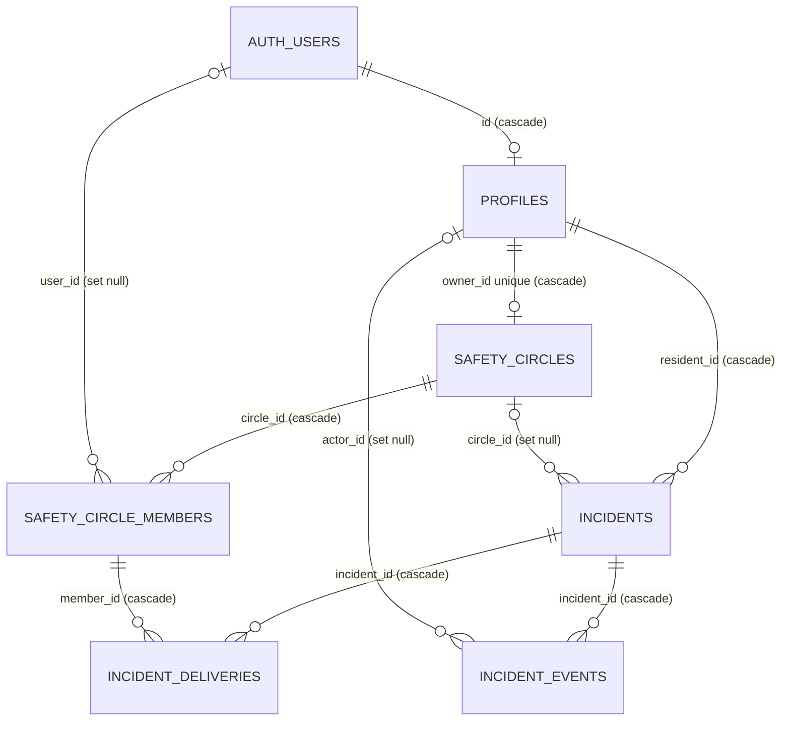
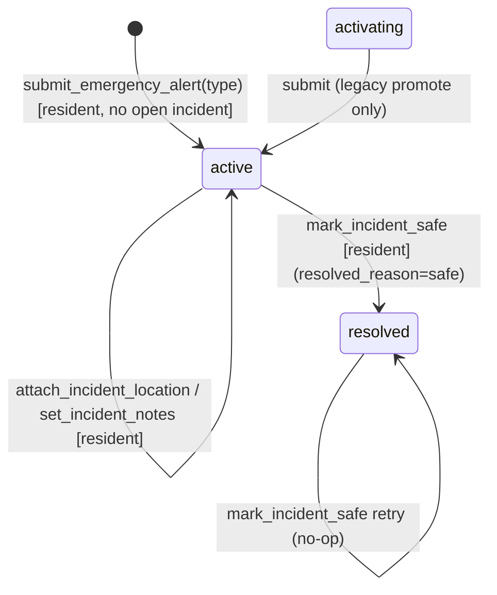

# Atlas Backend — Current State (Supabase) and Proposed API

> **How to use this document (for the implementing AI agent).**
> You do not have the Atlas repository. This file is your only source. It is split into two kinds of sections:
> - **CURRENT (Supabase, as built today)**: facts checked against the final state of the SQL migrations and the Flutter app code. Treat these as the behaviour to reproduce ("parity"). Where a contract document and the final migration disagree, the migration was used and the difference is listed in §13.4.
> - **PROPOSED (new API)**: decisions made by the product owner/developer (Dawit) on 2026-11-03, plus a suggested endpoint map and tables. Where this doc fills in details that were not decided, it says "suggested".
>
> Conventions: DB names are `snake_case`. Error codes keep today's `function_name:code` strings (example: `submit_emergency_alert:invalid_type`). "Owner" is the resident who owns a Safety Circle. "uid" is the authenticated user id. Times are `timestamptz` (UTC ISO-8601 in JSON).
> Anything marked **UNCLEAR** could not be confirmed from the code. Do not guess at it; ask.
>
> **Last verified against repo commit:** `226f133` (branch `main`) on **2026-11-09**.

---

## Table of contents

1. Overview
2. Current architecture (CURRENT)
3. Domain glossary
4. Data model (CURRENT)
5. Enumerations and state machines (CURRENT)
6. Business rules and invariants (CURRENT)
7. Server operations (CURRENT)
8. Authentication flows (CURRENT)
9. Realtime (CURRENT)
10. Mobile app expectations
11. Proposed API (PROPOSED)
12. Migration plan (PROPOSED)
13. Known gaps and constraints
14. Appendix

---

## 1. Overview

**What Atlas is.** A community emergency-response mobile app. A resident builds a **Safety Circle** of up to **5 trusted members** (the owner is not counted). With one tap (SOS, then pick an emergency type) the resident alerts every active member. Members see the emergency type, the resident's location (live while the incident is open), an optional live note, and only the emergency-profile fields the resident chose to share. The resident ends the incident by marking themselves **safe**. The same account can be a resident in one incident and a responder in another.

**V1 scope.** A closed prototype for simulated emergencies:
- Accounts (email + password, phone, Google; Apple button exists but provider not enabled), verification, login lockout.
- Onboarding profile: personal info, emergency info, per-field sharing flags, preferences, review/complete.
- Safety Circles: auto-create on setup completion, invite by phone or shareable link, accept/decline, list/remove/leave, cancel/resend invite.
- Incident loop: submit alert (type required) → in-app delivery to active members → live location → optional live note (backend only; no UI) → mark safe.

**Explicit non-goals (V1).**
- No police / ambulance / fire dispatch. Atlas coordinates trusted people only.
- No public maps or public incident feeds.
- No member chat outside an active incident (and no chat is built at all yet).
- No continuous location outside an active incident (or an explicit test).
- Notifications are **in-app only** today: no push, no SMS, no email beyond Supabase Auth's own mails.

**Platforms.** Flutter app (package `atlas_mobile`) for **Android and iOS**. Flutter ≥ 3.44.

**How to read this doc.** §2–§10 describe the system today. §11–§12 describe the target API and the migration. §13 lists gaps and contract/migration differences. §14 maps Jira story keys to features.

---

## 2. Current architecture (CURRENT)

There is **no custom server**. The Flutter app talks to a hosted Supabase project with the `supabase_flutter` SDK (anon key + user JWT).

| Component | Used for |
| --- | --- |
| **Supabase Auth (GoTrue)** | Email+password signup/sign-in, email confirmation link, phone OTP (test numbers only), phone+password sign-in, Google ID-token sign-in, Apple ID-token sign-in (code exists; provider disabled), password reset by email link, refresh-token rotation, global sign-out. A **custom access token hook** (Postgres function) blocks password sign-in for locked accounts. PKCE flow. |
| **Postgres + RLS** | All app data in schema `public`. Row-level security on every app table. |
| **SECURITY DEFINER RPCs** | Almost all business logic. Called with `supabase.rpc(name, params)` through PostgREST. Errors are raised as SQLSTATE `P0001` with message `fn_name:code`. |
| **Realtime** | `postgres_changes` on `public.incidents` (members watching an incident). `public.incident_events` is also in the publication but the app does not subscribe. |
| **Storage** | Public bucket `avatars` for profile photos. |

**What the app calls directly (PostgREST table access, not RPC)**
- `profiles`: SELECT own row; UPSERT personal info; UPDATE emergency info, preferences, share flags, `location_sharing_enabled`.
- `safety_circles`: SELECT own circle (`owner_id = uid`).
- `safety_circle_members`: SELECT all rows of the caller's own circle.
- Storage `avatars`: upload (upsert) `{uid}/avatar.{jpg|png|webp}`; build public URL.

**Everything else goes through RPCs** (§7). Incidents, deliveries and events are **not writable** by clients at all (SELECT-only grants).

**What does NOT exist yet**
- Push notifications (no FCM/APNs, no device-token table).
- SMS delivery (Twilio is configured off; "on hold"). Invite links are shared by the device's own SMS/share sheet; Atlas sends nothing.
- Email beyond Supabase Auth's confirmation / magic-link / recovery mails (default Supabase sender; no custom SMTP).
- Background jobs / schedulers (no pg_cron, no Edge Functions, no queues). The 24-hour auto-close was built and then removed.
- Server-side OTP attempt/resend limits (only enforced on the device).
- Server-enforced session lifetime cap on the hosted (Free) plan.

---

## 3. Domain glossary

| Term | Meaning |
| --- | --- |
| **Resident** | A signed-in user. As incident creator, the "resident" of that incident (`incidents.resident_id`). |
| **Profile** | `public.profiles` row (1:1 with the auth user). Created by the app at the Personal Info step. |
| **Profile setup complete** | `profiles.profile_setup_completed_at` is set by `complete_profile_setup()`. Required before submitting an alert. |
| **Safety Circle** | `public.safety_circles` row. At most one owned circle per user. Default name `My Safety Circle`. |
| **Owner** | The circle's creator (`safety_circles.owner_id`). Also has a `safety_circle_members` row with `role='owner'`, `status='active'`. **Never counted** in member counts or capacity. |
| **Member / trusted member** | A `safety_circle_members` row with `role='member'`. Only `status='active'` members receive incidents. |
| **Invite** | A member row with `status='pending'` plus a 64-hex-char `invite_token`, 7-day expiry. Phone invites carry the invitee's E.164 phone; link invites have `phone = null`. |
| **Invitee / recipient** | The user who may accept a token: for phone invites the user whose normalized Auth phone equals the row phone; for link invites, whoever holds the token. |
| **Claim** | Setting `safety_circle_members.user_id` on a still-pending invite when the recipient previews or lists it. Status stays `pending`. |
| **Capacity / slot** | 5 trusted slots. `active` and `pending` member rows use a slot; `declined` does not. |
| **Incident** | `public.incidents` row. Created `active` by `submit_emergency_alert`. Closed `resolved`/`safe` by `mark_incident_safe`. Never deleted. |
| **Open incident** | Status `active` (legacy `activating` also counts for the uniqueness index). At most one per resident. |
| **Delivery** | `public.incident_deliveries` row: the incident was made visible in-app to one active member at submit time. Not a push receipt. |
| **Acknowledgement** | `incident_deliveries.acknowledged_at` set by `acknowledge_incident` (RPC exists; no app UI yet). |
| **Re-notify** | A second submit (or `renotify_emergency_alert`) on an already active incident: bumps `renotified_at` and every existing delivery's `delivered_at`. Never a second incident. |
| **Share flags** | Nine booleans on `profiles` (eight `share_*` + `emergency_notes_shareable`), default `false`, deciding which emergency-profile fields members may see. |
| **Share payload** | `incidents.share_payload` JSON snapshot taken at submit of the flagged, non-empty emergency-profile fields. Not updated afterwards. |
| **Live location** | Repeated `attach_incident_location` calls (default every 12 s) overwriting the five location columns on the open incident. |
| **Location sharing (setting)** | `profiles.location_sharing_enabled`: Atlas app setting; required to own/manage a circle. Distinct from OS permission. |
| **Location sharing session** | From submit (`location_sharing_started` event) to mark safe (`location_sharing_ended_at` + `location_sharing_ended` event). |
| **Incident event** | Row in `public.incident_events`: append-only audit timeline. |
| **Lockout** | 5 failed password sign-ins in 15 minutes lock that account key for 15 minutes. |
| **Responder** | An active circle member viewing someone else's incident. |

---

## 4. Data model (CURRENT)

Final state after all 35 migrations. All tables are in schema `public` unless stated. API roles: `anon` (no JWT), `authenticated` (JWT), `service_role` (bypasses RLS), `supabase_auth_admin` (Auth server).

### 4.0 ER summary



Standalone tables: `app_config`, `login_lockouts`, `login_lockout_rpc_throttle`. Storage: bucket `avatars` (`storage.objects`).
`incident_deliveries.member_user_id` is **not** a foreign key (plain uuid).
No trigger on `auth.users`: a `profiles` row is **not** created on signup; the app upserts it at the Personal Info step.

### 4.1 `auth.users` (Supabase-managed) — fields the system relies on

| Field | Used by |
| --- | --- |
| `id` uuid | PK; equals `profiles.id`. |
| `email` | Login, lockout key (`lower(trim(email))`), `clear_login_failures` match. |
| `phone` | Stored by GoTrue **without** a leading `+` in some cases; server code always normalizes with `_normalize_e164`. Used for invite recipient matching and phone lockout keys. |
| `email_confirmed_at`, `phone_confirmed_at` | App treats a user as **verified** when either is non-null. |
| `created_at` | Tie-breaker when several users share a phone (lockout key resolution). |
| `raw_user_meta_data` | App writes `full_name`, `phone`, `signup_phone` at signup. Not read by SQL. |
| JWT claim `email` | Read by `clear_login_failures`. |
| Identities (Google / Apple) | Created by `signInWithIdToken`. |

### 4.2 `profiles`

| Column | Type | Null | Default | Notes / check |
| --- | --- | --- | --- | --- |
| `id` | uuid | no | — | PK, FK → `auth.users(id)` **on delete cascade** |
| `full_name` | text | no | — | check `char_length(trim(full_name)) > 0` |
| `date_of_birth` | date | no | — | client rejects future dates (no DB check) |
| `gender` | text | yes | null | `female` \| `male` \| `prefer_not_to_say` |
| `avatar_path` | text | yes | null | object path in `avatars`, e.g. `{uid}/avatar.jpg` |
| `personal_info_completed_at` | timestamptz | yes | null | set by the **client** on Personal Info continue |
| `created_at` | timestamptz | no | `now()` | |
| `updated_at` | timestamptz | no | `now()` | trigger `profiles_set_updated_at` (before update) |
| `alert_push_enabled` | boolean | no | `true` | stored only; no push exists |
| `alert_email_enabled` | boolean | no | `true` | stored only |
| `alert_sms_enabled` | boolean | no | `true` | stored only |
| `location_sharing_enabled` | boolean | no | `true` | gates circle ownership/invites (§6) |
| `hide_profile_from_non_members` | boolean | no | `false` | stored only; **not enforced anywhere** |
| `app_language` | text | no | `'en'` | check `app_language = 'en'` |
| `timezone` | text | no | `'Africa/Banjul'` | check `timezone = 'Africa/Banjul'` |
| `preferences_completed_at` | timestamptz | yes | null | set by client on Preferences continue |
| `preferred_language` | text | no | `'en'` | `en` \| `wo` \| `mnk` \| `ff` |
| `emergency_contact_full_name` | text | yes | null | required by `complete_profile_setup` |
| `emergency_contact_relationship` | text | yes | null | `spouse` \| `partner` \| `parent` \| `child` \| `sibling` \| `friend` \| `other` |
| `emergency_contact_phone` | text | yes | null | no DB check; `complete_profile_setup` requires `^\+[1-9][0-9]{7,14}$` |
| `emergency_contact_email` | text | yes | null | |
| `blood_type` | text | yes | null | `A+` `A-` `B+` `B-` `AB+` `AB-` `O+` `O-` `Unknown` |
| `allergies` | text | yes | null | free text |
| `medical_conditions` | text | yes | null | free text |
| `emergency_preferred_language` | text | yes | null | free text (not the enum) |
| `emergency_info_completed_at` | timestamptz | yes | null | set by client on Emergency Info continue |
| `emergency_notes` | text | yes | null | check `char_length <= 500` |
| `emergency_notes_shareable` | boolean | no | `false` | share flag for `emergency_notes` |
| `profile_setup_completed_at` | timestamptz | yes | null | set by `complete_profile_setup()` (first success wins) |
| `share_emergency_contact_full_name` | boolean | no | `false` | |
| `share_emergency_contact_relationship` | boolean | no | `false` | |
| `share_emergency_contact_phone` | boolean | no | `false` | |
| `share_emergency_contact_email` | boolean | no | `false` | |
| `share_blood_type` | boolean | no | `false` | |
| `share_allergies` | boolean | no | `false` | |
| `share_medical_conditions` | boolean | no | `false` | |
| `share_emergency_preferred_language` | boolean | no | `false` | |

Constraints (names): `profiles_full_name_nonempty`, `profiles_gender_allowed`, `profiles_app_language_allowed`, `profiles_timezone_allowed`, `profiles_preferred_language_allowed`, `profiles_emergency_contact_relationship_allowed`, `profiles_blood_type_allowed`, `profiles_emergency_notes_length`.
Indexes: btree on `personal_info_completed_at`, `preferences_completed_at`, `emergency_info_completed_at`, `profile_setup_completed_at`.
RLS (enabled): `profiles_select_own`, `profiles_insert_own`, `profiles_update_own` — all `auth.uid() = id`. No delete policy.
Grants: `authenticated`: SELECT, INSERT, UPDATE. Nobody else.
Note: because UPDATE is column-unrestricted, a client could today write `profile_setup_completed_at` or any completion timestamp directly. The app does not. The new API should not allow it.
Members **cannot** read other users' profiles. Resident name reaches members only through DEFINER RPCs (`resident_name`, `owner_name`, `avatar_url`).
Not in the realtime publication.

### 4.3 `safety_circles`

| Column | Type | Null | Default | Notes |
| --- | --- | --- | --- | --- |
| `id` | uuid | no | `gen_random_uuid()` | PK |
| `owner_id` | uuid | no | — | **UNIQUE**; FK → `profiles(id)` on delete cascade |
| `name` | text | no | `'My Safety Circle'` | check `char_length(trim(name)) > 0` |
| `created_at` | timestamptz | no | `now()` | |
| `updated_at` | timestamptz | no | `now()` | trigger `safety_circles_set_updated_at` |

RLS: `safety_circles_select_own` (`auth.uid() = owner_id`); `safety_circles_select_active_member` (`_is_active_circle_member(id, auth.uid())`); `safety_circles_insert_own`; `safety_circles_update_own`. No delete.
Grants: `authenticated` SELECT, INSERT, UPDATE. The app only SELECTs; creation happens in `complete_profile_setup()`.

### 4.4 `safety_circle_members`

| Column | Type | Null | Default | Notes |
| --- | --- | --- | --- | --- |
| `id` | uuid | no | `gen_random_uuid()` | PK. Called `member_id` in all JSON |
| `circle_id` | uuid | no | — | FK → `safety_circles(id)` on delete cascade |
| `role` | text | no | — | `owner` \| `member` |
| `status` | text | no | — | `pending` \| `active` \| `declined` |
| `display_name` | text | no | — | check non-empty after trim. Owner row = owner `full_name`; invite = name typed by owner |
| `relationship` | text | yes | null | same 7 values as `emergency_contact_relationship` |
| `phone` | text | yes | null | check `phone ~ '^\+[1-9][0-9]{7,14}$'`. Null for link invites and the owner row |
| `email` | text | yes | null | only filled for the onboarding emergency-contact invite |
| `user_id` | uuid | yes | null | FK → `auth.users(id)` **on delete set null**. Set on claim/accept/decline; owner row = owner uid |
| `invited_at` | timestamptz | no | `now()` | refreshed on resend |
| `created_at` | timestamptz | no | `now()` | |
| `updated_at` | timestamptz | no | `now()` | trigger; also used as `joined_at` in `list_my_joined_circles` |
| `invite_token` | text | yes | null | 64 hex chars (two UUIDs without dashes). Rotated on resend. Not cleared on accept/decline |
| `invite_expires_at` | timestamptz | yes | null | `invited_at + 7 days` |
| `invite_consumed_at` | timestamptz | yes | null | set on accept |
| `invite_canceled_at` | timestamptz | yes | null | set on decline and owner cancel; cleared on resend |

Check constraints:
- `safety_circle_members_role_allowed`, `_status_allowed`, `_display_name_nonempty`, `_relationship_allowed`, `_phone_e164`.
- `safety_circle_members_owner_shape`: `(role='owner' AND status='active' AND user_id IS NOT NULL) OR role='member'`.
- `safety_circle_members_pending_invite_token`: `role<>'member' OR status<>'pending' OR (invite_token IS NOT NULL AND char_length(invite_token) >= 32 AND invite_expires_at IS NOT NULL)`.

Indexes:
| Name | Definition |
| --- | --- |
| `safety_circle_members_circle_phone_uidx` | UNIQUE `(circle_id, phone)` WHERE `phone IS NOT NULL` (declined rows still hold the phone, so re-inviting reuses the row) |
| `safety_circle_members_circle_user_uidx` | UNIQUE `(circle_id, user_id)` WHERE `user_id IS NOT NULL` |
| `safety_circle_members_one_owner_uidx` | UNIQUE `(circle_id)` WHERE `role = 'owner'` |
| `safety_circle_members_invite_token_uidx` | UNIQUE `(invite_token)` WHERE `invite_token IS NOT NULL` |
| `safety_circle_members_circle_id_idx` | `(circle_id)` |
| `safety_circle_members_user_id_idx` | `(user_id)` WHERE `user_id IS NOT NULL` |
| `safety_circle_members_phone_list_idx` | `(phone)` WHERE `phone IS NOT NULL AND role = 'member'` |

Triggers:
- `safety_circle_members_set_updated_at` (before update).
- `safety_circle_members_enforce_capacity` (before insert or update) → `enforce_safety_circle_member_capacity()`: if the NEW row is `role='member'` with status `pending`/`active` and (INSERT, or UPDATE where OLD did not already occupy a slot), lock the circle row and raise `P0001` message **`circle_full`** (no prefix) when `available <= 0`.

RLS: `safety_circle_members_select_owner` (caller owns the circle), `safety_circle_members_select_self` (`user_id = auth.uid()`), `safety_circle_members_insert_owner`, `safety_circle_members_update_owner`. **No DELETE grant or policy**; deletes happen only in DEFINER RPCs.
Grants: `authenticated` SELECT, INSERT, UPDATE. App only SELECTs (own circle).

### 4.5 `incidents`

| Column | Type | Null | Default | Notes |
| --- | --- | --- | --- | --- |
| `id` | uuid | no | `gen_random_uuid()` | PK |
| `resident_id` | uuid | no | — | FK → `profiles(id)` on delete cascade |
| `circle_id` | uuid | yes | null | FK → `safety_circles(id)` on delete set null. The resident's owned circle at submit, or null |
| `status` | text | no | — | `activating` \| `active` \| `cancelled` \| `resolved` (see §5.4) |
| `activated_at` | timestamptz | no | `now()` | |
| `created_at` | timestamptz | no | `now()` | |
| `updated_at` | timestamptz | no | `now()` | trigger `incidents_set_updated_at` |
| `emergency_type` | text | no | `'unspecified'` | `medical` \| `domestic_violence` \| `fire` \| `burglary` \| `other` \| `unspecified`(legacy) |
| `location_lat` | double precision | yes | null | |
| `location_lng` | double precision | yes | null | |
| `location_accuracy_m` | double precision | yes | null | metres |
| `location_captured_at` | timestamptz | yes | null | device fix time |
| `location_source` | text | yes | null | `current` \| `last_known` \| `unavailable` |
| `cancelled_at` | timestamptz | yes | null | legacy only |
| `sent_at` | timestamptz | yes | null | set at submit; unchanged by re-notify |
| `share_payload` | jsonb | yes | null | check: null or JSON object |
| `incident_notes` | text | yes | null | check `char_length <= 250` |
| `incident_notes_updated_at` | timestamptz | yes | null | stamped on every `set_incident_notes` |
| `renotified_at` | timestamptz | yes | null | last re-notify |
| `resolved_at` | timestamptz | yes | null | |
| `resolved_reason` | text | yes | null | `safe` \| `ended`(legacy) |
| `auto_closed` | boolean | no | `false` | legacy; always false for new writes |
| `activity_confirmed_at` | timestamptz | yes | null | legacy; no writer |
| `location_sharing_ended_at` | timestamptz | yes | null | set by mark safe |

Check constraints:
- `incidents_status_allowed`, `incidents_emergency_type_allowed`, `incidents_location_source_allowed`, `incidents_share_payload_object`, `incidents_incident_notes_length`, `incidents_resolved_reason_check`.
- `incidents_location_shape`: (a) all five location columns null; or (b) `source='unavailable'` and the other four null; or (c) `source in ('current','last_known')`, lat/lng/captured_at not null, lat ∈ [-90,90], lng ∈ [-180,180], accuracy null or ≥ 0, and accuracy **required** when `source='current'`.
- `incidents_resolved_shape_check`: `(status='resolved' AND resolved_at NOT NULL AND resolved_reason NOT NULL) OR (status<>'resolved' AND resolved_at IS NULL AND resolved_reason IS NULL AND auto_closed = false)`.
- `incidents_location_sharing_ended_shape`: `location_sharing_ended_at IS NULL OR status = 'resolved'`.

Indexes: `incidents_one_open_per_resident_uidx` UNIQUE `(resident_id)` WHERE `status IN ('activating','active')`; `incidents_resident_id_idx (resident_id)`; `incidents_circle_id_idx (circle_id)` WHERE `circle_id IS NOT NULL`.
RLS: `incidents_select_own` (`auth.uid() = resident_id`); `incidents_select_active_member` (`circle_id IS NOT NULL AND _is_active_circle_member(circle_id, auth.uid()) AND status IN ('active','resolved')`). Insert/update policies were **dropped**.
Grants: `authenticated` **SELECT only**. All writes via DEFINER RPCs.
Realtime: **in** `supabase_realtime`.
Rows are never deleted by any code path.

### 4.6 `incident_deliveries`

| Column | Type | Null | Default | Notes |
| --- | --- | --- | --- | --- |
| `id` | uuid | no | `gen_random_uuid()` | PK |
| `incident_id` | uuid | no | — | FK → `incidents(id)` on delete cascade |
| `member_id` | uuid | no | — | FK → `safety_circle_members(id)` **on delete cascade** (removing/leaving deletes the member row and therefore its delivery history) |
| `member_user_id` | uuid | no | — | member's auth user id (no FK). Never the resident |
| `delivered_at` | timestamptz | no | `now()` | refreshed on re-notify |
| `acknowledged_at` | timestamptz | yes | null | set by `acknowledge_incident` |

Constraint: UNIQUE `(incident_id, member_user_id)` named `incident_deliveries_incident_member_user_uidx`. Indexes on `incident_id`, `member_user_id`.
RLS: `incident_deliveries_select_resident` (row's incident has `resident_id = auth.uid()`); `incident_deliveries_select_own` (`member_user_id = auth.uid()`); `incident_deliveries_update_own` (`member_user_id = auth.uid()`). No INSERT/DELETE policy.
Grants: `authenticated` SELECT, UPDATE. (Quirk: a member could UPDATE their own row's timestamps directly; the app does not.)
Not in realtime. The app never reads this table directly.

### 4.7 `incident_events`

| Column | Type | Null | Default | Notes |
| --- | --- | --- | --- | --- |
| `id` | uuid | no | `gen_random_uuid()` | PK |
| `incident_id` | uuid | no | — | FK → `incidents(id)` on delete cascade |
| `event_type` | text | no | — | see §5.6 |
| `occurred_at` | timestamptz | no | `now()` | server time |
| `actor_id` | uuid | yes | null | FK → `profiles(id)` on delete set null. Always the resident today |
| `detail` | jsonb | no | `'{}'` | check JSON object |

Indexes: `incident_events_incident_occurred_idx (incident_id, occurred_at)`; `incident_events_once_per_incident_uidx` UNIQUE `(incident_id, event_type)` WHERE `event_type IN ('alert_sent','location_sharing_started','location_sharing_ended','safe_recorded','incident_closed','closure_notified')` (`renotified` may repeat).
RLS: `incident_events_select_visible` → `_can_view_incident_events(incident_id)`: caller is the resident, **or** caller is an active member of the incident's circle and the incident status is `active`/`resolved`.
Grants: `authenticated` SELECT only. Written only by DEFINER functions.
Realtime: **in** `supabase_realtime` (app does not subscribe). App does not read this table today.

### 4.8 `app_config`

| Column | Type | Null | Default |
| --- | --- | --- | --- |
| `key` | text | no | — (PK) |
| `value` | jsonb | no | — |
| `updated_at` | timestamptz | no | `now()` (trigger `app_config_set_updated_at`) |

Seeds (insert … on conflict do nothing): `live_location_interval_seconds = 12`, `live_location_stale_threshold_seconds = 45` (JSON numbers).
RLS: `app_config_select_authenticated` (`using (true)`). Grants: `authenticated` SELECT only. Ops change values via SQL/service role.

### 4.9 `login_lockouts`

| Column | Type | Null | Default | Notes |
| --- | --- | --- | --- | --- |
| `email` | text | no | — | PK. **Lock key**: `lower(trim(email))`, or an E.164 phone when that phone has no usable Auth email (§6.8) |
| `failed_attempts` | integer | no | `0` | check `>= 0` |
| `locked_until` | timestamptz | yes | null | |
| `last_failed_at` | timestamptz | yes | null | |
| `updated_at` | timestamptz | no | `now()` | |

RLS enabled, no policies. Grants: none for `anon`/`authenticated`; `supabase_auth_admin` SELECT (used by the access-token hook).

### 4.10 `login_lockout_rpc_throttle`

| Column | Type | Null | Default |
| --- | --- | --- | --- |
| `bucket` | text | no | — (PK; `'{rpc_name}:{client_ip}'`) |
| `window_started_at` | timestamptz | no | — |
| `call_count` | integer | no | `0` (check ≥ 0) |

RLS enabled, no policies, no client grants. Rows are never cleaned up (UNCLEAR whether any ops job prunes it; none in repo).

### 4.11 Storage bucket `avatars`

| Setting | Value |
| --- | --- |
| Public | `true` (anyone can read with the public URL) |
| `file_size_limit` | 5,242,880 bytes (5 MiB) |
| `allowed_mime_types` | `image/jpeg`, `image/png`, `image/webp` |
| Path convention | `{auth.uid()}/avatar.{jpg\|png\|webp}`; app uploads with `upsert: true` |

Policies on `storage.objects`: `avatars_select_public` (to `public`, bucket = avatars); `avatars_insert_own`, `avatars_update_own`, `avatars_delete_own` (to `authenticated`, bucket = avatars AND first folder = `auth.uid()::text`).
Public URL form: `{SUPABASE_URL}/storage/v1/object/public/avatars/{avatar_path}`. DEFINER helper `_avatars_public_url` builds it from the request `Host` header (or returns a relative path if no header).
Note: changing extension (jpg → png) leaves the old object behind (UNCLEAR whether cleanup happens; no code does it).

### 4.12 Realtime publication `supabase_realtime`

Tables: `public.incidents`, `public.incident_events`. Nothing else (profiles are deliberately excluded).

---

## 5. Enumerations and state machines (CURRENT)

### 5.1 Simple enumerations

| Field | Values (stored) | Display labels (app) |
| --- | --- | --- |
| `profiles.gender` | `female`, `male`, `prefer_not_to_say`, null | — |
| relationship (profile + member) | `spouse`, `partner`, `parent`, `child`, `sibling`, `friend`, `other` | — |
| `profiles.blood_type` | `A+`, `A-`, `B+`, `B-`, `AB+`, `AB-`, `O+`, `O-`, `Unknown`, null | — |
| `profiles.preferred_language` | `en`, `wo`, `mnk`, `ff` | English, Wolof, Mandinka, Fula |
| `profiles.app_language` | `en` only | — |
| `profiles.timezone` | `Africa/Banjul` only | "GMT+00:00 Banjul" |
| `safety_circle_members.role` | `owner`, `member` | — |
| `incidents.location_source` | `current`, `last_known`, `unavailable` | — |
| `incidents.resolved_reason` | `safe` (only writer), `ended` (legacy) | — |
| `submit_outcome` (JSON only) | `created`, `promoted`, `renotified` | — |

### 5.2 Emergency type (`incidents.emergency_type`)

| Picker order | Stored | Label | Submittable |
| --- | --- | --- | --- |
| 1 | `medical` | Medical Emergency | yes |
| 2 | `domestic_violence` | Domestic Violence | yes |
| 3 | `fire` | Fire | yes |
| 4 | `burglary` | Burglary | yes |
| 5 | `other` | Other Emergency | yes |
| — | `unspecified` | Unspecified Emergency | **no** (legacy rows only; readers may return it) |

Removed values: `crime_safety` (renamed to `domestic_violence`), `accident` (renamed to `burglary`). Rejected with `invalid_type`.

### 5.3 Membership status (stored) and invite lookup status (derived)

Stored `status`: `pending`, `active`, `declined`. There is no stored "canceled", "expired", "removed" or "left".

Derived lookup status (`_circle_invite_lookup_status`), first match wins:

| # | Condition | Lookup status |
| --- | --- | --- |
| 1 | `invite_canceled_at IS NOT NULL` OR `status = 'declined'` | `canceled` |
| 2 | `invite_consumed_at IS NOT NULL` OR `status = 'active'` | `consumed` |
| 3 | `invite_expires_at <= now()` (or expires null and `invited_at + 7 days <= now()`) | `expired` |
| 4 | `status = 'pending'` | `pending` |
| 5 | otherwise / token unknown | `not_found` |

Preview adds display statuses: `own_circle`, `already_member`, `circle_full` (§7.3).

Member row transitions (who triggers):

| From | To | Trigger | Writes |
| --- | --- | --- | --- |
| (none) | `pending` | owner: `invite_circle_member_by_phone`, `invite_circle_members_by_phone`, `create_circle_invite_link`; system: `complete_profile_setup` (emergency contact) | new token, `invited_at=now`, `invite_expires_at=now+7d` |
| (none) | `active` owner row | `complete_profile_setup` | `role=owner`, `user_id=uid` |
| `pending` | `pending` (claimed) | invitee: `preview_circle_invite`, `list_my_circle_invites` | `user_id=uid` |
| `pending` | `pending` (refreshed) | owner: resend / re-invite same phone | new token, new expiry, `user_id=null`, clears consumed/canceled |
| `pending` | `active` | invitee: `accept_circle_invite` | `user_id=uid`, `invite_consumed_at=now`, `invite_canceled_at=null` |
| `pending` | `declined` | invitee: `decline_circle_invite` | `user_id=uid` (if no unique clash), `invite_canceled_at=now`, `invite_consumed_at=null` |
| `pending` (lookup pending only) | `declined` | owner: `cancel_circle_invite` | `invite_canceled_at=now` (returned as `canceled`) |
| `declined` | `pending` | owner: resend / re-invite same phone | needs a free slot; new token; `user_id=null` |
| `pending`/`active`/`declined` (member) | **row deleted** | owner: `remove_circle_member` | hard DELETE (cascades its deliveries) |
| `active` (member) | **row deleted** | member: `leave_safety_circle` | hard DELETE |
| `active` | anything | — | resend/invite on an active or consumed row → `already_active` |

Expired is never written; a pending row past `invite_expires_at` stays `pending` in storage (and still holds a slot) until resent, cancelled or removed. `cancel_circle_invite` on an expired invite raises `expired`.

### 5.4 Incident status

| Status | Written today? | By |
| --- | --- | --- |
| `active` | yes | `submit_emergency_alert` (insert, or promote a legacy `activating` row) |
| `resolved` | yes | `mark_incident_safe` (`resolved_reason='safe'`) |
| `activating` | no (legacy) | old `start_emergency_activation` (dropped). Migration converted all to `cancelled` |
| `cancelled` | no (legacy) | old grace cancel (dropped) + the cleanup migration |



No other transition exists. A resolved incident can never reopen; the next submit creates a new incident.

### 5.5 Location source shapes

| `location_source` | lat/lng/captured_at | accuracy |
| --- | --- | --- |
| null (never attached) | all null | null |
| `unavailable` | all null | null |
| `current` | required | **required**, ≥ 0 |
| `last_known` | required | optional, ≥ 0 |

### 5.6 `incident_events.event_type`

| Type | Written by | `detail` | Once per incident? |
| --- | --- | --- | --- |
| `alert_sent` | submit (created/promoted) | `{recipient_count:int, recipient_ids:uuid[], emergency_type:text}` | yes |
| `location_sharing_started` | submit (created/promoted) | `{}` | yes |
| `renotified` | submit on active / `renotify_emergency_alert` | `{recipient_count:int}` (= number of delivery rows refreshed) | no |
| `safe_recorded` | `mark_incident_safe` | `{}` | yes |
| `incident_closed` | `mark_incident_safe` | `{resolved_reason:"safe"}` | yes |
| `location_sharing_ended` | `mark_incident_safe` | `{}` | yes |
| `closure_notified` | `mark_incident_safe` | `{recipient_count:int, recipient_ids:uuid[]}` = current active members (user_id not null) excluding the resident | yes |

Incidents created before the events migration have no `alert_sent`/`location_sharing_started` rows (no backfill).

### 5.7 Login lockout state

`unlocked (failed_attempts 0..4)` → 5th failure within 15 min of `last_failed_at` → `locked (locked_until = now+15m)` → after `locked_until` passes, the next status/record call resets to `failed_attempts=0`. Successful sign-in → `clear_login_failures` deletes the row(s).

---

## 6. Business rules and invariants (CURRENT)

Each rule is testable. Numbers are exact.

### 6.1 Profile and onboarding
1. A profile row is created by the client (upsert on `id`) at Personal Info continue with `full_name` (non-empty after trim), `date_of_birth` (not in the future — client check only), optional `gender`, optional `avatar_path`, and `personal_info_completed_at` (client clock, UTC).
2. Onboarding order in the app: location permission step (client-only, stored on device) → Personal Info → Emergency Info (includes share flags and `location_sharing_enabled`) → optional "Incident sharing preview" → Preferences → Review → `complete_profile_setup()`.
3. Emergency Info requires contact full name, relationship, and phone. Phone without `+` gets `+220` (Gambia) prefixed by the client. Emergency notes ≤ 500 chars (client truncates; DB check enforces).
4. `complete_profile_setup()` requires: profile exists; `personal_info_completed_at` set, `full_name` non-blank, `date_of_birth` set; `emergency_info_completed_at` set with contact name, relationship and phone matching `^\+[1-9][0-9]{7,14}$`; `preferences_completed_at` set. It is idempotent: `profile_setup_completed_at` keeps its first value.
5. **Deferred circle creation:** if `location_sharing_enabled = false`, setup completes but no circle is created (`circle_id: null`). When the user later turns Location Sharing on (app updates `profiles.location_sharing_enabled = true` then calls `complete_profile_setup()` again), the circle, owner row and emergency-contact invite are created.
6. When `location_sharing_enabled = true`, `complete_profile_setup()` ensures: one circle (`name` default, never renamed on repeat), the owner member row (`role=owner, status=active, user_id=uid, display_name=trim(full_name)`), and a pending invite for the emergency contact (phone, relationship, email, name; 7-day token). Re-running keeps an existing pending token, keeps an active row active, and turns a declined row back to pending with a new token.

### 6.2 Circle ownership and capacity
7. One owned circle per user (`safety_circles.owner_id` UNIQUE). One owner row per circle.
8. Capacity limit = **5** trusted members, **owner excluded**. `used = active_count + pending_count` over `role='member'` rows; `declined` excluded; **expired-but-still-pending rows count** as pending. `available = max(0, 5 - used)`.
9. Any operation that makes a member row newly occupy a slot (insert as pending/active, or declined → pending) fails with `circle_full` when `available = 0` (RPC message `{rpc}:circle_full`; raw trigger message `circle_full`). Refreshing a pending row, or accepting a pending row, does not need a new slot.
10. Accept at exactly 5 used succeeds when the accepted row is itself one of the 5 pending; accept fails `circle_full` only if `other_active + other_pending + 1 > 5`.
11. Owner-side invite RPCs (`invite_*`, `create_circle_invite_link`, `resend_circle_invite`) require `profiles.location_sharing_enabled = true` (`location_sharing_disabled`) and an owned circle (`circle_not_found`). `circle_invite_capacity`, `cancel_circle_invite`, `remove_circle_member`, `list_circle_members` do **not** check location sharing. Accept/decline/preview do **not** check location sharing or profiles at all.
12. Member counts shown anywhere exclude the owner. UI disables Add Member at 5/5.

### 6.3 Invites
13. Token: 64 lowercase hex chars, unique across all rows; shared as `io.supabase.atlasmobile://invite/{token}`.
14. Expiry: `invite_expires_at = now() + 7 days` at create/resend.
15. Single use: accept sets `invite_consumed_at`; afterwards the token looks up as `consumed`. A repeat accept by the **same** user returns success with the same JSON (idempotent).
16. Phone invites: `invite_circle_member_by_phone` requires the phone already in strict E.164 `^\+[1-9][0-9]{7,14}$` (trimmed, no other normalization). The batch RPC normalizes each phone with `_normalize_e164` (trim; keep `+E.164`; prefix `+` on 8–15 digit strings starting 1–9).
17. Same phone in the same circle never creates a second row: existing pending → refreshed (new token, `resent: true`); existing declined → refreshed if a slot is free; existing active/consumed → `already_active`. Batch skips `already_pending` / `already_active` instead of refreshing pending rows.
18. Recipient check: a claimed row (`user_id` set) is only for that user. A phone invite requires the caller's Auth phone, normalized, to equal the row phone normalized. A link invite (`phone` null) accepts any holder of the current token.
19. The owner cannot accept their own circle's invite (`own_circle`). A user already active in that circle gets `already_member`.
20. Decline sets `declined` + `invite_canceled_at`; the slot is released; lookup returns `canceled`. Decline is pending-only (a second decline → `canceled`).
21. Owner cancel: only when lookup status is `pending` (`expired` → `:expired`; anything else → `:not_pending`); writes `declined` + `invite_canceled_at`; returns `status: "canceled"`.
22. Preview and list-invites have a **write side effect**: they claim (`user_id = uid`) pending rows the caller is the recipient of. Unique `(circle_id, user_id)` clashes are swallowed (list) or raise `duplicate_membership` (preview, pending case).
23. Anonymous `lookup_circle_invite` returns only `status` and `invite_expires_at` — never names, phones or ids.
24. Remove (owner) and leave (active non-owner member) **hard-delete** the member row (and cascade its `incident_deliveries`). The owner cannot be removed and cannot leave. The circle itself is never deleted by any RPC.

### 6.4 Incident submit
25. Submit requires a JWT, an existing profile, and `profile_setup_completed_at` set. Type must be one of the five submittable values.
26. **One open incident per resident**: enforced by the `profiles` row lock (`SELECT … FOR UPDATE`) inside submit plus the unique partial index on `(resident_id) WHERE status IN ('activating','active')`.
27. Submit outcomes: caller already has `active` → **re-notify** that incident (type unchanged), `submit_outcome='renotified'`; legacy `activating` → promote, `'promoted'`; else insert new `active` row, `'created'`. Under a lost race the insert uses `ON CONFLICT DO NOTHING` and falls back to re-notify.
28. On created/promoted: `activated_at = sent_at = now()` (promote keeps `activated_at`), `circle_id` = caller's owned circle or null, `share_payload` = snapshot (rule 31), insert one `incident_deliveries` row per **active** member of that circle with `user_id` not null and ≠ resident (never pending/declined); log `alert_sent` and `location_sharing_started` once. **No circle or zero active members is still success** (`delivered_count = 0`).
29. Re-notify: `renotified_at = now()`, every existing delivery row's `delivered_at = now()` (no new rows even if new members joined; acks kept), log `renotified {recipient_count}`. Does **not** refresh `share_payload`, `circle_id` or type.
30. Submit is retry-safe: a retry after a lost response becomes a re-notify of the same incident, never a second incident. The app additionally re-reads `get_my_open_incident` after ambiguous failures instead of blindly retrying (§10.5).

### 6.5 Share payload
31. Snapshot built once at create/promote from the resident's profile. Includes a key only when its flag is true **and** the value is non-null and non-empty after `btrim`. Keys and flags:

| Payload key | Flag column |
| --- | --- |
| `emergency_contact_full_name` | `share_emergency_contact_full_name` |
| `emergency_contact_relationship` | `share_emergency_contact_relationship` |
| `emergency_contact_phone` | `share_emergency_contact_phone` |
| `emergency_contact_email` | `share_emergency_contact_email` |
| `blood_type` | `share_blood_type` |
| `allergies` | `share_allergies` |
| `medical_conditions` | `share_medical_conditions` |
| `emergency_preferred_language` | `share_emergency_preferred_language` |
| `emergency_notes` | `emergency_notes_shareable` |

32. All flags default `false` (no hidden opt-in). Empty result is `{}` (not null) for new incidents. Never contains `full_name`, `date_of_birth`, `gender`, `preferred_language`, type, location or live notes. Later profile edits do not change an existing incident's payload.

### 6.6 Live location and notes
33. `attach_incident_location` works only on the caller's own incident with `status='active'` AND `location_sharing_ended_at IS NULL`; otherwise `not_open`. Late pings after mark safe never write.
34. **Out-of-order guard:** if stored `location_captured_at` is not null and incoming `p_location_captured_at` is not null and incoming < stored, skip the update and return the current row (success, not an error). Equal or newer timestamps overwrite. An `unavailable` ping (null captured_at) always overwrites.
35. Live interval default **12 s**, stale threshold default **45 s**, read from `app_config` (`live_location_interval_seconds`, `live_location_stale_threshold_seconds`); non-number, missing, or ≤ 0 values fall back to 12/45. Stale is a **client** decision (`now - location_captured_at > stale_threshold`); the server stores no stale flag.
36. Attach never notifies, never creates deliveries, never changes status/type/notes.
37. Live note (`set_incident_notes`): own incident in `activating`/`active`; `btrim`; empty/whitespace → null; > 250 chars after trim → `too_long`; always stamps `incident_notes_updated_at` (also when clearing). Not copied to `share_payload`. Not the profile's `emergency_notes`.

### 6.7 Mark safe
38. Only the resident, only from `active`. One call sets `status='resolved'`, `resolved_at=now()`, `resolved_reason='safe'`, `auto_closed=false`, `location_sharing_ended_at=now()`, and logs `safe_recorded`, `incident_closed`, `location_sharing_ended`, `closure_notified` **exactly once**.
39. Idempotent: if already `resolved` with `safe`, return the row unchanged — no events, no timestamp change. Legacy `cancelled`/`activating`/`ended` → `not_open`.
40. Closure notification is in-app only: members see `status` flip to `resolved` via Realtime/list/details. No push/SMS.
41. Members can still read a resolved incident (including last location) while they remain active members.

### 6.8 Login lockout
42. Lock: **5** failed password attempts within **15 minutes** (window measured from `last_failed_at`; a failure older than 15 min resets the count before incrementing) → `locked_until = now() + 15 minutes`. Further failures while locked do **not** extend the lock and raise `login_lockout:locked`.
43. Only Auth `invalid_credentials` counts. Unconfirmed email/phone, network errors, timeouts, 5xx do not (client responsibility today).
44. **Key:** email sign-in → `lower(trim(email))` (≤ 254 chars, must match `^[^@\s]+@[^@\s]+$`). Phone sign-in → normalized strict E.164; if an Auth user has that phone **and** a usable email, the key is that user's email (shared counter across email and phone sign-in); otherwise the E.164 itself. When several users share the phone: prefer one with a usable email, then oldest `created_at`.
45. Status responses always have the same shape for known and unknown identifiers (no account enumeration).
46. Server gate: the custom access token hook rejects any `password` grant (email or phone) whose user key is locked with HTTP 403 `login_lockout:locked`. OAuth, OTP, magic link, recovery and refresh are not blocked.
47. Successful password sign-in, Google sign-in, or password reset → `clear_login_failures` removes the caller's email row and E.164 row.
48. Per-IP throttle (5-minute fixed window, IP from `x-forwarded-for` first value, else `x-real-ip`, else `unknown`): `login_lockout_status` 60 calls, `record_login_failure` 15, `clear_login_failures` 30 → `login_lockout:rate_limited`.

### 6.9 Verification limits (client-only today)
49. Max **3** OTP/link resends per identifier per sliding **15 minutes**; **5** failed OTP attempts invalidate the current code until a resend; a resend resets the failure count. Stored in device SharedPreferences (survives restart; reinstall resets). Supabase cannot enforce these server-side.
50. Phone OTP countdown shown as 10 minutes; email link expiry 300 s (config). Hosted phone OTP expiry per README: 600 s, 6 digits.

### 6.10 Visibility (authorization summary)
51. Resident sees own incidents (all statuses) and all delivery rows of own incidents.
52. A user sees another user's incident only while they are an **active** member (current membership, not delivery rows) of the incident's `circle_id` and status is `active`/`resolved`. Pending/declined/removed/left users see nothing. The resident never gets their own incident through responder RPCs.
53. Non-owner active members of a circle see only active rows of that circle's member list, without phone/email/relationship/invite fields.

---


### 6.x Requirements added 2026-11-17 (device test-run decisions — keep in the new API)

54. **Membership time window for incident access (privacy).** A circle member may read an incident (details, location, shared fields, notes, events, delivery/ack data) **only if the incident started at or after the moment that person became an active member** of that circle, and only while they are still an active member. Alerts from before they joined are never visible; after they leave or are removed, nothing is visible. Enforce on the server for every read path (list, details, realtime/socket subscriptions, activity log). Requires storing the membership activation time (e.g. `safety_circle_members.activated_at`, set on accept; backfilled for existing active rows). Decision record: `qa/decisions-2026-11-17-test-run-fixes.md` (#9).
55. **Fail fast on emergency writes.** The client caps `submit_emergency_alert` at **12 s** (immediately when the device has no network) and then re-checks with `get_my_open_incident` (3 s cap) before showing failure; same pattern for mark safe. The new API must keep these operations fast and idempotent (Idempotency-Key) so a retry after a timeout never creates a second incident or a second closure. Decision record #6.

## 7. Server operations (CURRENT)

All RPCs below are `SECURITY DEFINER`, `set search_path = public`, return `jsonb`, and raise `SQLSTATE P0001` with `message = '<prefix>:<code>'`. `not_authenticated` means no JWT. "Grants" lists roles with EXECUTE. Unless noted, grants are `authenticated` only (`PUBLIC` and `anon` revoked).

### 7.0 Shared JSON shapes

**MemberInvitePayload** (`_circle_invite_payload`):
`member_id` uuid, `circle_id` uuid, `status` text, `display_name` text, `relationship` text|null, `phone` text|null, `invite_token` text, `invite_url` text (`io.supabase.atlasmobile://invite/{token}`), `invited_at` timestamptz, `invite_expires_at` timestamptz, `resent` bool (true when an existing row was refreshed).

**Capacity**: `limit` int (5), `active_count` int, `pending_count` int, `used` int, `available` int.

**IncidentShared** (`_incident_activation_json`), exactly 22 keys:
`id`, `resident_id`, `circle_id`, `status`, `activated_at`, `emergency_type`, `location_lat`, `location_lng`, `location_accuracy_m`, `location_captured_at`, `location_source`, `cancelled_at`, `sent_at`, `share_payload` (object or null — null only on legacy rows), `incident_notes`, `incident_notes_updated_at`, `renotified_at`, `resolved_at`, `resolved_reason`, `auto_closed` (bool), `activity_confirmed_at`, `location_sharing_ended_at`.

**IncidentSend** = IncidentShared + `delivered_count` int (rows in `incident_deliveries`) + `acknowledged_count` int (rows with `acknowledged_at` not null).

**DeliveryCounts**: `incident_id` uuid, `delivered_count` int, `acknowledged_count` int, `status` text.

**LockoutStatus**: `locked` bool, `locked_until` timestamptz|null (only when locked), `failed_attempts` int.

### 7.1 Profile

#### `complete_profile_setup()` — SCRUM-80 / 26 / 27
- Auth: JWT. Locks own profile row.
- Writes: `profiles.profile_setup_completed_at` (coalesce); if location sharing on: `safety_circles` (insert if missing), owner member row (upsert), emergency-contact pending invite (upsert on `(circle_id, phone)`).
- Returns: `{profile_setup_completed_at: timestamptz, location_sharing_enabled: bool, circle_id: uuid|null, member_id: uuid|null (the emergency-contact row), member_status: text|null}`.
- Errors: `complete_profile_setup:not_authenticated`, `:profile_not_found`, `:personal_info_incomplete`, `:emergency_info_incomplete`, `:preferences_incomplete`. Edge: the capacity trigger can raise raw `circle_full` if the circle is full and the contact phone is new or declined (UNCLEAR whether the app maps it).
- Idempotent: yes.

### 7.2 Circles and invites (owner side)

| RPC (args) | Returns | Errors (prefix = RPC name) | Notes |
| --- | --- | --- | --- |
| `circle_invite_capacity()` | Capacity | `not_authenticated`, `not_owner` | No location-sharing check |
| `invite_circle_member_by_phone(display_name text, phone text, relationship text default null)` | MemberInvitePayload | `not_authenticated`, `profile_not_found`, `location_sharing_disabled`, `circle_not_found`, `invalid_display_name`, `invalid_phone`, `invalid_relationship`, `already_active`, `circle_full`, `duplicate_membership` | Strict E.164. Existing row for phone refreshed (`resent:true`); relationship kept if arg null. App sends `relationship` only when non-empty |
| `invite_circle_members_by_phone(p_invites jsonb)` | `{created: MemberInvitePayload[], skipped: [{phone, display_name, reason, member_id}], not_created: [{phone, display_name, reason}], available_after: int}` | `not_authenticated`, `profile_not_found`, `location_sharing_disabled`, `circle_not_found`, `invalid_invites` (not an array) | `p_invites` = `[{phone, display_name}]` (no relationship). Skip reasons: `already_active`, `already_pending`. Not-created reasons: `invalid_invite`, `invalid_phone`, `invalid_display_name`, `circle_full`, `duplicate_membership`. One transaction; processes in array order |
| `create_circle_invite_link(display_name text default null)` | MemberInvitePayload (`phone: null`, `resent:false`) | `not_authenticated`, `profile_not_found`, `location_sharing_disabled`, `circle_not_found`, `circle_full` | Blank name → `'Invited member'`. Reserves a slot. Not idempotent (each call creates a row) |
| `resend_circle_invite(member_id uuid)` | MemberInvitePayload (`resent:true`) | `not_authenticated`, `profile_not_found`, `location_sharing_disabled`, `circle_not_found`, `member_not_found`, `not_invitable` (owner row), `already_active`, `circle_full` (declined→pending when full), `invalid_display_name` | Rotates token; old link becomes `not_found`. Clears `user_id`, consumed, canceled |
| `cancel_circle_invite(member_id uuid)` | `{member_id, circle_id, status: "canceled", owner_name}` | `not_authenticated`, `not_found`, `not_authorized`, `cannot_cancel_owner`, `expired`, `not_pending` | Writes `declined` + `invite_canceled_at`. No location-sharing check |
| `remove_circle_member(member_id uuid)` | `{member_id, circle_id, removed: true}` | `not_authenticated`, `not_found`, `not_authorized`, `cannot_remove_owner` | Hard DELETE any non-owner row (pending/active/declined). App throws if `removed` is not true |
| `list_circle_members(circle_id uuid)` | array (see below) | `not_authenticated`, `not_found`, `not_authorized` | Owner or active member |

`list_circle_members` element keys:
- Always: `member_id`, `role`, `status`, `display_name`, `is_owner` (bool), `invited_at`, `user_id`, `avatar_url` (public URL from the member's `profiles.avatar_path`, or null).
- Owner caller only, plus: `phone`, `email`, `relationship`, `invite_expires_at`, `invite_consumed_at`, `invite_canceled_at`. (Never `invite_token`.)
- Owner sees every row; a non-owner active member sees only `status='active'` rows (owner row + active members).
- Order: owner first, then status `active` < `pending` < `declined`, then `lower(display_name)`, then `invited_at`.

### 7.3 Circles and invites (invitee / member side)

#### `lookup_circle_invite(token text)` — grants: **anon** and authenticated; not SECURITY-critical
- Returns `{status: pending|expired|consumed|canceled|not_found, invite_expires_at: timestamptz|null}`. No errors (blank/unknown → `not_found`). Read-only.

#### `preview_circle_invite(token text)`
- Returns `{status, invite_expires_at, member_id, circle_id, owner_name, invited_at, claimed: bool, recipient_ok: bool, owner_avatar_url}`.
- Status logic (first match): unknown/blank → `not_found` (all other keys null/false); caller owns the circle → `own_circle` (shows owner, never claims); row active for caller → `already_member`; lookup `consumed` → `consumed` (hides row/owner); lookup `canceled` → `canceled` (row ids only if recipient_ok; no owner); lookup `expired` → `expired` (owner + row only if recipient_ok); caller already active in that circle via another row → `already_member`; pending + recipient_ok: if accepting would exceed 5 → `circle_full` (claims if the caller has no other row in the circle), else `pending` (claims; unique clash → error `duplicate_membership`); else the lookup status with nothing revealed.
- `member_id`, `circle_id`, `invited_at` only when the row is "included"; `owner_name`/`owner_avatar_url` only when owner is shown.
- Errors: `preview_circle_invite:not_authenticated`, `:duplicate_membership`.
- **Side effect:** claim (`user_id = uid`). Safe to repeat.

#### `accept_circle_invite(token text)`
- Locks the circle row, then the member row.
- Returns `{circle_id, member_id, status: "active", owner_name}`.
- Errors: `not_authenticated`, `not_found`, `expired`, `consumed`, `canceled`, `not_recipient`, `own_circle`, `already_member`, `circle_full`, `duplicate_membership`.
- Idempotent for the same user + same token. Does not read/write profiles, does not require location sharing, does not create a circle for the invitee.

#### `decline_circle_invite(token text)`
- Returns `{circle_id, member_id, status: "declined", owner_name}`.
- Errors: `not_authenticated`, `not_found`, `expired`, `consumed`, `canceled`, `not_recipient`. Not idempotent (repeat → `canceled`).

#### `list_my_circle_invites()`
- Returns array ordered by `invited_at` desc of `{member_id, circle_id, status (pending|expired|canceled), owner_name, invited_at, invite_expires_at, invite_token (only when pending, else null)}`.
- Includes member rows where `user_id = uid`, or unclaimed rows whose normalized phone equals the caller's normalized Auth phone; `consumed` rows excluded.
- Side effect: claims pending rows the caller may accept (skips if caller is already active in that circle).
- Errors: `list_my_circle_invites:not_authenticated`.

#### `list_my_joined_circles()`
- Returns array ordered by `joined_at` desc of `{circle_id, name, role (owner|member), member_id, status: "active", owner_name, joined_at (= member row updated_at), active_member_count (role member + active; owner excluded)}`.
- **Includes the caller's own circle** (role `owner`). Errors: `:not_authenticated`.

#### `leave_safety_circle(circle_id uuid)`
- Returns `{circle_id, member_id, left: true}`. Hard DELETE of the caller's active member row.
- Errors: `not_authenticated`, `not_found` (null/unknown circle), `is_owner`, `not_authorized` (caller not an active member).

`owner_name` everywhere = the circle's owner member row `display_name` (copied from `profiles.full_name` at circle creation; **not** updated if the owner later renames).

### 7.4 Incidents

| RPC (args) | Auth / who | Returns | Errors (prefix = RPC) | Idempotency / notes |
| --- | --- | --- | --- | --- |
| `submit_emergency_alert(p_emergency_type text)` | resident | IncidentSend + `submit_outcome` | `not_authenticated`, `invalid_type`, `profile_not_found`, `profile_setup_incomplete` | §6.4. Repeat = re-notify |
| `get_my_open_incident()` | resident | IncidentSend, or JSON `null` | `not_authenticated` | Read-only. Only `status='active'` |
| `list_my_recent_incidents(p_limit integer default 5)` | resident | array of `{id, emergency_type, status, activated_at, sent_at, resolved_at, resolved_reason}` | `not_authenticated` | Own `active`/`resolved` only; order `activated_at desc, id desc`; limit null→5, clamped 1–20 |
| `attach_incident_location(p_incident_id uuid, p_location_source text, p_location_lat float8 default null, p_location_lng float8 default null, p_location_accuracy_m float8 default null, p_location_captured_at timestamptz default null)` | resident | IncidentShared | `not_authenticated`, `invalid_source`, `invalid_location`, `not_found`, `not_open` | Validation before lookup. Out-of-order older ping returns current row (success). App omits lat/lng/captured_at for `unavailable` and omits accuracy when null |
| `get_live_location_config()` | any JWT | `{interval_seconds: int, stale_threshold_seconds: int}` | `not_authenticated` | Defaults 12 / 45 |
| `renotify_emergency_alert(p_incident_id uuid)` | resident | IncidentSend | `not_authenticated`, `not_found`, `not_open` | Not called by the app (submit covers it) |
| `set_incident_notes(p_incident_id uuid, p_incident_notes text default null)` | resident | IncidentShared | `not_authenticated`, `not_found`, `not_open`, `too_long` | Store method exists; **no UI** (SCRUM-39 not built) |
| `mark_incident_safe(p_incident_id uuid)` | resident | IncidentSend | `not_authenticated`, `not_found` (also for non-residents), `not_open` | Idempotent if already safe |
| `incident_delivery_counts(p_incident_id uuid)` | resident (any status) or active member (status `active` only) | DeliveryCounts | `not_authenticated`, `not_found` (also no access) | App polls every 2 s while open |
| `acknowledge_incident(p_incident_id uuid)` | member with a delivery row | DeliveryCounts | `not_authenticated`, `not_found` (no delivery row), `not_open` (status ≠ active) | Idempotent. **Not called by the app** (Epic 5) |
| `list_responder_incidents()` | any JWT | array of `{id, resident_name, emergency_type, activated_at, status, sent_at, renotified_at, resolved_at, resolved_reason, auto_closed}` | `not_authenticated` | Incidents with status active/resolved, resident ≠ caller, caller currently active member of `circle_id`. Order `coalesce(resolved_at, sent_at, activated_at) desc, id`. No pagination |
| `get_incident_details(p_incident_id uuid)` | active member (not the resident) | `{id, resident_name, emergency_type, activated_at, status, sent_at, renotified_at, resolved_at, resolved_reason, auto_closed, location_lat, location_lng, location_accuracy_m, location_captured_at, location_source, location_sharing_ended_at, incident_notes, incident_notes_updated_at, share_payload (object, {} if null)}` | `not_authenticated`, `not_found` | `resident_name` = `profiles.full_name` (empty string if missing) |

### 7.5 Login lockout (SCRUM-16)

All three use error prefix **`login_lockout:`** (not the function name).

| RPC (args) | Grants | Returns | Errors |
| --- | --- | --- | --- |
| `login_lockout_status(p_email text default null, p_phone text default null)` | anon, authenticated | LockoutStatus | `rate_limited`, `identifier_exclusive` (both given), `identifier_required` (none), `email_required`, `invalid_email`, `phone_required`, `invalid_phone` |
| `record_login_failure(p_email text default null, p_phone text default null)` | anon, authenticated | LockoutStatus (5th failure returns `locked: true` — it does **not** raise, so the write commits) | same as above + `locked` when already locked (DETAIL = LockoutStatus JSON text) |
| `clear_login_failures(email text default null)` | authenticated | `{locked:false, locked_until:null, failed_attempts:0}` | `rate_limited`, `not_authenticated`, `email_required`/`invalid_email` (caller has an email but arg blank/invalid), `email_mismatch` (arg ≠ JWT email and ≠ Auth email) |

Exactly one of `p_email` / `p_phone` must be non-null. Clear deletes the email-key row (only if caller has an email and arg matches) and the caller's E.164 row.

### 7.6 Auth hook (not callable by clients)

`hook_reject_locked_password_session(event jsonb)` — EXECUTE granted only to `supabase_auth_admin`; configured as Supabase "custom access token" hook. For `authentication_method = 'password'`, if the user's lock key is locked → returns `{error: {http_code: 403, message: "login_lockout:locked"}}`; otherwise returns `{claims}` unchanged.

### 7.7 Internal helpers still present (not for clients)

Granted to `authenticated` only because RLS policies call them: `_is_active_circle_member(circle_id uuid, uid uuid) → bool`, `_can_view_incident_events(p_incident_id uuid) → bool`. (`enforce_safety_circle_member_capacity()` trigger function also has EXECUTE granted to `authenticated` — harmless quirk.)

Not granted to API roles: `new_circle_invite_token`, `_owner_circle_for_invite`, `_circle_invite_payload`, `_refresh_circle_invite`, `_require_auth_uid`, `_auth_user_phone`, `_normalize_e164`, `_circle_owner_display_name`, `_circle_invite_lookup_status`, `_circle_invite_recipient_ok`, `_reject_unless_pending`, `_circle_has_active_membership`, `_circle_invite_preview_payload` (unused leftover), `_avatars_public_url`, `_member_avatar_url`, `_circle_member_limit`, `_circle_invite_capacity_json`, `_require_circle_invite_slot`, `_circle_accept_used_after`, `_incident_activation_json`, `_incident_share_payload`, `_incident_delivery_counts_json`, `_incident_send_json`, `_incident_record_event`, `_incident_active_recipient_ids`, `_incident_apply_renotify`, `_normalize_login_email`, `_login_lockout_status_json`, `_login_lockout_client_ip`, `_login_lockout_rate_limit`, `_login_lockout_load`, `_login_lockout_payload`, `_login_lockout_phone_key`, `_login_lockout_key_for_user`, `_login_lockout_resolve_key`.
Trigger functions: `set_profiles_updated_at`, `set_safety_circles_updated_at`, `set_safety_circle_members_updated_at`, `set_incidents_updated_at`, `_app_config_set_updated_at`, `enforce_safety_circle_member_capacity`.

### 7.8 Direct table, storage and auth use by the app

| Operation (app method) | Call | Columns / payload |
| --- | --- | --- |
| `fetchOwn` | `profiles` SELECT * WHERE id = uid (maybeSingle) | all columns |
| `isPersonalInfoComplete` / `isPreferencesComplete` / `isEmergencyInfoComplete` / `isProfileSetupComplete` | `profiles` SELECT one timestamp column | `*_completed_at` |
| `upsertPersonalInfo` | `profiles` UPSERT on `id` | `id, full_name (trimmed), date_of_birth (YYYY-MM-DD), gender, avatar_path, personal_info_completed_at` |
| `updateEmergencyInfo` | `profiles` UPDATE WHERE id = uid | `emergency_contact_full_name, emergency_contact_relationship, emergency_contact_phone (E.164, +220 default), emergency_contact_email, blood_type, allergies, medical_conditions, emergency_preferred_language, location_sharing_enabled, emergency_notes (≤500), emergency_notes_shareable, 8 share_* flags, emergency_info_completed_at` (blank strings sent as null) |
| `updatePreferences` | `profiles` UPDATE | `alert_push_enabled, alert_email_enabled, alert_sms_enabled, location_sharing_enabled, hide_profile_from_non_members, app_language ('en'), timezone ('Africa/Banjul'), preferred_language, preferences_completed_at` |
| `updateIncidentSharingFlags` | `profiles` UPDATE | 8 `share_*` flags + `emergency_notes_shareable` only |
| `updateLocationSharingEnabled` | `profiles` UPDATE | `location_sharing_enabled` |
| `fetchOwnCircle` | `safety_circles` SELECT * WHERE owner_id = uid | `id, owner_id, name, created_at, updated_at` |
| `fetchCircleMembers` | `safety_circle_members` SELECT * WHERE circle_id = own circle | all columns (incl. `invite_token`) |
| `uploadAvatar` | Storage `avatars.uploadBinary('{uid}/avatar.{ext}', upsert:true, contentType)` | ext from content type: png, webp, else jpg |
| `publicAvatarUrl` | `storage.from('avatars').getPublicUrl(path)` | |
| `watchIncidentRow` | Realtime channel (§9) | |
| Auth calls | see §8 | |

### 7.9 Functions that were REMOVED (do not reintroduce)

| Removed | Replacement |
| --- | --- |
| `start_emergency_activation()` | `submit_emergency_alert(type)` |
| `set_emergency_type(uuid, text)` | type is the submit argument |
| `send_emergency_alert(uuid)` | `submit_emergency_alert(type)` |
| `cancel_emergency_activation(uuid)` | none (grace period cancelled, SCRUM-42) |
| `end_incident(uuid)` | `mark_incident_safe` (SCRUM-46 merged into 45) |
| `incident_inactivity_due()` | none (no 24 h auto-close) |
| `confirm_incident_still_active(uuid)` | none |
| `auto_close_inactive_incident(uuid)` | none |
| `_incident_inactivity_is_due(incidents)`, `_incident_activity_at(incidents)` | none |
| `login_lockout_status(email text)` (1-arg) | `login_lockout_status(p_email, p_phone)` |
| `record_login_failure(email text)` (1-arg) | `record_login_failure(p_email, p_phone)` |
| Policies `incidents_insert_own`, `incidents_update_own`; client INSERT/UPDATE grants on `incidents` | none (RPC-only writes) |

There is no grace period, countdown, "end incident", or inactivity prompt anywhere.

---

## 8. Authentication flows (CURRENT)

Supabase Auth with PKCE. Redirect URL for all auth mails: `io.supabase.atlasmobile://login-callback/`. Settings below come from the local `config.toml` and contracts; hosted values are set in the dashboard and may differ where noted.

| Setting | Value |
| --- | --- |
| Access JWT lifetime | 3600 s |
| Refresh token rotation | on; reuse interval 10 s |
| Signup | enabled; anonymous sign-in disabled; manual identity linking disabled |
| Password policy (server) | min length 8; `lower_upper_letters_digits` (needs lowercase, uppercase, digit) |
| Password policy (client UI) | ≥ 8 chars, ≥ 1 digit, ≥ 1 uppercase (lowercase not checked client-side) |
| Email confirmations | on; email OTP/link expiry 300 s |
| Phone (SMS) | signup on, confirmations on; Twilio **off**; only configured **test numbers** receive a fixed code (no SMS sent). Real numbers fail (`sms_send_failed` / provider errors) |
| Session timebox / inactivity | local 168 h / 168 h; **hosted disabled (Free plan)** |
| Google | enabled (ID-token flow with Web/Android/iOS client IDs) |
| Apple | **disabled** in config; app shows the button and maps the failure to "Apple Sign In is not available yet" |
| Custom access token hook | `public.hook_reject_locked_password_session` |
| Auth rate limits (local config) | email sent 2 per hour, SMS sent 30 per hour; sign-in/sign-up 30, token verifications 30, token refresh 150 (these three per 5 minutes per IP, Supabase semantics). Hosted values UNCLEAR (dashboard) |

### 8.1 Sign up (SCRUM-14)
1. Client validates name, phone (E.164 after normalization), email, password.
2. `auth.signUp(email, password, data: {full_name, phone, signup_phone}, emailRedirectTo: callback)`. Phone cannot be sent together with email in GoTrue signup, so it is kept in metadata and on the device (`atlas.pending_signup_phone`).
3. Duplicate detection: Supabase returns a fake user for existing emails; app maps that to `user_already_exists`.
4. If a session exists right away, the app calls `auth.updateUser(phone: E.164)` ("attach phone"). Otherwise it attaches the phone after the user verifies email and gets a session.
5. Verification channel: phone OTP only when the phone is attached **and** is a configured test number; else email link.

### 8.2 Email confirmation (SCRUM-15)
- Mail contains a link to `io.supabase.atlasmobile://login-callback/...`. App receives it (app_links), calls `auth.getSessionFromUrl(uri)`, then refreshes the user. Verified = `email_confirmed_at` or `phone_confirmed_at` non-null.
- Resend: `auth.resend(type: signup, email)`; on non-rate-limit failure, falls back to `signInWithOtp(email)` (magic link).

### 8.3 Phone OTP (test numbers only)
- Send: `auth.signInWithOtp(phone, channel: sms)`; resend: `auth.resend(type: sms, phone)`; verify: `auth.verifyOTP(type: sms, phone, token)` (6 digits).
- Test-number mechanism: Supabase "test OTP" map (phone → fixed code) configured in the dashboard/config; the app also has a hard-coded list of the same test numbers to decide when to offer phone verification. (Numbers/codes intentionally not listed here.)
- Limits 3 resends / 15 min and 5 failed attempts: **client-only** (§6.9).

### 8.4 Sign in with email or phone + password (SCRUM-16)
1. Exactly one identifier (email trimmed, or phone normalized to E.164).
2. `rpc('login_lockout_status', {p_email} or {p_phone})`. If `locked` → show remaining time (copy: "This account is locked for 15 minutes. Try again in N minutes."). If the RPC is missing from the schema cache (PGRST202), fail open.
3. `auth.signInWithPassword(email|phone, password)`.
4. On `invalid_credentials` → `rpc('record_login_failure', same identifier)`; if response `locked` → locked screen.
5. On Auth error containing `login_lockout:locked` (hook) → re-read status for remaining time.
6. On success → refresh user → `rpc('clear_login_failures', {email: user's email or null})`; if the user is unverified, route to verification.

### 8.5 Google and Apple (ID token)
- Google: native Google Sign-In → `auth.signInWithIdToken(provider: google, idToken, accessToken)`.
- Apple: native Sign in with Apple (scopes email, fullName) → `auth.signInWithIdToken(provider: apple, idToken)`. Provider disabled on the server today.
- After success: `clear_login_failures` with the user email.

### 8.6 Password reset
1. `auth.resetPasswordForEmail(email, redirectTo: callback)`.
2. User opens the link; URI has `type=recovery` (query or fragment) → app recovers the session and sets a persisted "recovery pending" flag.
3. New password screen → `auth.updateUser(password)` (same policy) → `clear_login_failures(email)`.

### 8.7 Sign out
- `auth.signOut(scope: global)` (revokes all refresh tokens of the user). Before that, the app stops live location and polling.
- If the server call fails: `signOut(scope: local)` and show "server could not confirm sign-out" (`signOutServerUnconfirmed`).
- No push token deregistration (no push exists).

### 8.8 Session expiry
- Triggers: Auth `signedOut` event not started by the user, `session_expired` / `refresh_token_not_found`, any RPC error `*:not_authenticated`, or `42501` permission errors on lockout RPCs.
- Behaviour: if the user has a finished profile on Home, show a session-expired modal over Home; otherwise go to Sign In. The on-device profile cache is kept.

### 8.9 Deep links
| Link | Purpose |
| --- | --- |
| `io.supabase.atlasmobile://login-callback/` (+ query/fragment) | Auth callback (confirmation, magic link, recovery when `type=recovery`) |
| `io.supabase.atlasmobile://invite/{token}` | Safety Circle invite; first path segment is the token. Not an auth callback |

Custom scheme only; no HTTPS universal/app links (no domain yet), so links opened on a phone without the app do nothing (no deferred deep linking).

### 8.10 Gaps
- Server cannot enforce OTP attempt/resend limits (Supabase Auth limitation for this setup).
- No 7-day session timebox on hosted Free plan (JWT 1 h + refresh rotation only; sessions live until refresh failure or global sign-out).
- Lockout before-check is a client courtesy; the hook is the real gate for password grants.

---

## 9. Realtime (CURRENT)

| Item | Value |
| --- | --- |
| Publication | `supabase_realtime`: `public.incidents`, `public.incident_events` |
| App subscriptions | One: the **member** Incident Details screen while the incident is live (`status = active`) |
| Channel name | `incident:{incidentId}` |
| Subscription | `postgres_changes`, event `*` (all), schema `public`, table `incidents`, filter `id=eq.{incidentId}` |
| Payload used | `payload.newRecord` (full incident row as the member can SELECT it). App merges keys: `emergency_type, status, sent_at, renotified_at, resolved_at, resolved_reason, auto_closed, location_lat, location_lng, location_accuracy_m, location_captured_at, location_source, incident_notes, incident_notes_updated_at, share_payload` |
| Unsubscribe | when the row stops being live (status not active) or the screen closes |
| RLS effect | Realtime delivers only rows the subscriber can SELECT: active members get updates while status is `active`/`resolved` (so they see the flip to resolved); pending/declined/removed users and outsiders receive nothing |
| Not subscribed | `incident_events`; responder list (re-fetched by RPC on screen open / pull); resident's own incident (resident polls `incident_delivery_counts` every 2 s and re-reads `get_my_open_incident` on resume) |

What a member receives per change today = the whole incidents row including `resident_id`, `circle_id`, `share_payload`, legacy columns. It does not include `resident_name`.

---

## 10. Mobile app expectations

### 10.1 Structure
- `AtlasAppController` owns five `ChangeNotifier` stores: **SessionStore** (auth, verification, lockout, sign-out, session expiry, deep-link auth), **ProfileStore** (onboarding, profile read/writes, avatar, location-sharing toggle, `complete_profile_setup`), **CirclesStore** (own circle, members, capacity, invites, joined circles, pending invites, invite token from deep link), **IncidentStore** (submit, restore open incident, counts polling, live location, mark safe, recent activity, responder list/details), plus a shared base `AtlasStore`.
- All server access goes through one `ProfileRepository` interface (Supabase implementation + in-memory fake for tests). Replacing Supabase means implementing this interface against the new API (and replacing `AtlasAuth`).
- Bottom navigation: **Home | Activity | Safety Circle | Settings**. Activity shows pending incoming invitations and incoming responder alerts. All settings only via Settings.

### 10.2 Screens → operations
| Screen | Operations |
| --- | --- |
| Welcome / Create account / Sign in / Verification / Reset password / Locked | §8 auth calls, lockout RPCs |
| Location onboarding | OS permission only (stored on device, not server) |
| Personal Info | `profiles` upsert, avatar upload |
| Emergency Info / Incident sharing preview | `profiles` update (emergency fields + flags) |
| Preferences | `profiles` update |
| Review | `complete_profile_setup` |
| Home (SOS, What's happening?, Alert Sent, I'm safe, Recent Activity) | `submit_emergency_alert`, `get_my_open_incident`, `attach_incident_location`, `get_live_location_config`, `incident_delivery_counts` (2 s poll), `mark_incident_safe`, `list_my_recent_incidents` |
| Activity tab / Incident details (member) | `list_responder_incidents`, `get_incident_details`, Realtime `incident:{id}`; `list_my_circle_invites` |
| Safety Circles landing / My Safety Circle | `safety_circles` + `safety_circle_members` direct SELECT, `circle_invite_capacity`, `list_circle_members`, `remove_circle_member`, `resend_circle_invite`, `cancel_circle_invite` |
| Add Member (contacts / share link) | `invite_circle_members_by_phone`, `invite_circle_member_by_phone`, `create_circle_invite_link`; opens native SMS/share sheet itself |
| Safety Circle Unavailable (location sharing off) | `profiles.location_sharing_enabled = true` + `complete_profile_setup` (deferred creation) |
| Circles I've Joined / joined circle members | `list_my_joined_circles`, `list_circle_members`, `leave_safety_circle` |
| Pending Invitations / invite decision / invite link | `lookup_circle_invite` (signed out), `preview_circle_invite`, `accept_circle_invite`, `decline_circle_invite`, `list_my_circle_invites` |

### 10.3 Client rules the server must stay consistent with
- **Emergency types**: the five submittable values and order in §5.2; `unspecified` read-only.
- **Password**: server must accept what the client allows only if it also contains a lowercase letter (current server rule). Keep: ≥ 8, upper, lower, digit — or relax server to match client (decide; do not silently differ).
- **Phone**: client normalizes (strip spaces/dashes/parentheses; `00` → `+`; digits-only → `+digits`; emergency contact without `+` → `+220…`). Client accepts `^\+[1-9]\d{6,14}$` (7–15 digits); server requires 8–15 digits. Return clear `invalid_phone` errors.
- **Live location**: client calls config once per incident start/resume, attaches every `interval_seconds` (position stream throttled to the interval + fallback timer), background updates enabled during an active incident (iOS blue indicator), stops on mark-safe success or `attach_incident_location:not_open`. Stale label when `now - location_captured_at > stale_threshold_seconds`.
- **Counts**: polled every 2 s while the resident's incident is open.
- **Errors**: the app string-matches `fn:code` messages (for example `submit_emergency_alert:not_authenticated` → session expired). Keep the exact codes.
- **Invite token**: from a deep link while signed out, stored on device until verified, then `lookup` → `preview` → accept/decline.

### 10.4 JSON parsing
The app parses snake_case keys exactly as listed in §7. Timestamps as ISO-8601 strings. `get_my_open_incident` may return JSON `null`. `share_payload` may be `{}`.

### 10.5 Idempotent retries / rechecks
- Submit: on any non-mapped failure (network/timeout/unknown error), the app calls `get_my_open_incident`; if it returns an active incident, it shows Alert Sent for it (no second submit). "Try Again" re-submits the same type (safe: becomes a re-notify).
- Mark safe: on unknown failure, or `not_found`/`not_open`, the app calls `get_my_open_incident`; null or a different id → treat as closed.
- Restore: on launch/sign-in/resume, `get_my_open_incident` → if active, resume Alert Sent, counts polling and live location; if null while showing an alert, drop it (closed elsewhere).

---

## 11. Proposed API (PROPOSED)

### 11.1 Decisions (2026-11-03, Dawit)

| Area | Decision |
| --- | --- |
| Language / framework | TypeScript, **NestJS on the Fastify adapter** |
| Shape | One service, **modular monolith** (no microservices). Code in `backend/api/` of the Atlas repo |
| Modules | `auth`, `users`, `profiles`, `circles`, `invites`, `incidents`, `locations`, `notifications`, `activity`, `config`, `audit`; plus `realtime/` (Socket.IO gateway), `jobs/` (BullMQ workers), `common/` (guards, policies, idempotency, errors) |
| Database | **Keep PostgreSQL** and the existing schema and data. **Drizzle ORM** (typed queries, SQL-first migrations) |
| Authorization | Moves from RLS to per-module policy checks with tests. RLS may stay as defense in depth (**optional**) |
| Realtime | **Socket.IO** + `@socket.io/redis-adapter`; one room per incident `incident:{id}`; JWT checked on handshake; client re-fetches state after reconnect |
| Redis | socket fan-out, rate limits, login lockouts, OTP attempt/resend counters (server-enforced: 5 failed attempts invalidate a code; 3 resends per 15 min), latest location cache, BullMQ queues |
| Jobs | BullMQ workers: push (FCM Android, APNs iOS), SMS (Twilio), email; retries; per-recipient delivery records; **the DB write happens before any notification is queued** |
| Auth (own) | Access JWT **15 min**, asymmetric signing, key rotation via `kid`; refresh token **30 days**, rotating with reuse detection, stored **hashed** per device session; device sessions table holds the push token; **argon2id** passwords; phone OTP via **Twilio Verify**; Google/Apple ID-token verification server-side; lockout **5 / 15 min** kept; logout revokes the session; multi-device |
| Contract | REST under `/v1`; OpenAPI generated from code; Dart client generated from the spec; **`Idempotency-Key` header required** on SOS submit and mark-safe (recommended on invite creation) |
| Files | S3-compatible storage (Cloudflare R2 / AWS S3), presigned upload URLs for avatars |
| Ops | pino structured logs, OpenTelemetry tracing, Sentry, health/readiness endpoints, audit table, Docker, GitHub Actions, staging + production |
| Not decided | **Hosting provider, budget, start date** (team discussion) |

### 11.2 API conventions (suggested)
- **JSON naming: snake_case** for all request/response bodies (matches today's payloads and the Dart models). Query params snake_case. Paths kebab-case.
- Timestamps ISO-8601 UTC. IDs uuid.
- Auth: `Authorization: Bearer <access_jwt>`. JWT claims: `sub` (user id), `sid` (device session id), `iat`, `exp`, `kid` header.
- **Error envelope** (all non-2xx):
  ```json
  { "error": { "code": "submit_emergency_alert:invalid_type", "message": "Human-readable text", "details": {} } }
  ```
  `code` keeps the existing `fn:code` string so the app's matching logic keeps working.
- **HTTP status mapping for existing codes:**

| Code suffix | HTTP |
| --- | --- |
| `not_authenticated` | 401 |
| `not_authorized`, `not_owner`, `not_recipient`, `email_mismatch` | 403 |
| `not_found`, `member_not_found`, `profile_not_found`, `circle_not_found` | 404 |
| `invalid_*`, `too_long`, `identifier_*`, `email_required`, `phone_required` | 422 |
| `already_active`, `already_member`, `already_pending`, `duplicate_membership`, `circle_full`, `consumed`, `canceled`, `not_pending`, `not_open`, `own_circle`, `is_owner`, `cannot_remove_owner`, `cannot_cancel_owner`, `not_invitable`, `location_sharing_disabled`, `profile_setup_incomplete`, `*_incomplete` | 409 |
| `expired` | 410 |
| `login_lockout:locked` | 423 (body `details` = LockoutStatus) |
| `rate_limited` | 429 (+ `Retry-After`) |
| Idempotency key reused with a different body | 422 `idempotency:key_mismatch` |
| Same key still in flight | 409 `idempotency:in_progress` |

- **Idempotency**: `Idempotency-Key` (UUID v4 from client) **required** on `POST /v1/incidents` and `POST /v1/incidents/{id}/mark-safe`; recommended on invite creation. Store `(user_id, key, method, path, request_hash, response_status, response_body, created_at)` for 24 h (suggested); replay returns the stored response. Domain idempotency (one open incident; mark-safe no-op) stays in place underneath.
- **Pagination** (new lists): `?limit=&cursor=`; existing lists keep their current limits for parity.

### 11.3 Complete endpoint map

Legend — **P** = required for parity with today's app; **N** = new and required by the decided architecture (own auth, push, files); **F** = future/Epic 5 or later. "Owner" = caller owns the circle; "Resident" = caller is `incidents.resident_id`; "Active member" = caller has an active member row in the circle.

#### auth module

| # | Method + path | Replaces | Request | Response | Errors | Rule / idempotency | Tag |
| --- | --- | --- | --- | --- | --- | --- | --- |
| A1 | `POST /v1/auth/signup` | `auth.signUp` (+ phone metadata) | `{email, password, phone, full_name, device: {platform, app_version, device_name?}}` | `201 {user: User, verification: {channel: "email"\|"phone"}}` (no tokens until verified — suggested; today Supabase returns no session when confirmations are on) | 409 `auth:email_exists` / `auth:phone_exists`, 422 `auth:weak_password`, `auth:invalid_email`, `auth:invalid_phone` | Public. Stores phone unverified on the user (no metadata trick needed). Sends email verification job | P |
| A2 | `POST /v1/auth/email/verify` | `getSessionFromUrl` | `{token, device}` | `200 Session` | 400 `auth:link_invalid`, 410 `auth:link_expired` | Public. Link: `io.supabase.atlasmobile://login-callback/?type=signup&token=…` (scheme kept for app compatibility) | P |
| A3 | `POST /v1/auth/email/resend` | `auth.resend(signup)` / magic link | `{email, purpose: "signup"\|"magic_link"}` | `202` | 429 `auth:over_email_send_rate_limit` | Public; always 202 (no enumeration) | P |
| A4 | `POST /v1/auth/otp/send` | `signInWithOtp(phone)` | `{phone, purpose: "verify_phone"\|"sign_in"}` | `202 {expires_in_seconds, resends_remaining}` | 429 `auth:otp_resend_limit` (3 / 15 min, Redis), 422 `auth:invalid_phone`, 503 `auth:sms_unavailable` | Twilio Verify. Server-enforced resend limit | P |
| A5 | `POST /v1/auth/otp/resend` | `auth.resend(sms)` | `{phone, purpose}` | same as A4 | same | resets failed-attempt counter | P |
| A6 | `POST /v1/auth/otp/verify` | `verifyOTP(sms)` | `{phone, code, purpose, device}` | `200 Session` (sign_in) or `200 {user}` (verify_phone) | 400 `auth:otp_invalid` (+`attempts_remaining`), 410 `auth:otp_expired`, 423 `auth:otp_invalidated` (5 failures) | Server-enforced 5 attempts per code | P |
| A7 | `POST /v1/auth/login` | `login_lockout_status` + `signInWithPassword` + `record_login_failure` + `clear_login_failures` | `{email?, phone?, password, device}` exactly one identifier | `200 Session` | 401 `auth:invalid_credentials`, 423 `login_lockout:locked` (+LockoutStatus), 403 `auth:email_not_confirmed` / `auth:phone_not_confirmed`, 422 `login_lockout:identifier_exclusive`/`identifier_required`/`invalid_email`/`invalid_phone`, 429 `login_lockout:rate_limited` | Lockout check → verify argon2id → on wrong password increment (same key rules §6.8) → on success clear. Lockout counters in Redis (or keep `login_lockouts` table) | P |
| A8 | `GET /v1/auth/lockout-status?email=\|phone=` | `login_lockout_status` | — | `200 LockoutStatus` | 422, 429 | Public; optional (A7 enforces). Keep for UI copy parity | P |
| A9 | `POST /v1/auth/oauth/google` | `signInWithIdToken(google)` | `{id_token, access_token?, device}` | `200 Session` (+`is_new_user`) | 401 `auth:oauth_invalid_token`, 409 `auth:identity_conflict` | Verify Google JWKS, `aud` ∈ configured client IDs; link by provider subject; clears lockout | P |
| A10 | `POST /v1/auth/oauth/apple` | `signInWithIdToken(apple)` | `{id_token, nonce?, full_name?, device}` | `200 Session` | same | Verify Apple JWKS; link by `sub` | P (provider currently disabled) |
| A11 | `POST /v1/auth/refresh` | SDK auto refresh | `{refresh_token}` | `200 Session` | 401 `auth:session_expired`, 401 `auth:refresh_token_reused` (revokes the whole session family) | Rotating; reuse detection | N |
| A12 | `POST /v1/auth/logout` | `signOut(local)` | — | `204` | 401 | Revokes current device session; clears its push token | P |
| A13 | `POST /v1/auth/logout-all` | `signOut(global)` | — | `204` | 401 | Revokes all sessions of the user (today's app default) | P |
| A14 | `POST /v1/auth/password/forgot` | `resetPasswordForEmail` | `{email}` | `202` | 429 | Sends link `io.supabase.atlasmobile://login-callback/?type=recovery&token=…` | P |
| A15 | `POST /v1/auth/password/reset` | recovery session + `updateUser(password)` + clear lockout | `{token, new_password, device}` | `200 Session` | 410 `auth:link_expired`, 422 `auth:weak_password`, `auth:same_password` | Clears lockout; revokes other sessions (suggested) | P |
| A16 | `PUT /v1/auth/password` | `updateUser(password)` (signed in) | `{current_password, new_password}` | `204` | 401, 422 | | F |
| A17 | `GET /v1/me` | `auth.getUser()` | — | `200 User` | 401 | `User = {id, email, phone, email_confirmed_at, phone_confirmed_at, created_at, identities: [{provider, created_at}]}` | P |
| A18 | `PUT /v1/me/phone` | `updateUser(phone)` (attach signup phone) | `{phone}` | `202 {verification: {channel:"phone"}}` | 409 `auth:phone_exists`, 422 | Stores unverified phone and sends OTP (A4) | P |
| A19 | `GET /v1/me/sessions` | — | — | `200 [{id, platform, device_name, created_at, last_seen_at, current: bool}]` | 401 | | N |
| A20 | `DELETE /v1/me/sessions/{session_id}` | — | — | `204` | 404 | Own sessions only | N |

`Session = {access_token, access_token_expires_at, refresh_token, refresh_token_expires_at, session_id, user: User}`.
Password policy (server): ≥ 8 chars with lowercase, uppercase and digit (today's Auth preset) — align the client or the server (§10.3).

#### users / devices (notifications module)

| # | Method + path | Request | Response | Rule | Tag |
| --- | --- | --- | --- | --- | --- |
| U1 | `PUT /v1/me/devices/current/push-token` | `{platform: "android"\|"ios", provider: "fcm"\|"apns", token, app_version}` | `204` | Stored on the caller's device session; one active token per session; token unique across sessions (re-register moves it) | N |
| U2 | `DELETE /v1/me/devices/current/push-token` | — | `204` | | N |

#### profiles module

| # | Method + path | Replaces | Request | Response | Errors | Rule | Tag |
| --- | --- | --- | --- | --- | --- | --- | --- |
| P1 | `GET /v1/me/profile` | `profiles` SELECT (`fetchOwn`, `is*Complete`) | — | `200 Profile` (all §4.2 columns except `id` → `id`, plus `avatar_url`) | 404 `profiles:profile_not_found` | Own only. Completion checks derive from timestamps | P |
| P2 | `PUT /v1/me/profile/personal-info` | `profiles` upsert | `{full_name, date_of_birth (YYYY-MM-DD), gender?, avatar_path?}` | `200 Profile` | 422 `profiles:invalid_full_name`, `profiles:invalid_date_of_birth` (future), `profiles:invalid_gender`, `profiles:invalid_avatar_path` (must be the caller's own object) | Creates row if missing; **server** sets `personal_info_completed_at` (first time) | P |
| P3 | `PUT /v1/me/profile/emergency-info` | `profiles` update | `{emergency_contact_full_name, emergency_contact_relationship, emergency_contact_phone, emergency_contact_email?, blood_type?, allergies?, medical_conditions?, emergency_preferred_language?, location_sharing_enabled, emergency_notes?, emergency_notes_shareable, share_emergency_contact_full_name, share_emergency_contact_relationship, share_emergency_contact_phone, share_emergency_contact_email, share_blood_type, share_allergies, share_medical_conditions, share_emergency_preferred_language}` | `200 Profile` | 404 profile, 422 per field (`invalid_phone`, `invalid_relationship`, `invalid_blood_type`, `emergency_notes_too_long`, `invalid_email`) | Server sets `emergency_info_completed_at`; blank → null; validate E.164 | P |
| P4 | `PUT /v1/me/profile/preferences` | `profiles` update | `{alert_push_enabled, alert_email_enabled, alert_sms_enabled, location_sharing_enabled, hide_profile_from_non_members, app_language: "en", timezone: "Africa/Banjul", preferred_language}` | `200 Profile` | 422 | Server sets `preferences_completed_at` | P |
| P5 | `PATCH /v1/me/profile/sharing-flags` | `profiles` update (SCRUM-25) | any subset of the 9 flags | `200 Profile` | 422 | Does not touch values or completion timestamps | P |
| P6 | `PATCH /v1/me/profile/location-sharing` | `profiles.location_sharing_enabled` update | `{enabled: bool}` | `200 Profile` | 404 | | P |
| P7 | `POST /v1/me/profile/complete` | `complete_profile_setup()` | — | `200 {profile_setup_completed_at, location_sharing_enabled, circle_id, member_id, member_status}` | 401, 404 `complete_profile_setup:profile_not_found`, 409 `complete_profile_setup:personal_info_incomplete` / `:emergency_info_incomplete` / `:preferences_incomplete`, 409 `complete_profile_setup:circle_full` | Same semantics §6.1; idempotent; one transaction | P |
| P8 | `POST /v1/me/avatar/upload-url` | Storage upload | `{content_type: "image/jpeg"\|"image/png"\|"image/webp", content_length}` | `200 {upload_url, method: "PUT", headers, object_path: "{uid}/avatar-{uuid}.{ext}", expires_at}` | 422 `profiles:invalid_content_type`, `profiles:file_too_large` (> 5 MiB) | Presigned PUT; then client sends `avatar_path` in P2 (or P9). Suggest unique filenames to bust caches | N |
| P9 | `PUT /v1/me/profile/avatar` | — | `{object_path}` or `null` to remove | `200 Profile` | 422 | Verifies the object exists and belongs to caller; deletes the old object (job) | N |

`avatar_url` in responses = public/CDN URL (replaces `_avatars_public_url` and `getPublicUrl`). Decide whether avatars stay public (today: public bucket) or use signed GET URLs (privacy improvement; F).

#### circles module

| # | Method + path | Replaces | Request | Response | Errors | Authorization | Tag |
| --- | --- | --- | --- | --- | --- | --- | --- |
| C1 | `GET /v1/me/circle` | `safety_circles` SELECT + `safety_circle_members` SELECT | — | `200 {circle: {id, owner_id, name, created_at, updated_at}\|null, members: OwnerMemberView[], capacity: Capacity\|null}` | 401 | Own circle. `OwnerMemberView` = owner view of C3 **plus `invite_token`** for pending rows (today's direct SELECT exposes it; keep only if the app needs it — UNCLEAR) | P |
| C2 | `GET /v1/me/circle/capacity` | `circle_invite_capacity()` | — | `200 Capacity` | 401, 403 `circle_invite_capacity:not_owner` | Owner | P |
| C3 | `GET /v1/circles/{circle_id}/members` | `list_circle_members(circle_id)` | — | `200 Member[]` (keys §7.2; owner vs member projection) | 401, 404 `list_circle_members:not_found`, 403 `list_circle_members:not_authorized` | Owner or active member | P |
| C4 | `DELETE /v1/circles/{circle_id}/members/{member_id}` | `remove_circle_member(member_id)` | — | `200 {member_id, circle_id, removed: true}` | 404 `remove_circle_member:not_found`, 403 `:not_authorized`, 409 `:cannot_remove_owner` | Owner. **Parity = hard delete**; Epic 3 will change to status `removed` (§13) | P |
| C5 | `POST /v1/circles/{circle_id}/leave` | `leave_safety_circle(circle_id)` | — | `200 {circle_id, member_id, left: true}` | 404 `leave_safety_circle:not_found`, 409 `:is_owner`, 403 `:not_authorized` | Active non-owner member. Parity = hard delete; Epic 3 → status `left` | P |
| C6 | `GET /v1/me/joined-circles` | `list_my_joined_circles()` | — | `200 JoinedCircle[]` (keys §7.3, includes own circle) | 401 | Self | P |

#### invites module

| # | Method + path | Replaces | Request | Response | Errors (HTTP per §11.2) | Authorization / idempotency | Tag |
| --- | --- | --- | --- | --- | --- | --- | --- |
| I1 | `POST /v1/me/circle/invites/phone` | `invite_circle_member_by_phone` | `{display_name, phone, relationship?}` | `201 MemberInvitePayload` (`200` with `resent:true` when an existing row was refreshed) | `invite_circle_member_by_phone:*` codes §7.2 | Owner with location sharing on. `Idempotency-Key` recommended | P |
| I2 | `POST /v1/me/circle/invites/phone/batch` | `invite_circle_members_by_phone` | `{invites: [{phone, display_name}]}` | `200 {created, skipped, not_created, available_after}` | `invite_circle_members_by_phone:*` | Owner; one transaction; `Idempotency-Key` recommended | P |
| I3 | `POST /v1/me/circle/invites/link` | `create_circle_invite_link` | `{display_name?}` | `201 MemberInvitePayload` | `create_circle_invite_link:*` | Owner; **`Idempotency-Key` strongly recommended** (each call reserves a slot) | P |
| I4 | `POST /v1/me/circle/invites/{member_id}/resend` | `resend_circle_invite` | — | `200 MemberInvitePayload` | `resend_circle_invite:*` | Owner. Queues SMS when Twilio is enabled (F) | P |
| I5 | `POST /v1/me/circle/invites/{member_id}/cancel` | `cancel_circle_invite` | — | `200 {member_id, circle_id, status:"canceled", owner_name}` | `cancel_circle_invite:*` | Owner | P |
| I6 | `GET /v1/invites/{token}/status` | `lookup_circle_invite` | — | `200 {status, invite_expires_at}` | none | **Public** (no auth). Rate-limit per IP | P |
| I7 | `POST /v1/invites/{token}/preview` | `preview_circle_invite` | — | `200 {status, invite_expires_at, member_id, circle_id, owner_name, invited_at, claimed, recipient_ok, owner_avatar_url}` | `preview_circle_invite:duplicate_membership` | Auth. POST because it claims | P |
| I8 | `POST /v1/invites/{token}/accept` | `accept_circle_invite` | — | `200 {circle_id, member_id, status:"active", owner_name}` | `accept_circle_invite:*` | Auth + recipient. Idempotent same user | P |
| I9 | `POST /v1/invites/{token}/decline` | `decline_circle_invite` | — | `200 {circle_id, member_id, status:"declined", owner_name}` | `decline_circle_invite:*` | Auth + recipient | P |
| I10 | `GET /v1/me/invites` | `list_my_circle_invites` | — | `200 IncomingInvite[]` | 401 | Auth. Side effect: idempotent claim. SCRUM-33 may add `?direction=incoming\|outgoing` (F) | P |
| I11 | `GET /v1/me/circle/invites` | — (today from C1 members) | — | `200 OutgoingInvite[]` | 401 | Owner; for SCRUM-33 Outgoing tab | F |

Invite tokens must stay opaque, 64 hex chars (or longer), unique; invite URL format `io.supabase.atlasmobile://invite/{token}` for parity; an HTTPS link (`https://<domain>/invite/{token}`) once a domain exists (F, enables deferred deep linking).

#### incidents module

| # | Method + path | Replaces | Request | Response | Errors | Authorization / idempotency | Tag |
| --- | --- | --- | --- | --- | --- | --- | --- |
| E1 | `POST /v1/incidents` | `submit_emergency_alert` | `{emergency_type}` + header **`Idempotency-Key` (required)** | `201` (created/promoted) or `200` (renotified) `IncidentSend + {submit_outcome}` | 401, 422 `submit_emergency_alert:invalid_type`, 404 `:profile_not_found`, 409 `:profile_setup_incomplete`, 400 `idempotency:key_required` | Self. Transaction: lock profile → create/renotify → deliveries → events → commit → **then** enqueue push/SMS per recipient | P |
| E2 | `GET /v1/me/incidents/open` | `get_my_open_incident` | — | `200 {open_incident: IncidentSend\|null}` (suggested wrapper; or `200` body `null`) | 401 | Self | P |
| E3 | `GET /v1/me/incidents?limit=5` | `list_my_recent_incidents` | — | `200 RecentIncident[]` | 401 | Self; limit clamp 1–20 | P |
| E4 | `POST /v1/incidents/{id}/renotify` | `renotify_emergency_alert` | — | `200 IncidentSend` | 404, 409 `renotify_emergency_alert:not_open` | Resident | P (unused by app) |
| E5 | `PUT /v1/incidents/{id}/notes` | `set_incident_notes` | `{incident_notes: string\|null}` | `200 IncidentShared` | 404, 409 `set_incident_notes:not_open`, 422 `:too_long` | Resident; emits realtime `incident.notes` | P (no UI yet) |
| E6 | `POST /v1/incidents/{id}/mark-safe` | `mark_incident_safe` | header **`Idempotency-Key` (required)** | `200 IncidentSend` | 404 `mark_incident_safe:not_found`, 409 `:not_open` | Resident. Commit → realtime `incident.resolved` → enqueue closure push per recipient | P |
| E7 | `GET /v1/incidents/{id}/delivery-counts` | `incident_delivery_counts` | — | `200 DeliveryCounts` | 404 | Resident (any status) or active member (active only). Prefer realtime `incident.delivery_counts` over 2 s polling | P |
| E8 | `POST /v1/incidents/{id}/acknowledge` | `acknowledge_incident` | — | `200 DeliveryCounts` | 404, 409 `acknowledge_incident:not_open` | Member with delivery row. Exists server-side today; no UI | F (Epic 5) |
| E9 | `GET /v1/responder/incidents` | `list_responder_incidents` | — | `200 ResponderIncident[]` | 401 | Current active membership rule §6.10 | P |
| E10 | `GET /v1/incidents/{id}` | `get_incident_details` | — | `200 IncidentDetails` (keys §7.4) | 404 `get_incident_details:not_found` | Active member, not resident (parity). Suggested: resident gets `IncidentSend` from the same path (F) | P |
| E11 | `GET /v1/incidents/{id}/events` | `incident_events` SELECT (RLS) | — | `200 [{id, event_type, occurred_at, actor_id, detail}]` ordered `occurred_at` | 404 | Resident, or active member while active/resolved. Not used by app today | F (SCRUM-82) |
| E12 | `POST /v1/incidents/{id}/responding` | — | `{status: "responding"\|"arrived"\|…}` | — | — | Epic 5 responder statuses; undefined today | F |

#### locations module

| # | Method + path | Replaces | Request | Response | Errors | Rule | Tag |
| --- | --- | --- | --- | --- | --- | --- | --- |
| L1 | `POST /v1/incidents/{id}/locations` | `attach_incident_location` | `{location_source, location_lat?, location_lng?, location_accuracy_m?, location_captured_at?}` | `200 IncidentShared` | 422 `attach_incident_location:invalid_source` / `:invalid_location`, 404 `:not_found`, 409 `:not_open` | Resident; active and sharing not ended; out-of-order guard (§6.6). Write DB (or Redis latest + periodic DB flush — must keep the guard and `not_open` semantics), then emit `incident.location`. No idempotency key needed (guard makes it safe). Rate-limit ≈ 1 per (interval/2) | P |

#### config module

| # | Method + path | Replaces | Response | Tag |
| --- | --- | --- | --- | --- |
| G1 | `GET /v1/config/live-location` | `get_live_location_config` | `200 {interval_seconds, stale_threshold_seconds}` (defaults 12 / 45) | P |
| G2 | `GET /v1/config` | `app_config` SELECT | `200 {key: value, …}` (authenticated) | F |

#### activity module (future)

| # | Method + path | Purpose | Tag |
| --- | --- | --- | --- |
| V1 | `GET /v1/me/activity?cursor=&limit=` | SCRUM-82 activity log: own incidents + responder incidents + invites, built from `incident_events` / deliveries / member rows | F |

#### audit / health

| # | Method + path | Purpose | Tag |
| --- | --- | --- | --- |
| H1 | `GET /healthz` | liveness (no dependencies) | N |
| H2 | `GET /readyz` | DB + Redis reachable, migrations applied | N |
| H3 | (internal) audit writer | every auth event, membership change, incident write → `audit_log` | N |

### 11.4 Authorization policies (replacing RLS) — must be unit-tested

| Policy | Rule |
| --- | --- |
| `profile.self` | caller id = profile id |
| `circle.owner` | `safety_circles.owner_id = caller` |
| `circle.activeMember(circle_id)` | exists member row (circle_id, user_id = caller, status active) — includes the owner row |
| `incident.resident` | `incidents.resident_id = caller` |
| `incident.memberView` | `circle_id not null` AND `circle.activeMember(circle_id)` AND status ∈ {active, resolved} AND caller ≠ resident (for details/list) |
| `incident.eventsView` | resident OR (`circle.activeMember` AND status ∈ {active, resolved}) |
| `delivery.own` | `member_user_id = caller` |
| `invite.recipient(row)` | §6.3 rule 18 |
| Hidden existence | Unauthorized incident reads return **404 `not_found`**, not 403 (parity) |

### 11.5 Realtime (Socket.IO) — PROPOSED

- Namespace `/v1/realtime`. Handshake `auth: {token: <access_jwt>}`; reject on invalid/expired (`connect_error` `auth:session_expired`). Re-validate membership on every `join`.
- Redis adapter for multi-instance fan-out.
- Rooms: `incident:{id}` (resident + authorized members), `user:{id}` (each socket auto-joins its own user room).
- After reconnect the client **must re-fetch** state over REST (E2/E7/E10) — events are not replayed.
- Payload keys snake_case. Every event carries `incident_id` and `occurred_at` (server time); clients ignore events older than their last applied `updated_at`.

| Direction | Event | Payload | Notes |
| --- | --- | --- | --- |
| C→S | `incident.join` | `{incident_id}` | ack `{ok: true}` or `{ok:false, error:{code:"get_incident_details:not_found"}}` |
| C→S | `incident.leave` | `{incident_id}` | |
| S→C | `incident.updated` | `{incident_id, incident: {emergency_type, status, sent_at, renotified_at, resolved_at, resolved_reason, auto_closed, location_lat, location_lng, location_accuracy_m, location_captured_at, location_source, location_sharing_ended_at, incident_notes, incident_notes_updated_at, share_payload}, updated_at}` | Generic replacement for today's postgres_changes row (same keys the app merges). Do **not** send `resident_id`/`circle_id` to members unless needed |
| S→C | `incident.location` | `{incident_id, location_source, location_lat, location_lng, location_accuracy_m, location_captured_at}` | after each accepted L1 |
| S→C | `incident.notes` | `{incident_id, incident_notes, incident_notes_updated_at}` | after E5 |
| S→C | `incident.renotified` | `{incident_id, renotified_at}` | after E1 (renotified) / E4 |
| S→C | `incident.resolved` | `{incident_id, status:"resolved", resolved_at, resolved_reason, location_sharing_ended_at}` | after E6; clients stop live views |
| S→C | `incident.delivery_counts` | `{incident_id, delivered_count, acknowledged_count, status}` | to resident room on submit/ack/renotify; replaces 2 s polling |
| S→C (user room) | `incident.incoming` | `{incident_id, resident_name, emergency_type, activated_at, sent_at}` | to each recipient user room on create (F; push covers background) |
| S→C (user room) | `invite.received` / `invite.updated` | `{member_id, circle_id, status, owner_name}` | F (SCRUM-33) |
| S→C (user room) | `membership.changed` | `{circle_id, member_id, status}` | F (Epic 3 removed/left) — server also force-leaves sockets from incident rooms of that circle |

### 11.6 Notifications (jobs) — PROPOSED
- Order: DB transaction commits (incident, deliveries, events) → insert `notification_outbox` rows (same transaction) → worker publishes to BullMQ → per-recipient sender (FCM/APNs/Twilio/email) → update `notification_deliveries`.
- Retries with exponential backoff (suggested: 5 attempts within ~2 min for SOS push; SMS fallback when push fails or `alert_sms_enabled`; respect `alert_push_enabled`/`alert_email_enabled`/`alert_sms_enabled`).
- Push payloads must not contain medical/share data (only incident id, type, resident display name) — suggested.
- `incident_deliveries` (in-app visibility) stays as is; channel receipts go in `notification_deliveries`.

### 11.7 Proposed new tables (PROPOSED)

Suggested columns; types Postgres. Keep existing tables untouched for parity.

**`users`** (if auth leaves `auth.users`; keep the **same ids**)
| Column | Type | Notes |
| --- | --- | --- |
| `id` | uuid PK | same as old `auth.users.id` = `profiles.id` |
| `email` | citext null unique | |
| `email_confirmed_at` | timestamptz null | |
| `phone` | text null unique (E.164 with `+`) | normalized |
| `phone_confirmed_at` | timestamptz null | |
| `created_at`, `updated_at` | timestamptz | |
| `disabled_at` | timestamptz null | |
| `metadata` | jsonb default `{}` | e.g. migrated `full_name`, `signup_phone` |

Repoint FKs `profiles.id` and `safety_circle_members.user_id` from `auth.users` to `users` during cutover.

**`user_credentials`**: `user_id` uuid PK FK users, `password_hash` text, `hash_algo` text (`bcrypt`\|`argon2id`), `password_updated_at` timestamptz.

**`user_identities`**: `id` uuid PK, `user_id` FK users, `provider` text (`google`\|`apple`\|`email`\|`phone`), `provider_subject` text, `email` text null, `created_at`, `last_sign_in_at`; UNIQUE `(provider, provider_subject)`.

**`device_sessions`**: `id` uuid PK, `user_id` FK, `platform` text, `device_name` text null, `app_version` text null, `push_provider` text null, `push_token` text null (UNIQUE where not null), `push_token_updated_at`, `created_at`, `last_seen_at`, `ip_last` inet null, `user_agent` text null, `revoked_at` timestamptz null, `revoke_reason` text null.

**`refresh_tokens`**: `id` uuid PK, `session_id` FK device_sessions, `token_hash` bytea UNIQUE (SHA-256), `family_id` uuid, `parent_id` uuid null, `issued_at`, `expires_at` (30 days), `used_at` null, `revoked_at` null. Reuse of a used token → revoke the session family.

**`auth_tokens`** (email verify / password reset / magic link): `id`, `user_id`, `purpose`, `token_hash`, `expires_at`, `used_at`, `created_at`.

**`notification_outbox`**: `id` uuid PK, `topic` text (`incident.created`, `incident.renotified`, `incident.resolved`, `invite.created`…), `aggregate_id` uuid, `payload` jsonb, `created_at`, `published_at` null, `attempts` int.

**`notification_deliveries`**: `id` uuid PK, `outbox_id` FK, `recipient_user_id` uuid, `channel` text (`push`\|`sms`\|`email`), `device_session_id` uuid null, `provider_message_id` text null, `status` text (`queued`\|`sent`\|`delivered`\|`failed`\|`skipped`), `error_code` text null, `attempts` int, `queued_at`, `sent_at`, `updated_at`; index `(recipient_user_id, queued_at)`.

**`idempotency_keys`**: `user_id` uuid, `key` text, `method` text, `path` text, `request_hash` text, `status` text (`in_progress`\|`completed`), `response_status` int null, `response_body` jsonb null, `created_at`, `expires_at`; PK `(user_id, key)`.

**`audit_log`**: `id` bigserial PK, `occurred_at`, `actor_user_id` uuid null, `actor_session_id` uuid null, `action` text (e.g. `auth.login.success`, `auth.login.failure`, `circle.member.removed`, `incident.created`), `target_type` text, `target_id` uuid null, `ip` inet null, `request_id` text, `detail` jsonb. Append-only.

Optional: keep `login_lockouts` as a durable mirror of Redis counters (or drop after cutover); `otp_challenges` is not needed if Twilio Verify holds codes (counters in Redis).

---

## 12. Migration plan (PROPOSED)

Strangler approach: the Supabase app keeps working; each store in the app switches to the new API when its domain is ready (the `ProfileRepository`/`AtlasAuth` seams in §10.1 make this per-store).

| Phase | Work | Estimate |
| --- | --- | --- |
| 1. Spike | NestJS+Fastify skeleton in `backend/api/`; Drizzle introspection of the existing schema; verify **Supabase JWTs** (HS/JWKS of the project) as the auth guard; implement one read (`GET /v1/me/incidents/open`) against the live DB | ~1 wk |
| 2. Foundation | CI/CD (GitHub Actions), Docker, staging env, OpenAPI generation + Dart client, error envelope, idempotency middleware, pino + OpenTelemetry + Sentry, Redis, health endpoints, policy framework + test harness | ~2 wks |
| 3. Move domains | Rewrite each SQL function in TypeScript with tests, in this order: **incidents** (submit, open, recent, locations, notes, mark-safe, counts, responder list/details) → **circles & invites** → **profile** (incl. complete-setup). App switches per store. During this phase the SQL functions stay deployed for rollback; new code must hold the same row locks (profile lock for submit, circle lock for invites/accept) | 4–6 wks |
| 4. Realtime | Socket.IO gateway + Redis adapter; app replaces `postgres_changes` and 2 s counts polling | 1–2 wks |
| 5. Notifications | Device registration, outbox, BullMQ workers, FCM/APNs push, Twilio SMS (lifts the SMS hold), email | 2–3 wks |
| 6. Own auth | `users`/credentials/identities/sessions tables; export Supabase users (bcrypt hashes) → verify bcrypt on first login then **re-hash to argon2id**; email/phone identities; Google/Apple linked by provider subject; accept **both** Supabase and own JWTs during cutover; then retire Supabase Auth and the access-token hook | 3–4 wks |
| 7. Storage + decommission | Copy `avatars` objects to S3/R2 (same object paths), switch to presigned uploads, remove Supabase client from the app, drop unused RLS/RPCs (or keep RLS as defense in depth) | ~1 wk |
| **Total** | | **~14–19 weeks** |

### 12.1 Data-migration notes per table

| Table | Notes |
| --- | --- |
| `auth.users` → `users`, `user_credentials`, `user_identities` | Keep ids. Copy `email`, `phone` (normalize to `+E.164`), confirmations, `created_at`, `raw_user_meta_data` → `metadata`. Password hashes are bcrypt (`encrypted_password`); users without a password (Google-only) get no credential row. Google/Apple: from `auth.identities` (`provider`, `provider_id`/`sub`). Repoint FKs `profiles.id` and `safety_circle_members.user_id` |
| Sessions / refresh tokens | Not migrated. Users sign in again at auth cutover, or the API exchanges a valid Supabase session for its own session once (suggested) |
| `profiles` | No change. Move completion timestamps to server-set. `avatar_path` kept; rewrite only if the storage key format changes |
| `safety_circles`, `safety_circle_members` | No change for parity. Epic 3 adds statuses (`removed`, `left`, maybe stored `canceled`/`expired`) — migrate stored data accordingly when those stories land |
| `incidents`, `incident_deliveries`, `incident_events` | No change. Legacy statuses/columns (`activating`, `cancelled`, `cancelled_at`, `auto_closed`, `activity_confirmed_at`, `ended`) must stay readable |
| `app_config` | No change |
| `login_lockouts`, `login_lockout_rpc_throttle` | Move counters to Redis; drop throttle table after cutover; lockout rows can be discarded (15-minute TTL data) |
| Storage `avatars` | Copy objects; keep public read or switch to signed URLs (decision) |

### 12.2 Parity checklist (each must pass against the new API)

- [ ] Every error code in §7 returned for the same condition (same `fn:code` string).
- [ ] Every response key in §7 present with the same type and null behaviour.
- [ ] Submit: one open incident under 10 concurrent submits; retry = renotify; `delivered_count` correct; events once.
- [ ] Share payload: only flagged non-empty fields; `{}` when none; frozen after submit.
- [ ] Live location: out-of-order guard; `not_open` after mark safe; no write after close.
- [ ] Mark safe: one call → 4 events exactly once; idempotent retry adds nothing.
- [ ] Capacity: 5 trusted, owner excluded; pending (incl. expired) counts; concurrent accepts/invites never exceed 5.
- [ ] Invite: 7-day expiry; lookup precedence §5.3; recipient phone matching with normalization; preview/list claim side effects; own_circle/already_member/circle_full; accept idempotent; decline releases slot; cancel only when pending.
- [ ] Visibility: pending/declined/removed/outsiders get 404 on incidents; members lose access after remove/leave.
- [ ] Lockout: 5/15/15 rules, shared email/phone key, no extension while locked, per-IP limits, uniform responses.
- [ ] Profile setup completion rules and deferred circle creation.
- [ ] `get_live_location_config` defaults and fallbacks.
- [ ] Realtime: members receive updates for active→resolved; unauthorized sockets cannot join.

---

## 13. Known gaps and constraints

### 13.1 Product/infra gaps (today)
1. **No push, no SMS, no app email** — everything is in-app. Twilio is on hold (do not send to real numbers until Dawit says Twilio is set up). Invite SMS is composed by the device; Atlas must not claim it was delivered.
2. **Supabase Free plan**: no hosted session timebox (7-day idle/absolute cap only local); default email sender (no custom SMTP); Auth email rate limits.
3. **OTP limits client-only** (3 resends/15 min, 5 failed attempts).
4. **Apple Sign In** provider not enabled (button shows "not available").
5. **Deferred deep linking not built** — custom scheme only; needs an HTTPS domain for universal/app links.
6. **Location Access settings screen** (post-setup) not built (SCRUM-19 follow-up, no wireframe).
7. **Membership removal/leave hard-delete rows** (and cascade delivery history). Upcoming Epic 3 stories (SCRUM-30 / 31 / 33, in progress) need explicit states such as Removed / Left / Canceled / Expired. Today "canceled" is stored as `declined` + `invite_canceled_at`, "expired" is derived from time.
8. **SCRUM-33 Pending Invitations redesign** (one screen with Incoming / Outgoing tabs; outgoing Resend/Cancel moves off My Safety Circle) is pending PO confirmation of conflicting acceptance-criteria text.
9. Bottom nav is **Home / Activity / Safety Circle / Settings**; the **Activity log story (SCRUM-82) is not built** (Activity tab today = pending invites + incoming alerts).
10. **SCRUM-39 live notes**: backend RPC exists; no UI; story unassigned.
11. **Acknowledge / responding statuses (Epic 5)** not built in the app; `acknowledge_incident` exists server-side.
12. Killed app: OS stops location; sharing resumes only when Atlas is reopened (members see the fix go stale).
13. `hide_profile_from_non_members` and `alert_*_enabled` are stored but have no effect.
14. `owner_name` is a snapshot of the owner's name at circle creation (not updated on rename).
15. `login_lockout_rpc_throttle` grows without cleanup.

### 13.2 Edge cases noticed in the final SQL (not runtime-verified)
- `complete_profile_setup` re-run where the emergency-contact phone row is `declined`: it sets status `pending` and a new token but does **not** clear `invite_canceled_at` or `user_id`, so the token would look up as `canceled`. UNCLEAR if this happens in practice.
- `complete_profile_setup` can surface the trigger's unprefixed `circle_full` message.
- Re-notify refreshes only existing delivery rows; members who joined after submit never get a delivery row (but can still see the incident via current membership).
- `incident_delivery_counts` for members works only while `active` (not `resolved`); residents any status.

### 13.3 Constraints for the new API
- Keep `fn:code` strings and snake_case keys (the app matches them).
- Keep ids; keep legacy columns/values readable.
- Writes for incidents must be transactional with the same locking guarantees.
- Hosting/budget/start date undecided.

### 13.4 Contract vs final migration discrepancies (migration wins)

| Contract | Says | Final migration / code |
| --- | --- | --- |
| `scrum-41-live-location.md` (body) | attach allowed on `activating` or `active`; `incidents_update_own` policy exists | attach requires `status='active'` and `location_sharing_ended_at IS NULL`; update policy and grant dropped (the file's header note is correct) |
| `scrum-41-live-location.md` | "If a key is missing, fall back to 12/45" | also falls back when value is not a JSON number or ≤ 0 |
| `incident_events.detail` column comment (migration 20261023140000) | `alert_sent: {recipient_count, recipient_ids}` | submit writes `{recipient_count, recipient_ids, emergency_type}` (contract `scrum-45-mark-safe.md` is correct) |
| `scrum-40/43/72/39/48` bodies | describe `start_emergency_activation`, `set_emergency_type`, `send_emergency_alert`, `cancel_emergency_activation`, `end_incident` | all dropped (headers mark them historical) |
| `scrum-36-43-submit-alert.md` | `attach_incident_location`/`set_incident_notes` return "the same minus the three extra keys" | correct: IncidentShared (22 keys) without `delivered_count`, `acknowledged_count`, `submit_outcome` |
| `scrum-16-login-session.md` / `scrum-14` | Apple "stays disabled" | app code implements Apple ID-token sign-in and shows the button (fails until enabled) |
| Password policy (`scrum-14`, `scrum-16`) | 8 chars, 1 uppercase, 1 digit (ticket); Auth also requires lowercase | client checks only length/digit/uppercase → a password without lowercase passes the client and is rejected by Auth (`weak_password`) |
| Phone format | server `^\+[1-9][0-9]{7,14}$` (8–15 digits) | client accepts 7–15 digits (`^\+[1-9]\d{6,14}$`) |
| `incident_deliveries` comment "Ack is via `acknowledge_incident()`" | | members also hold a direct UPDATE grant/policy on their own row |
| QA TC-32 copy "n = active + **valid** pending" | | server `used` counts all `pending` rows including expired ones; the app displays the server number |

---

## 14. Appendix

### 14.1 Story key index (SCRUM-xx → feature)

Titles for keys with a contract/QA section in the repo are verified; others are from Jira notes in the project (not verifiable from code) and marked *(notes)*.

| Key | Feature | State (repo) |
| --- | --- | --- |
| SCRUM-14 | Account registration (email+password, phone metadata, Google, Apple button) | built |
| SCRUM-15 | Phone/email verification | built (OTP limits client-only) |
| SCRUM-16 | Login & session management (lockout, sign-out, reset) | built |
| SCRUM-17 | Personal profile setup + avatars | built |
| SCRUM-18 | Profile preferences | built |
| SCRUM-19 | Location permission setup (client-only) | built; settings screen deferred |
| SCRUM-22 | Emergency notes (profile, ≤500) | built |
| SCRUM-23 | Preferred language (en/wo/mnk/ff) | built |
| SCRUM-24 | Per-field privacy (share flags) | built |
| SCRUM-25 | Configure incident sharing (preview) | built |
| SCRUM-26 | Automatically create a Safety Circle | built |
| SCRUM-27 | Invite members via contacts or shareable link (+ capacity 5) | built (no SMS) |
| SCRUM-28 | Accept or decline invitations | built |
| SCRUM-29 | View Safety Circle members (list, remove, leave, cancel, resend) | built |
| SCRUM-30 / 31 | Epic 3 membership follow-ups (owner remove / member leave with explicit states; "You've Left the Circle") *(notes)* | assigned, not built |
| SCRUM-32 | Safety Circles navigation & landing (Activity tab, n of 5 bar) | built (commit 226f133) |
| SCRUM-33 | Pending Invitations (Incoming/Outgoing redesign) *(notes)* | not built; PO confirmation pending |
| SCRUM-35 | Epic 3 item needing push; "to be refined" *(notes)* | parked |
| SCRUM-36 | One-tap emergency activation (SOS → type → submit); open-incident restore; recent activity | built |
| SCRUM-37 | *(notes)* | cancelled |
| SCRUM-38 | Emergency type selection | built |
| SCRUM-39 | Optional live incident notes | backend only; unassigned |
| SCRUM-40 | Capture GPS location | built |
| SCRUM-41 | Live location sharing | built |
| SCRUM-42 | Accidental activation grace period | **cancelled** (RPCs dropped) |
| SCRUM-43 | Send emergency alert (in-app delivery, counts) | built |
| SCRUM-44 / SCRUM-64 | Epic 6 items (notes supersession; read-only incident history) *(notes)* | not built |
| SCRUM-45 | Mark safe (+ closure events, sharing end) | built |
| SCRUM-46 | End incident / 24 h inactivity | **cancelled** (merged into 45; RPCs dropped) |
| SCRUM-47 | Push notifications (FCM/APNs) *(notes)* | not built (Epic 5) |
| SCRUM-48 | View incident details (member) + realtime | built |
| SCRUM-49 – 55 | Epic 5 responder features (acknowledge/respond, etc.) *(notes)* | not built |
| SCRUM-72 | Duplicate incident prevention (re-notify) | built |
| SCRUM-79 | Emergency information setup | built |
| SCRUM-80 | Review & complete profile setup | built |
| SCRUM-81 | Active-incident indicators on circles *(notes)* | assigned, not built |
| SCRUM-82 | View emergency activity log (Activity tab) *(notes)* | not built |

### 14.2 Source files this document was derived from

- `README.md`
- `.cursor/rules/project-rule-book.mdc`
- `backend/.env.example` (key names only)
- `backend/supabase/config.toml`
- `backend/supabase/migrations/` — all 35 files `20261015184500_scrum17_personal_profiles.sql` … `20261023160000_scrum36_resident_incident_reads.sql`
- `backend/supabase/tests/scrum28_accept_amendment.sql`, `scrum29_cancel_invite.sql`, `scrum36_resident_incident_reads.sql`, `scrum43_submit_emergency_alert.sql`, `scrum45_closure_events.sql` (names/headers)
- `backend/contracts/scrum-36-43-submit-alert.md`, `scrum-45-mark-safe.md`, `scrum-41-live-location.md`, `scrum-16-login-session.md`, `scrum-23-preferred-language.md`, and headers of `scrum-36-one-tap-activation.md`, `scrum-38-emergency-type.md`, `scrum-39-incident-notes.md`, `scrum-40-capture-gps.md`, `scrum-42-grace-cancel.md`, `scrum-43-send-alert.md`, `scrum-46-end-incident.md`, `scrum-48-incident-details.md`, `scrum-72-duplicate-prevention.md`
- `mobile/lib/profile/profile_repository.dart`, `profile_validation.dart`, `incident_models.dart`, `circle_models.dart`, `incident_sharing.dart`, `invite_token_store.dart`
- `mobile/lib/auth/atlas_auth.dart`, `deep_links.dart`, `password_rules.dart`, `identifiers.dart`, `verification_cooldown.dart`, `verification_status.dart`, `otp_countdown.dart`, `login_lockout.dart`, `auth_errors.dart`
- `mobile/lib/state/atlas_app_controller.dart`, `session_store.dart`, `incident_store.dart`, `circles_store.dart`, `profile_store.dart`
- `mobile/lib/location/os_location_gateway.dart`, `location_onboarding_store.dart`
- `mobile/lib/screens/incident_details_screen.dart`, `safety_circle_screen.dart`; `mobile/lib/app.dart`, `mobile/lib/main.dart`
- `mobile/.env.example` (key names only)
- `qa/manual-test-cases.md`, `qa/sms-twilio-hold.md`, `qa/supabase-pro-session-hold.md`
